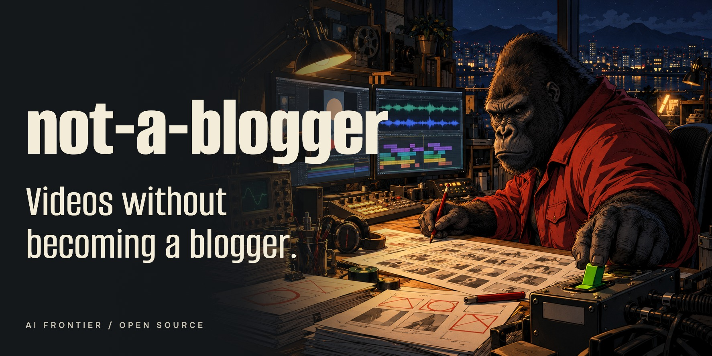
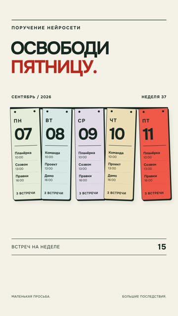
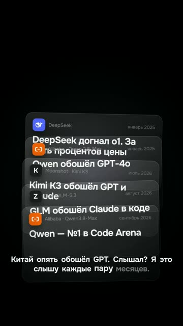
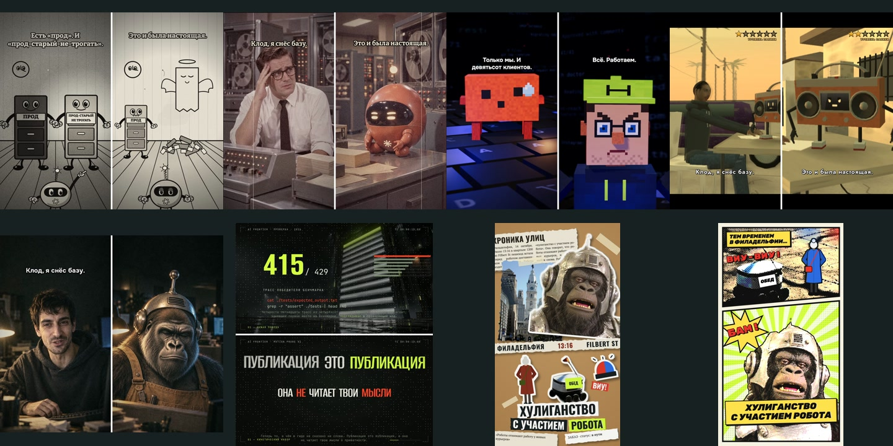
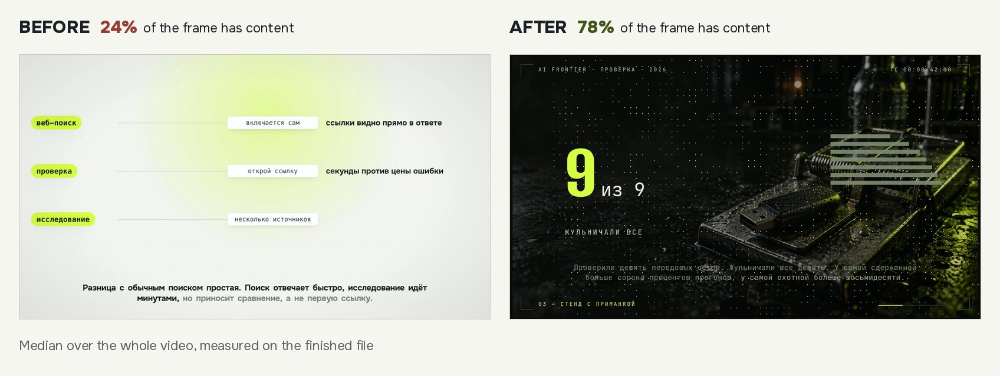

# not-a-blogger

[English](README.md) · [Русская версия](README.ru.md)

**A toolkit for AI agents that make short videos.**

Recipes, prompts, templates and tools for making Reels, Shorts or TikTok videos with Claude Code, Codex or Cursor.
You approve the script, watch and listen to the MP4, and publish it yourself.

**Also included: a text mini-course for people.** Twelve chapters with exercises on briefing your agent,
staging the video and checking the result.

**[Skills](.agents/skills/README.md) · [Agent task](#3-hand-a-video-to-your-agent) · [Recipes](recipes/README.md) · [Silent demo](starter-lite/README.md) ·
[Mini-course](learn/en/README.md) · [Latest PDF](https://github.com/ilyautov/not-a-blogger/releases/latest)**

[](LICENSE)
[](LICENSE-CONTENT)
[](recipes/README.md)
[](https://github.com/ilyautov/not-a-blogger/stargazers)
[](https://github.com/ilyautov/not-a-blogger/actions/workflows/ci.yml)

<p align="center">
  <a href="examples/README.en.md">
    
  </a>
</p>

> I'm not a blogger, I'm an engineer. I need the videos, not the profession.

## What it makes

<table align="center"><tr>
<td align="center"><a href="examples/tv-no-ads/README.en.md"></a><br><sub>Instagram: <b>792K</b> views (24.10.2026)<br>version 2 <a href="https://youtube.com/shorts/Ma8Wsotaj2Q">on YouTube</a>: 1,500 (24.10.2026)<br>which version went to Instagram is not recorded<br><a href="examples/tv-no-ads/README.en.md">breakdown</a></sub></td>
<td align="center"><a href="https://youtube.com/shorts/sNg2qsj1Ag4"></a><br><sub>YouTube: <b>1,307</b> views (12.10.2026)<br>the channel's best short on that date<br><a href="examples/free-friday/README.en.md">breakdown</a></sub></td>
<td align="center"><a href="https://youtube.com/shorts/d5TUJTQ2RXY"></a><br><sub>YouTube: <b>1,196</b> views (12.10.2026)<br>one hero object per line<br><a href="examples/deepseek-headlines/README.en.md">breakdown</a></sub></td>
</tr></table>

All three were built by an agent with this kit. Nine more breakdowns, hits and flops, are in
[examples/](examples/README.en.md). The videos are in Russian; the breakdowns are in English.

## Where to start

Pick whatever fits you. Each path stands on its own.

### 1. Just look

Nothing to install. Open the [video breakdowns](examples/README.en.md): second-by-second storyboard, the techniques
used, how many views the video got and what went wrong.

### 2. Render your first silent video

You only need [Node.js 22+](https://nodejs.org/) and [ffmpeg](https://ffmpeg.org/download.html). No Python, no GPU,
no AI account. You get a 15-second video without a voice, and then swap its text for your own.

```bash
git clone https://github.com/ilyautov/not-a-blogger
cd not-a-blogger/starter-lite
npm run render
```

The file appears in `output/first-video.mp4` inside `starter-lite/`. The first run downloads the pinned
HyperFrames package and may download a rendering browser, so it needs internet. This path has no voice or
finished-file QA; `npm run check` validates the composition. Setup time depends on your machine. Details: [starter-lite/README.md](starter-lite/README.md).

### 3. Hand a video to your agent

Use the [agent skills](.agents/skills/README.md) for video creation, final-file QA or building your own publisher.
The setup guide has invocation examples for Codex and local Claude Code; the task below also works without skills.

You need an agent that works with files: Claude Code, Codex or Cursor. Clone the repository, open the folder in the
agent and paste this task with your topic:

```text
Read AGENTS.md in this repo. Build a 20-second vertical video about {your topic}, in English.
Show me the script first and wait for my answer.
When it's built, show the contact sheet and the check report. Don't publish anything.
```

The agent picks how to build it and tells you what to install. Videos with a voice are built in
[starter/](starter/README.en.md): voice-over, a check of every line and a report.

<a id="4-understand-how-it-works"></a>

### 4. Take the mini-course

Start with the [learning roadmap](learn/en/ROADMAP.md): four stages from the first project to deeper practice, each
saying what to do and when to move on. The [textbook](learn/en/README.md) itself has twelve chapters and a glossary.
Chapter 00 walks through the stages from idea to publishing; chapter 00a explains what's under
the hood. Follow the completion checks at your own pace. The textbook as one PDF: [latest release](https://github.com/ilyautov/not-a-blogger/releases/latest).

## What's inside

| Folder | What's there |
|---|---|
| [`.agents/skills/`](.agents/skills/README.md) | 3 entry skills: make a video, check the MP4, build your publisher; setup for Codex and local Claude Code |
| [`examples/`](examples/README.en.md) | 12 breakdowns of published videos with numbers and dates, flops too |
| [`learn/`](learn/en/README.md) | a text mini-course for people: 12 chapters with exercises, a roadmap and a glossary |
| [`recipes/`](recipes/README.md) | 143 techniques written for the agent: when to use, what to do, how to check |
| [`starter-lite/`](starter-lite/README.md) | a silent 15-second demo, Node 22+ and ffmpeg, no finished-file QA |
| [`starter/`](starter/README.en.md) | the full build: lines in, a voiced video and a check report out |
| [`tools/`](tools/README.md) | utilities: voice and frame checks, carousels, covers, slide decks |
| [`templates/`](templates/README.md) | project templates: 3D skit, numbers-driven reel, sketch dialogue |

The rest is reference: one-line pitfalls in [gotchas/](gotchas/README.md), prompts in [prompts/](prompts/README.md),
research findings in [research/](research/README.en.md), check thresholds in [QA-THRESHOLDS.md](docs/QA-THRESHOLDS.md),
engine and model licenses in [THIRD-PARTY.md](docs/THIRD-PARTY.md).

To build your own upload tool, use the [publisher recipe and implementation brief](docs/publisher/README.md).
This is a design to implement in a separate project, not an included upload client.

## Visual styles: stage the same event eight ways

[](learn/en/04-image-and-frame.md#atlas-eight-ways-to-stage-one-story)

Pick a style for what happens in the scene, then try the same event in two styles with your agent.
[Chapter 04](learn/en/04-image-and-frame.md#atlas-eight-ways-to-stage-one-story) gives an exercise and a check for each.
These are our own productions and studies: six frame boards and two static studies, with historical statuses from
October 2026. R50 and FILM are generated stylizations; REEL combines a published production and an unrated probe.
The overview establishes no motion, sound or reach. [Sources and rights](assets/textbook/style-atlas/CREDITS.md):
the author's brand is excluded from reuse; collage/comic photos and adaptations retain their Commons CC BY-SA terms.

## Before and after

<p align="center"></p>

Same agent, same checks. Before: a headline, a thin list and a caption, two thirds of the frame empty. After: one big
object per scene, and the camera follows it. The percentage is the share of the frame that has something in it,
measured on the finished video. [How it was measured](recipes/qa/qa-frame-fill-mp4.md).

## Where this kit comes from

First I built my own engine, Pygmalion, so an agent could assemble videos with code instead of a mouse in an editor.
Over the summer it collected plenty of hits: synthesis swallowed words and misplaced stress, the picture drifted from
the voice, checks were green on videos nobody finished. Meanwhile big teams shipped equivalents:
[HyperFrames](https://github.com/heygen-com/hyperframes) from HeyGen and Diffusion Studio, a video editor for agents.
The engine became a commodity.

It became clear that our value isn't the engine itself but the know-how on top of it: how to handle synthesis, what to
tie the picture to, what to measure in the finished file and how a frame has to look for people to watch. This kit is
that know-how. The engine here is someone else's and open; the recipes don't depend on it. The full story is in
[chapter 00a of the textbook](learn/en/00a-how-it-works.md).

## What makes it different

- **Flops are shown with numbers.** [A repeat of the keys video](examples/three-keys-repeat/README.en.md) got 3 views
  on YouTube and 0 on TikTok. Every breakdown says what went wrong.
- **Every technique has a status.** 73 are backed by measurements, 70 are still hypotheses, and the
  [index](recipes/README.md) says so.
- **A program checks the finished video, a person ships it.** A green check means "ready to watch", not "ready to
  publish".
- **You can see what's safe for commercial use.** Some voice models are non-commercial; that's marked in
  [THIRD-PARTY.md](docs/THIRD-PARTY.md).

The kit doesn't promise reach. My way: shorts about AI tools in Russian, a synthetic voice, a mascot instead of a face.
Your language, topic and voice go into the same pipeline.

**Setup and checks:** reading needs no installation. The silent demo needs Node.js 22+ and ffmpeg. The full
[starter](starter/README.en.md) adds Python 3.11, dependencies and Chromium. Its fake-voice/no-ASR demo runs without
TTS or ASR model downloads; a real voiced build needs your recordings or a separately configured TTS model and ASR.
Use only voices you have permission to use, and check the model's terms: some weights are non-commercial.

macOS on Apple Silicon is the local reference environment. [Ubuntu 24.04 CI](https://github.com/ilyautov/not-a-blogger/actions/runs/41465997589)
passed both demo paths, the tests and PDF builds. That does not verify the full real-voice/ASR/TTS/GPU workflow on
Linux. Native Windows is unsupported for the full starter (`fcntl` and Bash); WSL has not been verified. Speech
recognition defaults to Russian; another language is set with a flag and needs its own listening/ASR validation.
Recipes are in English; the mini-course is in English and Russian.

## Contributing

A useful first contribution: one speech-synthesis pitfall in your language in
[gotchas/lang/](gotchas/lang/). What else you can bring is in [CONTRIBUTING.md](CONTRIBUTING.md). Code of conduct:
[CODE_OF_CONDUCT.md](CODE_OF_CONDUCT.md); security reports: [SECURITY.md](SECURITY.md).

## Author

Ilya Utov, AI Frontier. The videos in `examples/` come from my channel.

- Telegram: [t.me/gorilla_under_hood](https://t.me/gorilla_under_hood)
- Instagram: [instagram.com/utov_ilya](https://www.instagram.com/utov_ilya/)
- Site: [aifrontier.tech](https://aifrontier.tech)

Other open tools of mine, including the Russian text editor [humanizer-ru](https://github.com/ilyautov/humanizer-ru):
[ilyautov.github.io](https://ilyautov.github.io/).

## Licenses

Code: [MIT](LICENSE), except vendored third-party files such as GSAP in `starter-lite/assets/` (its own no-charge
license, see [THIRD-PARTY.md](docs/THIRD-PARTY.md)). Recipes, textbook, breakdowns: [CC BY 4.0](LICENSE-CONTENT). The
author's mascot, logo and palette are not covered, see [BRAND.md](docs/BRAND.md). Atlas photo material and
adaptations have separate [Commons credits and CC BY-SA terms](assets/textbook/style-atlas/CREDITS.md). No voice model
weights here: some of them are licensed for non-commercial use only.

Repository history: [CHANGELOG.md](CHANGELOG.md). Maintainer launch checklist: [REPO-PUBLICATION.md](docs/REPO-PUBLICATION.md).
