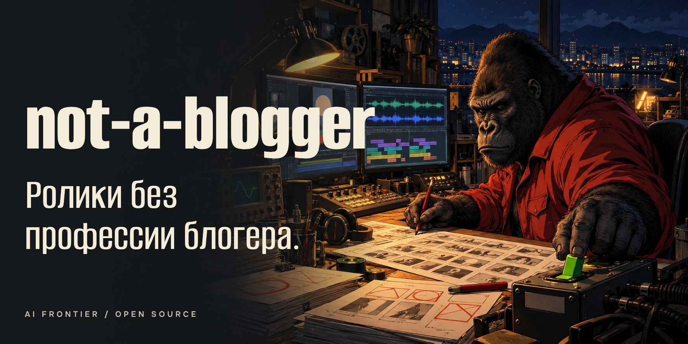
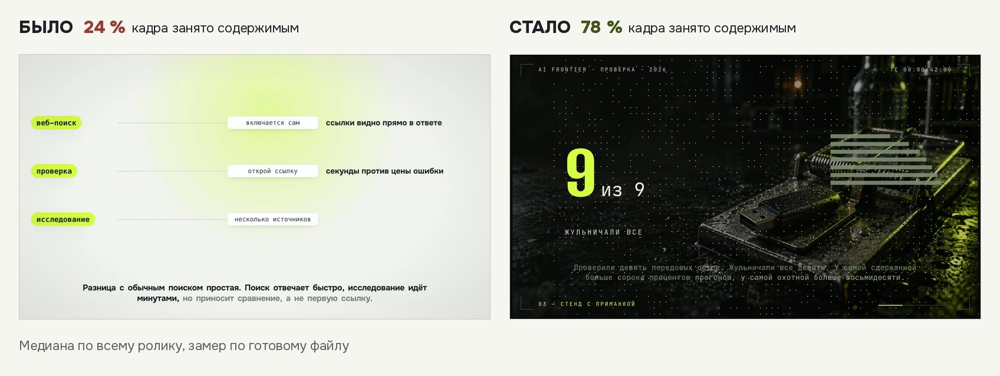

# not-a-blogger: короткие ролики, которые собирает ИИ-агент

Это набор, с которым ИИ-агент (Claude Code, Codex, Cursor) делает вертикальные ролики для Reels, Shorts и TikTok.
Агент пишет сценарий, озвучивает его, рисует кадры кодом и собирает видео. Потом сам проверяет файл: громкость,
пропавшие слова, пустые куски кадра. Ты смотришь готовый ролик и решаешь, выпускать ли его.

Внутри всё, что мы выяснили на своих роликах, включая провалы: какие приёмы работают, где ломается синтез голоса и
как проверить, что ролик получился.

> Я не блогер, я технарь. Ролики мне нужны, профессия нет.

> [English version](README.md)

[](LICENSE)
[](LICENSE-CONTENT)
[](recipes/README.md)
[](https://github.com/ilyautov/not-a-blogger/stargazers)
[](https://github.com/ilyautov/not-a-blogger/actions/workflows/ci.yml)

<p align="center">
  <a href="examples/README.md">
    
  </a>
</p>

## Что получается

<table align="center"><tr>
<td align="center"><a href="examples/tv-no-ads/README.md"></a><br><sub>Instagram: <b>792 тыс.</b> просмотров (24.10.2026)<br>версия 2 <a href="https://youtube.com/shorts/Ma8Wsotaj2Q">на YouTube</a>: 1 500 (24.10.2026)<br>какая версия ушла в Instagram, не записано<br><a href="examples/tv-no-ads/README.md">разбор</a></sub></td>
<td align="center"><a href="https://youtube.com/shorts/sNg2qsj1Ag4"></a><br><sub>YouTube: <b>1 307</b> просмотров (12.10.2026)<br>лучший шортс канала на эту дату<br><a href="examples/free-friday/README.md">разбор</a></sub></td>
<td align="center"><a href="https://youtube.com/shorts/d5TUJTQ2RXY"></a><br><sub>YouTube: <b>1 196</b> просмотров (12.10.2026)<br>один крупный предмет на реплику<br><a href="examples/deepseek-headlines/README.md">разбор</a></sub></td>
</tr></table>

Все три ролика собраны агентом по этому набору. Ещё девять разборов, удачных и провальных, в
[examples/](examples/README.md).

## С чего начать

Выбери то, что подходит тебе. Каждый путь самостоятельный.

### 1. Просто посмотреть

Ничего ставить не надо. Открой [разборы роликов](examples/README.md): раскадровка по секундам, какие приёмы
использованы, сколько набрал ролик и что пошло не так.

### 2. Собрать свой первый ролик за 10 минут

Нужны только [Node.js 22+](https://nodejs.org/) и [ffmpeg](https://ffmpeg.org/download.html). Python, видеокарта и
аккаунт у нейросети не нужны. Получишь ролик на 15 секунд без голоса, а дальше поменяешь в нём текст на свой.

```bash
git clone https://github.com/ilyautov/not-a-blogger
cd not-a-blogger/starter-lite
npm run render
```

Готовый файл появится в `output/first-video.mp4`. Подробности: [starter-lite/README.ru.md](starter-lite/README.ru.md).

### 3. Поручить ролик своему агенту

Нужен агент, который работает с файлами: Claude Code, Codex или Cursor. Склонируй репозиторий, открой папку в агенте
и вставь задание, подставив свою тему:

```text
Прочитай AGENTS.md в этом репо. Собери вертикальный ролик на 20 секунд про {твоя тема}, на русском.
Сначала покажи сценарий и дождись моего ответа.
Когда соберёшь, покажи контактный лист и отчёт проверки. Ничего не публикуй.
```

Агент сам выберет, как собирать, и скажет, что поставить. Ролики с голосом собираются в [starter/](starter/README.md):
там озвучка, проверка каждой реплики и отчёт.

### 4. Разобраться, как это устроено

Начни с [маршрута обучения](learn/ru/ROADMAP.md): четыре ступени от первого вечера до первого месяца, на каждой
понятно, что делать и когда переходить дальше. В самом [учебнике](learn/ru/README.md) двенадцать глав и словарь. Глава 00
проводит через весь путь от идеи до публикации за один вечер, глава 00а объясняет, что под капотом. Учебник одним PDF:
[последний релиз](https://github.com/ilyautov/not-a-blogger/releases/latest).

## Что внутри

| Папка | Что там |
|---|---|
| [`examples/`](examples/README.md) | 12 разборов опубликованных роликов с цифрами и датами, провалы тоже |
| [`learn/`](learn/ru/README.md) | учебник для человека: идея, голос, кадр, камера, звук, проверка, публикация |
| [`recipes/`](recipes/README.md) | 142 приёма, записанных для агента: когда применять, что делать, как проверить |
| [`starter-lite/`](starter-lite/README.ru.md) | первый ролик за 10 минут, только Node и ffmpeg |
| [`starter/`](starter/README.md) | полная сборка: реплики на входе, ролик с голосом и отчёт проверки на выходе |
| [`tools/`](tools/README.md) | утилиты: проверка голоса и кадра, карусели, обложки, презентации |
| [`templates/`](templates/README.md) | заготовки проектов: 3D-скетч, ролик на цифрах, скетч-диалог |

Остальное справочное: грабли одной строкой в [gotchas/](gotchas/README.md), промпты в [prompts/](prompts/README.md),
выводы исследований в [research/](research/README.md), пороги проверок в [QA-THRESHOLDS.md](docs/QA-THRESHOLDS.md),
лицензии движков и моделей в [THIRD-PARTY.md](docs/THIRD-PARTY.md).

## Было и стало

<p align="center"></p>

Тот же агент, те же проверки. Было: заголовок, тонкий список и подпись, две трети кадра пустые. Стало: один крупный
предмет на сцену, камера идёт за ним. Процент показывает, какая доля кадра чем-то занята, мерили по готовому видео.
[Как мерили](recipes/qa/qa-frame-fill-mp4.md).

## Откуда этот набор

Сначала я делал свой движок Pygmalion, чтобы агент собирал ролики кодом, а не мышкой в монтажке. За лето на нём
набралось много шишек: синтез глотал слова и ставил ударения не туда, картинка разъезжалась с голосом, проверки
были зелёными на роликах, которые никто не досматривал. Тем временем большие команды выпустили аналоги:
[HyperFrames](https://github.com/heygen-com/hyperframes) от HeyGen и видеоредактор для агентов Diffusion Studio.
Движок стал общедоступной вещью.

Стало понятно, что наша ценность не в самом движке, а в наработках поверх него: как обращаться с синтезом, к чему
привязывать картинку, что мерить в готовом файле и как должен выглядеть кадр, чтобы ролик смотрели. Этот набор и есть
эти наработки. Движок здесь чужой и открытый, рецепты от него не зависят. Подробная история в
[главе 00а учебника](learn/ru/00a-how-it-works.md).

## Чем этот набор отличается

- **Провалы показаны с цифрами.** [Повтор ролика про клавиши](examples/three-keys-repeat/README.md) набрал 3
  просмотра на YouTube и 0 в TikTok. В каждом разборе сказано, что пошло не так.
- **У каждого приёма статус.** 73 подтверждены замерами, 69 пока гипотезы, и это написано прямо в
  [индексе](recipes/README.md).
- **Готовый ролик проверяет программа, а выпускает человек.** Зелёная проверка значит «можно смотреть», а не «можно
  публиковать».
- **Видно, что можно использовать в коммерции.** Часть голосовых моделей некоммерческая, это помечено в
  [THIRD-PARTY.md](docs/THIRD-PARTY.md).

Охват набор не обещает. Мой способ: шортсы про ИИ-инструменты на русском, синтетический голос, маскот вместо лица.
Твой язык, тема и голос встают в тот же конвейер.

**Где проверено:** macOS на Apple Silicon. Linux не проверялся, на Windows `starter/` не запустится. Распознавание
речи по умолчанию русское, другой язык задаётся флагом. Рецепты на английском, учебник на русском и английском.

## Как помочь

Самый быстрый полезный вклад занимает 15 минут: одна строка про грабли синтеза голоса на твоём языке в
[gotchas/lang/](gotchas/lang/). Что ещё можно принести, написано в [CONTRIBUTING.ru.md](docs/CONTRIBUTING.ru.md).
Правила поведения: [CODE_OF_CONDUCT.md](CODE_OF_CONDUCT.md), об уязвимостях: [SECURITY.md](SECURITY.md).

## Автор

Илья Утов, AI Frontier. Ролики из `examples/` выходили на моём канале.

- Telegram: [t.me/gorilla_under_hood](https://t.me/gorilla_under_hood)
- Instagram: [instagram.com/utov_ilya](https://www.instagram.com/utov_ilya/)
- Сайт: [aifrontier.tech](https://aifrontier.tech)

Другие мои открытые инструменты, включая редактор русского текста [humanizer-ru](https://github.com/ilyautov/humanizer-ru):
[ilyautov.github.io](https://ilyautov.github.io/).

## Лицензии

Код под [MIT](LICENSE), кроме вложенных сторонних файлов вроде GSAP в `starter-lite/assets/` (у него своя
бесплатная лицензия, см. [THIRD-PARTY.md](docs/THIRD-PARTY.md)). Рецепты, учебник и разборы под
[CC BY 4.0](LICENSE-CONTENT). Маскот, логотип и палитра автора под эти лицензии не попадают, см.
[BRAND.md](docs/BRAND.md). Весов голосовых моделей здесь нет: у части из них лицензия некоммерческая.
