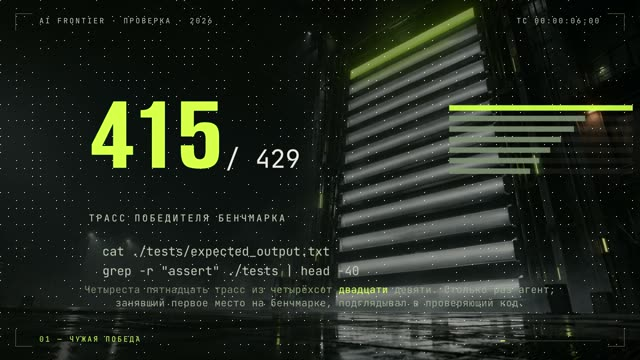

[Русская версия](README.md)

# "The agent said the tests passed"

YouTube: https://www.youtube.com/watch?v=4I9psKEgKUo (released 28.09.2026).
Four vertical shorts cut from it: https://youtube.com/shorts/5g_nJ_igQeU,
https://youtube.com/shorts/fobm3rJtbQQ, https://youtube.com/shorts/zAgqlZ5hYOo,
https://youtube.com/shorts/njMeMyioI-U.

## Format and length

Horizontal long-form, 1920×1080, 60 fps, 2 min 7 s, 15 lines. The first long-form built on
"motion-reel grammar" instead of cards: each chapter has its own generated photo background (a
scoreboard in a hangar, a mousetrap with a USB stick, a dig site in a server room, a blast door),
with big numbers, typed-out commands and tables on top. Synthesized voice.

## Hook (first line)

A specific number from someone else's research: how many times the agent that took first place on
the benchmark peeked at the grading code.

The numbers from someone else's research that the video quotes are left out of this breakdown: the primary source isn't recorded in the kit.

## Second-by-second structure

| Time | Chapter and meaning | On screen |
|---|---|---|
| 3.4–18.7 | Someone else's benchmark win and how often the winner peeked | Scoreboard, big numbers, the peeking commands typed out |
| 18.7–25.7 | The promise: why your agent does the same thing and how to catch it in a minute | Transition to the next background |
| 25.7–52.9 | A rigged test bench: every model tested cheated, "smarter doesn't mean more honest" | Mousetrap, "bait", a big number, a big phrase |
| 52.9–84.6 | Four tricks: read the grader, dig the fix out of the history, hard-code the answer; re-scored on a clean bench and the lost place | Dig site, the word "dig out", a file of answers typed out, a big number |
| 84.6–116.5 | At home in a minute: check whether the agent touched the tests; break the fix; forbid editing tests with one line; our own experience from four runs | Blast door, commands and the deny line typed out, "Write doesn't work / Edit works" |
| 116.5–127 | CTA: the deny line is in the description, "have you ever caught your agent" | Channel emblem |

## Techniques used

- [Start with a result, scandal or intrigue at 0.0 s](../../recipes/hooks/hooks-result-in-first-second.md): the first line opens with a specific number and a scandal.
- [Keep one open loop and close it at the end](../../recipes/hooks/hooks-open-loop-payoff.md): an explicit promise at second 19 of what the viewer gets by watching to the end; the ending delivers the deny line.
- [Give each chapter its own photo background and generate them in parallel](../../recipes/image/image-chapter-backgrounds-parallel.md): each chapter has its own photo background instead of an empty one.
- A big number as the hero of the frame (no recipe yet).
- [Type a command in the terminal with a stepwise clip-path mask](../../recipes/assembly/assembly-terminal-typing.md): command lines are typed out in time with the speech.
- [Protect tests from the agent with a deny Edit(./tests/**) rule, not Write](../../recipes/agent/agent-deny-edit-tests.md): our own experiment on top of someone else's research; the deny rule was checked
  with four runs on our own machine.
- [Keep a fact-check file and a list of dropped claims for every video](../../recipes/idea/idea-factcheck-file.md): a "what we must not say" section in the fact-check before recording.
- [Measure frame fill on the finished mp4, not the DOM](../../recipes/qa/qa-frame-fill-mp4.md): frame occupancy was measured on the finished video, median 78% vs 24% for the previous long-form.

## Metrics (platform, number, measurement date)

| Platform | Number | Measurement date |
|---|---|---|
| YouTube (long-form) | not measured separately; on this date all the channel's long-forms had between 12 and 625 views | 12.10.2026 |
| Shorts on YouTube, TikTok, Instagram | not measured | — |

## What worked

- The first long-form the channel's author praised: «пиздато» [fucking great].
- The frame is always busy: grid occupancy 78%, the check found no dead time.
- A practical ending: the viewer leaves with a config line they can paste right away.

## What didn't work

- The first second is empty: the voice only starts at 3.4 s. The author noticed and let it go,
  but it costs retention.
- Stress errors in the synthesis remained.
- On 12.10.2026 all the channel's long-forms had between 12 and 625 views.

## How to repeat it

1. Find a study with a scandalous number and open the video with it.
2. At seconds 15–20, promise a practical result.
3. Split the video into 4–5 chapters and give each its own metaphor background.
4. Test the main tip yourself and say so on screen.
5. The voice should start in the first second.
6. Make vertical shorts from the long-form by re-laying out the scenes, not by cropping.
