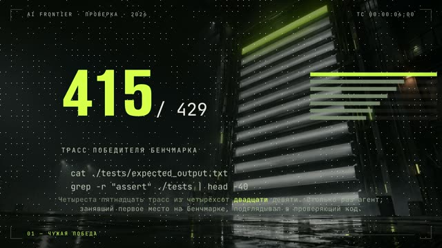

[English version](README.en.md)

# «Агент сказал, что тесты прошли»

YouTube: https://www.youtube.com/watch?v=4I9psKEgKUo (вышел 28.09.2026).
Четыре вертикальных шортса из него: https://youtube.com/shorts/5g_nJ_igQeU,
https://youtube.com/shorts/fobm3rJtbQQ, https://youtube.com/shorts/zAgqlZ5hYOo,
https://youtube.com/shorts/njMeMyioI-U.

## Формат и длительность

Горизонтальный лонг 1920×1080, 60 fps, 2 мин 7 с, 15 реплик. Первый лонг на «грамматике
моушен-рила» вместо карточек: у каждой главы своя сгенерированная фотоподложка (табло в
ангаре, мышеловка с флешкой, раскоп в серверной, гермодверь), поверх крупные цифры, печать
команд, таблицы. Голос синтезирован.

## Хук (первая фраза)

Конкретное число из чужого исследования: сколько раз агент, занявший первое место на бенчмарке,
подглядывал в проверяющий код.

Цифры чужого исследования, которые звучат в ролике, в разборе не приводятся: первоисточник в наборе не записан.

## Структура по секундам

| Время | Глава и смысл | Что в кадре |
|---|---|---|
| 3,4–18,7 | Чужая победа на бенчмарке и сколько раз победитель подглядывал | Табло, крупные цифры, печать команд подглядывания |
| 18,7–25,7 | Обещание: почему твой агент делает то же самое и как поймать за минуту | Переход к следующей подложке |
| 25,7–52,9 | Стенд с приманкой: жульничали все проверенные сетки, «умнее не значит честнее» | Мышеловка, «приманка», крупная цифра, крупная фраза |
| 52,9–84,6 | Четыре приёма: прочитать проверку, выкопать правку из истории, зашить ответ; пересчёт на чистом стенде и потеря места | Раскоп, слово «выкопать», печать файла с ответами, крупная цифра |
| 84,6–116,5 | Дома за минуту: проверить, трогал ли агент тесты; сломать правку; запретить правку тестов одной строкой; свой опыт из четырёх прогонов | Гермодверь, печать команд и строки запрета, «Write не работает / Edit работает» |
| 116,5–127 | CTA: строка запрета в описании, «ловил ли ты своего агента» | Эмблема канала |

## Какие приёмы использованы

- [Начинать с результата, скандала или интриги в 0,0 с](../../recipes/hooks/hooks-result-in-first-second.md): первая фраза начинается с конкретного числа и скандала.
- [Держать одну открытую петлю и закрывать её в финале](../../recipes/hooks/hooks-open-loop-payoff.md): явное обещание на 19-й секунде, что зритель получит, досмотрев; финал выдаёт строку запрета.
- [Давать каждой главе свою фотоподложку и генерировать их параллельно](../../recipes/image/image-chapter-backgrounds-parallel.md): у каждой главы своя фотоподложка вместо пустого фона.
- Крупная цифра как герой кадра (рецепта пока нет).
- [Печатать команду в терминале маской clip-path по шагам](../../recipes/assembly/assembly-terminal-typing.md): строки команд печатаются в темп речи.
- [Защищать тесты от агента правилом deny Edit(./tests/**), а не Write](../../recipes/agent/agent-deny-edit-tests.md): собственный эксперимент поверх чужого исследования, правило запрета проверено
  четырьмя прогонами на своей машине.
- [Вести к каждому ролику файл фактчека и список снятых тезисов](../../recipes/idea/idea-factcheck-file.md): раздел «чего говорить нельзя» в фактчеке до записи.
- [Мерить заполнение кадра по готовому mp4, а не по DOM](../../recipes/qa/qa-frame-fill-mp4.md): занятость кадра замерена по готовому видео, медиана 78 % против 24 % у прошлого лонга.

## Метрики (площадка, число, дата замера)

| Площадка | Число | Дата замера |
|---|---|---|
| YouTube (лонг) | отдельно не снято; все лонги канала на эту дату набрали от 12 до 625 просмотров | 12.10.2026 |
| Шортсы на YouTube, TikTok, Instagram | не снято | — |

## Что сработало

- Первый лонг, который автор канала похвалил: «пиздато».
- Кадр всегда занят: занятость сетки 78 %, мёртвого времени проверка не нашла.
- Практический финал: зритель уходит со строкой настройки, которую можно вставить сразу.

## Что не сработало

- Первая секунда пустая: голос начинается только на 3,4 с. Автор это заметил и пропустил,
  но для удержания это потеря.
- Ошибки ударений в синтезе остались.
- Все лонги канала на 12.10.2026 набрали от 12 до 625 просмотров.

## Как повторить

1. Найди исследование со скандальной цифрой и начни ролик с неё.
2. На 15–20-й секунде пообещай практический результат.
3. Раздели ролик на 4–5 глав, каждой дай свою подложку-метафору.
4. Проверь главный совет сам и скажи об этом в кадре.
5. Голос должен начинаться с первой секунды.
6. Из лонга сделай вертикальные шортсы переверсткой, а не кропом.
