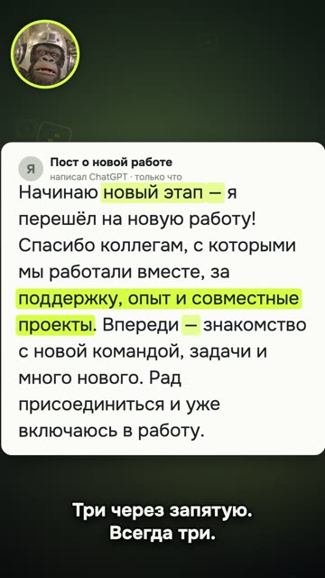

[Русская версия](README.md)

# "AI gives itself away, and not with 'it's worth noting'" (Q04)

YouTube Shorts: https://youtube.com/shorts/p4sU6N8ud4g (released 13.10.2026).

## Format and length

Vertical short, 1080×1920, 28.9 s. "I can spot AI text instantly" format: a real post written
by ChatGPT fills the frame, the mascot names the tells, and they light up word by word.
No face, synthesized voice, the mascot in a circle.

## Hook (first line)

«Короче. Все ищут в тексте „стоит отметить“. А нейросеть давно палится по-другому.» [Long story
short. Everyone looks for "it's worth noting" in a text. But AI has been giving itself away
differently for a while now.]

## Second-by-second structure

| Time | What you hear | On screen |
|---|---|---|
| 0.15–5.1 | Hook: everyone looks for "it's worth noting", but the tell is different | Mascot in close-up, «стоит отметить» gets crossed out, «по-другому» [differently] in color |
| 5.6–8.8 | «Длинное тире. Ты его на клавиатуре вообще найдёшь?» [The em dash. Can you even find it on your keyboard?] | Post card, all the dashes light up |
| 9.2–13.5 | «Человек сменил работу. А нейросеть начинает новый этап.» [A person changed jobs. An AI "begins a new chapter".] | «новый этап» [new chapter] lights up |
| 13.8–18.5 | «Три слова через запятую. Всегда три.» [Three words separated by commas. Always three.] | «поддержку, опыт и совместные проекты» [support, experience and joint projects] lights up |
| 18.8–23.0 | «Впереди. Много нового. Рад присоединиться. Это не пост, а открытка.» [Ahead. Lots of new things. Glad to join. That's not a post, that's a greeting card.] | The three closing clichés light up |
| 23.4–28.9 | «Пиши в комментах слово чисто. Скину скилл, который это вычищает.» [Write the word "clean" in the comments. I'll send you the skill that scrubs this out.] | Code-word button «ЧИСТО» [CLEAN], mascot |

## Techniques used

- [Write the first line as a spoiler of the result, give context at 3–5 s](../../recipes/hooks/hooks-result-in-first-second.md): the hook refutes common knowledge ("everyone's looking in the wrong place").
- [Frame the topic as a guessing game and exposé, leave the how-to as a tail](../../recipes/idea/idea-guess-over-howto.md): "I can spot AI text" format, a guessing game instead of a tutorial, the tool only at the end.
- [Look for dashes, triplets and "new chapter" in fresh model output, not old clichés](../../recipes/text/text-modern-chatgpt-tells.md): real text instead of invented text; the post was honestly generated by ChatGPT,
  and the tells were found in it, not planted.
- [Hang animation on the word's timing from alignment, not on a timer](../../recipes/assembly/assembly-word-anchored-animation.md): highlights are synced to the narrator's words using speech-recognition timings.
- Each tell comes with a joke comparison ("that's not a post, that's a greeting card") (no recipe yet).
- [End a reel with a question and a code word the viewer writes in the comments](../../recipes/cta/cta-codeword-in-comments.md) and [Promise a free tool with a guide for the code word, not an abstract lesson](../../recipes/cta/cta-promise-free-tool.md): the code word at the end leads to the author's free
  tool.

## Metrics (platform, number, measurement date)

| Platform | Number | Measurement date |
|---|---|---|
| YouTube Shorts | 989 views in the first day | 14.10.2026 |
| TikTok | 530 views in the first day | 14.10.2026 |
| Instagram | not measured | — |

## What worked

- "Spot the AI text" takes off in neighboring hits, while tool tutorials don't. The video is
  built as a guessing game, with the tool only at the end.
- Viewers joked using the tell itself: comments consisting of a single em dash.
- The format was put together in one session after an earlier template on the same topic had
  been called «нейрослоп» [neuro-slop]: what helped was building the video from a situation,
  not from the tool's features.

## What didn't work

- A follow-up on the same template (same background, card, circle, subtitles, badge) a day
  later was called «слоп» [slop]: copying a winning format doesn't work.
- The skill noticeably fixes only some genres of text; the video doesn't say so, and the CTA
  promises more than the real effect.
- Fresh ChatGPT barely writes the old clichés anymore, so this set of tells will age quickly.

## How to repeat it

1. Generate a real text with the AI in question and find 3–4 tells in it yourself.
2. Hook: refute a popular piece of advice.
3. One tell per line, highlighted exactly on the narrator's word.
4. Give each tell a short joke, not a definition.
5. A code word at the end and an honest promise of what the viewer gets.
6. Build the next video on a different template.
