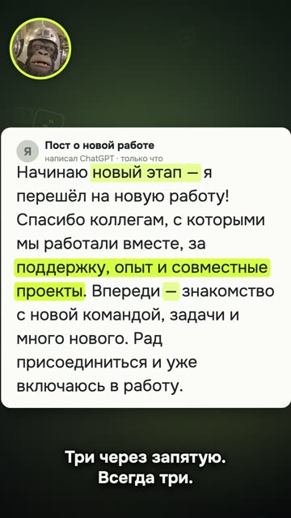

[English version](README.en.md)

# «Нейросеть палится не по „стоит отметить“» (Q04)

YouTube Shorts: https://youtube.com/shorts/p4sU6N8ud4g (вышел 13.10.2026).

## Формат и длительность

Вертикальный шортс 1080×1920, 28,9 с. Формат «вижу ИИ-текст сразу»: настоящий пост,
написанный ChatGPT, на весь кадр, маскот называет признаки, они подсвечиваются по словам.
Без лица, голос синтезирован, маскот в кружке.

## Хук (первая фраза)

«Короче. Все ищут в тексте „стоит отметить“. А нейросеть давно палится по-другому.»

## Структура по секундам

| Время | Что звучит | Что в кадре |
|---|---|---|
| 0,15–5,1 | Хук: все ищут «стоит отметить», а палится иначе | Маскот крупно, «стоит отметить» перечёркивается, «по-другому» цветом |
| 5,6–8,8 | «Длинное тире. Ты его на клавиатуре вообще найдёшь?» | Карточка поста, подсвечиваются все тире |
| 9,2–13,5 | «Человек сменил работу. А нейросеть начинает новый этап.» | Подсвечивается «новый этап» |
| 13,8–18,5 | «Три слова через запятую. Всегда три.» | Подсвечивается «поддержку, опыт и совместные проекты» |
| 18,8–23,0 | «Впереди. Много нового. Рад присоединиться. Это не пост, а открытка.» | Подсвечиваются три штампа финала |
| 23,4–28,9 | «Пиши в комментах слово чисто. Скину скилл, который это вычищает.» | Кнопка-слово «ЧИСТО», маскот |

## Какие приёмы использованы

- [Писать первую реплику как спойлер результата, контекст отдавать на 3–5 с](../../recipes/hooks/hooks-result-in-first-second.md): хук опровергает общее знание («все ищут не там»).
- [Подавать тему угадайкой и разоблачением, а how-to оставлять хвостом](../../recipes/idea/idea-guess-over-howto.md): формат «вижу ИИ-текст», угадайка вместо туториала, инструмент только в финале.
- [Искать в свежем тексте модели тире, тройки и «новый этап», а не старые штампы](../../recipes/text/text-modern-chatgpt-tells.md): настоящий текст вместо выдуманного, пост сгенерирован ChatGPT по-честному,
  признаки найдены в нём, а не подставлены.
- [Вешать анимацию на время слова из выравнивания, а не на таймер](../../recipes/assembly/assembly-word-anchored-animation.md): подсветка синхронизирована со словами диктора по таймингам распознавания речи.
- Каждый признак сопровождается шуткой-сравнением («не пост, а открытка») (рецепта пока нет).
- [Заканчивать рил вопросом и кодовым словом, которое зритель пишет в комментариях](../../recipes/cta/cta-codeword-in-comments.md) и [Обещать за кодовое слово бесплатный инструмент с гайдом, а не абстрактный урок](../../recipes/cta/cta-promise-free-tool.md): кодовое слово в финале ведёт к бесплатному
  инструменту автора.

## Метрики (площадка, число, дата замера)

| Площадка | Число | Дата замера |
|---|---|---|
| YouTube Shorts | 989 просмотров за первые сутки | 14.10.2026 |
| TikTok | 530 просмотров за первые сутки | 14.10.2026 |
| Instagram | не снято | — |

## Что сработало

- Тема «угадай ИИ-текст» в соседних хитах залетает, а туториалы по инструментам нет. Ролик
  построен как угадайка, инструмент только в финале.
- Зрители шутили признаком: комментарии из одного длинного тире.
- Формат собран за одну сессию, когда до этого шаблон на ту же тему назвали «нейрослопом»:
  помогло то, что ролик построен от ситуации, а не от функций инструмента.

## Что не сработало

- Ролик-продолжение на том же каркасе (те же фон, карточка, кружок, субтитры, плашка) через
  день назвали «слопом»: копия удачного формата не работает.
- Скилл заметно правит только часть жанров текста; в ролике это не сказано, обещание в CTA
  шире реального эффекта.
- Свежий ChatGPT почти не пишет старые штампы, поэтому набор признаков быстро устареет.

## Как повторить

1. Сгенерируй настоящий текст нужной нейросетью и найди в нём 3–4 признака сам.
2. Хук: опровергни расхожий совет.
3. Один признак на фразу, подсветка ровно на слове диктора.
4. Каждому признаку дай короткую шутку, а не определение.
5. Кодовое слово в финале и честное обещание того, что получит зритель.
6. Следующий ролик делай на другом каркасе.
