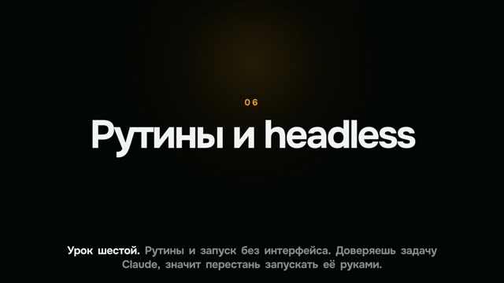

[Русская версия](README.md)

# "Claude Code in Action: the whole course in 20 minutes" (flop)

YouTube: https://www.youtube.com/watch?v=96zjz5-Ka8Q (released 19.09.2026).

## Format and length

Horizontal long-form, 1920×1080, 19 min 56 s. A full retelling of the nine lessons of a free
Anthropic Academy course: 166 lines, about 2,800 words. Black stage, one hero object in frame (a
lesson page, a terminal, a code block, a list), slow camera push-in, karaoke captions.
Synthesized voice.

## Hook (first line)

«Anthropic выпустила бесплатный курс „Claude Code in Action“: как отпустить Claude Code без
присмотра и доверять результату.» [Anthropic released a free course, "Claude Code in Action":
how to let Claude Code run unattended and trust the result.]

Second line: «Девять уроков, час чтения, квиз и значок. Я прочитал все девять и пересказываю
целиком, ничего не пропуская.» [Nine lessons, an hour of reading, a quiz and a badge. I read all
nine and I'm retelling them in full, skipping nothing.]

## Second-by-second structure

| Time | Chapter |
|---|---|
| 0:01 | Intro: what the course is and who it's for |
| 0:30 | Lesson 1. Long sessions |
| 2:31 | Lesson 2. CLAUDE.md |
| 4:42 | Lesson 3. A verification skill |
| 6:12 | Lesson 4. Permission modes |
| 7:55 | Lesson 5. Hooks |
| 10:46 | Lesson 6. Routines and headless runs |
| 13:17 | Lesson 7. GitHub Actions and Code Review |
| 15:29 | Lesson 8. Trusting the result |
| 16:59 | Lesson 9. Plugins |
| 19:25 | Wrap-up: nine lessons |

## Techniques used

The video flopped, so some items link to a recipe that says what to do instead.

- Chapters with a number and a full-frame title. Instead: [Keep one zone in frame, no titles or chrome](../../recipes/transitions/transitions-one-zone-no-chrome.md).
- One static hero object per line: a documentation page, code, a terminal, a list. How to catch
  this stillness before showing it: [Catch frame stillness on the timeline with the camera off](../../recipes/qa/qa-still-lint.md).
- Slow camera push-in, 1.0 → 1.06 over 5 seconds. Instead: [Don't mask a static frame with a slow push-in](../../recipes/camera/camera-no-ken-burns.md) and
  [Change shot size with a cut per line, not a six-percent zoom](../../recipes/camera/camera-scale-change-not-zoom.md).
- Karaoke captions at the bottom: [Anchor karaoke to the bottom of the strip so line wraps grow upward](../../recipes/captions/captions-grow-upward.md).
- Every claim checked against the lesson text, no numbers of our own: [Keep a fact-check file and a list of dropped claims for every video](../../recipes/idea/idea-factcheck-file.md).
- The twenty-minute video was assembled one heavy step at a time: [Run synthesis, alignment and render one at a time behind a lock](../../recipes/assembly/assembly-serialize-heavy-jobs.md).

## Metrics (platform, number, measurement date)

| Platform | Number | Measurement date |
|---|---|---|
| YouTube | the channel's four course-retelling long-forms got between 32 and 79 views; this video's own number wasn't recorded | 12.10.2026 |
| Shorts from this long-form | none were cut | — |

## What worked

- Technically the video is clean: 20 minutes of speech with no recognition errors, checks green.
- The "Hooks" chapter of this long-form was later re-laid out into a separate vertical short (see
  [hook-vertical-from-long](../hook-vertical-from-long/README.en.md)).

## What didn't work

- The channel's author: «это не смотрибельно — иллюстрации полное статическое гавно» [this is
  unwatchable, the illustrations are total static crap]. Cards, lists, code and page screenshots
  with a 6% push-in come across as slides: nothing happens inside the frame, and each new line
  looks like a slide change.
- Retelling someone else's course gives no reason to watch: the original is free and takes an
  hour to read.
- The hook describes the course, not the viewer's problem. The first 30 seconds are an intro.
- 20 minutes were assembled without a test clip: the format was only checked on the finished video.

## How not to repeat it

1. Before a long-form, build a 20–30-second test clip of the new visual grammar and show it.
2. Something has to happen inside the frame in time with the speech: text types out, lines
   light up, pages scroll to the right spot, diagrams assemble from parts.
3. Replace retelling a source with your own story or an experiment on top of it.
4. The hook is about a result or the viewer's problem, not about a course coming out.
5. A slow zoom on a static frame doesn't count as motion.
