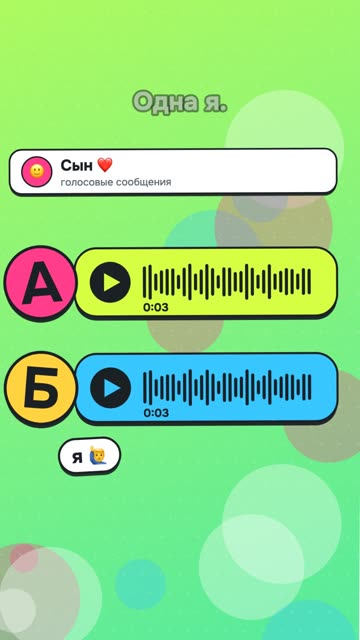

[Русская версия](README.md)

# "Guess which one is my voice" (N09): a guessing game

YouTube Shorts: https://youtube.com/shorts/-6XgmlaQXK4 (released 22.10.2026).

## Format and length

Vertical reel, 1080×1920, 39.5 s. An "A or B" guessing game: one line plays twice, in the
author's live voice and in a clone, and the viewer guesses in the comments. Bright gradient
backgrounds, voice messages with a breathing waveform, emoji stickers. No face.

## Hook (first line)

«Твоё голосовое в чате. Этого хватит, чтобы позвонить твоей маме твоим голосом.» [Your voice
message in a chat. That's enough to call your mom in your voice.]

## Second-by-second structure

| Time | What you hear | On screen |
|---|---|---|
| 0.1–4.8 | Hook: your voice message is enough to call your mom | A chat with a voice message |
| 5.2–8.4 | Option A: «Слушай, я сегодня проверил одну штуку…» [Listen, I tested something today…] | Voice message "A" in close-up |
| 9.3–12.3 | Option B: the same line | Voice message "B" in close-up |
| 13.0–14.9 | «Одна — я. Вторая — клон. Угадаешь?» [One is me. The other is a clone. Can you guess?] | "A or B?", "Write in the comments" |
| 15.5–22.6 | A free program, a laptop with no internet, seven seconds of voice; installed with one sentence through Claude | "0 ₽", an offline laptop, a window with the install request |
| 22.9–24.7 | «Сказка детям твоим голосом.» [A bedtime story for your kids in your voice.] | A storybook with a voice waveform |
| 25.0–28.3 | «Мошенникам хватит тех же семи секунд.» [Scammers need the same seven seconds.] | A stack of voice messages, "7 seconds is enough" |
| 28.6–31.7 | «Защита одна: семейное слово, которого нет в соцсетях.» [There's one defense: a family word that's nowhere on social media.] | A shield with a password |
| 32.0–34.7 | «Напиши „голос“, пришлю памятку для родителей.» [Write "voice" and I'll send you a cheat sheet for your parents.] | Comment field with the word «голос» [voice] |
| 35.2–38.4 | Twist: «Весь этот ролик, кроме одной фразы, говорил клон.» [This whole video, except one line, was spoken by the clone.] | Glitch, A and B again with question marks |

## Techniques used

- [Start with a result, scandal or intrigue at 0.0 s](../../recipes/hooks/hooks-result-in-first-second.md): a fear hook about loved ones, not about technology.
- [Frame the topic as a guessing game and exposé, leave the how-to as a tail](../../recipes/idea/idea-guess-over-howto.md): interactivity, the "A or B?" question at second 13 and a "comment" badge until the end.
- [Normalize each take to −16 LUFS before mixing](../../recipes/voice/voice-loudness-per-take.md): a fair comparison; both options are loudness-matched, and pauses inside lines
  weren't squeezed.
- The clone was picked from 24 takes for how close its tempo and rhythm were to the live recording (no recipe yet).
- [End a reel with a question and a code word the viewer writes in the comments](../../recipes/cta/cta-codeword-in-comments.md): something useful ("family word") and a lead magnet for the code word.
- A twist at the end that makes people rewatch (no recipe yet).
- [On YouTube Shorts, point to the profile link or a Related Video, not a code word](../../recipes/cta/cta-youtube-link-in-description.md): the answer isn't revealed in the video, the author pins it in the comments;
  on YouTube the cheat-sheet link was in the description and the pinned comment, but in Shorts such
  links aren't clickable ([YouTube Help](https://support.google.com/youtube/answer/13748639)); the working path is the channel profile link.
- [Put noise whooshes on cuts, even if people hear them as "sniffling"](../../recipes/sound/sound-keep-noise-whooshes.md): noise whooshes on cuts, glitch only in the twist.

## Metrics (platform, number, measurement date)

| Platform | Number | Measurement date |
|---|---|---|
| YouTube Shorts | not measured | — |
| Instagram Reels | not measured | — |
| TikTok | not measured | — |

Benchmark from the review of neighboring hits before production: in the voice-cloning niche,
guessing games had a median of 3.7K views on YouTube versus 787 for how-to videos.

## What worked

- Format chosen from a sample of neighboring hits: median 3.7K for guessing games versus 787 for how-tos.
- The twist is true: the whole video, except one line, really is voiced by the clone.
- The video gives two reasons to comment: the "A or B" answer and the code word.

## What didn't work

- On YouTube a code word in the comments doesn't work: there are no DMs, so the cheat-sheet
  link went into the description and the pinned comment. In Shorts it isn't clickable there; the
  cheat sheet should go behind the channel profile link.
- The synthesizer mispronounced the program's name, so in the voiceover it had to be replaced
  with «через Клода» [through Claude].
- Metrics weren't measured at the time of the breakdown: the conclusion about the format isn't
  confirmed by our own numbers yet.

## How to repeat it

1. Find a topic where viewers can test themselves: voice, text, photo.
2. A hook about a risk to loved ones or to money.
3. Show two options of equal length and loudness, and ask a question.
4. Give a short useful tip and a code word; on YouTube Shorts, a link in the channel profile.
5. End with a twist that changes the meaning of what they just saw.
