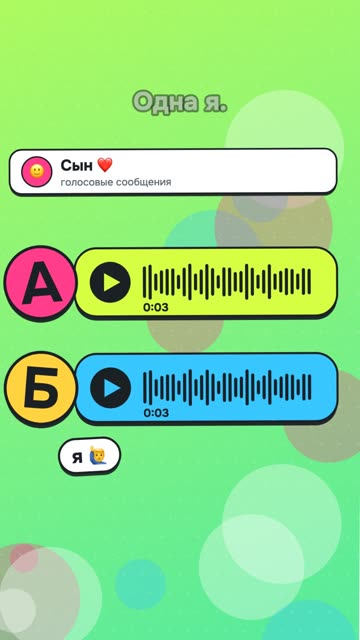

[English version](README.en.md)

# «Угадай, где мой голос» (N09) — угадайка

YouTube Shorts: https://youtube.com/shorts/-6XgmlaQXK4 (вышел 22.10.2026).

## Формат и длительность

Вертикальный рил 1080×1920, 39,5 с. Угадайка «А или Б»: одна фраза звучит дважды, живым
голосом автора и клоном, зритель угадывает в комментариях. Яркие градиентные фоны,
голосовые сообщения с дышащей волной, эмодзи-стикеры. Без лица.

## Хук (первая фраза)

«Твоё голосовое в чате. Этого хватит, чтобы позвонить твоей маме твоим голосом.»

## Структура по секундам

| Время | Что звучит | Что в кадре |
|---|---|---|
| 0,1–4,8 | Хук: твоего голосового хватит, чтобы позвонить маме | Чат с голосовым сообщением |
| 5,2–8,4 | Вариант А: «Слушай, я сегодня проверил одну штуку…» | Голосовое «А» крупно |
| 9,3–12,3 | Вариант Б: та же фраза | Голосовое «Б» крупно |
| 13,0–14,9 | «Одна — я. Вторая — клон. Угадаешь?» | «А или Б?», «Пиши в комменты» |
| 15,5–22,6 | Бесплатная программа, ноутбук без интернета, семь секунд голоса; ставится одной фразой через Claude | «0 ₽», ноутбук без сети, окно с просьбой установить |
| 22,9–24,7 | «Сказка детям твоим голосом.» | Книга сказок с волной голоса |
| 25,0–28,3 | «Мошенникам хватит тех же семи секунд.» | Стопка голосовых, «хватит 7 секунд» |
| 28,6–31,7 | «Защита одна: семейное слово, которого нет в соцсетях.» | Щит с паролем |
| 32,0–34,7 | «Напиши „голос“, пришлю памятку для родителей.» | Поле комментария со словом «голос» |
| 35,2–38,4 | Твист: «Весь этот ролик, кроме одной фразы, говорил клон.» | Глитч, снова А и Б со знаками вопроса |

## Какие приёмы использованы

- [Начинать с результата, скандала или интриги в 0,0 с](../../recipes/hooks/hooks-result-in-first-second.md): хук-страх про близких, а не про технологию.
- [Подавать тему угадайкой и разоблачением, а how-to оставлять хвостом](../../recipes/idea/idea-guess-over-howto.md): интерактив, вопрос «А или Б?» на 13-й секунде и плашка «в комменты» до конца ролика.
- [Выравнивать каждый дубль к −16 LUFS до сведения](../../recipes/voice/voice-loudness-per-take.md): честное сравнение, громкость обоих вариантов выровнена, паузы внутри фраз
  не ужимались.
- Клон подобран из 24 дублей по близости темпа и ритма к живой записи (рецепта пока нет).
- [Заканчивать рил вопросом и кодовым словом, которое зритель пишет в комментариях](../../recipes/cta/cta-codeword-in-comments.md): польза («семейное слово») и лид-магнит по кодовому слову.
- Твист в финале, который заставляет пересмотреть ролик (рецепта пока нет).
- [В YouTube Shorts вести не кодовым словом, а ссылкой в профиле или «Связанным видео»](../../recipes/cta/cta-youtube-link-in-description.md): ответ в ролике не раскрывается, автор закрепляет его в комментариях;
  ссылка на памятку на YouTube стояла в описании и закрепе, но в Shorts такие ссылки некликабельны
  ([справка YouTube](https://support.google.com/youtube/answer/13748639)), рабочий путь: ссылка в профиле канала.
- [Ставить на склейки шумовые вжухи, даже если их слышат как «шмыганье»](../../recipes/sound/sound-keep-noise-whooshes.md): шумовые вжухи на склейках, глитч только в твисте.

## Метрики (площадка, число, дата замера)

| Площадка | Число | Дата замера |
|---|---|---|
| YouTube Shorts | не снято | — |
| Instagram Reels | не снято | — |
| TikTok | не снято | — |

Ориентир из разбора соседних хитов до сборки: в теме клонирования голоса угадайки набирали
медиану 3,7 тыс. просмотров на YouTube против 787 у роликов-инструкций.

## Что сработало

- Формат выбран по срезу соседних хитов: медиана угадаек 3,7 тыс. против 787 у инструкций.
- Твист правдив: весь ролик, кроме одной фразы, действительно озвучен клоном.
- Ролик даёт повод написать комментарий дважды: ответ «А или Б» и кодовое слово.

## Что не сработало

- На YouTube кодовое слово в комментариях не работает: личных сообщений нет, поэтому ссылку
  на памятку поставили в описание и закреп. В Shorts она там некликабельна; памятку надо вести
  через ссылку в профиле канала.
- Название программы синтез читал неверно, в речи пришлось заменить его на «через Клода».
- Метрики на момент разбора не сняты: вывод о формате пока не подтверждён своими цифрами.

## Как повторить

1. Найди тему, где зритель может проверить себя: голос, текст, фото.
2. Хук про риск для близких или для денег.
3. Покажи два варианта одинаковой длины и громкости, задай вопрос.
4. Дай короткую пользу и кодовое слово; для YouTube Shorts ссылку в профиле канала.
5. Закончи твистом, который меняет смысл увиденного.
