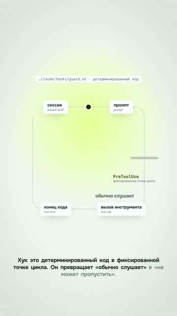

[Русская версия](README.md)

# "A hook that blocks a dangerous command": a vertical cut from a long-form

YouTube Shorts: https://youtube.com/shorts/Lie2qTO_bmg (released 22.09.2026).
Source long-form: https://www.youtube.com/watch?v=96zjz5-Ka8Q (see
[course-retelling](../course-retelling/README.en.md)).

## Format and length

Vertical short, 1080×1920, 35 s, four lines. Built from the "Hooks" chapter of a horizontal
long-form: same voice and timings, scene geometry re-laid out for vertical. Light brand
palette, diagrams, a terminal, a mascot sticker.

## Hook (first line)

«Хук это детерминированный код в фиксированной точке цикла. Он превращает „обычно слушает“
в „не может пропустить“.» [A hook is deterministic code at a fixed point in the loop. It turns
"usually listens" into "can't skip it".]

## Second-by-second structure

| Time | What you hear | On screen |
|---|---|---|
| 0–1.2 | (silence) | Background, the diagram starts assembling |
| 1.2–8.3 | What a hook is: code at a fixed point in the loop | The loop "session → prompt → tool call → end of turn", a "can't skip it" label, the mascot |
| 8.3–15.6 | PreToolUse's power is in its response: JSON and the key decision field | Terminal types out the hook's JSON response |
| 15.6–23.8 | allow / deny / ask, plus a fourth value, defer | Three lanes: the call went through, was stopped, a human decides |
| 23.8–35 | The obvious move: deny. More interesting: swapping the key for a placeholder | A command with a key, the key gets replaced with a placeholder, channel emblem |

## Techniques used

- [Make a short from a long-form by re-laying it out, not cropping](../../recipes/vertical/vertical-relayout-not-crop.md): re-layout, not a crop. The wide loop became tall, captions moved
  under the nodes, the code card got narrower.
- [Lay out a vertical scene with the formula screen = 540 + s·(world − P)](../../recipes/camera/camera-keep-in-frame.md): everything that must stay in frame is kept inside the visible strip at the current
  camera push-in; push-ins were reduced.
- [Hang animation on the word's timing from alignment, not on a timer](../../recipes/assembly/assembly-word-anchored-animation.md): voice and word-anchored animations were taken from the long-form without re-synthesis.
- [Keep the palette in :root of one CSS file and read it from the timeline via getComputedStyle](../../recipes/brand/brand-palette-in-root.md): the light brand palette instead of a dark one out of habit.
- [Bring the mascot out once per episode on the right word, and the logo only at the end](../../recipes/brand/brand-mascot-once-logo-last.md): the mascot appears once per episode, secondary to the diagram.
- [Put stickers and the mascot in a layer outside the camera and give them a white outline from four shadows](../../recipes/brand/brand-stickers-outside-camera.md): the mascot moved to a corner that the camera doesn't touch.
- [Publish shorts only after the long-form they link to is actually out](../../recipes/publishing/publishing-long-before-shorts.md): the description mentions the source long-form.

## Metrics (platform, number, measurement date)

| Platform | Number | Measurement date |
|---|---|---|
| YouTube Shorts | not measured (shorts cut from long-forms were getting 1 to 17 views as of 12.10.2026) | 12.10.2026 |
| TikTok | not measured | — |

## What worked

- The re-layout method: text on a phone is bigger than it would be with the whole frame fitted
  in. A later measurement on another long-form showed that fitting into the 1080 width gives
  0.56–0.67 of the original font size (0.56 for the whole frame, 0.62–0.67 after trimming the
  margins), meaning the text ends up smaller than in the horizontal video. A center crop to 9:16
  doesn't shrink the font, but cuts off the edges of the diagram.
- The first video in the channel's house style; the author approved the test clip:
  «прикольно, публикуем» [nice, let's publish].

## What didn't work

- The first line is a definition of a term. That's a lecture, not a hook: no pain, no result.
- The voice comes in at 1.2 s, the first second is empty.
- Shorts cut from tutorial long-forms on the channel got 1 to 17 views (12.10.2026).

## How to repeat it

1. Take a 30–45-second chunk of the long-form with one complete thought.
2. Re-lay out the scene for 1080 width: reduce push-ins, make wide diagrams tall, shorten long
   commands.
3. Rewrite the first line for the short: a result or a problem, not a definition.
4. Voice from the first second.
5. Point to the full video through the short's "Related video" setting: links in Shorts
   descriptions aren't clickable ([YouTube Help](https://support.google.com/youtube/answer/13748639)).
