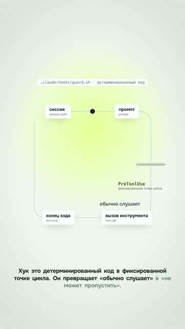

[English version](README.en.md)

# «Хук, который не пропускает опасную команду» — вертикаль из лонга

YouTube Shorts: https://youtube.com/shorts/Lie2qTO_bmg (вышел 22.09.2026).
Исходный лонг: https://www.youtube.com/watch?v=96zjz5-Ka8Q (см.
[course-retelling](../course-retelling/README.md)).

## Формат и длительность

Вертикальный шортс 1080×1920, 35 с, четыре реплики. Собран из главы «Хуки» горизонтального
лонга: голос и тайминги те же, геометрия сцены переверстана под вертикаль. Светлая брендовая
палитра, схемы, терминал, маскот-стикер.

## Хук (первая фраза)

«Хук это детерминированный код в фиксированной точке цикла. Он превращает „обычно слушает“
в „не может пропустить“.»

## Структура по секундам

| Время | Что звучит | Что в кадре |
|---|---|---|
| 0–1,2 | (тишина) | Фон, схема начинает собираться |
| 1,2–8,3 | Что такое хук: код в фиксированной точке цикла | Петля «сессия → промпт → вызов инструмента → конец хода», метка «не может пропустить», маскот |
| 8,3–15,6 | Сила PreToolUse в ответе: JSON и ключевое поле решения | Терминал печатает JSON-ответ хука |
| 15,6–23,8 | allow / deny / ask, четвёртое значение defer | Три дорожки: вызов прошёл, остановлен, решает человек |
| 23,8–35 | Очевидный ход: deny. Интереснее: подмена ключа заглушкой | Команда с ключом, ключ заменяется заглушкой, эмблема канала |

## Какие приёмы использованы

- [Делать шортс из лонга переверсткой, а не кропом](../../recipes/vertical/vertical-relayout-not-crop.md): переверстка, а не кроп. Широкая петля стала высокой, подписи переехали
  под узлы, карточка кода сужена.
- [Верстать вертикальную сцену по формуле screen = 540 + s·(world − P)](../../recipes/camera/camera-keep-in-frame.md): всё, что должно остаться в кадре, держится внутри видимой полосы при текущем
  наезде камеры; наезды уменьшены.
- [Вешать анимацию на время слова из выравнивания, а не на таймер](../../recipes/assembly/assembly-word-anchored-animation.md): голос и привязка анимаций к словам взяты из лонга без пересинтеза.
- [Держать палитру в :root одного CSS-файла и читать её из таймлайна через getComputedStyle](../../recipes/brand/brand-palette-in-root.md): брендовая светлая палитра вместо тёмной по инерции.
- [Выпускать маскота один раз за эпизод на подходящем слове, а логотип только в финале](../../recipes/brand/brand-mascot-once-logo-last.md): маскот один раз за эпизод, вторичен к схеме.
- [Класть стикеры и маскота в слой вне камеры и давать им белый кант из четырёх теней](../../recipes/brand/brand-stickers-outside-camera.md): маскот переехал в угол, свободный от камеры.
- [Публиковать шортсы только после того, как лонг, на который они ссылаются, реально вышел](../../recipes/publishing/publishing-long-before-shorts.md): в описании упомянут исходный лонг.

## Метрики (площадка, число, дата замера)

| Площадка | Число | Дата замера |
|---|---|---|
| YouTube Shorts | не снято (шортсы, нарезанные из лонгов, на 12.10.2026 набирали от 1 до 17 просмотров) | 12.10.2026 |
| TikTok | не снято | — |

## Что сработало

- Метод переверстки: текст на телефоне крупнее, чем был бы при вписывании всего кадра. Позже
  замер на другом лонге показал: вписывание в ширину 1080 даёт 0,56–0,67 от исходного кегля
  (0,56 для всего кадра, 0,62–0,67 после обрезки полей), то есть текст становится мельче, чем в
  горизонтальном ролике. Центральная обрезка в 9:16 кегль не уменьшает, но отрезает края схемы.
- Первый ролик в фирменном стиле канала, пробник автор принял: «прикольно, публикуем».

## Что не сработало

- Первая фраза — определение термина. Это лекция, а не хук: ни боли, ни результата.
- Голос вступает на 1,2 с, первая секунда пустая.
- Шортсы, вырезанные из лонгов-туториалов, на канале набирали от 1 до 17 просмотров (12.10.2026).

## Как повторить

1. Бери из лонга кусок с одной законченной мыслью на 30–45 секунд.
2. Переверстай сцену под 1080 по ширине: уменьши наезды, сделай широкие схемы высокими,
   длинные команды сократи.
3. Перепиши первую фразу под шортс: результат или проблема, а не определение.
4. Голос с первой секунды.
5. На полный ролик веди через «Связанное видео» в настройках шортса: ссылки в описании Shorts
   некликабельны ([справка YouTube](https://support.google.com/youtube/answer/13748639)).
