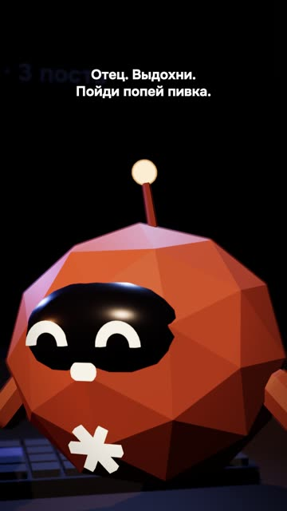

[Русская версия](README.md)

# "I gave my Instagram to Claude": a 3D skit

Uploaded to YouTube manually by the channel's author. This breakdown has no public link.

## Format and length

Vertical skit, 1080×1920, 25 s. Low-poly 3D characters built in code with three.js: the hero
(a stylized version of the author), a Claude character and the mascot Goro. Nine shots. The
hero's voice was recorded by the author on a phone voice recorder; Claude and Goro are voiced by
synthesis.

## Hook (first line)

«Я отдал свой инстаграм Claude — и вот что получил.» [I gave my Instagram to Claude, and here's
what I got.]

## Second-by-second structure

| Time | What you hear | On screen |
|---|---|---|
| 0.25–3.0 | Hook: gave my Instagram to Claude | The hero in close-up with a phone |
| 3.3–7.8 | «Говорящие головы из инсты обещали мне миллионы подписчиков, миллиарды просмотров.» [Talking heads on Insta promised me millions of followers, billions of views.] | Phone screen: cartoon gurus with follower counts |
| 7.8–9.3 | «Ахуеть, — подумал я,» [Holy shit, I thought,] | A sharp cut to the hero |
| 9.3–11.1 | «…и купил подписку за двадцать баксов.» […and bought a twenty-buck subscription.] | Payment screen "$20 / mo" |
| 11.3–16.1 | «Зашёл в Claude, попросил сделать меня популярным. Без риска, без вложений.» [Opened Claude, asked it to make me popular. No risk, no investment.] | Chat: the hero types the request |
| 16.2–17.6 | «И тут Claude мне говорит:» [And then Claude tells me:] | A waiting pause |
| 18.2–20.7 | Claude: «Отец. Выдохни. Пойди попей пивка.» [Pops. Breathe out. Go have a beer.] | The Claude character in close-up |
| 20.7–21.4 | (freeze frame) | Freeze |
| 21.9–25 | Goro: «Балумба!» [Balumba!] | Wide shot: all three, a meme shout |

## Techniques used

- [Remake someone else's hit by rhythm and structure, but in your own words](../../recipes/idea/idea-remake-rhythm-not-words.md): the text of a popular trend was rebuilt for our own audience and characters.
- [Give the lead role to a live voice, keep synthesis for the side characters](../../recipes/voice/voice-live-for-character.md): the author's live voice for the hero, meme-style synthesis for the side characters.
- [Record the voice on a phone and clean mouth clicks before cloning](../../recipes/voice/voice-record-reference-clean.md): the voice was recorded on a phone, with less noise than a laptop recording (signal-to-noise
  41 dB vs 33).
- Stress in the synthesis was marked with symbols in the text, with 7–11 takes per line. On another video
  marks lost to rewording, compare: [Fix stress by rewording, not with marks, and synthesize in chunks](../../recipes/voice/voice-stress-by-rewording.md).
- The punchline comes from an unexpected character, plus a meme shout at the end (no recipe yet).
- A freeze frame before the final shout (no recipe yet).
- [Smooth the speech envelope before animating a 3D character's mouth](../../recipes/face/face-3d-envelope-smoothing.md): mouth animation follows the smoothed speech envelope; without smoothing the models twitched.

## Metrics (platform, number, measurement date)

| Platform | Number | Measurement date |
|---|---|---|
| Instagram Reels | 398 views in the first 3 hours | 21.10.2026 |
| YouTube Shorts | not measured | — |
| TikTok | not measured | — |

## What worked

- The channel's author: «вышло ахуенно» [came out fucking awesome]. The best rating among the skits.
- The hero's live voice removed the main complaint about synthesis (wrong stress and a "sad"
  intonation).
- Self-irony about "talking heads" and promises of millions.

## What didn't work

- Synthesis in the hero's voice couldn't handle conversational phrases: the stress in «попей
  пивка» [have a beer] drifted. The voice had to be recorded live, and the laptop recording
  sounded odd, so it was re-recorded on a phone.
- The noise sound effects (whooshes, swipes, room tone) at first sounded like a vacuum cleaner
  and were removed. Later, after another video took off, the decision was to keep them.
- The author's TikTok upload didn't go through on the first try.

## How to repeat it

1. Take a popular skit trend and rebuild the plot around your topic (don't copy the text).
2. Three characters at most: hero, counterpart, reaction.
3. Record the hero's voice yourself on a phone; give the side characters synthesis.
4. A script of 6–8 lines, the punchline goes to the counterpart, a meme shout at the end.
5. If you animate the mouth from audio, smooth the loudness envelope.
