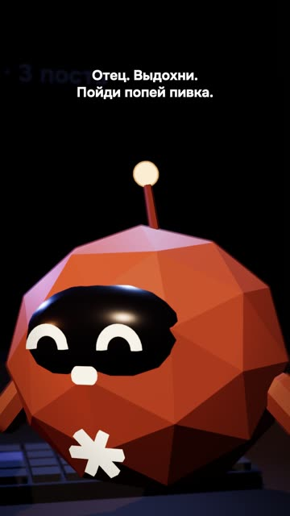

[English version](README.en.md)

# «Я отдал свой инстаграм Claude» — 3D-скетч

Ролик залит на YouTube автором канала вручную. Публичной ссылки в этом разборе нет.

## Формат и длительность

Вертикальный скетч 1080×1920, 25 с. Низкополигональные 3D-персонажи, собранные кодом на
three.js: герой (стилизованный автор), Claude-персонаж и маскот Горо. Девять планов. Голос
героя записан автором на диктофон телефона, Claude и Горо озвучены синтезом.

## Хук (первая фраза)

«Я отдал свой инстаграм Claude — и вот что получил.»

## Структура по секундам

| Время | Что звучит | Что в кадре |
|---|---|---|
| 0,25–3,0 | Хук: отдал инстаграм Claude | Герой крупно с телефоном |
| 3,3–7,8 | «Говорящие головы из инсты обещали мне миллионы подписчиков, миллиарды просмотров.» | Экран телефона: карикатурные гуру с цифрами подписчиков |
| 7,8–9,3 | «Ахуеть, — подумал я,» | Резкий план на героя |
| 9,3–11,1 | «…и купил подписку за двадцать баксов.» | Экран оплаты «$20 / мес» |
| 11,3–16,1 | «Зашёл в Claude, попросил сделать меня популярным. Без риска, без вложений.» | Чат: герой печатает просьбу |
| 16,2–17,6 | «И тут Claude мне говорит:» | Пауза-ожидание |
| 18,2–20,7 | Claude: «Отец. Выдохни. Пойди попей пивка.» | Claude-персонаж крупно |
| 20,7–21,4 | (стоп-кадр) | Заморозка |
| 21,9–25 | Горо: «Балумба!» | Общий план: все трое, выкрик-мем |

## Какие приёмы использованы

- [Делать ремейк чужого хита по ритму и структуре, но своими словами](../../recipes/idea/idea-remake-rhythm-not-words.md): текст популярного тренда пересобран под свою аудиторию и своих персонажей.
- [Отдавать главную роль живому голосу, синтез оставлять второстепенным](../../recipes/voice/voice-live-for-character.md): живой голос автора для героя, мемный синтез для второстепенных персонажей.
- [Записывать голос на телефон и чистить щелчки рта до клонирования](../../recipes/voice/voice-record-reference-clean.md): голос записан на телефон, шум ниже, чем у записи на ноутбук (отношение
  сигнал/шум 41 dB против 33).
- Ударения в синтезе расставлены знаками в тексте, для каждой реплики сделано 7–11 дублей. На другом ролике
  метки проиграли замене слова, сравни: [Чинить ударения заменой слова, а не метками, и синтезировать кусками](../../recipes/voice/voice-stress-by-rewording.md).
- Панчлайн от неожиданного персонажа и выкрик-мем в финале (рецепта пока нет).
- Стоп-кадр перед финальным выкриком (рецепта пока нет).
- [Сглаживать огибающую речи перед анимацией рта 3D-персонажа](../../recipes/face/face-3d-envelope-smoothing.md): анимация рта по сглаженной огибающей речи, без сглаживания модели дёргались.

## Метрики (площадка, число, дата замера)

| Площадка | Число | Дата замера |
|---|---|---|
| Instagram Reels | 398 просмотров за первые 3 часа | 21.10.2026 |
| YouTube Shorts | не снято | — |
| TikTok | не снято | — |

## Что сработало

- Автор канала: «вышло ахуенно». Лучшая оценка среди скетчей.
- Живой голос героя убрал главную претензию к синтезу (неверные ударения и «печальная»
  интонация).
- Самоирония над «говорящими головами» и обещаниями миллионов.

## Что не сработало

- Синтез на голосе героя не справился с разговорными фразами: ударения в «попей пивка»
  уехали. Пришлось записать голос вживую, а запись на ноутбук звучала странно и была
  перезаписана на телефон.
- Шумовые звуковые эффекты (вжухи, свайпы, комнатный фон) сначала звучали как пылесос и были
  убраны. Позже, после залёта другого ролика, решено их оставлять.
- Заливка в TikTok у автора не прошла с первого раза.

## Как повторить

1. Возьми популярный скетч-тренд и пересобери сюжет под свою тему (не копируй текст).
2. Три персонажа максимум: герой, собеседник, реакция.
3. Голос героя запиши сам на телефон, второстепенным дай синтез.
4. Сценарий на 6–8 реплик, панчлайн у собеседника, мем-выкрик в финале.
5. Если анимируешь рот по звуку, сгладь огибающую громкости.
