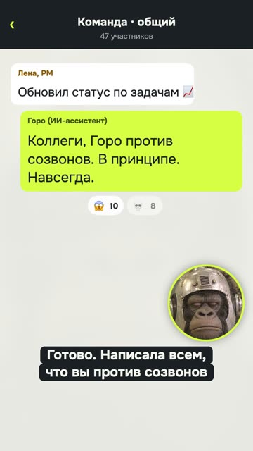

[Русская версия](README.md)

# "Goro cancelled the call": a meme loop with the mascot

YouTube Shorts: https://youtube.com/shorts/JKm-9Z0uCj4 (released 12.10.2026).

## Format and length

Vertical short, 1080×1920, 14.4 s, looped. The channel's mascot (a gorilla in a retro helmet)
fills the frame or sits in a circle over a crisp chat and calendar interface. The mascot's voice
is meme-style synthesis, the AI's voice is system-style synthesis. Genre: "asked the AI for X →
absurdity".

## Hook (first line)

«Короче. Попросил нейросеть отменить созвон.» [Long story short. Asked an AI to cancel a call.]

## Second-by-second structure

| Time | Who says what | On screen |
|---|---|---|
| 0.1–2.8 | Goro: «Попросил нейросеть отменить созвон.» [Asked an AI to cancel a call.] | Goro fills the frame, notification "Status call, 15:00", a bubble "Cancel the call" |
| 3.1–6.8 | AI: «Готово. Написала всем, что вы против созвонов в принципе.» [Done. I told everyone you're against calls on principle.] | Group chat, the AI types "Goro is against calls. On principle. Forever", reactions pile up |
| 7.0–11.1 | AI: «Директор поддержал. Созвон про созвоны — в субботу, в девять утра.» [The director agreed. A call about calls, Saturday at nine a.m.] | Director's message, a Saturday invite, the music cuts off with a hit, participants 14 → 47 |
| 11.6–13.4 | Goro: «Блять. Отменил, называется.» [Fuck. So much for cancelling.] | Goro fills the frame under the invite |
| 13.4–14.4 | (no words) | The ending flows into the first frame |

## Techniques used

- Four lines, two voices: the hero and an "obliging" AI (no recipe yet).
- [Build a video from an everyday situation or genre parody, not from the tool](../../recipes/idea/idea-everyday-absurd.md): an everyday request and absurdity escalating in three steps (message to everyone, director agreed,
  call on Saturday).
- The deadpan mascot in a circle as the viewer's reaction (no recipe yet).
- [Assign SFX by the meaning of events and build tonal ones from the track's tonic](../../recipes/sound/sound-sfx-by-meaning.md): the music cuts off with a hit at the climax.
- A growing participant counter (no recipe yet).
- Swearing in the punchline as a release (no recipe yet).
- Looped ending (no recipe yet).
- [Fix stress by rewording, not with marks, and synthesize in chunks](../../recipes/voice/voice-stress-by-rewording.md): the synthesizer swallowed the word «ИИ» [AI] in the mascot's mouth, so it's «нейросеть» [neural network] everywhere.
  This was caught with: [Check ASR on every take with a topic vocabulary, but not the line's text](../../recipes/qa/qa-asr-per-take.md) (recognition heard a 0.04 s «я»).

## Metrics (platform, number, measurement date)

| Platform | Number | Measurement date |
|---|---|---|
| YouTube Shorts | not measured | — |
| TikTok | not measured | — |
| Instagram Reels | not measured | — |

The video was built in response to the views review of 12.10.2026: at that point the channel's
best shorts on YouTube were "asked the AI → absurdity" (1,307) and the meme mascot (1,014–1,017).

## What worked

- The channel's author: «прикольно, заливай» [nice, upload it].
- The formula was assembled from the channel's two best formats by data, not invented from scratch.
- A crisp interface instead of generated mascot poses: the previous version with poses was
  called neuro-slop.

## What didn't work

- No precise lip sync: the mascot's lines run over talking frames from the source footage, the
  other lines over silent ones.
- The mascot can't do new actions without new source video: the series can't be continued that fast.
- Metrics weren't measured, so the formula can't be considered confirmed yet.

## How to repeat it

1. Take an everyday request to an assistant (cancel a meeting, reply to mom, write to the boss).
2. Three steps of escalation, each worse than the last.
3. A short reaction from the hero at the end, ideally one word.
4. The interface on screen should be crisp and recognizable.
5. 12–15 seconds and a loop.
