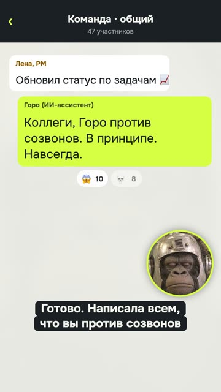

[English version](README.en.md)

# «Горо отменил созвон» — мем-петля с маскотом

YouTube Shorts: https://youtube.com/shorts/JKm-9Z0uCj4 (вышел 12.10.2026).

## Формат и длительность

Вертикальный шортс 1080×1920, 14,4 с, зацикленный. Маскот канала (горилла в ретро-шлеме) во
весь кадр или в кружке поверх чёткого интерфейса чата и календаря. Голос маскота мемный
синтез, голос нейросети системный синтез. Жанр: «попросил ИИ X → абсурд».

## Хук (первая фраза)

«Короче. Попросил нейросеть отменить созвон.»

## Структура по секундам

| Время | Кто и что говорит | Что в кадре |
|---|---|---|
| 0,1–2,8 | Горо: «Попросил нейросеть отменить созвон.» | Горо во весь кадр, уведомление «Созвон по статусу, 15:00», пузырь «Отмени созвон» |
| 3,1–6,8 | Нейросеть: «Готово. Написала всем, что вы против созвонов в принципе.» | Общий чат, нейросеть печатает «Горо против созвонов. В принципе. Навсегда», растут реакции |
| 7,0–11,1 | Нейросеть: «Директор поддержал. Созвон про созвоны — в субботу, в девять утра.» | Сообщение директора, приглашение на субботу, музыка обрывается ударом, участников 14 → 47 |
| 11,6–13,4 | Горо: «Блять. Отменил, называется.» | Горо во весь кадр под приглашением |
| 13,4–14,4 | (без слов) | Финал перетекает в первый кадр |

## Какие приёмы использованы

- Четыре реплики, два голоса: герой и «исполнительная» нейросеть (рецепта пока нет).
- [Строить ролик от бытовой ситуации или жанровой пародии, а не от инструмента](../../recipes/idea/idea-everyday-absurd.md): бытовая просьба и эскалация абсурда в три шага (сообщение всем, директор поддержал,
  созвон в субботу).
- Маскот с каменным лицом в кружке как реакция зрителя (рецепта пока нет).
- [Расписывать SFX по смыслу событий и строить звонкие от тоники трека](../../recipes/sound/sound-sfx-by-meaning.md): музыка обрывается ударом на кульминации.
- Растущий счётчик участников (рецепта пока нет).
- Мат в панчлайне как разрядка (рецепта пока нет).
- Зацикленный финал (рецепта пока нет).
- [Чинить ударения заменой слова, а не метками, и синтезировать кусками](../../recipes/voice/voice-stress-by-rewording.md): слово «ИИ» в устах маскота синтез проглатывал, поэтому везде «нейросеть».
  Нашли это так: [Проверять ASR по каждому дублю со словарём темы, но не текстом реплики](../../recipes/qa/qa-asr-per-take.md) (распознавание слышало «я» длиной 0,04 с).

## Метрики (площадка, число, дата замера)

| Площадка | Число | Дата замера |
|---|---|---|
| YouTube Shorts | не снято | — |
| TikTok | не снято | — |
| Instagram Reels | не снято | — |

Ролик собран как ответ на разбор просмотров 12.10.2026: лучшие шортсы канала на YouTube
тогда были «попросил ИИ → абсурд» (1 307) и мемный маскот (1 014–1 017).

## Что сработало

- Автор канала: «прикольно, заливай».
- Формула собрана из двух лучших по данным канала форматов, а не придумана с нуля.
- Чёткий интерфейс вместо сгенерированных поз маскота: прошлую версию с позами назвали
  нейрослопом.

## Что не сработало

- Точной синхронизации губ нет: под репликами маскота идут говорящие кадры исходника, под
  чужими репликами молчащие.
- Маскот не умеет новых действий без нового видеоисходника: серию так быстро не продолжить.
- Метрики не сняты, поэтому формулу пока нельзя считать подтверждённой.

## Как повторить

1. Возьми бытовую просьбу к ассистенту (отменить встречу, ответить маме, написать
   начальнику).
2. Три шага эскалации, каждый хуже предыдущего.
3. Короткая реакция героя в конце, лучше одним словом.
4. Интерфейс в кадре должен быть чётким и узнаваемым.
5. 12–15 секунд и кольцо.
