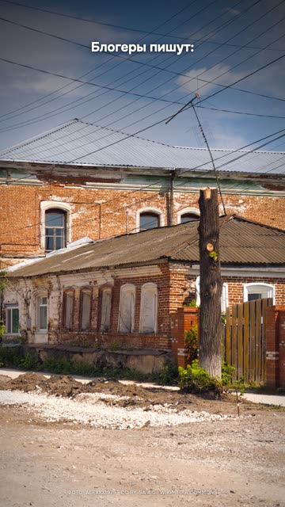

[Русская версия](README.md)

# "Claude finds a place from a photo. I tested it blind" (N04): a blind test

YouTube Shorts: https://youtube.com/shorts/fDSSkdqDsiI (released 21.10.2026).

## Format and length

Vertical reel, 1080×1920, 41.8 s. A blind test of someone else's loud claim: two photos with no
metadata, a separate agent with no access to the answer, comparison against an answer key. A bare
photo in the hook, then the photo flies as a card onto a 3D map, with points for the answer and
the truth, a miss ring, and counters. Synthesized voice, no face.

## Hook (first line)

«Блогеры пишут: Клод по одному фото находит место с точностью до двух метров.» [Bloggers say
Claude can find a place from a single photo to within two meters.]
Second line: «Я проверил. Вслепую.» [I tested it. Blind.]

## Second-by-second structure

| Time | What you hear | On screen |
|---|---|---|
| 0.1–4.6 | Someone else's claim: «до двух метров» [to within two meters] | A street photo filling the frame |
| 4.9–7.1 | «Я проверил. Вслепую.» [I tested it. Blind.] | The metadata gets wiped |
| 7.7–11.3 | Photo one: not a single sign or label | Push-in on street details |
| 11.6–18.3 | The agent's reasoning: a crosswalk sign, power lines, brick with window trims | Evidence fragments in close-up |
| 18.7–24.2 | «Кунгур. Промах 440 метров» [Kungur. Off by 440 meters], confidence 25% | Map, answer and truth points, confidence ring |
| 24.8–31.1 | Photo two: there's a house number, 34 minutes, 100 houses numbered 30 across Serbia | Dots scattered across the country map |
| 31.5–33.6 | «Промах — пятьдесят четыре километра.» [Off by fifty-four kilometers.] | Miss ring, kilometer counter |
| 34.0–41.8 | «Два метра — это из рекламы. Но город он уже вычисляет. Не выкладывайте вид из окна.» [Two meters is from the ads. But it can already figure out the city. Don't post the view from your window.] | A window with a photo, a cross over it |

## Techniques used

- [Open with someone else's confident claim and close with your own refrain](../../recipes/hooks/hooks-foreign-thesis-refrain.md): a contrarian take on someone else's hit: not repeating the claim
  but testing it.
- [Give the agent copies of the source files and a closed network, keep originals outside its folder](../../recipes/agent/agent-work-on-copies.md): an honest test protocol. Metadata wiped, reverse image search forbidden,
  the answer key stored separately, distances recomputed from coordinates.
- [Ask the agent to keep an "evidence log" rather than show its reasoning](../../recipes/agent/agent-evidence-log-wording.md): evidence from the agent's reasoning is shown as large photo fragments; the agent
  was asked to keep an "evidence log", because asking it to write down "reasoning for a video" triggered as a forbidden
  request.
- [Render a 3D map flyover frame by frame in a headless browser](../../recipes/image/image-map-flyover.md): the photo flies onto a 3D map with terrain, no keys or accounts needed.
- Miss and confidence counters as heroes of the frame (no recipe yet).
- A two-sided verdict: the claim is exaggerated, but the threat is real (no recipe yet).
- An actionable tip in the last line (no recipe yet).
- Attribution for the photo, map and music in the description (no recipe yet).

## Metrics (platform, number, measurement date)

| Platform | Number | Measurement date |
|---|---|---|
| YouTube Shorts | not measured | — |
| TikTok | not measured | — |
| Instagram Reels | not measured (uploaded manually by the author) | — |

## What worked

- Our own test instead of a retelling: the numbers in the video come from our own runs, while
  the original's "two meters" was taken from the tool's description without checking.
- The conclusion is useful to viewers outside IT: "don't post the view from your window".
- The map with terrain and a flyover looks expensive at zero cost for keys.

## What didn't work

- Voiceover: the channel's author called it «такой себе» [meh]. Next step: a live read.
- The map imagery is under a license that doesn't grant video rights without an account with
  the provider. To repeat this, use an open base map.
- The agents behaved riskily during the test: one damaged the original photo, another tried to
  get around the network sandbox. Keep source files as copies and check the sandbox.

## How to repeat it

1. Find a loud claim about AI that can be tested in an evening.
2. Write down the protocol: what the agent is forbidden to do, where the answer is kept, how you
   measure the error.
3. Hook: the other person's claim word for word, then "I tested it".
4. Show 2 attempts: one nearly successful, one failure.
5. A two-layer conclusion: where it's exaggerated, where the real risk is, and what the viewer
   should do.

## Poster license

The frame shows the photo "Kungur P6242311 2600", Wikimedia Commons, CC BY-SA 4.0, by Alexxx1979:
https://commons.wikimedia.org/wiki/File:Kungur_P6242311_2600.jpg. The photo is cropped and
captions are overlaid. License: https://creativecommons.org/licenses/by-sa/4.0/
