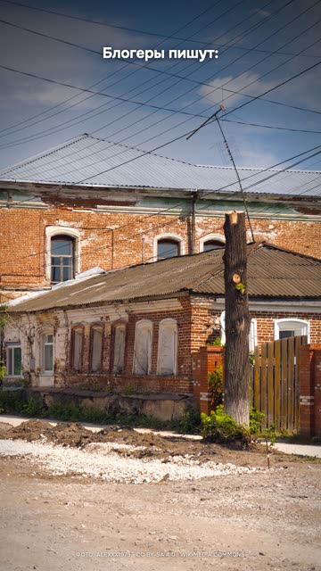

[English version](README.en.md)

# «Claude ищет место по фото. Я проверил вслепую» (N04) — слепой тест

YouTube Shorts: https://youtube.com/shorts/fDSSkdqDsiI (вышел 21.10.2026).

## Формат и длительность

Вертикальный рил 1080×1920, 41,8 с. Слепой тест чужого громкого обещания: два фото без
метаданных, отдельный агент без доступа к ответу, сравнение с ключом. Голое фото в хуке,
дальше фото улетает карточкой на 3D-карту, точки ответа и правды, кольцо промаха, счётчики.
Голос синтезирован, без лица.

## Хук (первая фраза)

«Блогеры пишут: Клод по одному фото находит место с точностью до двух метров.»
Вторая фраза: «Я проверил. Вслепую.»

## Структура по секундам

| Время | Что звучит | Что в кадре |
|---|---|---|
| 0,1–4,6 | Чужое обещание: «до двух метров» | Фото улицы на весь кадр |
| 4,9–7,1 | «Я проверил. Вслепую.» | Метаданные стираются |
| 7,7–11,3 | Фото первое: ни одной надписи | Наезд на детали улицы |
| 11,6–18,3 | Рассуждение агента: знак перехода, провода, кирпич с наличниками | Фрагменты-улики крупно |
| 18,7–24,2 | «Кунгур. Промах 440 метров», уверенность 25 % | Карта, точки ответа и правды, кольцо уверенности |
| 24,8–31,1 | Фото второе: номер дома есть, 34 минуты, 100 домов №30 по Сербии | Россыпь точек по карте страны |
| 31,5–33,6 | «Промах — пятьдесят четыре километра.» | Кольцо промаха, счётчик километров |
| 34,0–41,8 | «Два метра — это из рекламы. Но город он уже вычисляет. Не выкладывайте вид из окна.» | Окно с фото, крест поверх |

## Какие приёмы использованы

- [Открывать чужим уверенным тезисом и закрывать своим рефреном](../../recipes/hooks/hooks-foreign-thesis-refrain.md): контрарианская подача поверх чужого хита, не повторить обещание,
  а проверить его.
- [Давать агенту копии исходников и закрытую сеть, оригиналы держать вне его папки](../../recipes/agent/agent-work-on-copies.md): честный протокол теста. Метаданные стёрты, обратный поиск по картинке запрещён,
  ключ хранится отдельно, расстояния пересчитаны по координатам.
- [Просить агента вести «журнал улик», а не показывать свои рассуждения](../../recipes/agent/agent-evidence-log-wording.md): улики из рассуждения агента показаны крупными фрагментами фото; агента
  просили вести «журнал улик», потому что просьба записать «рассуждения для видео» срабатывала как запрещённый
  запрос.
- [Рендерить 3D-пролёт над картой покадрово в headless-браузере](../../recipes/image/image-map-flyover.md): фото улетает на 3D-карту с рельефом, ключи и аккаунты не нужны.
- Счётчики промаха и уверенности как герои кадра (рецепта пока нет).
- Двойной вывод: обещание преувеличено, но угроза реальна (рецепта пока нет).
- Совет-действие в последней фразе (рецепта пока нет).
- Атрибуция фото, карты и музыки в описании (рецепта пока нет).

## Метрики (площадка, число, дата замера)

| Площадка | Число | Дата замера |
|---|---|---|
| YouTube Shorts | не снято | — |
| TikTok | не снято | — |
| Instagram Reels | не снято (залит автором вручную) | — |

## Что сработало

- Своя проверка вместо пересказа: цифры в ролике получены на своих прогонах, а у образца
  «два метра» взяты из описания инструмента без проверки.
- Вывод полезен зрителю не из IT: «не выкладывайте вид из окна».
- Карта с рельефом и пролётом смотрится дорого при нулевых затратах на ключи.

## Что не сработало

- Озвучка: автор канала назвал её «такой себе». Следующий шаг — живая начитка.
- Снимки карты под лицензией, которая не даёт прав на видео без аккаунта у провайдера.
  Для повторения бери открытую подложку.
- Агенты во время теста вели себя рискованно: один испортил исходное фото, другой пытался
  обойти сетевую песочницу. Исходники держи в копии, песочницу проверяй.

## Как повторить

1. Найди громкое обещание про ИИ, которое можно проверить за вечер.
2. Опиши протокол: что запрещено агенту, где лежит ответ, как считаешь ошибку.
3. Хук: чужое обещание дословно и «я проверил».
4. Покажи 2 попытки: одну почти удачную, одну провальную.
5. Вывод в два слоя: где преувеличение, где реальный риск, и что делать зрителю.

## Лицензия постера

В кадре фото «Kungur P6242311 2600», Wikimedia Commons, CC BY-SA 4.0, автор Alexxx1979:
https://commons.wikimedia.org/wiki/File:Kungur_P6242311_2600.jpg. Фото кадрировано, поверх
наложены подписи. Лицензия: https://creativecommons.org/licenses/by-sa/4.0/
