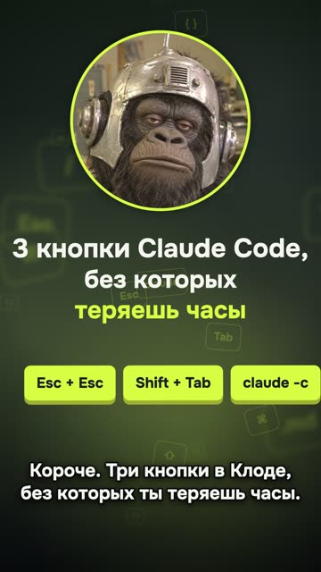

[Русская версия](README.md)

# "3 Claude Code keys" as a repeat (Q02): flop

YouTube Shorts: https://youtube.com/shorts/oAyMRFDHC-k (released 12.10.2026).
The first version, released the same day: https://youtube.com/shorts/NURQmJ6m9d4.

## Format and length

Vertical short, 1080×1920, 21.5 s. The quick "three points" template: the mascot in a circle,
huge keys, narrow terminal crops, subtitles. Synthesized voice. This is the second version of
the same video: same text, with a different background, subtitles and ending (a code word
instead of "save this").

## Hook (first line)

«Короче. Три кнопки в Клоде, без которых ты теряешь часы.» [Long story short. Three keys in
Claude that you're losing hours without.]

## Second-by-second structure

| Time | What you hear | On screen |
|---|---|---|
| 0.15–3.5 | Hook: three keys you're losing hours without | Mascot, title, three key badges |
| 4.0–7.1 | «Первая. Два раза Эскейп. Клод откатит свою правку.» [First. Escape twice. Claude rolls back its edit.] | Smash cut to huge Esc + Esc, then the rewind menu |
| 7.4–11.5 | «Вторая. Шифт Таб, пока не включится план.» [Second. Shift Tab until plan mode turns on.] | Huge Shift + Tab, then plan mode |
| 11.8–16.4 | «Третья. Клод континью. Вернёт разговор.» [Third. Claude continue. Brings the conversation back.] | Command and terminal output |
| 16.7–19.9 | «Пиши в комментах слово кнопки. Скину все сочетания.» [Write the word "keys" in the comments. I'll send you all the shortcuts.] | Badge «КНОПКИ» [KEYS] |

## Techniques used

The video flopped. The cause isn't established: the first version's metrics weren't recorded and there's no control comparison.

- A promise hook built on loss ("you're losing hours") (no recipe yet).
- "First, second, third" numbering (no recipe yet).
- [Open a video with a smash cut from silence to a hit](../../recipes/transitions/transitions-smash-cut.md): a half-second smash cut to huge keys around the keypress.
- [For on-screen top-N formats, put the presenter on top and the screen below](../../recipes/vertical/vertical-split-face-screen.md): the mascot in a circle on top, narrow terminal crops so the text is readable
  on a phone, subtitles without badges, with an outline and a shadow.
- [End a reel with a question and a code word the viewer writes in the comments](../../recipes/cta/cta-codeword-in-comments.md): a code word at the end. The promised cheat sheet never came out, and it should have:
  [Prepare the promised material and the path to it before publishing the call to action](../../recipes/cta/cta-deliver-before-asking.md).
- The second version was uploaded the same day as the first. Recipe for this case: [Don't upload two versions of the same video back to back](../../recipes/publishing/publishing-no-twin-versions.md).

## Metrics (platform, number, measurement date)

| Platform | Number | Measurement date |
|---|---|---|
| YouTube Shorts | 3 views | 14.10.2026 |
| TikTok | 0 views | 14.10.2026 |
| Instagram | not measured | — |
| First version (Q01) | not measured | — |

## What worked

- The template itself: the channel's author called the first version «кайфово» [awesome], and a
  video is assembled in about 15 minutes from one file with the hook, the points and the CTA.
- The smash cut to keys and the narrow terminal crops later carried over to other videos.

## What didn't work

- The second version, uploaded the same day as the first, got 3 views on YouTube and 0 on
  TikTok. Whether that's related to the repeat can't be told from this data.
- The post with the cheat sheet that the code word promised never came out. The CTA's promise
  went unfulfilled.
- Narrow dev tutorials ("three keyboard shortcuts") on the channel got between 2 and 400 views.

## How to repeat it (and how not to)

1. If you upload an improved version next to the first one, record the metrics of both: here
   the first wasn't measured, so there's nothing to compare. We haven't tested deleting the
   first version as a fix.
2. Don't promise in the CTA something that isn't posted yet: lead magnet first, then the video.
3. The "three points" template works as a quick way to assemble a video, but pick a topic
   broader than a tutorial: a situation, a mistake, a story.
