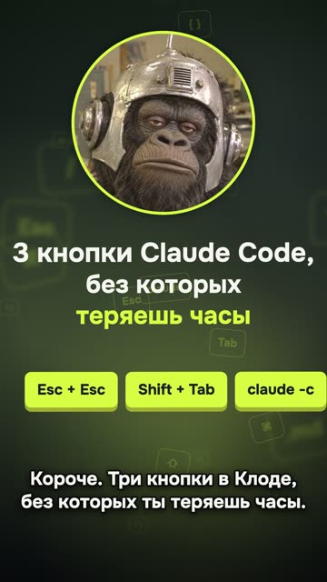

[English version](README.en.md)

# «3 кнопки Claude Code» повтором (Q02) — провал

YouTube Shorts: https://youtube.com/shorts/oAyMRFDHC-k (вышел 12.10.2026).
Первая версия, вышедшая в тот же день: https://youtube.com/shorts/NURQmJ6m9d4.

## Формат и длительность

Вертикальный шортс 1080×1920, 21,5 с. Быстрый шаблон «три пункта»: маскот в кружке, огромные
клавиши, узкие кропы терминала, субтитры. Голос синтезирован. Это вторая версия того же
ролика: текст тот же, поменяли фон, субтитры и финал (кодовое слово вместо «сохрани»).

## Хук (первая фраза)

«Короче. Три кнопки в Клоде, без которых ты теряешь часы.»

## Структура по секундам

| Время | Что звучит | Что в кадре |
|---|---|---|
| 0,15–3,5 | Хук: три кнопки, без которых теряешь часы | Маскот, заголовок, три плашки клавиш |
| 4,0–7,1 | «Первая. Два раза Эскейп. Клод откатит свою правку.» | Смэш-кат на огромные Esc + Esc, затем меню отката |
| 7,4–11,5 | «Вторая. Шифт Таб, пока не включится план.» | Огромные Shift + Tab, затем режим плана |
| 11,8–16,4 | «Третья. Клод континью. Вернёт разговор.» | Команда и вывод терминала |
| 16,7–19,9 | «Пиши в комментах слово кнопки. Скину все сочетания.» | Плашка «КНОПКИ» |

## Какие приёмы использованы

Ролик провальный. Причина не установлена: метрика первой версии не снята, контрольного сравнения нет.

- Хук-обещание с потерей («теряешь часы») (рецепта пока нет).
- Нумерация «первая, вторая, третья» (рецепта пока нет).
- [Открывать ролик смэш-катом с тишины на удар](../../recipes/transitions/transitions-smash-cut.md): смэш-кат на огромные клавиши на полсекунды вокруг нажатия.
- [Для экранных топ-форматов ставить ведущего сверху и экран снизу](../../recipes/vertical/vertical-split-face-screen.md): маскот в кружке сверху, узкие кропы терминала, чтобы текст читался
  с телефона, субтитры без плашек, с обводкой и тенью.
- [Заканчивать рил вопросом и кодовым словом, которое зритель пишет в комментариях](../../recipes/cta/cta-codeword-in-comments.md): кодовое слово в финале. Обещанная шпаргалка так и не вышла, а надо было:
  [Готовить обещанный материал и путь к нему до публикации призыва](../../recipes/cta/cta-deliver-before-asking.md).
- Вторая версия залита в тот же день, что и первая. Рецепт про такой случай: [Не заливать две версии одного ролика подряд](../../recipes/publishing/publishing-no-twin-versions.md).

## Метрики (площадка, число, дата замера)

| Площадка | Число | Дата замера |
|---|---|---|
| YouTube Shorts | 3 просмотра | 14.10.2026 |
| TikTok | 0 просмотров | 14.10.2026 |
| Instagram | не снято | — |
| Первая версия (Q01) | не снято | — |

## Что сработало

- Сам шаблон: автор канала назвал первую версию «кайфово», ролик собирается примерно за
  15 минут из одного файла с хуком, пунктами и CTA.
- Смэш-кат на клавиши и узкие кропы терминала потом перешли в другие ролики.

## Что не сработало

- Вторая версия, залитая в тот же день, что и первая, собрала 3 просмотра на YouTube и 0 в
  TikTok. Связан ли результат с повтором, по этим данным сказать нельзя.
- Пост со шпаргалкой, которую обещало кодовое слово, так и не вышел. Обещание в CTA осталось
  невыполненным.
- Узкие дев-туториалы («три сочетания клавиш») на канале набирали от 2 до 400 просмотров.

## Как повторить (и как не повторять)

1. Если заливаешь улучшенную версию рядом с первой, запиши метрики обеих: здесь первая не
  снята, и сравнить не с чем. Удаление первой версии как средство мы не проверяли.
2. Не обещай в CTA то, что ещё не выложено: сначала лид-магнит, потом ролик.
3. Шаблон «три пункта» годится как быстрый способ собрать ролик, но тему бери шире
  туториала: ситуация, ошибка, история.
