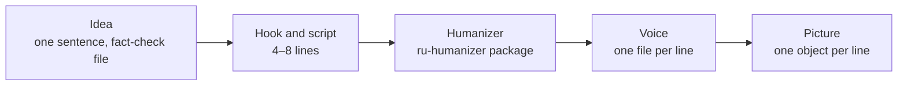
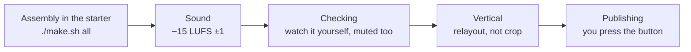

# 00. Your first video in one evening

Twenty seconds. Four lines. Someone asks an AI to free up their Friday. The AI wipes Friday, and then every other day
of the week falls after it. The meeting counter melts from 15 to zero, the closing line says "when you hand a task to
an AI, say what has to survive", and the video loops back to its first frame.

At the time we measured, this video ([breakdown](../../examples/free-friday/README.en.md),
[YouTube](https://youtube.com/shorts/sNg2qsj1Ag4)) was the channel's best YouTube short: 1,307 views. That's not a
viral hit, that's the channel's ceiling. But it has everything a first video needs: one everyday situation, absurdity
shown through action, a picture you understand with the sound off, and a short runtime. No face, no studio, no
editor. The script fits on a napkin.

This chapter walks you through ten stages, from idea to publishing. The rest of the textbook covers each stage in
detail, with numbers and mistakes. Here you only get the route and the "done" signal for each step.

Before you start, install the [starter](../../starter/README.en.md) and run its demo, the one with beeps instead of a
voice. Installing things and downloading models is not part of this evening. That's a separate evening, and a boring
one. If you work with an agent, give it [AGENTS.md](../../AGENTS.md): it explains how to find a recipe and when to stop.

The main rule of the route: don't move to the next stage until you have the "done" signal. A script mistake is cheaper
to catch before the voice, and a voice mistake is cheaper to catch before the render. We learned this the hard way: we
built a twenty-minute video end to end without a test piece, and then heard "this is unwatchable". An hour of
synthesis and several hours of rendering went into a format we could have thrown out after a thirty-second sample.

## 1. Idea

The classic beginner mistake is starting with the tool. "I'll make a video about how to install X." We made dozens of
those, and the numbers are blunt: tool How-Tos on the channel got anywhere from 2 to 400 views, while the Friday video,
which never even names the tool, got 1,307. Viewers don't care about the tool. They care about what happened.

So start with a situation. An everyday pain (a call, an email, a calendar, a TV full of ads) plus an unexpected
result. Or take someone else's video that took off in your niche and invent your own story in its rhythm. The test is
simple: can you retell the video to a friend in one sentence without naming the tool? If not, you have a tutorial.

Create a fact-check file right away. Empty. It's where sources go, along with claims you must not make. Why at stage
one? Agents confidently write numbers and commands from memory, and a video that "exposes other people's mistakes" can
easily ship with invented ones of its own.

More on ideas: [chapter 01](01-idea-hook-script.md). To break down someone else's reel second by second, use the
[reel-teardown-card](../../prompts/agent/reel-teardown-card.md) prompt.

**Done when** the idea fits into "who, what happened, how it ended", and next to it you have a link to a reference
video and an empty fact-check file.

Agent recipe: [idea-everyday-absurd](../../recipes/idea/idea-everyday-absurd.md),
[idea-find-hits-by-median](../../recipes/idea/idea-find-hits-by-median.md),
[idea-remake-rhythm-not-words](../../recipes/idea/idea-remake-rhythm-not-words.md),
[idea-factcheck-file](../../recipes/idea/idea-factcheck-file.md)

## 2. Hook and script

Write the first line first, then everything else. In the seven hits from our niche that we took apart, the first word
lands at second zero, and not one of them has an intro. "Today I'll tell you", "coming up", "TikTok says you should"
kill the video before the viewer even knows what it's about. The Friday video opens with "I asked an AI to free up my
Friday". The situation, right away, plus a promise that something is about to go wrong.

Then a script of 4–8 lines with one example: four are enough for 20 seconds, about eight for 40. For your first video, stay under 40 seconds. We once shipped a 2:11 reel that
spent seconds 8 to 19 explaining the methodology, with the funny examples only after the tables. The verdict was
"it's all really bad". One example equals one video. Save the other examples for the next ones.

And show the script to someone before you build. Even just to tomorrow's you. A few lines of text take a minute to
throw away. A finished video takes an evening.

Prompts: [hook-first-second](../../prompts/script/hook-first-second.md),
[scenario-from-material](../../prompts/script/scenario-from-material.md),
[antislop-brief](../../prompts/script/antislop-brief.md).

**Done when** you have 4–8 lines, the first one answers "what happened", and the person who read the script didn't
ask "so what?".

Agent recipe: [hooks-result-in-first-second](../../recipes/hooks/hooks-result-in-first-second.md),
[idea-script-before-build](../../recipes/idea/idea-script-before-build.md),
[idea-one-example-short-reel](../../recipes/idea/idea-one-example-short-reel.md)

## 3. Running it through a humanizer

A script written by a model sounds like a news anchor: "not X, but Y" in every other sentence, lists of three, "a new
era". If you only notice after synthesizing the voice, you'll have to re-voice takes and rebuild the timings. So the
text gets fixed before the first take.

Run a diagnostic with a scanner (our package is `ru-humanizer`, built for Russian) and fix things surgically: clichés,
dashes, triplets. Don't ask the model to "make it livelier": it will add emotions and conclusions you never had. After
editing, check numbers, dates and names against the source, because editing loves to shift them.

And remember: "clean" by the scanner doesn't mean "a living script". The scanner sees words, not form. A reel built on
a "top 3" template passed the scanner with almost no flags and was still rated "AI slop".

More: [chapter 02](02-text-humanizer.md). Fact-check prompt: [fact-check](../../prompts/script/fact-check.md).

**Done when** the scanner is quiet, numbers and names match the source, and the text, read aloud, sounds like you.

Agent recipe: [text-humanize-script-before-tts](../../recipes/text/text-humanize-script-before-tts.md),
[text-local-edit-not-rewrite](../../recipes/text/text-local-edit-not-rewrite.md),
[text-fact-lock-before-after](../../recipes/text/text-fact-lock-before-after.md),
[text-scanner-misses-form-slop](../../recipes/text/text-scanner-misses-form-slop.md)

## 4. Voice

The simplest path: record the lines yourself, one file per line, using `./make.sh live` in the starter. Record on your
phone, not your laptop: on the laptop we counted 385 mouth clicks in 34 seconds, and the synthesis then copies them.

If you synthesize, expect surprises. Synthesis puts stress on the wrong syllable, swallows the first word, clips the
last sound, and doesn't pause on dashes. In the Friday video we had to replace «ИИ» [the Russian abbreviation for
"AI"] with «нейросеть» ["neural network"]: the synthesis mumbled the abbreviation, and speech recognition heard «я»
["I"] lasting 0.04 seconds instead. Stress marks help about half the time, so if a word gets the wrong stress, replace
it with a different word. Your language will have its own quirks of this kind: see
[gotchas/lang](../../gotchas/lang/README.md).

After synthesis, run speech recognition on every take separately, not on the finished mix. On one long video this
found three takes out of 97 missing their first word, and nobody had heard it in the full mix.

More: [chapter 03](03-voice.md). The tools `voice/ru_tts_text.py`, `voice/pick_take.py`, `audio/tail_trim.py` and
`audio/gaps.py` are described in [tools/README.md](../../tools/README.md), and the Russian synthesis pitfalls are in
[gotchas](../../gotchas/README.md).

**Done when** every line has its own file, the recognized text matches the line, no word is eaten at the start or the
end, and there are no pauses longer than 0.8 s.

Agent recipe: [voice-live-for-character](../../recipes/voice/voice-live-for-character.md),
[voice-record-reference-clean](../../recipes/voice/voice-record-reference-clean.md),
[voice-stress-by-rewording](../../recipes/voice/voice-stress-by-rewording.md),
[qa-asr-per-take](../../recipes/qa/qa-asr-per-take.md)

## 5. Picture

One main object per line, filling the frame. In the Friday video it's a calendar with five day cards and one counter
that melts throughout the video. Nothing else.

Three mistakes, and we made all of them. First: drawing a real thing as an SVG silhouette. A video about a car with a
drawn silhouette got a harsh rejection and the question "why not use a picture of a real one?". A real thing is shown
with a real, openly licensed photo. Second: a title on top, a diagram in the middle, a bar at the bottom. That's a
slide, no matter how much you animate it. Third: bringing a still image to life with a slow push-in. A push-in of 0.6%
per second got the verdict "not enough motion".

More: [chapter 04](04-image-and-frame.md). Tools `image/depth.py` and `image/depth_layers.py`, prompts
[backdrop-preamble](../../prompts/image/backdrop-preamble.md) and
[image-agent-wrapper](../../prompts/image/image-agent-wrapper.md).

**Done when** for every line it's clear what's in the frame, every third-party photo has its source and license
written down, and there are no real people in the frame without their consent.

Agent recipe: [image-real-object-real-photo](../../recipes/image/image-real-object-real-photo.md),
[transitions-one-zone-no-chrome](../../recipes/transitions/transitions-one-zone-no-chrome.md),
[camera-no-ken-burns](../../recipes/camera/camera-no-ken-burns.md),
[image-depth-parallax-layers](../../recipes/image/image-depth-parallax-layers.md)

## 6. Assembly in the starter

Drop the voice and images into the starter, edit `scene/scene.ts`, run `./make.sh frames`, then `./make.sh all`.

The key thing at this stage: animation is tied to when a word is spoken, not to a stopwatch. When the narrator says
"just Friday", Friday falls exactly on that word. Word timings come from speech alignment. If you hang an animation on
"after 3.7 seconds", it will drift away from the voice after the very first edit to the line.

The second common problem: an empty scene start. A block is tied to its word, the word is spoken at second five of the
scene, and for five seconds the viewer stares at the background. Bring the block in at the joint between lines.

More on camera and editing: [chapter 05](05-camera-editing.md); on assembly and checks: [chapter 07](07-assembly-qa.md).
The agent's task is in [starter/FIRST-TASK.md](../../starter/FIRST-TASK.md).

**Done when** `./make.sh all` exits with code 0, `output/final.mp4` exists, and `lint/still_lint.py` finds no scenes
standing still for longer than 3 s (the threshold and what it was measured on: [QA-THRESHOLDS.md](../../docs/QA-THRESHOLDS.md)).

Agent recipe: [assembly-word-anchored-animation](../../recipes/assembly/assembly-word-anchored-animation.md),
[assembly-no-empty-scene-start](../../recipes/assembly/assembly-no-empty-scene-start.md),
[assembly-motion-timing](../../recipes/assembly/assembly-motion-timing.md)

## 7. Sound

If no track is set, the starter synthesizes a quiet pad by itself. Put your own openly licensed track in `reel.json`
and copy the credit into the description. Mix the final to −15 LUFS ±1: that's how hits sound, and next to them a
quiet video feels broken.

Put noisy whooshes on the cuts and meaningful sounds on events in the frame. The Friday video has four seconds with no
speech at all: the days fall, and you can hear it. Viewers of one of our videos heard sniffling in the whooshes and
started a whole discussion under it, and the video got 212 thousand views. We kept the whooshes.

More: [chapter 06](06-sound-captions.md).

**Done when** the starter's QA doesn't complain about loudness or peaks, and the voice doesn't drown in the music on a
phone speaker.

Agent recipe: [sound-loudness-like-hits](../../recipes/sound/sound-loudness-like-hits.md),
[sound-sfx-by-meaning](../../recipes/sound/sound-sfx-by-meaning.md),
[sound-keep-noise-whooshes](../../recipes/sound/sound-keep-noise-whooshes.md)

## 8. Checking

A green `qa/final-result.json` only means the technical side is fine. One of our videos passed 15 green automated
checks and was rejected anyway. Another, 27 minutes long, ran on an empty background for 22% of its runtime despite
green checks: six minutes of nothing but subtitles.

So watch it yourself. Open the contact sheet `qa/sheet.jpg`, watch the whole video with sound, and once more without.
The Friday video makes sense with the sound off: the days fall, the counter melts. If yours doesn't make sense without
sound, that's not a sound problem, it's a picture problem.

The [meaning-check](../../prompts/script/meaning-check.md) prompt checks meaning frame by frame on the finished mp4.
Tools: `qa/frame_fill.py`, `qa/jitter.py`, `project/artifacts.py`.

**Done when** you've watched the video to the end yourself, it's clear what happened without sound, and the contact
sheet has no empty or overlapping frames.

Agent recipe: [qa-green-is-not-approval](../../recipes/qa/qa-green-is-not-approval.md),
[qa-contact-sheet-final](../../recipes/qa/qa-contact-sheet-final.md),
[qa-frame-fill-mp4](../../recipes/qa/qa-frame-fill-mp4.md),
[qa-preflight-ffmpeg](../../recipes/qa/qa-preflight-ffmpeg.md)

## 9. Vertical

The starter builds a 1080×1920 vertical, so you can skip this stage for your first video. If your video is horizontal,
make the vertical version by re-laying it out, not by cropping. We measured it: a center crop to 9:16 cuts off the
edges of the content, and fitting the horizontal frame into the 1080 width shrinks the text to 0.56–0.67 of its
original size (0.56 for the whole frame, 0.62–0.67 after trimming the margins), and you can't read it on a phone.

More: [chapter 08](08-vertical-publishing.md). Prompt: [vertical-relayout-review](../../prompts/agent/vertical-relayout-review.md).

**Done when** the text in the vertical is no smaller than in the original, and nothing slides off the edge when the
camera pushes in.

Agent recipe: [vertical-relayout-not-crop](../../recipes/vertical/vertical-relayout-not-crop.md),
[camera-keep-in-frame](../../recipes/camera/camera-keep-in-frame.md),
[vertical-titles-on-joint](../../recipes/vertical/vertical-titles-on-joint.md)

## 10. Publishing

You press "publish". Don't hand that button to the agent. If the ending has a code word, the promised material has to
be in place before the video goes out. We once promised a cheat sheet for a code word and never posted it. The video
got 3 views, but that's not the bad part. The bad part is the promise left hanging.

Upload to every platform. The video about a TV without ads got 212 thousand views on Instagram and between 1 and 328 on
YouTube and TikTok. Virality happens where you don't expect it, and conclusions from one platform don't carry over to
another.

After uploading to YouTube, check whether the "made for kids" flag switched itself on: it turns off comments. That
happened to all five videos in one of our series. Set the AI label on Instagram by hand.

More: [chapter 08](08-vertical-publishing.md). The `project/artifacts.py` tool records exactly which file went out.

**Done when** the video is live on every platform, the "made for kids" flag is off, the AI label is on, the links in
the description work, and the date of the first view count is in your calendar.

Agent recipe: [cta-codeword-in-comments](../../recipes/cta/cta-codeword-in-comments.md),
[cta-deliver-before-asking](../../recipes/cta/cta-deliver-before-asking.md),
[publishing-youtube-kids-flag](../../recipes/publishing/publishing-youtube-kids-flag.md),
[publishing-instagram-ai-label](../../recipes/publishing/publishing-instagram-ai-label.md)

## What's next

If you want to understand what happened under the hood at each stage and why the video is assembled by code, read
[chapter 00a](00a-how-it-works.md).

Your first video is out. The most dangerous move now is building the second one on the first one's skeleton. If the
first one worked, you'll want to repeat the same background, the same card, the same order. We posted a second version
of a video right after the first and got 3 views on YouTube and 0 on TikTok. The third video in a row on the same
skeleton was rated "slop". Start your second video with a new situation.

If you need a carousel or a presentation instead of a video, the first three stages are the same, and then comes
layout: [chapter 09](09-carousels-slides.md).

## Exercise

Set a timer for 30 minutes and do only stages 1 and 2.

1. Write down three everyday requests you could give an AI: cancel a meeting, reply to your mom, sort your inbox.
2. For each one, push the literal execution to absurdity in three steps, each worse than the last.
3. Pick one. Write a four-line script: request, clarification, disaster, takeaway.
4. Check the first line: does something happen in it? Does it land at second zero, with no intro?
5. Retell the video out loud in one sentence without naming the tool. Worked? You have your first video. Didn't? Start
   with a different request.

## Don't

- Don't install models on the same evening: it will eat the whole evening.
- Don't make your first video a tool tutorial.
- Don't build the whole video before anyone has read the script.
- Don't synthesize the voice before running the text through a humanizer.
- Don't treat green QA as approval.
- Don't publish a second version of a video right next to the first.
- Don't hand the publish button to the agent.
