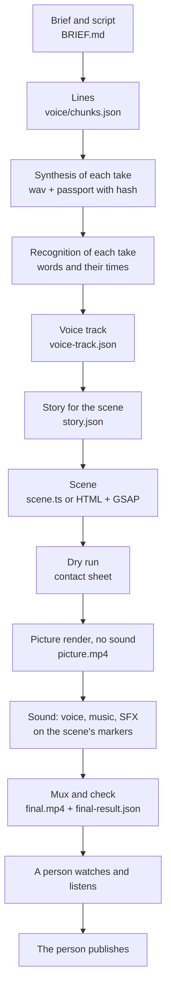

# 00a. How it works: a video as a program


This kit has a backstory, and without it you can't see why it's built the way it is.

First we built our own engine. It was called Pygmalion, and its idea was the same as the whole kit's: an agent makes a
video with code, not with a mouse in an editor. Over the summer we took a lot of hits on it. Synthesis swallowed the
first word and clipped tails, stress drifted, the animation fell out of sync with the voice after every edit, every
check was green on videos nobody finished, and the templates produced identical pictures.

While we were at it, big teams shipped the same thing. Diffusion Studio made a video editor for agents where a project
is a folder of code. HeyGen open-sourced HyperFrames: a scene in HTML, rendered in a windowless browser. By the end of
September HyperFrames had about 53 thousand GitHub stars, and add-ons like Hypit had already grown on top of it. The
engine we had spent months writing became a commodity, built by people for whom it's the main job.

On 7 September 2026 this became visible on a single video. It was built twice in one day. The plot is simple: someone
asks a neural network to free up their Friday, and it wipes out the whole week. The Diffusion Studio version came out
with the takeaway as text on screen only: the scene adapter was built for three lines, the fourth didn't fit, and the
channel's author answered "not fully voiced". That evening the same story was built on HyperFrames, taking the voice
and the checks from Pygmalion. All four lines made it in, loudness came out at −15.8 LUFS, and the author liked it.
Three days later it came out as ["Asked an AI to free up my Friday"](../../examples/free-friday/README.en.md).

The conclusion was unpleasant but useful. Our value isn't in the engine. It's in what sits on top of it: how to handle
Russian synthesis, how to tie the picture to the voice, what to measure in the finished file, how a frame has to look
and move for people to watch it, and which videos all of that was tested on. The engine can be someone else's. This kit
is the part on top.

This chapter is about what's under the hood: why a video here is written as a program, which steps it goes through,
what we took from our own engine and from others', and which engine to pick when. The other chapters take apart
individual stages. This one shows how they connect into one system.

You can read the chapter without installing anything. The exercise at the end lets you see every step on your own
machine.

## The main idea: a video is assembled by code

An ordinary video is made in an editing program. A person drags clips onto tracks, moves keyframes, listens, trims.
All the work rests on hand and eye: the person feels where a cut should go.

An agent can't work like that. It has no mouse, and it can't listen to a passage a hundred times. What it does well is
something else: write code, run it, read the measurements and edit text. Hence the main decision of the kit. A video is
described by files: the lines live in JSON, the scene in TypeScript or HTML, the sound in a list of events. The finished
video is produced from them by a program, and it can always be rebuilt.

What that gives you in practice:

- **Reproducibility.** The same sources give the same mp4. If something breaks, you can see which file changed. The
  kit checks this directly: render twice and compare frame hashes.
- **Edits as text.** "Put the card on the word 'Friday'" turns into one line of code. You don't have to remember
  where on the track the keyframe was.
- **Checking by measurement.** The finished file can be measured: loudness, empty stretches of frame, frozen
  passages, whether every word can be heard. For the agent this replaces eye and ear where they can be replaced.
- **The agent sees its own work.** It grabs frames at regular intervals, lays them out on a contact sheet and looks
  at them. That isn't watching the video, but layout problems, overlaps and empty space show up on the sheet.

The decision has a price, and you should know it up front:

- **Every visual idea has to be programmed.** "Something lively would be nice here" is a stock clip and one minute in
  an editor. Here it's a scene somebody has to write. That's the main illness of the first months: videos came out
  static, because motion costs work and a still card doesn't. More in chapters [04](04-image-and-frame.md),
  [05](05-camera-editing.md) and [07](07-assembly-qa.md).
- **Measurements don't tell you whether it's interesting to watch.** Every check can be green on a video nobody will
  finish. The last word always belongs to the person who watches the finished file.
- **You need an environment.** Speech synthesis, speech recognition, a headless browser, ffmpeg. The kit tries to keep
  this to a minimum, but you can't do it with no installation at all.

## The whole pipeline

Here is the full path of a video from idea to publishing. Each arrow is a file one step hands to the next.



Let's walk through the steps. File names come from [starter/](../../starter/README.en.md); in the main pipeline they're
nearly the same.

**1. Brief and script.** Before any code, you write down the exact lines, what the viewer sees at each moment and
what they get at the end. This rule grew out of a failure: a copy of a successful video was built on the same skeleton
without showing the script first, and it was called slop. The script is shown to a person before assembly, because
rewriting a paragraph is cheaper than rebuilding a video. Ideas and scripts are covered in chapters
[01](01-idea-hook-script.md) and [02](02-text-humanizer.md).

**2. Lines.** The script is cut into pieces, and each is synthesized separately. In `voice/chunks.json` every line
has its text, the pause after it and the synthesis engine. Separate pieces let you redo one phrase without touching
the rest: synthesis sounds slightly different every time, and regenerating the whole video for one word changes
everything.

**3. Synthesis of each take.** Each line becomes a wav. Next to it goes a passport: the exact text, the engine, the
settings and the file hash. The hash lets the next step notice that the sound changed while the timings stayed old. We
had exactly that bug: a line was rewritten, and the frame showed the words from the previous version. The cache key now
includes the text too. Voice and its traps are covered in chapter [03](03-voice.md).

**4. Recognition of each take.** Each wav goes through speech recognition (Whisper, WhisperX). That's two checks in
one. First, were all the words spoken: synthesis can swallow the first word or clip the tail. Second, at which second
each word is heard. Without those times the scene doesn't know when to show what. You recognize the takes, not the
final mix: the mix has music and effects, and recognition lies there.

**5. Voice track.** The takes are joined into one track with pauses. The result is `voice-track.json`: where each
line starts and at which second each word falls in the whole video. From here the video's length is known: the voice
sets it, not the scene.

**6. Story for the scene.** The renderer builds `story.json`. It holds the frame size, frame rate, duration, lines
and words. The scene reads nothing else. If the voice changed and `story.json` wasn't rebuilt, the render stops: the
wav hash won't match the passport.

**7. Scene.** This is where the picture lives. It's code that draws a frame for a time `t`. Every event in the scene
is tied to words: "the card slides in on the word 'Friday'", not "after 2.3 seconds". Then, after a voice edit, the
picture follows by itself. The scene also hands two things to the sound step: cut times (whooshes go there) and named
markers (sounds by meaning go there).

**8. Dry run.** Before the full render, a frame is grabbed every 0.75 seconds and laid out on a sheet. One minute
instead of a full render, and the sheet shows overlaps, clipped text, empty scene starts. We brought this habit over
from Diffusion Studio, which has a `capture` command. Once a dry run caught, before rendering, two overlapping scenes,
overflowing labels, a clipped sticker and two made-up numbers.

**9. Picture render.** A windowless browser opens the scene, sets the time for each frame, grabs a screenshot and
pipes it to ffmpeg. The result is `picture.mp4` with no sound. Sound is deliberately kept out of the picture render:
that way a voice edit doesn't require re-rendering the picture, as long as the timings didn't change.

**10. Sound.** Voice, music and effects are mixed separately. Music comes with an open license and rotates: one track
on every video in a row gets old fast. Effects land on the scene's cuts and markers. Loudness is brought to −15 LUFS ±1
with a peak ceiling. More in chapter [06](06-sound-captions.md).

**11. Mux and check.** Picture and sound are joined into `final.mp4`, and the check writes `qa/final-result.json`.
There are three statuses. `technical_failed` means something measurable is broken: loudness, duration, a missing
word. `preview_partial` means some checks were skipped: beeps stand in for the voice, or recognition didn't run.
`ready_for_user_preview` means everything measurable is fine and the video can be shown to a person. That status is not
approval of the video.

**12. A person.** Someone watches the whole video and listens. Only they decide it can go out.

**13. Publishing.** The person publishes. The agent prepares the title, description and publishing checklist, but
uploads nothing itself.

The pipeline looks long, but on a prepared machine the starter demo builds in about two minutes. Building isn't the
slow part, redoing is. The pipeline exists so that a redo costs one command.

## The contract: the frame depends only on time

Everything else rests on this rule. A scene is built as a function: time `t` goes in, a frame comes out. The scene
remembers nothing between frames, doesn't know real time, and its randomness is seeded.

In the [starter](../../starter/scene/scene.ts) this is the `window.setTime(t)` function. The renderer calls it in
turn for `t = 0, 1/30, 2/30…` and grabs a screenshot after each call. In [starter-lite](../../starter-lite/README.md)
and in HyperFrames the same thing is done with a paused GSAP timeline: the engine scrubs it to the right second and
grabs the frame.

Why not record the screen while the animation plays? Because the browser doesn't have to keep up. With screen
recording, a heavy frame drops and the video stutters. With frame-by-frame rendering the browser can take a whole
second on one frame, and in the video it still takes exactly 1/30. That's also why a render can be repeated: the same
code gives the same bytes.

The contract makes all the checking possible:

- **You can get any frame without playing the video from the start.** Dry runs, contact sheets, the stillness check
  and the frame-fill measurement all rest on this.
- **The preview matches the render.** If the scene has `Date.now()` or an unseeded `Math.random()`, particles fly
  one way in the preview and another way in the mp4. Hand-held camera shake also has to be computed from `t`, for
  example as a sum of sines. `tools/lint/motion_lint.py` flags these things right in the scene code.
- **Physics is run from zero to `t` with a fixed step.** Otherwise each frame comes out "almost" the same, and the
  motion jitters.
- **The engine can be swapped.** Canvas, HTML with GSAP, three.js and even generative video inserts live in one
  pipeline because they keep the same contract.

Technical details and traps, like a tween that outlives its scene, are in chapter [07](07-assembly-qa.md).

## Time comes from the voice

The second rule of the kit: the stopwatch belongs to the voice. The scene doesn't decide how long a line lasts; it
learns that from recognition.

Why this way and not the other? We tried the other way. If you make the animation first and then fit the voice to it,
you have to stretch or squeeze the synthesis. A sped-up clone starts sounding like a robot, and a stretched one
drifts. We now keep synthesis speed at 1.0 and leave it alone. If the voice needs more time, the scene gets more time.

In practice, the scene doesn't say "at 2.3 seconds". It says something like this:

```ts
const E = { kod: wt(0, 'кода'), bez: wt(0, 'без'), montazh: wt(0, 'монтажки') };
```

`wt(0, 'кода')` means "the time when the word 'кода' is spoken in line 0" (the demo is in Russian). You rewrite the
line, resynthesize, and every event moves along with the words. If the word is no longer in the line, the helper fails
with an error instead of returning zero. A silent zero once cost us a whole scene: it simply vanished, and no check
noticed.

Captions come from the same word times, so they match the speech without manual fitting.

## History: our engine, other people's engines, our know-how

The current setup wasn't designed up front. First came our own engine, then two others. Below is what we took from each.

### Pygmalion: our own engine (June–August 2026)

The author's first engine, a private repository. The idea was ambitious: give it any text (an article, a list, a
process description, a podcast topic) and the engine makes the video by itself. A local language model via Ollama
wrote the script and picked one of thirteen genres, the visual plan was laid out across twenty-nine HTML templates,
the voice came from edge-tts or a clone, WhisperX gave word times, Playwright rendered frames, ffmpeg assembled them. On
the outside sat an MCP server with 79 tools so an agent could drive it all.

The hits we took on it:

- **The edit loop was slow.** Change the script JSON, wait for a preview at 3–6 seconds per frame, then render.
  Nothing could be adjusted visually.
- **Templates gave the average.** Twenty-nine templates for every occasion produced videos that looked alike. A
  template that writes and lays out by itself gives you the average, and nobody watches the average. It's no accident
  that one of the first published videos was about exactly this: "In AI video, you have to break the template".
- **There was no timeline.** On 2 July it was decided Pygmalion wouldn't build one: the door to the editor had to be
  one-way, a script gets exported to an editor and nothing syncs back.

We let the engine go, but this is what stayed and still lives in the kit:

- **The "frame as a function of time" contract.** Pygmalion's templates were already `renderAt(t)` functions. Back
  then it was an implementation detail; now it's the kit's main rule.
- **The Russian voice.** Handling stress, brand names, the voice clone. For a long time the main pipeline synthesized
  voice by importing code straight from Pygmalion.
- **Word times from recognition** as the source of the stopwatch.

When other engines appeared, we put two of them to work.

### Diffusion Studio: a video editor for agents (September 2026)

Diffusion Studio came out on 7 July 2026. It's a video editor built with agents in mind: a project is a folder of JSX
code, and changes on the canvas are written back into the code. On the outside there's a command line, `dapi`:
`check` validates a composition, `capture` grabs frames into contact sheets, `export` renders an mp4. The core is open
under MPL-2.0; the app ran only on Apple Silicon Macs.

The first two published videos were built on it: an eleven-second loop, "In AI video, you have to break the template",
and a twenty-second comedy, "A little bigger", about a small button edit someone asked an AI for. It worked like this.
The scene source lived in `design.tsx.txt`, a `build.mjs` script turned it into a composition, and `dapi` checked it,
grabbed frames and exported the picture. Sound was assembled separately in Python and dropped into the finished video
without re-encoding the picture.

What we took from it:

- **A contact sheet before rendering.** `dapi capture` showed that it helps an agent to look at frames laid out on a
  sheet. Now it's a required step for every video.
- **Picture separate from sound.** In the Diffusion versions the shared audio was deliberately kept out of the JSX so
  a voice edit wouldn't break the render. That rule stayed.
- **Source separate from generated output.** You edit `design`, and the generated file gets overwritten. The starter's
  `scene/scene.ts` and `build/scene.js` work the same way.

Why it didn't become the main engine:

- **Mac only.** Rendering on a Linux machine or in CI was impossible.
- **An early version.** Version 0.2xx; the JSX API could change. The reference had to be read from the installed app
  itself, not from memory.
- **Cloud features for credits.** Transcription, "listening" and generation went through their server. We didn't use
  them, because we had all of that locally, but a good share of the editor's features stayed out of reach.
- **No Russian voice.** It had to be made outside anyway.
- **A simpler solution showed up the same evening.** The Friday video on HyperFrames came out more complete and the
  author liked it, while the Diffusion version of the same story stayed half-voiced.

The bridge idea from 7 September stayed on paper: export the script and scene clips into a Diffusion Studio project as
a desk for manual finishing. It has value if you ever want to nudge something by hand on a canvas. But in two months of
work that need never came up: editing as text turned out faster.

### HyperFrames: a scene in HTML, rendered in a headless browser (since 7 September 2026)

[HyperFrames](https://github.com/heygen-com/hyperframes) is an open engine under Apache-2.0: the scene is written in
HTML and CSS, animated with a GSAP timeline, and the engine scrubs the timeline frame by frame in headless Chromium and
assembles an mp4. A composition is marked up with attributes like `data-composition-id`, `data-start`,
`data-duration`, and the timeline is registered in `window.__timelines`. Look at any file in
[`starter-lite/compositions/`](../../starter-lite/README.md): the whole contract fits in a few lines.

Why it won:

- **Ordinary web technology.** An agent knows HTML, CSS and GSAP better than any video format. There's no new
  scene-description language to learn.
- **Checking out of the box.** `hyperframes check` validates the composition, including text contrast. When we moved
  the videos to a light palette, it immediately produced thirty warnings: the grey inactive caption words on a light
  background gave contrast between 1.9:1 and 2.6:1.
- **It runs without a window, and the engine itself isn't tied to the Mac.** We haven't tested it on Linux, though.
- **It doesn't impose a look.** There are no templates; the scene is empty until you write it. That's a minus for a
  beginner, but it's exactly why the videos don't come out alike.

On top of the engine, the main pipeline grew a shared layer: synthesis and checking of takes, retiming to the voice,
the sound mix, the final check. Each video became its own production folder with its own scene, and the shared parts
live in one place.

One HyperFrames lesson is worth telling on its own. The same day, the author said the first three videos on it were
"angular, with primitive animations". The breakdown found something unpleasant: the HyperFrames repository clone held a
whole expressiveness layer. More than fifty motion rules with code, a closed-form spring easing, the doctrine "smooth
beats bouncy, at least three different easing characters", and thirteen ready techniques. We simply hadn't read it.
The engine does exactly what the scene says. If you write a scene without knowing how good motion works, you get a
jerky slideshow, and the engine isn't to blame.

Later a library of 406 ready motion cards from an open MIT-licensed teaching kit was added, recolored to the channel's
palette with a single tokens file. Eighty of them are marked as forbidden: they're slides.

## The engine took one evening, the grammar took two months

This is the most important takeaway of the whole story. Choosing the engine took one evening on 7 September.
Everything after that went into something else: what a frame should look like, how it should move and how to check
it. The engine didn't change during that time. The grammar did, that is, the set of rules a scene is written by.

Each step below was caused by a specific rejection.

| When | What was said | What changed |
|---|---|---|
| 9 September | "Feels like a presentation" | Removed the title, diagram and footer. One frame, a hero in it, no chrome |
| 10 September | A drawn car: "why not take a picture of the real one" | Real objects are shown in real photos with an open license |
| 19 September | A twenty-minute course retelling: "the illustrations are static" | Animation by word, typing in a terminal, the camera changes framing from 0.96 to 1.55 instead of a 6% push-in |
| 25 September | "The picture just hangs there and gets in the way" | A two-zone layout reads as a slide. Full-screen frame, framing changes by cut |
| 26 September | Measured: 22% of runtime was empty background while checks were green | The camera follows the content, frame fill is measured on the finished mp4 |
| 28 September | "There's no motion design" | Reel grammar: 60 frames per second, kinetic type, a persistent HUD, photo backgrounds per chapter |
| 12 October | Needed fast, reels of 15–40 seconds | A scene template in TypeScript and Canvas, live background, hand-held camera |
| 21 October | Wanted the trending 3D-skit format | Characters in three.js; the speech envelope is smoothed, or the models jitter |
| 23 October | Looking for visuals that don't look synthetic | Period styles: 1930s cartoon on Canvas, a 1950s educational film from archive footage and generative inserts, a game cutscene in three.js |

One number sums up the table. The two-minute long ["The agent said the tests
passed"](../../examples/agent-cheats-long/README.en.md), built on the reel grammar, filled 78% of the frame (median, on
the finished video). The long on the old grammar had 24%. Same engine.

Another example with the same conclusion. The kit's most-viewed video, [the TV without
ads](../../examples/tv-no-ads/README.en.md), is a 2D Canvas scene without a single generative insert: the TV is drawn in
code, a terminal types commands. On Instagram it got 792 thousand views (measured 24.10.2026). It didn't need an
expensive engine.

## The value on top of the engine

Put it all together and you get this. There are now several engines that render a scene from code, and they're built
by teams for whom that's the main product. Competing with them on the engine makes no sense. But the traps you hit when
you make real videos on such an engine are the same for everyone, and no engine ships answers to them.

Here's what we carried away from our hits. Each row is something the engine doesn't have and that had to be worked out
on actual videos.

| Hit | What we found | Recipe |
|---|---|---|
| Synthesis puts stress in the wrong place | Stress marks don't help; replacing the word does | [voice-stress-by-rewording](../../recipes/voice/voice-stress-by-rewording.md) |
| Synthesis swallows the first word | The first word is made sacrificial | [voice-f5-sacrificial-first-word](../../recipes/voice/voice-f5-sacrificial-first-word.md) |
| Synthesis clips the end of a line | A sacrificial word at the end and a check of the last fraction of a second | [voice-f5-tail-sacrificial-word](../../recipes/voice/voice-f5-tail-sacrificial-word.md) |
| Missing words can't be heard in the mix | Recognize every take separately | [qa-asr-per-take](../../recipes/qa/qa-asr-per-take.md) |
| The picture drifts from the voice after an edit | Scene events hang on words | [assembly-word-anchored-animation](../../recipes/assembly/assembly-word-anchored-animation.md) |
| The preview doesn't match the render | The frame depends only on time; randomness is seeded | [assembly-deterministic-timeline](../../recipes/assembly/assembly-deterministic-timeline.md) |
| The frame shows words from the previous version of a line | The cache key includes the text | [captions-cache-key-text](../../recipes/captions/captions-cache-key-text.md) |
| Checks are green, but it's boring to watch | Frame fill is measured on the finished mp4 | [qa-frame-fill-mp4](../../recipes/qa/qa-frame-fill-mp4.md) |
| Layout bugs are found after the render | A dry frame review before rendering | [qa-dry-frame-review](../../recipes/qa/qa-dry-frame-review.md) |
| A technically ready video is taken as approved | A green status doesn't mean "ship it" | [qa-green-is-not-approval](../../recipes/qa/qa-green-is-not-approval.md) |

The kit has more than a hundred and forty rows like these, collected in [recipes/](../../recipes/README.md). None of
them is tied to a particular engine: they work on HyperFrames, on Canvas, on three.js, and they'll work on the next
engine somebody ships.

## Which engine to pick when

All the options below keep one contract and fit into one pipeline. The choice depends on what has to be in the frame.

| Engine | When to pick it | Where in the kit | Where it breaks |
|---|---|---|---|
| HTML + CSS + GSAP (HyperFrames) | Kinetic type, interfaces, cards, infographics, terminal typing | [starter-lite](../../starter-lite/README.md) | Complex graphics and thousands of objects slow the render. Browser-dependent effects are unstable |
| TypeScript + Canvas | Objects drawn in code, fast single-file scenes, full control over every pixel | [starter](../../starter/README.en.md), [the TV](../../examples/tv-no-ads/README.en.md) | Text layout has to be computed by hand; line breaks and fonts are on you |
| three.js | Characters, 3D skits, scenes with a camera in space | [the Instagram skit](../../examples/instagram-to-claude-skit/README.en.md) | Models made of primitives look like a prototype. Faces and mouths need a smoothed signal |
| Generative video (LTX and similar) | 2–4 second inserts: a person in frame, an atmospheric shot, stylization | chapter [04](04-image-and-frame.md) | Can't carry a whole video: the face drifts mid-clip, details float. We don't generate real people |
| Archive footage | Period stylization | chapter [04](04-image-and-frame.md) | The license has to be checked for each clip separately |
| Diffusion Studio | You need to nudge something by hand on a canvas, working on a Mac | not used in the kit's code | Mac only, early version, some features are cloud-based |
| Remotion | We don't use it | not used | The license is free only for individuals and small teams |

If you don't know where to start, take HTML and GSAP through starter-lite. It's the shortest way to see how the engine
turns a scene into video. When you need voice and checking, move to the starter.

## Where it all lives in the kit

The kit repeats the pipeline at a smaller scale so you can run it on one machine.

| Pipeline step | File or command in the starter |
|---|---|
| Brief | `BRIEF.md` |
| Lines | `voice/chunks.json` (what is spoken), `voice/lines.json` (what is on screen) |
| Synthesis of takes | `./make.sh voice`, or `./make.sh live` for your own recording |
| Placeholder voice for a trial | `./make.sh fake`: beeps instead of speech, to check assembly without models |
| Scene | `scene/scene.ts`, built into `build/scene.js` with `./make.sh scene` |
| Dry run | `./make.sh frames`, sheets in `qa/frames/` |
| Sound | `./make.sh sound`; music is set in `reel.json` |
| Picture render | `./make.sh render` |
| Mux and check | `./make.sh finish`, result in `qa/final-result.json` |
| Everything at once | `./make.sh all` |
| Rollback | `./make.sh checkpoint save NAME` and `restore NAME` |

Heavy steps go through the `locked.py` lock. That's not a formality. When several agents on one machine ran synthesis,
recognition and rendering at the same time, memory ran out and everything crashed. Heavy work runs one job at a time.

## What stays with the person

The pipeline takes everything measurable off the person. The decisions stay with them:

- **Approve the script** before assembly.
- **Listen to the voice.** Recognition confirms the words were spoken, but not that they sound good. Stress on the
  wrong syllable or a dead intonation passes every check.
- **Look at the frames.** Green checks don't mean the video is interesting to watch. A twenty-minute video with perfect
  measurements was called static.
- **Say "ship it" and post the video.** Only they publish.

Good agent work in a pipeline like this looks like this: it shows the path to the mp4, the duration, the hash, the check
status, and states honestly what it saw and heard itself and what remains unchecked.

## Exercise

30 minutes. The first part needs neither Python nor models.

1. Open [starter-lite](../../starter-lite/README.md), run `npm run dev` and look at the preview. Open
   `compositions/hook.html` and find the line with `gsap.timeline({paused:true})`. That's the scene as a function of
   time: the timeline sits paused, and the engine scrubs it itself.
2. Change the duration of one tween and the text in `h1`, then run `npm run render`. See what changed in
   `output/first-video.mp4`.
3. Save a copy of the video, run `npm run render` again without changing anything, and compare the frames of the two
   files: `ffmpeg -i output/first-video.mp4 -f framemd5 -` for each. The frame hashes should match. The whole-file hash
   can differ because of container metadata, so compare frames. If the frames differ, find what in the scene depends on
   more than time.
4. If you have Python, go to the [starter](../../starter/README.en.md) and run `./make.sh fake`, then `./make.sh frames`.
   Open the contact sheet in `qa/frames/` and find the frame where each line appears.
5. Open `scene/scene.ts` and find the `E` object with its `wt(...)` calls. Move one event to another word in the same
   line, run `./make.sh frames` again and find on the sheet where it moved.
6. Sketch on paper the pipeline for your own future video: which steps you need and which you can skip. For example,
   no synthesis if you read the lines yourself.

## Don't

- Don't record the screen instead of rendering frame by frame.
- Don't use real time or unseeded randomness in a scene.
- Don't fit the voice to the animation. Fit the animation to the voice.
- Don't hang events on seconds. Hang them on words.
- Don't bake sound into the picture render.
- Don't run recognition on the final mix instead of the takes.
- Don't expect a new engine to cure static videos. Frame grammar cures them.
- Don't mistake `ready_for_user_preview` for approval.
- Don't let the agent publish. The person publishes.
