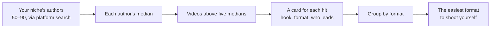
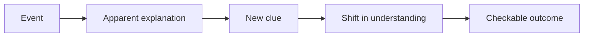

# 01. Idea, hook, script

"So. This guy sets up Netflix for his parents, and the TV shows him an ad first. On his own TV."

That's how a video opens that got 212 thousand Instagram views and 7,515 likes on its first evening, and 21,496 likes
and 257 comments by the next day ([breakdown](../../examples/tv-no-ads/README.en.md),
[YouTube](https://youtube.com/shorts/Ma8Wsotaj2Q)). Other reels from the same account in the same days got 58–400.

Look at what's in that first line. No "AI". No project name. No "today I'll tell you". There's an everyday grievance:
ads on your own TV. And there's a twist: "on his own TV" sounds like a personal insult, not a technical detail. Twenty
five seconds later the viewer sees a big "deleted: 0", and the main fear ("will I break my TV?") is gone. The ending:
what to do and how long it takes, 15 minutes.

The video wasn't made up out of thin air. The rhythm comes from someone else's hit in the niche, the words are ours.
The topic comes from an open-source project, but it's told as a story about parents and a TV. Each of these decisions
can be repeated, and this chapter is about them.

## Start from a situation, not a tool

**Problem.** The most natural video for someone who knows a tool well is "how to install X". We made plenty. Narrow dev
tutorials and clips cut from long videos got the fewest views on our channel.

**How we saw it.** A snapshot of 39 of our YouTube shorts. The channel ceiling is 1.0–1.3 thousand. On top: "asked an
AI to free up my Friday" (1,307) and a meme video with our mascot (1,017). Tool How-Tos: from 2 to 400. Shorts cut
from a long video: from 1 to 17. Long course retellings: 32–79. The gap between a situation and a tutorial is an
order of magnitude. Niche research shows a similar picture: among 936 Western channels, not a single AI tutorial beat
its author's median five times over (how the channels were selected isn't described).

**What we do.** Two working formulas. One: "asked an AI for X, got something absurd". An everyday pain (a call, an
email, a calendar) and a literal execution pushed all the way to disaster. Two: a genre world. A courtroom, a cash
register, noir, a messenger, a pager, a TV show. In a world like that, numbers live inside objects: on a scoreboard,
on a receipt, in a court record. Out of a batch of ten videos set in different genre worlds, five got the top rating.
The "TV show" one came out limp, another one "a bit boring". The tool shows up at the end as the solution, not as the
topic.

The check before you build: retell the video to a friend in one sentence without naming the tool. If you can't, you
have a tutorial.

**Where it breaks.** The "top N" template works for real lists: hotkeys, commands. Stretched over a topic that isn't a
list, it produces slop. And even an honest list pulls weakly: our "three keys" video got pennies.

Agent recipe: [idea-everyday-absurd](../../recipes/idea/idea-everyday-absurd.md)

## Ideas from hits picked by median

**Problem.** People invent ideas out of their heads or from the news. A news item without a proven format is still a
hypothesis, and the video collects its usual few hundred views.

**How we saw it.** We built a slice of the niche: 92 candidates, 65 authors with enough history. Absolute views lie:
on a big account, any video is "big". So a hit was a video that got at least five times its author's median and at
least 100 thousand views. We found 115 of those and downloaded 106. An interesting detail: 62 of the 106 hits were
made without a face. Who leads the hits: a face in 44 videos, an AI character in 34, text and music only in 17, a
voiceover in 11.

The TV video was built on the format of one of those hits. You saw the result above.

**What we do.** Gather 50–90 authors in your niche using the platform's own search. Calculate each one's median. Pick
the videos above five medians. Make a card for each: hook, format, who leads, how hard it is to shoot, call to action,
whether you can repeat it. Group them by format and pick the easiest ones to shoot yourself. From then on the rule is:
any new idea equals a news item or your own topic plus a specific hit to model it on, with numbers.

A day after publishing, compare your video with your own median, not with the hit. The hit belonged to another person
with another audience.

**Where it breaks.** Counters are public and rounded, there's no retention data, and correlation doesn't prove cause.
About 15 of the 115 hits turned out not to be about the niche at all, just everyday posts by the same authors: tag
those by hand. And a format lives for about a week: after the second copycat, the plot is taken.

Agent recipe: [idea-find-hits-by-median](../../recipes/idea/idea-find-hits-by-median.md)

## Remake the rhythm, not the words

**Problem.** You found a hit and want to repeat it word for word. A verbatim copy risks a platform penalty for
unoriginal content and accusations of theft. And a video "inspired by" loses the thing that worked: the rhythm.

**How we saw it.** The first draft of the TV video repeated four lines from the original. We rewrote them in our own
words, keeping only the structure: the hook, line lengths, where the cuts and pauses fall. The remake got 212
thousand. Breaking down seven hits showed one more shared trait: in every one, the first word lands at second zero.

**What we do.** Take the hit apart second by second: contact sheets at four frames per second, cuts via a scene
detector, loudness, a transcript with per-word timecodes. Put the text into a table: line number, length in words,
role (hook, loop, example, punch, call to action). Write your own text into the same table: same role, line length
±1 word if the line is up to five words, otherwise ±20%. The example, the numbers and the punch are yours. Finish with
a machine check: the longest shared word sequence with the original is no longer than two words, and those are
function words.

**Where it breaks.** The same remake got between 1 and 328 on YouTube and TikTok: a format from one platform doesn't
carry over automatically. Two remakes of business hits built on a made-up "store example" were rejected outright:
rhythm doesn't save you if there's no living story or real result inside. And keep frames from other people's videos
to yourself; don't put them in a public repository.

Agent recipe: [idea-remake-rhythm-not-words](../../recipes/idea/idea-remake-rhythm-not-words.md)

## A guessing game instead of a tutorial

**Problem.** For a tool (a voice clone, a text "humanizer"), people shoot an install guide. In this niche those videos
consistently lose to videos that pull the viewer into a game.

**How we saw it.** Voice cloning videos on YouTube: guessing games have a median of 3.7 thousand, tutorials 787.
Almost five times more. For AI-written text the gap is even bigger: "I can spot AI text instantly" exposés reached
hundreds of thousands, install tutorials stayed at 4 thousand and below. Our "spot the AI text" video got 989 on
YouTube and 530 on TikTok in its first day, close to the channel ceiling.

**What we do.** Make the viewer a participant: "guess which one is my voice", "these words give away AI text". The
answer comes at the end, ideally with a twist. In ["Guess which one is my voice"](../../examples/guess-my-voice/README.en.md)
the twist is that the clone spoke the whole video except for one line. The "how to do it yourself" part goes into the
last seconds or into the code-word material.

**Where it breaks.** The twist has to be true. Don't repeat unverified claims from other people's hits like "100%
human": an exposé only works if it's honest.

Agent recipe: [idea-guess-over-howto](../../recipes/idea/idea-guess-over-howto.md)

## A hook at second zero

**Problem.** The video opens with an intro: "soon a robot will be interviewing you", "TikTok says you should", "I asked
an AI". That's a lecture. The viewer scrolls on before getting to the point.

**How we saw it.** Two openings with an intro in a row were rejected with "the opening is a bit weak". Hits from the
same week in the niche (up to 710 thousand) opened straight with the disaster: "I deleted the database…". In seven
hits we broke down, ranging from 178 thousand to three million, the first word lands at 0.0 seconds. Meanwhile our long
video ["The agent said the tests passed"](../../examples/agent-cheats-long/README.en.md), the author's favorite, wastes
its first second: the voice comes in at 3.4 seconds.

**What we do.** The first line at 0.0 seconds, one of three types. Result as spoiler: "got past an AI recruiter thanks
to one invisible line". Scandal or secret: "while you sleep, we talk about you". Intrigue with an object: "nothing is
open, and the laptop is screaming". Context at seconds 3–5, not earlier. If you open with a conditional ("if you…"),
rewrite it as a statement.

Design the first second on three tracks at once: the picture shows something strange, the voice adds the conflict, a
short caption helps people get it without sound. Don't make all three repeat the same line. And the voice comes in no
later than 0.45 seconds: after that fix (together with a hit in the first second), one of our videos was approved and
posted on three platforms.

**Where it breaks.** A hook that promises more than the video delivers breaks trust. First the real result, then a hook
that fits it, not the other way around. And the 0.45 seconds figure comes from one video; it's not a retention
measurement.

Agent recipe: [hooks-result-in-first-second](../../recipes/hooks/hooks-result-in-first-second.md),
[hooks-voice-by-045](../../recipes/hooks/hooks-voice-by-045.md)

## Someone else's claim in the hook, your own refrain at the end

**Problem.** Without a face and without a character, a video sounds like a faceless announcer. Nothing to argue about
in the comments and no recognizable signature.

**How we saw it.** A breakdown of an author with a median of 311 thousand per video: an opponent's claim as the hook
in 6–7 hits out of 8, the same closing line in all 11 transcripts, and "camp" topics (one model versus another)
getting 1.4 times more comments per view. Our [DeepSeek video](../../examples/deepseek-headlines/README.en.md) is built
this way: "China beat GPT again. Heard that? I hear it every couple of months." Recognition puts the author on the
viewer's side. 1,196 views, one of the channel's three best shorts.

**What we do.** Hook: a confident claim someone else made in your niche, quoted with a link, not invented. A short
reply: "let me show you". Proof on screen. Always end with the same line; it works as a signature better than a brand
bar. In the [video about finding a location from a photo](../../examples/photo-geo-blind-test/README.en.md), the hook is
"bloggers say it finds the spot from a single photo within two meters", followed immediately by "I tested it, blind".

**Where it breaks.** That author has a live face and voice; the technique hasn't been tested without a face. The
borrowed piece in the hook has to stay within quotation: a short fragment and a link to the source.

Agent recipe: [hooks-foreign-thesis-refrain](../../recipes/hooks/hooks-foreign-thesis-refrain.md)

## One open loop

**Problem.** The video explains the cause right away, and by second six there's no question left to stay for. Or the
opposite: the hook promises one thing, and the ending delivers a moral instead of an answer.

**How we saw it.** A hit with 269 thousand views that we broke down: in the first 3.4 seconds, a price and "an
employee who never sleeps"; by 6.5 seconds, the promise "there are three catches, but first, how it works". The
catches themselves start at second 86, so the answer is held back for almost 80 seconds. The punch comes at second
130, as a one-line definition. In our long video about tests, the promise lands at second 19, and the ending hands
over a settings line the viewer can paste right away.

**What we do.** One specific question in the hook. Each next shot brings a new clue or raises the stakes; cut anything
that restates the obvious in other words. The ending pays out exactly what was promised: a line of code, a test
result, a before-and-after value. The check: write the hook's question and the final line side by side. Does the
second answer the first?

**Where it breaks.** A long 139-second loop conflicts with the "reels under 40 seconds" rule. Short version: hook,
three catches at one line each, punch. And this is an observation from a single hit; causation isn't proven.

Agent recipe: [hooks-open-loop-payoff](../../recipes/hooks/hooks-open-loop-payoff.md)

## One example, under 40 seconds

**Problem.** You want to tell an honest experiment in full: methodology, accuracy tables, four blocks of numbers with
caveats. The video stretches past two minutes, and the funny examples drown.

**How we saw it.** A rejected 2:11 video. Seconds 8 to 19 explained the methodology, half the frames were tables and
bars. The verdict: "it's all really bad, from what the visuals mean to retention". For comparison, the Friday video is
20 seconds long and has four lines.

**What we do.** One example equals one video; the other examples go into the next videos. The punchline in the first
seconds, the methodology in the description. No tables, no bars, no tiny prompt text on screen. Model names that mean
nothing to the viewer come out of the voiceover. The check: retell the video in one sentence. If it contains "and
also", you have two videos.

**Where it breaks.** Length by itself isn't a death sentence. In a sample of 102 viral reels, the median length is 63
seconds, and 28 videos run longer than 90. The limit protects you from lecturing, not from length: a video with one
open loop can run longer.

Agent recipe: [idea-one-example-short-reel](../../recipes/idea/idea-one-example-short-reel.md)

## Script before build, and the knowledge chain

**Problem.** The agent builds the whole video, you only see it finished, and you say "slop". An hour of synthesis and
rendering went into an idea you could have thrown out after three lines.

**How we saw it.** A video that passed 15 green automated checks was rejected anyway. A twenty-minute course retelling
was built without a test piece, and only the finished video revealed that the picture was static. Three videos in a
row on the same skeleton were called "slop", even though each was technically clean on its own.

**What we do.** Before the voice, show a 3–5 line script, the first frame, and one storyboard. Build after you get an
"ok".

Before writing prose, lay out the viewer's knowledge chain: an event, an apparent explanation, a new clue, a shift in
understanding, a checkable outcome. Then the swap test: swap two neighboring shots. If the causality didn't break, you
have a list of illustrations, not a story. The ending has to answer exactly the question from the first frame.

**Where it breaks.** The method comes from studying screenwriting material and platform documentation; its effect on
retention hasn't been measured on our videos. It works as a filter, not a guarantee.

Agent recipe: [idea-script-before-build](../../recipes/idea/idea-script-before-build.md)

For the shape of the lines, a five-beat skeleton helps: hook at 0.0 s, the mistake everyone makes, what actually happened with a number, three steps, a twist with a question and the keyword; a timestamp on the hero ("DAY 1 · 18:04") when the trouble grows over time. It is a hypothesis, inspired by a breakdown of the Kylo AI format: [idea-five-beat-skeleton](../../recipes/idea/idea-five-beat-skeleton.md)

## Don't repeat your own hit

**Problem.** A video works, and the next one gets built the same way: same background, same card, same circle with a
character. Viewers recognize the assembly line.

**How we saw it.** The video ["AI gives itself away, and not with «стоит отметить»"](../../examples/ai-text-tells/README.en.md)
[«стоит отметить» is roughly "it's worth noting", a classic Russian AI-text tell] worked. The follow-up on the same
skeleton, a day later, was called "slop". The second version of ["3 keys"](../../examples/three-keys-repeat/README.en.md),
posted the same day as the first: 3 views on YouTube and 0 on TikTok. The next batch of five videos, each in its own
visual world: three top ratings, one "format's okay", one "a bit boring". Every language has its own AI-text tells;
for language-specific pitfalls, see [gotchas/lang](../../gotchas/lang/README.md).

**What we do.** After a successful video, look for a new living situation, not new text for the old skeleton. Every
video in a series gets its own visual world; only the character and the refrain stay shared. The check: put a frame
from the new video next to a frame from the last one. Could you mix them up? Same skeleton.

**Where it breaks.** A series with a recognizable frame works if the situation inside changes. You can repeat a
segment format, but not a whole scene.

Agent recipe: [idea-no-repeat-own-hit](../../recipes/idea/idea-no-repeat-own-hit.md)

## Fact-check from day one

**Problem.** The agent confidently writes commands and numbers from memory. A video that "corrects other people's
mistakes" ships with made-up commands of its own.

**How we saw it.** Breaking down someone else's tutorial, we found five mistakes in the original and four of our own
(commands that don't exist and the wrong number of modes). Two of them surfaced halfway through the render. In another
long video, a dry review of 104 frames caught two invented numbers in illustrations and a title card: nobody had
checked the numbers on screen as strictly as the ones in the voiceover. In the video about usage limits, the
fact-check removed four popular claims that would otherwise have been spoken out loud.

**What we do.** Every video gets a fact-check file: every fact in the voiceover and in the frame, with a link to the
primary source. A separate section for "what we must not say". Check commands against the live version of the tool,
not against the model's memory.

**Where it breaks.** Fact-checking doesn't affect retention. It protects you from devastating comments, and that has
its own value.

Agent recipe: [idea-factcheck-file](../../recipes/idea/idea-factcheck-file.md)

## Exercise

20–30 minutes.

1. Open three videos from [examples](../../examples/README.en.md): the TV one, the Friday one, and ["The whole course in
   20 minutes"](../../examples/course-retelling/README.en.md). Write down their first lines.
2. For each, answer: is there an event or stakes? Does it land at 0.0? Does it make sense without naming the tool?
3. Take a topic you've wanted to cover for a while. Write three versions of the first line: result, scandal, intrigue.
4. Pick the best one and write a five-line knowledge chain: event, apparent explanation, clue, shift in understanding,
   outcome.
5. Swap lines 2 and 3. If the meaning didn't break, rewrite the chain.

## Don't

- Don't open a video with "today I'll tell you", "coming up" or "if you".
- Don't make the tool the topic: the tool shows up at the end.
- Don't copy a hit word for word, and don't put other people's frames in a public repository.
- Don't stuff methodology and tables into a reel: one example per video.
- Don't promise in the hook what the ending doesn't deliver.
- Don't build the follow-up to a successful video on the same skeleton.
- Don't trust numbers and commands the agent wrote from memory.
