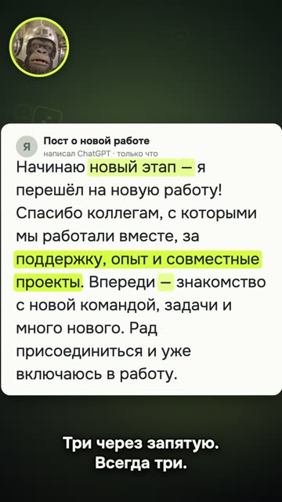
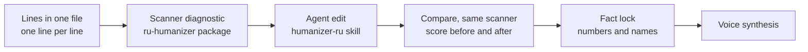
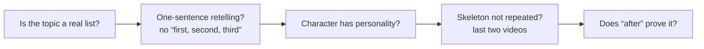

# 02. Text and the humanizer

«Короче. Все ищут в тексте „стоит отметить“. А нейросеть давно палится по-другому.» [“So. Everyone looks for ‘it's
worth noting’ in a text. But AI gives itself away differently these days.”]

The video runs 28.9 seconds ([breakdown](../../examples/ai-text-tells/README.en.md),
[YouTube](https://youtube.com/shorts/p4sU6N8ud4g)). Filling the frame is a real post about changing jobs, written by
ChatGPT honestly, no tricks. The mascot names the tells, and each one lights up exactly on the narrator's word. The
long dash: "can you even find that on your keyboard?". "A new chapter": the person changed jobs, and the AI starts a
new chapter. Three words separated by commas, always three. "Lots of new things ahead, excited to join": that's not a
post, that's a greeting card.

In its first day: 989 views on YouTube and 530 on TikTok. Viewers joked back using the tell itself: comments
consisting of a single long dash.

The example is in Russian, but the tells (em dashes, triplets, stock phrases) show up in most languages, each with its
own local flavor. Your language will have its own quirks: see [gotchas/lang](../../gotchas/lang/README.md).

This video is about how someone else's text gives itself away. But the same thing happens to your script if a model
wrote it and you didn't proofread it. Viewers don't know the word "triplet", but they hear that people don't talk
like that. This chapter is about cleaning text before the voice without breaking its meaning.

One subtle point up front. This same video has a failure, and it's also about text. The ending promises a skill that
"cleans this up", but the skill noticeably edits only some genres. The promise in the call to action was wider than
the real effect. Honest text starts not with clichés but with what you promise.

## Humanizer before synthesis, not after

**Problem.** A script written by a model sounds like a news anchor: "not X, but Y" in every other sentence, lists of
three, "a new chapter", long dashes. If you notice after synthesis, you'll have to re-voice takes and then rebuild the
animation timings that hang on the words.

**How we saw it.** We ran ten scripts for dialogue reels, 45–50 seconds each, through the scanner. All of them landed
in the "clean" band, scoring 92–100. Two of the ten lost eight points to a "choppy meditativeness" penalty: three or
more lines of one to three words in a row, like «Удали. Пожалуйста. Быстро.» ["Delete it. Please. Now."]. We didn't
edit those lines. That's how people talk, and in a dialogue it's normal.

Second observation: on texts from a fresh ChatGPT, editing with the skill makes a visible difference only in some
genres. In one the score went from 77 to 100; in others it stayed at 80 and 80. Clean input leaves almost nothing to
fix.

**What we do.** Put the lines in one file, one line per line, no timecodes or stage notes. Run a diagnostic with the
scanner (the `ru-humanizer` package, built for Russian; use a scanner for your own language). Give the text to an
agent with the humanizer-ru skill and the task: "edit this as a voiceover script, conversational, short sentences,
don't touch the hook or the final call to action". Compare "before" and "after" with the same scanner: the score
before and after, plus a fact lock on numbers and names. Only then synthesize.

**Where it breaks.** The scanner sees words and constructions, but not a formulaic plot (more on that below). The
browser version of the scanner doesn't count nominal style, so its score can be up to 8 higher than the Python
version: for before-and-after comparisons, use the same one. And the humanizer doesn't catch words the synthesizer
mispronounces; that's a separate check (chapter 03).

Agent recipe: [text-humanize-script-before-tts](../../recipes/text/text-humanize-script-before-tts.md)

## Fresh model tells, not old clichés

**Problem.** Lists of AI-text tells go stale. A fresh model hardly ever writes "it's worth noting" or "in today's
world", so the text looks clean, even though viewers still recognize it.

**How we saw it.** We got ChatGPT texts through a clean profile with no custom instructions. The scanner gave them
78–91 without a single "it's worth noting". Other things gave them away: the long dash, "a new chapter", comma
triplets, "ahead", "excited to join". Those exact tells became the stars of the video above. And the fact that
viewers left comments made of a single dash confirmed it: people already see this tell on their own.

**What we do.** Look for what the model leaves behind now. The long dash. Comma triplets ("fast, convenient and
reliable"). "A new chapter", "ahead", "beyond". Polite filler. A grep over the script plus the scanner is enough.
Either remove each match or keep it deliberately.

**Where it breaks.** A dash belongs legitimately in direct speech and in genres where it's the norm: reference,
legal. A triplet can be a genuine list of three things. And this set of tells will go stale too: in six months the
model will give itself away with something else, so test on fresh texts.

Agent recipe: [text-modern-chatgpt-tells](../../recipes/text/text-modern-chatgpt-tells.md)

## Surgical edits instead of "make it livelier"

**Problem.** Ask a model to "make it livelier" and it adds emotions, particles, imagery and conclusions you never had.
The text turns perky but foreign. It picks up claims you can't stand behind, and in a video script they then sound in
your voice.

**How we saw it.** A paired blind run: 13 source texts, three conditions (an editor without the skill, the full skill
with "voice" quotas, a compact local edit), five repeats each. 195 responses and 195 blind ratings. The "voice"
quotas produced a foreign intonation and staged rhetoric. The local edit drew fewer complaints about meaning.

**What we do.** Frame the task as a local edit. The model marks specific spots: the quote, what's wrong, what to do
(keep it, strip the wrapper, say it more clearly, remove the duplicate). No new facts, emotions or imagery. At the
end: there were this many markers, now there are this many. In a diff, a good edit looks like short replacements and
deletions, not new sentences.

**Where it breaks.** The sample is small, and the raters were agents, not people. And if the source is empty of
content, a surgical edit won't save it: you need new text from you, not from the model.

Agent recipe: [text-local-edit-not-rewrite](../../recipes/text/text-local-edit-not-rewrite.md)

## The fact lock: editing must not change meaning

**Problem.** Editing quietly shifts meaning. "Often more important" becomes "more important". "The process of
carrying out the plan" turns into "we carried out the plan". An explanation that wasn't there sneaks in. In a video,
it's spoken aloud and shows up on screen, and by then it's expensive to fix.

**How we saw it.** All of these examples come from the same 195-rating blind editing run. We don't have our own
measurement of what share of errors gets caught, but we saw the shifts with our own eyes, and they look harmless.
That's exactly why they slip through.

**What we do.** After every edit, compare "after" with "before" by machine: the scanner with the `--before` flag
checks numbers with units, dates, names and titles. Read the links between claims by eye along four axes: who did
what, degree of certainty ("may", "usually"), conditions, numbers with units. Not a single "often" may become
"always".

**Where it breaks.** The fact lock compares extracted elements, not logic. It won't notice cause and effect swapped
around the same numbers. That's a job for your eyes.

Agent recipe: [text-fact-lock-before-after](../../recipes/text/text-fact-lock-before-after.md)

## "Clean" by the scanner doesn't mean "a living script"

**Problem.** The scanner catches words and constructions. It can't see slop in the form. A "top 3" template on a
topic that isn't a list, a narrator character with no personality, the third video in a row on the same skeleton: all
of these pass as "clean", while viewers recognize the assembly line in the first seconds.

**How we saw it.** A reel about the humanizer built on a "top 3" template was rated "AI slop". On its script, the
scanner only flagged the quotes; everything else passed. Another reel: five congratulation messages written by
ChatGPT, with the phrase "beyond its limits" in four of the five. The scanner gave 91–98, the "clean" band. The
rating: "slop". Ironically, a video about AI-text tells was itself built from AI-form tells.

And the video from the start of this chapter came right after that "AI slop" verdict. What helped was building it
from a situation ("everyone is looking in the wrong place"), not from the tool's features.

**What we do.** The scanner covers the vocabulary layer. Check the form separately with five questions before you
build. Is the topic really a list? Can you retell the video in one sentence without "first, second, third"? Does the
character have a personality (a reaction, an opinion, a joke), or does it read out bullet points? Was this skeleton in
your last two videos? Does the "after" example prove something, or is it just bland? If even one answer is wrong,
rewrite the script, not the words.

**Where it breaks.** Real lists (hotkeys, commands, install steps) live legitimately in the "top N" format: they pass
the first question honestly.

Agent recipe: [text-scanner-misses-form-slop](../../recipes/text/text-scanner-misses-form-slop.md),
[idea-script-before-build](../../recipes/idea/idea-script-before-build.md)

## Tell the scanner the genre

**Problem.** By default, the scanner treats text as marketing. Reference, legal or news text legitimately uses dashes
and bureaucratic language, and in marketing mode it gets penalized for its own norms. You start "cleaning" things that
don't need cleaning.

**How we saw it.** A false-positive control: three verbatim excerpts from Wikipedia articles with the `academic` genre
scored 89, 92 and 92, all three in the "clean" band. Human text in its own genre shouldn't look AI-generated, and with
the flag it doesn't.

**What we do.** Pass the genre with a flag: `marketing` (the default), `academic`, `legal`, `fiction`, `news`. Keep
video scripts and posts on `marketing`. The check: a text you know is human, in its own genre, lands in the "clean"
band.

**Where it breaks.** The genre doesn't lift the nominal-style penalty, so even a human academic text won't score 100.
Compare bands, not exact scores.

Agent recipe: [text-scanner-genre-flag](../../recipes/text/text-scanner-genre-flag.md)

## The first line as a result

**Problem.** Even a cleaned-up script fails if it opens with an intro. That's the subject of chapter 01, but the
first line usually gets rewritten right here, at the text stage.

**How we saw it.** An example from our own edit. Before: "Soon a robot will be interviewing you". After: "The mascot
got past an AI recruiter thanks to one invisible line". The first was rejected as "the opening is a bit weak"; the
second delivered an event and a result. In the video at the start of this chapter, the hook overturns common
knowledge: everyone is looking in the wrong place.

**What we do.** Cover everything except the first line. Can you tell from it how the video ends, or why it's worth
watching to the end? If not, rewrite: result as spoiler, scandal, or intrigue with an object. If you open with a
conditional clause, turn it into a statement.

**Where it breaks.** If there's no real result, a loud hook becomes a lie. First the result, then the hook.

Agent recipe: [hooks-result-in-first-second](../../recipes/hooks/hooks-result-in-first-second.md)

## Text against the stopwatch

**Problem.** A script looks short on paper, and after voicing the video runs past a minute. You end up cutting
finished takes and breaking the rhythm.

**How we saw it.** Eleven lines of 3.5 seconds each didn't fit into a 40-second video. A 2:11 reel with four blocks of
numbers got "it's all really bad". The DeepSeek video was planned at about 45 seconds and came out at 59, right on the
edge.

**What we do.** One video equals one example. The punchline first, the methodology in the description or a pinned
comment. Count the runtime from voiceover durations before editing: roughly, N seconds of video fit N/4 lines. If it
doesn't fit, cut the text instead of speeding up the voice (chapter 03 explains why).

**Where it breaks.** Length isn't a death sentence: in a sample of 102 viral reels, the median is 63 seconds. The
40-second limit protects you from lecturing, not from length as such.

Agent recipe: [idea-one-example-short-reel](../../recipes/idea/idea-one-example-short-reel.md)

## Exercise

15–20 minutes.

1. Ask your model to write a 100-word post about changing jobs. No custom instructions.
2. Find the dashes, comma triplets, "a new chapter", "ahead" and polite filler by eye. Underline them.
3. Run the text through the scanner: `uvx ru-humanizer post.txt` (for Russian text; for other languages, use a
   scanner built for yours). Compare what you found with what the scanner found.
4. Ask the model to edit the text locally (not "make it livelier"), then compare with the `--before` flag. Did the
   numbers or the degree of certainty shift?
5. Ask yourself the five questions about form. If this were a video script, would it pass?

## Don't

- Don't synthesize the voice until the text has passed the scanner and the fact lock.
- Don't ask the model to "make it livelier": ask for a surgical edit.
- Don't look only for "it's worth noting": a fresh model gives itself away with dashes, triplets and "a new chapter".
- Don't treat the "clean" band as proof that the script is alive.
- Don't "fix" choppy short lines in a dialogue: that's how people talk.
- Don't promise more in the call to action than the tool actually does.
