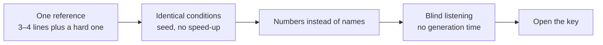
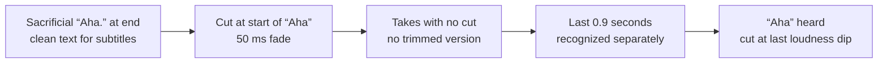

# 03. Voice and TTS

The video "That's what they said about DeepSeek" shipped on the third try
([breakdown](../../examples/deepseek-headlines/README.en.md), [YouTube](https://youtube.com/shorts/d5TUJTQ2RXY)). The
visuals were approved right away: "visuals okay, speed more or less". So was the script. All three versions happened
because of the voice.

First, the word «дырка» ["hole", as in a loophole] didn't land. It was replaced with «подвох» ["catch"]. Then the
synthesis read «флагман» ["flagship"] with the stress on the first syllable, and «модель» ["model"] with a hard "e".
We tried a stress mark, then a doubled vowel, then a hyphen. Nothing worked for either word. In the end we simply cut
both words from the text. The third version went out, got 1,196 views and became one of the channel's three best
YouTube shorts.

That's a typical story. Russian voice synthesis breaks where you don't expect it, and not in the way you try to fix it.
Speech recognition can't hear stress at all. Marks work half the time. Regenerating with a fixed seed produces the
exact same file, byte for byte. This chapter is what we learned over hundreds of takes, and its main conclusion: if
your video has a protagonist, record their voice live.

Many examples below are about Russian. Your language will have its own quirks, and they're collected per language in
[gotchas/lang](../../gotchas/lang/README.md); the methods (test by ear, fix by rewording, check every take) carry over.

Almost all the numbers below come from two engines, F5-TTS and OmniVoice. Don't carry a rule from one engine to
another blindly; test it again. And on licenses, right away: the weights of Russian F5-TTS and OmniVoice are under
non-commercial licenses. If your videos will be monetized, you need an engine under Apache-2.0.

## A live voice for the protagonist, synthesis for supporting roles

**Problem.** A character with personality (a boss, the hero of a skit) gets a synthesized voice from a description or
a clone. The result is a flat, "sad" delivery, and timbre doesn't fix it.

**How we saw it.** A boss character: three synthesis versions (two from a description, one clone with the emotion
cranked up). All three were rejected as "sad"; the emotion knob barely did anything. A talking head on a clone: six
variants with different references, with and without speed-up, with and without an enhancer. All rejected.

And then the skit ["I gave my Instagram to Claude"](../../examples/instagram-to-claude-skit/README.en.md): the
protagonist's voice recorded on a phone voice recorder, Claude and the mascot voiced by synthesis, a synthetic meme
shout at the end. Verdict: "came out great", the best rating among the skits. Before that, synthesis on the
protagonist's voice couldn't handle the casual phrase «попей пивка» ["have a beer"]; the stress drifted.

**What we do.** Voice the protagonist live, on a phone. Give synthesis to the supporting roles (an assistant, a
mascot): a flat delivery is forgivable for them. One meme shout at the end can be synthetic. If you can't do without
synthesizing the protagonist, take an actor's reference with the delivery you need: personality comes from the
reference, not from an "emotion" knob.

**Where it breaks.** The conclusion rests on one listener's ratings; there are no publishing metrics to compare. It's
a hypothesis with a good story behind it, not a law.

Agent recipe: [voice-live-for-character](../../recipes/voice/voice-live-for-character.md)

## Recording a reference on your phone and cleaning clicks

**Problem.** A clone copies everything in the reference, crackle included. A laptop's built-in mic records mouth
clicks, and the synthesis "crackles". Wireless earbuds record at 16 kHz.

**How we saw it.** A laptop recording: 385 clicks in 34 seconds, versus one in an old clean recording. The same
counter gave 336 clicks per minute on a raw reference and zero on a cleaned one. Phone versus laptop by signal-to-noise
ratio: 41 dB versus 33. In the skit above, the protagonist's voice was first recorded on a laptop, it "sounded weird",
and it was re-recorded on a phone.

**What we do.** Record references and live voiceovers on your phone's ordinary voice recorder. If you only have a
laptop recording, run it through the `adeclick` filter twice before handing it to the clone: in one case the count
dropped from 83 to 8.

**Where it breaks.** `adeclick` also fires on sharp consonants in synthetic speech, so its count is good for comparing
variants against each other, not as an absolute number. And speech "enhancers" can ruin the first word: in one A/B,
after that kind of cleanup, «Короче» ["anyway"] turned into «Корч».

Agent recipe: [voice-record-reference-clean](../../recipes/voice/voice-record-reference-clean.md)

## Picking an engine with a blind test

**Problem.** People pick an engine from someone else's demo or by name. On your voice and your text, the winner is
different. And speech recognition barely sees the difference.

**How we saw it.** A blind test of six engines on one reference: 7.3 seconds of live recording, four lines from a real
video, one of them with a stretched interjection. Variants were numbered, with the key in a separate file. By speech
recognition, all six lost no words. The ear decided.

The pick was OmniVoice: closest to the pace of the live voice (5.77 syllables per second versus 5.48 in the reference)
and 3.6 times faster than F5. VoxCPM2 was "fine" but clicked the most. F5 turned out to have the fastest speaking rate
(6.12 syllables per second), with almost no pauses between sentences, and sounded like a chatterbox. CosyVoice3 was the
cleanest by the metrics (fewest clicks, never clipped an ending), but slower than the live voice and flat in
intonation. Fish S2-Pro ate 28.7 GB of memory and got the worst rating.

Full report: [research/tts-bakeoff.md](../../research/tts-bakeoff.en.md).

**What we do.** One reference, the same 3–4 lines plus one hard one (profanity, a stress trap). Identical conditions:
seed, no speed-up, one loudness level, silence trimmed at the edges. Numbers instead of names, open the key after
listening. Leave generation time out of the blind part: it gives the engine away.

**Where it breaks.** Licenses. OmniVoice and F5 are non-commercial, Fish is research-only. For commercial use, the
closest of the tested engines to the best one is VoxCPM2 under Apache-2.0.

Agent recipe: [voice-blind-tts-bakeoff](../../recipes/voice/voice-blind-tts-bakeoff.md)

## Stress: replace the word, don't mark it up

**Problem.** The model puts the stress in the wrong place («модэль», «флАгман» [mispronounced "model" and
"flagship"]) or swallows an abbreviation. `+` marks, doubled vowels and hyphens sometimes help and sometimes don't.

**How we saw it.** The video from the start of this chapter: three markup methods, zero results on two words. When the
clone said «ИИ» [Russian for "AI"], speech recognition heard «я» ["I"] lasting 0.04 seconds, so the
[Friday](../../examples/free-friday/README.en.md) and [call](../../examples/mascot-cancels-call/README.en.md) videos use
«нейросеть» ["neural network"] everywhere. «Джи пи ти» ["GPT" spelled out] was recognized as "G5", and "ChatGPT" as
«чад джи пяти» [roughly "chad gee five"]. An A/B on a talking head: the same text in chunks without marks got "love
it", while the version with manual pluses got "the stress is just awful".

**What we do.** Replace a word with wrong stress with another word, or rephrase. Spell abbreviations out as words or
swap them. If the model can't pronounce a term, explain it in plain words in the voiceover and show it as is on
screen. Try doubling the vowel last, and check it by ear. Synthesize in chunks of 2–3 sentences, with no marks and no
speed-up. Every language has its own stress and abbreviation traps: see [gotchas/lang](../../gotchas/lang/README.md).

**Where it breaks.** A different engine reads the same spelling differently: a stretched interjection that sounded
right in F5 turned into another word in OmniVoice. Automatic stress markers make mistakes too: run one dry and look at
where it put the stress.

Agent recipe: [voice-stress-by-rewording](../../recipes/voice/voice-stress-by-rewording.md)

## The sacrificial first word

**Problem.** F5's cloning wrapper glues a service lead token (for example «Так,» ["So,"]) onto the text and then cuts
it out by timecodes. The cut is imprecise. If a line starts with a vowel, a "k" stays in the audio: «Отличие от файла»
["The difference from the file"] sounds like «К отличии от файла». If it starts with a consonant, the first word
disappears entirely.

**How we saw it.** On a long video of 97 takes, three lost their first word, and they were only found by running
recognition on each take separately. The line «Так что Китай сделал…» ["So what China did…"] was recognized after
synthesis as «за китай сделал»: the real word matched the lead token and got cut.

**What we do.** Make the line's first word one whose loss breaks nothing: «Главное отличие от файла проекта» ["The
main difference from the project file"]. If «Главное» ["main"] gets cut, the meaning survives. Start with a consonant
and a word longer than four letters. Don't start a line with «Так». Reorder a short opener: «Шаг шестой» ["Step six"]
becomes «Шестой шаг» ["Sixth step"].

**Where it breaks.** This rule is about the mechanics of one specific F5 wrapper. For other engines, test again.

Agent recipe: [voice-f5-sacrificial-first-word](../../recipes/voice/voice-f5-sacrificial-first-word.md)

## The end of the line: a sacrificial "Aha" and a check

**Problem.** F5 clips the last sound of a line. In recognition it looks like a word chopped mid-way, as in «стоит
ошиб» or «переделка девяно» [truncated "mistake" and "ninety"]. It's easy to blame the splice, but the defect is in
the generation itself: the model didn't finish speaking.

**How we saw it.** In all six raw takes we checked, there were zero seconds of silence at the tail, with the cut at −44
dB. The fix: append a sacrificial «Ага.» ["Aha."] to each line so the real ending is no longer last, and cut the
"Aha" off using word alignment. But that's not all: on a long video of 246 takes, "Aha" survived the cut in 34 (14%).
The aligner swallows the final interjection on a full file, and the script writes "word not found, take left as is",
which is easy to read as "it was clean anyway".

**What we do.** A sacrificial word at the end, the clean text kept separately for subtitles. Cut at the start of the
sacrificial word with a 50 ms fade. Then take the list of takes with no trimmed version: cut the last 0.9 seconds off
each and recognize it separately. If you hear "aha", cut at the last dip in loudness. For any engine, a clipped ending
can be caught from the signal: if the last 30 ms of speech are louder than the peak minus 30 dB, the sound is cut off
rather than fading out. In the blind test, four engines out of five had this kind of clipping.

**Where it breaks.** You can't cut at the word boundary: the aligner puts it right up against the ending. Not at the
energy minimum either: the minimum falls into the closure before a plosive, and the word loses a syllable. The
`silenceremove` filter at a −45 dB threshold eats the fade-out itself, so use it only to trim silence at the start of
the file.

Agent recipe: [voice-f5-tail-sacrificial-word](../../recipes/voice/voice-f5-tail-sacrificial-word.md),
[voice-tail-rescue-check](../../recipes/voice/voice-tail-rescue-check.md)

## Pauses: inside a line and between lines

**Problem.** You put in a dash or an ellipsis and expect a pause, and the synthesis reads the sentence without a
breath. And the reverse: the timeline gets laid out for the animation, and pauses of 1.3–3.8 seconds grow between
lines.

**How we saw it.** A measurement on ten variants of one sentence: a period, question mark or exclamation mark gives
about 0.43 seconds of pause, quotation marks 0.39, a colon 0.30. A comma, dash or ellipsis about 0.08, which is the
same as no punctuation at all. A meme reference holds 0.08–0.14 seconds on any mark, the period included.

Between lines: pauses of 1.3, 3.8 and 1.5 seconds, set to fit the scene mechanics, were rejected as "really long
pauses". For comparison, a voxel skit with 710 thousand views: one 1.1-second pause before the punch, every other gap
0.1–0.46. In the seven hits we broke down, there's no silence longer than 0.25 seconds.

**What we do.** For a pause inside a line, use a period. Replace colons with periods before synthesis. When you need a
guaranteed pause, split the line with the ` | ` marker: the segments are synthesized separately, with 0.4 seconds of
silence between them. Keep 0.5–0.8 seconds between lines and fit the scene mechanics to the speech, not the other way
around. Leave one long pause (about a second) as a breath before the punch.

**Where it breaks.** Each segment after ` | ` goes through lead-token trimming again, so make the segment's first word
sacrificial too. A voice with no pauses of its own needs more room between lines: on one test piece we raised the gaps
from 0.55 to 0.9 seconds.

Agent recipe: [voice-f5-pauses](../../recipes/voice/voice-f5-pauses.md),
[voice-gaps-between-lines](../../recipes/voice/voice-gaps-between-lines.md)

## Don't speed up the clone

**Problem.** The clone sounds slower than a reel needs, so the agent raises the model's speed to 1.15. The voiceover
turns "awful": stress and intonation drift.

**How we saw it.** An A/B at speeds 1.15, 1.0 and 0.9: 1.0 won. After the comment "feels like it needs to be faster",
a long video was rebuilt differently: the finished takes were sped up by 12% and the pauses shortened. The video
shrank from 9:53 to 8:34, and the intonation stayed the way the model produced it at its native speed.

**What we do.** Generation speed 1.0. Get the pace from the text: short sentences, fewer filler phrases, gaps of
0.5–0.8 seconds. If a video is long and slow overall, speed up the finished takes as a whole, moderately.

**Where it breaks.** If the text doesn't fit the reel, cut the text. A sped-up voice won't save an overloaded script.

Agent recipe: [voice-no-speedup-clone](../../recipes/voice/voice-no-speedup-clone.md)

## Fixed seed: fix it with text

**Problem.** A take with a clipped word or mush («Промок», «Римит», «Стикет» [garbled non-words]) gets regenerated
again and again.

**How we saw it.** F5 with seed 42 produced the same file, byte for byte, on re-synthesis. In one long video, four
lines with a broken word were fixed only by editing the text. The word «Заголовок» ["heading"], squashed into
«Заголок», came back thanks to a comma after it.

**What we do.** Check for determinism: generate a line twice and compare the hashes. If they match, only the text can
fix it: reorder the words, change the opener, use a synonym, add a comma. Change as little as possible and run
recognition on the take again.

**Where it breaks.** Non-deterministic engines behave the opposite way: there, regenerating actually helps.

Agent recipe: [voice-seed-fix-by-text](../../recipes/voice/voice-seed-fix-by-text.md)

## Loudness for every take and recognition for every take

**Problem.** A clone on a calm reference comes out noticeably quieter than on an emotional one, and drowns under the
music. And recognition on the final mix hides a lost first word and clipped endings.

**How we saw it.** The calm reference produced synthesis about 13 dB quieter than the emotional one. In ["Guess which
one is my voice"](../../examples/guess-my-voice/README.en.md), the loudness of the live and cloned variants was matched;
otherwise the guessing game would have been unfair, because loudness would have given away the answer.

Recognition has the opposite problem: false alarms. The word «гит» ["git"] was recognized as «гид» ["guide"] in 12 of
12 takes, even though the voice was right. With a topic vocabulary, all 12 were recognized correctly. Two real defects
had text similarity of 0.975 and 0.988: a 0.90 threshold would have let them through.

**What we do.** Normalize each take's loudness before mixing it with music, not the whole mix at the end. Run
recognition on every take before assembly. Recheck suspicious ones with a large model and a topic vocabulary, but not
with the line's own text: otherwise recognition will simply agree with the script. Look at missing words, not at the
similarity percentage.

**Where it breaks.** Recognition can't see stress at all. Only your ears can check it. If your peak ceiling is −2 dB,
short phrases may fall short of the loudness target.

Agent recipe: [voice-loudness-per-take](../../recipes/voice/voice-loudness-per-take.md),
[qa-asr-per-take](../../recipes/qa/qa-asr-per-take.md)

## Stretching a word

**Problem.** You need a juicy, drawn-out shout, and the synthesis won't stretch the word. Caps and repeated letters do
almost nothing, and slowing it down sounds like distortion.

**How we saw it.** Spelling with repeated letters only grew the word from 0.5 to 0.68 seconds. In an A/B, a 2× stretch
won; 2.5× sounded worse.

**What we do.** Cut the word out using recognition timecodes. Separate the final consonant and don't stretch it.
Stretch the rest 2× while preserving formants (rubberband), and join with a 10 ms crossfade.

**Where it breaks.** Profanity in the hook cuts reach on the platforms. That's an author's decision, not a technical
one.

Agent recipe: [voice-stretch-word](../../recipes/voice/voice-stretch-word.md)

## Exercise

20–30 minutes.

1. Record 10 seconds of calm speech on your phone. Record the same thing on your laptop mic.
2. Listen to both files on headphones. Can you hear mouth clicks in the second one?
3. Take three lines from your script. Find words where the synthesis might get the stress wrong, and any
   abbreviations. Rewrite each line so no risky words are left.
4. Check the first word of each line: in Russian, the rule is a consonant, longer than four letters, not «Так»; for
   your language and engine, find the equivalent in [gotchas/lang](../../gotchas/lang/README.md). If it gets cut, does
   the meaning survive?
5. If you have synthesis set up, generate one line twice and compare the file hashes. Do they match? Now you know
   regenerating won't help you.

## Don't

- Don't voice the protagonist with synthesis if you can record it live.
- Don't record a reference on a laptop or into wireless earbuds.
- Don't pick an engine from someone else's demo: run a blind test on your own voice.
- Don't fix stress with marks: replace the word.
- Don't start a line with a vowel or with «Так» ["So"] (F5 with Russian; check your own engine and language).
- Don't trust "word not found" in the cut log: check the tail by ear or with recognition.
- Don't use a dash to get a pause.
- Don't raise the generation speed.
- Don't regenerate a take with a fixed seed: change the text.
- Don't run recognition on the final mix instead of the takes.
