# 04. Image, frame, face and character

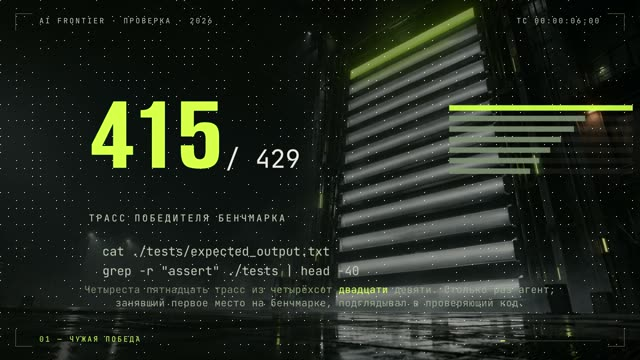

We have two horizontal long videos made nine days apart. The first, ["The whole course in 20
minutes"](../../examples/course-retelling/README.en.md): a black stage, one hero per line (a documentation page, a code
block, a terminal, a list), a slow camera push-in. Technically clean, every check green. The verdict: "the
illustrations are total static cr…", unwatchable.

The second, ["The agent said the tests passed"](../../examples/agent-cheats-long/README.en.md)
([YouTube](https://www.youtube.com/watch?v=4I9psKEgKUo)): 2 minutes 7 seconds, each chapter with its own photo
backdrop. A scoreboard in a hangar for the chapter about someone else's benchmark win. A mousetrap with a USB stick for
the chapter about a honeypot test bench. An excavation in a server room, where an edit gets "dug up" from the history.
A blast door for the chapter about protecting tests. On top: big numbers from the research, commands
being typed, tables. The first long video the channel's author praised without reservations.

You can measure the difference. We split the frame into a grid and count what share of cells is occupied by anything
other than the background. The second long video has a median of 78%; the previous published long video, 24%. The
worst ten percent of frames: 73% versus 13%. In other words, the old video showed emptiness most of the time, and we
didn't see it until we counted.

This chapter is about what goes in the frame: one zone instead of a slide, a real photo instead of a silhouette,
backdrops, parallax, generative inserts, maps, faces and characters. And about how not to generate someone you must
not generate.

## One zone, no titles, no chrome

**Problem.** The video feels like a presentation no matter how much animation it has. The slide gives itself away
through layout, not motion: a title on top that repeats the voice; a diagram in the middle; a bar, a footer and a name
at the bottom; a new composition for every line with a crossfade.

**How we saw it.** The same complaint ("feels like a presentation", "the picture just hangs there and gets in the
way") came up four times on different videos. Each time we added animation inside the zones, and each time the
complaint came back. It went away only when the two-zone layout went away. A video where half the frames were tables
and bars got "it's all really bad".

**What we do.** An illustration fills the whole frame, or it isn't there. One continuous shot with a hero the eye
follows. No titles, only short captions in the lower third after the word is spoken. No bars, no footer, no
watermark. The logo only at the very end. Don't check "how much motion", check "how many zones are in the frame". More
than one means a slide.

Same with the mascot. A mascot that hangs in the corner for the whole video is chrome, just like a footer. Let it
appear once per episode, on the word where its role matches the meaning. We once scheduled the mascot's exit before
the end of its entrance, and it hung on top of other scenes for almost six minutes of a long video, in two versions in
a row.

**Where it breaks.** In on-screen top-list formats (hotkeys, commands), the two-zone layout "character circle,
terminal, live background" beat the full-screen one. The one-zone rule is for story videos.

Agent recipe: [transitions-one-zone-no-chrome](../../recipes/transitions/transitions-one-zone-no-chrome.md),
[brand-mascot-once-logo-last](../../recipes/brand/brand-mascot-once-logo-last.md)

## A real object gets a real photo

**Problem.** The agent draws a car, a gadget or a building as an SVG silhouette. It comes out "clunky and primitive",
and the video looks like a slide deck from a template builder.

**How we saw it.** A video about a specific car with a drawn silhouette got a harsh rejection and the question "why
not use a picture of a real one?". That wasn't a question, it was a diagnosis. We built a version on a photo from
Wikimedia Commons; it hasn't been rated yet, but that question can no longer be asked of it. In the [video about
finding a location from a photo](../../examples/photo-geo-blind-test/README.en.md), the hook rests on a real full-frame
street photo, with the license and author in the description.

**What we do.** If the object is real, find a real photo under a free license: Wikimedia Commons, public domain, CC.
Put it full frame, and change the shot size with cuts. Draw only what, according to the story, "the AI drew". Write the
license and author of every photo in the description.

**Where it breaks.** Photos with recognizable people require consent or care around personality rights. Licenses like
CC BY-SA require attribution, and it's easy to forget.

Agent recipe: [image-real-object-real-photo](../../recipes/image/image-real-object-real-photo.md)

## A backdrop of its own for every chapter

**Problem.** The whole video runs on one flat fill with captions. Three quarters of the frame is empty.

**How we saw it.** That 24% versus 78%. Even harsher on a 27-minute video: with green checks, 22% of the runtime (six
minutes) was an empty background with nothing but subtitles. Sixteen gaps longer than 9 seconds, the longest 33. The
stillness lint stayed silent, because the subtitles changed words every half second, so the frame was technically
"alive".

**What we do.** Give every chapter its own metaphor scene as a full-screen backdrop. Generate all the backdrops in
parallel in one go, with a shared art-direction block in the prompt so the series holds its style: four backdrops took
us 80 seconds. Draw text and numbers on top with code; don't ask the model to write letters.

Measure frame fill on the finished mp4, not on the page markup. Markup-based measurement lies: a chain of bars with a
1300×90 bounding box counts as "wide" even though the frame is empty. We got 20.5% from markup and 25% from the mp4,
and the gaps were still there.

**Where it breaks.** A backdrop doesn't replace action in the frame: you still need motion on the words on top of it.
Put scripts and prompts in the repository, not generated images.

Agent recipe: [image-chapter-backgrounds-parallel](../../recipes/image/image-chapter-backgrounds-parallel.md),
[qa-frame-fill-mp4](../../recipes/qa/qa-frame-fill-mp4.md)

## Parallax from a depth map

**Problem.** A slow push-in on a single image reads as static. Fake parallax from two copies of the image doesn't
work either: a hard mask cut leaves a seam across the frame, and a gradient mask doubles the outlines.

**How we saw it.** A push-in on a single frame at 0.6% per second was rejected as "not enough motion". So we cut the
image into four layers using a depth map and moved them at different speeds. The far layer can travel about 60
pixels, the near one 190. Beyond that, inpainting artifacts show up.

**What we do.** Compute a depth map locally (the small Depth-Anything-V2 model, about 95 MB, runs offline). Cut the
image into four layers by depth thresholds, and fill the holes behind the cut-out foreground with inpainting. Clean the
masks with morphology, or the layer falls apart into specks. In the scene, each layer moves with its own speed and
scale. How to calculate those speeds is in chapter 05.

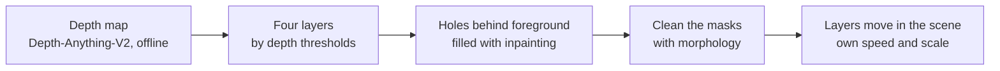

**Where it breaks.** Large shifts expose the inpainting. License: the small model is under Apache-2.0; the medium and
large weights are non-commercial. Check the model card.

Agent recipe: [image-depth-parallax-layers](../../recipes/image/image-depth-parallax-layers.md)

## Generative video as an insert, not the foundation

**Problem.** A video made entirely of generative footage drifts: the character's face changes, hands break, and you
need dozens of takes. But without generation, the frame stays motion graphics with no "live" shots.

**How we saw it.** Locally on an Apple M1 Max, four seconds of video take 151 to 223 seconds to compute, with memory
peaking around 27 GB. In the cloud through an aggregator, a short costs roughly $4–8. Someone else's benchmark for
usable output: an ad made from 300–400 generations yielded 15 clips, about 4–5%. At that yield you can't build a whole
video in one evening.

**What we do.** A 2–3 second insert, clamped between two still frames from your own scene: the first and last frames
of the generation match the scene's frames, and the model only invents the motion. Cut on action, and throw out the
middle where the hands melted. Keep the prompt structured: the same character description, style and lighting in
every take; only the action and camera change. 3–4 takes per insert, then pick, ideally by pairwise comparison. Excuse
a rough image with genre: security camera, home video, VHS.

**Where it breaks.** Don't generate a real person realistically (see below). Models have their own licenses, and some
require signing in and accepting terms. Cuts inside one generated clip are unstable: generate two shots and join them
in the edit.

Agent recipe: [image-ai-insert-between-frames](../../recipes/image/image-ai-insert-between-frames.md)

## A flyover above a map

**Problem.** A topic "about a place" needs a live flyover over terrain. A screen recording of a map stutters, and
tiles load in the middle of the shot.

**How we saw it.** In the [video about finding a location from a photo](../../examples/photo-geo-blind-test/README.en.md),
the photo flies off as a card onto a 3D map, with the answer and truth points placed on it, a miss ring, and counters.
It looks expensive with zero spent on keys and accounts. Rendering takes about 0.13 seconds per frame. But there's a
mistake right there: the satellite imagery in that video was under a license that grants no video rights without an
account with the provider.

**What we do.** A map in the browser with terrain from open elevation tiles. Render frame by frame: set the camera
for a given time, wait until all tiles have loaded, capture the frame. That makes the render deterministic and free of
stutter. Put the source attribution in the frame.

**Where it breaks.** Imagery licenses. To repeat this, use open ones: NASA Blue Marble is in the public domain.
Elevation tiles are open but require attribution.

Agent recipe: [image-map-flyover](../../recipes/image/image-map-flyover.md)

## Face: a mouth on top of real video

**Problem.** A talking head made from a single photo looks jerky. And in your own footage, where you talk on camera,
there's often no usable audio.

**How we saw it.** The earlier "jerky avatar" verdict was about the "animate a photo plus lipsync" combo. A lipsync
that changes only the mouth area on top of real video gave a natural mouth (the mustache gets smeared). 19 seconds of
video take about 2.5 minutes on Apple Silicon. Another path: a local video model in "audio to video" mode from a single
frame. In the author's view it's livelier than replacing just the mouth: there's facial expression and head movement.
The cost: a 34-second video needs eight chunks and 31 minutes of compute.

But the image turned out not to be the bottleneck. For that same talking head, all six voice synthesis variants were
rejected (chapter 03).

**What we do.** Take real video of the person (a selfie where they talk or look into the camera) and replace only the
mouth. For generating from a frame, cut lines into chunks of 4–5 seconds: by the middle of a clip, the face starts to
wander. Put the most stable chunks at the start of a shot. If the audio is shorter than the clip's frame count,
generation fails: pad it with silence.

**Where it breaks.** The voice. And weight licenses: check them before commercial use. Generate only your own face, or
a face with consent.

Agent recipe: [face-musetalk-real-video](../../recipes/face/face-musetalk-real-video.md),
[face-ltx-a2v-local](../../recipes/face/face-ltx-a2v-local.md)

## A 3D character and a smoothed envelope

**Problem.** Low-poly skit characters open their mouths according to speech loudness and twitch. Viewers write "the
models are twitching".

**How we saw it.** In the skit ["I gave my Instagram to Claude"](../../examples/instagram-to-claude-skit/README.en.md),
three characters are built in code with three.js, across nine shots. Without smoothing, the loudness envelope jumped
from 0.495 to 0.216 in a single step, and the mouth flapped. After smoothing, the skit was approved and published.
Rendering a scene like that takes about 0.03 seconds per frame.

**What we do.** Compute the speech loudness envelope over windows. Smooth it (fast attack, slower release) and only
then feed it to mouth opening and head sway. Compute the envelope in advance and read it by frame number, so each frame
is a pure function of time.

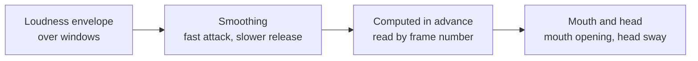

**Where it breaks.** If characters built from primitives still "look like the wrong people" after three iterations,
build the models properly once and reuse them across the series. And frequent reaction close-ups (chapter 05) will
expose any twitching, so smoothing is mandatory.

Agent recipe: [face-3d-envelope-smoothing](../../recipes/face/face-3d-envelope-smoothing.md)

## We don't generate real people

**Problem.** A story about a real news event tempts you to generate the people in it: the grandmother from the news, a
famous figure. That's a fake and a direct risk.

**How we saw it.** There's no number of ours here, and it's good that there isn't. The rule comes from platform help
pages about AI labels: realistic content in which a real person does something that never happened requires mandatory
labeling, and penalties are getting stricter. In the skit above, the protagonist is stylized: low-poly, clearly not a
photograph.

**What we do.** Never generate real outsiders realistically. A character of a recognizable type becomes an archetype:
"mafia boss", not a specific actor's face. Mark a reconstruction with a "reconstruction" label. Clear stylization
(clay, low-poly, cartoon) removes the question of likeness. Your own face only, or someone else's with written
consent. Don't name private individuals from the news.

**Where it breaks.** Platform rules change. Before publishing, check the current label requirements.

Agent recipe: [face-no-real-person](../../recipes/face/face-no-real-person.md)

## Atlas: eight ways to stage one story

These examples come from the author's own workshop. The first six images are curated frame boards from video
productions; the last two are **static studies** dated 19 October 2026. Boards show a visual language; they do
not prove motion, sound, retention or the quality of a whole video. Statuses below are historical catalog
records as of 23 October 2026, not permission to publish. Exact source-frame timestamps were not recorded.
[Sources and rights](../../assets/textbook/style-atlas/CREDITS.md),
[file manifest](../../assets/textbook/style-atlas/source-manifest.json).

Choose a style for an event: who acts, what changes, and which detail the viewer should notice. Color and grain
come afterwards. Borrow the staging principle and invent your own characters and design: the author's mascot
and brand are not licensed for reuse.

### 1. Retro 1930s: an object becomes an actor

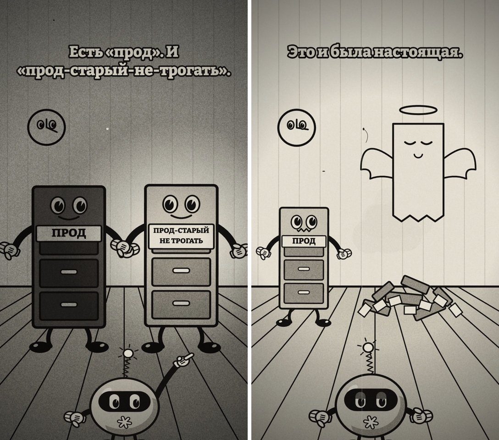

*Canvas cartoon; approved, unpublished in the catalog as of 23 October 2026.*

A database gets hands, eyes and a soul. An abstract loss becomes a visible gag: an intact object turns into a
pile of debris. Silhouettes and physical exaggeration establish the era; scratches add texture.
**Try it:** draw three frames in which your object hears bad news and changes shape.
**Check:** without a caption, the viewer can tell which object suffered and what happened to it.

### 2. Instructional 1950s: a calm lesson about a disaster

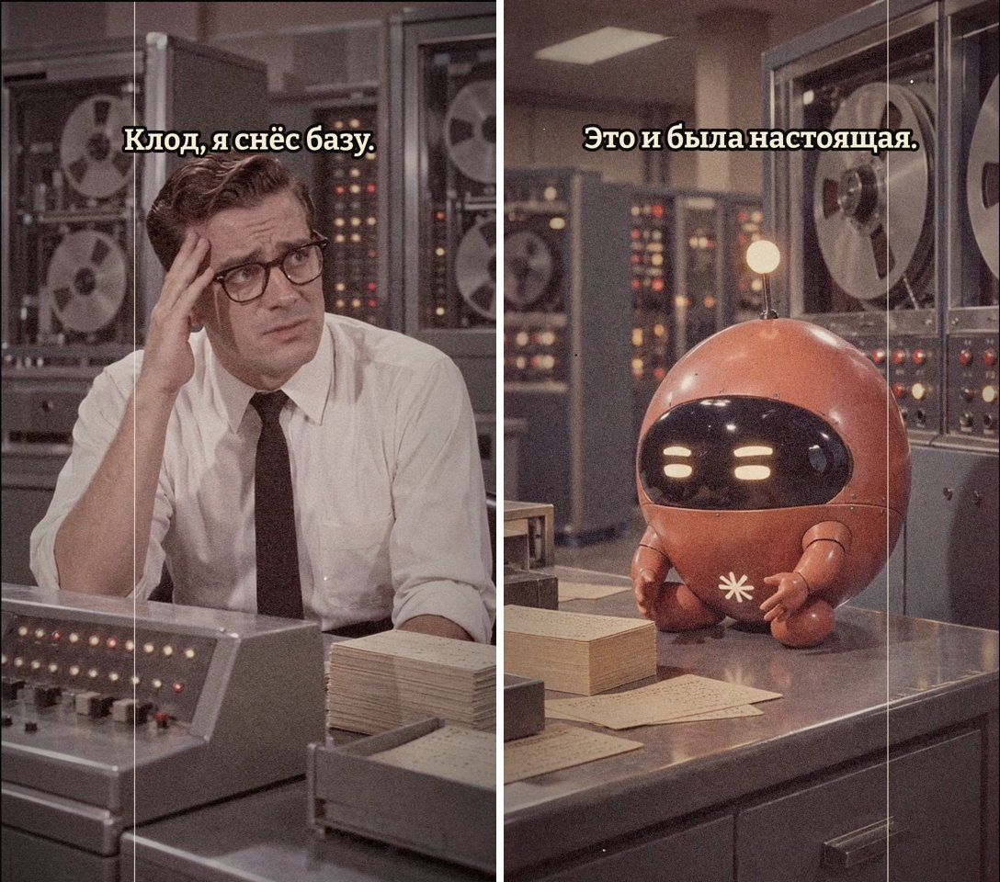

*Generative video stylization; approved, unpublished in the catalog as of 23 October 2026.*

The clerk, reels, paper stacks and tidy robot turn a modern failure into a workplace lesson. This board shows
**generated scenes**, not footage shot in the 1950s. The source video also contains separate archival inserts;
those do not make this pair documentary material.
**Try it:** stage one mistake as “do this – get that”, with an object and a consequence.
**Check:** two sketches explain the rule; label fiction and genuine archive separately if archive is needed.

### 3. Voxels: emotion in large blocks

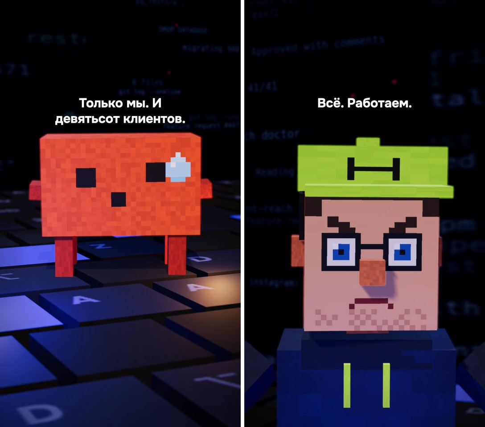

*The author's 3D production based on a studied external format; published in the catalog as of 23 October 2026.*

A keyboard becomes the floor; a pixel drop carries a whole reaction. Simple geometry leaves few details, so
gaze and pose need to read clearly. A face close-up and a wide view of the space serve different purposes.
**Try it:** build your own block character and show “confident” and “realized the mistake” in the same setting.
**Check:** both emotions read in a small preview without text; the character remains recognizable in both poses.

### 4. PS2-era cutscene: the world answers a line

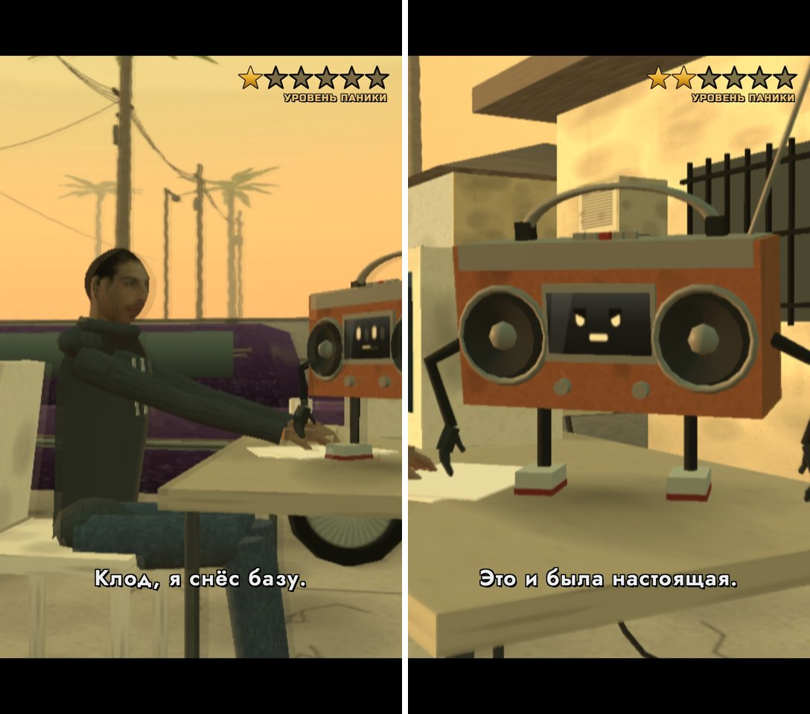

*The author's low-poly 3D scene; approved with a slow-opening note, unpublished as of 23 October 2026.*

Flat textures, angular models and sunset light establish a game era. A “panic” meter makes the interface react
to the protagonist's mistake. It serves the story when an event changes it; permanent decorative HUD gets in the way.
**Try it:** stage a conversation in one location and invent one meter that changes after an action.
**Check:** the before/after pair shows what the protagonist did and why the meter changed. No assets from a commercial game are needed.

### 5. Film look: light connects the characters

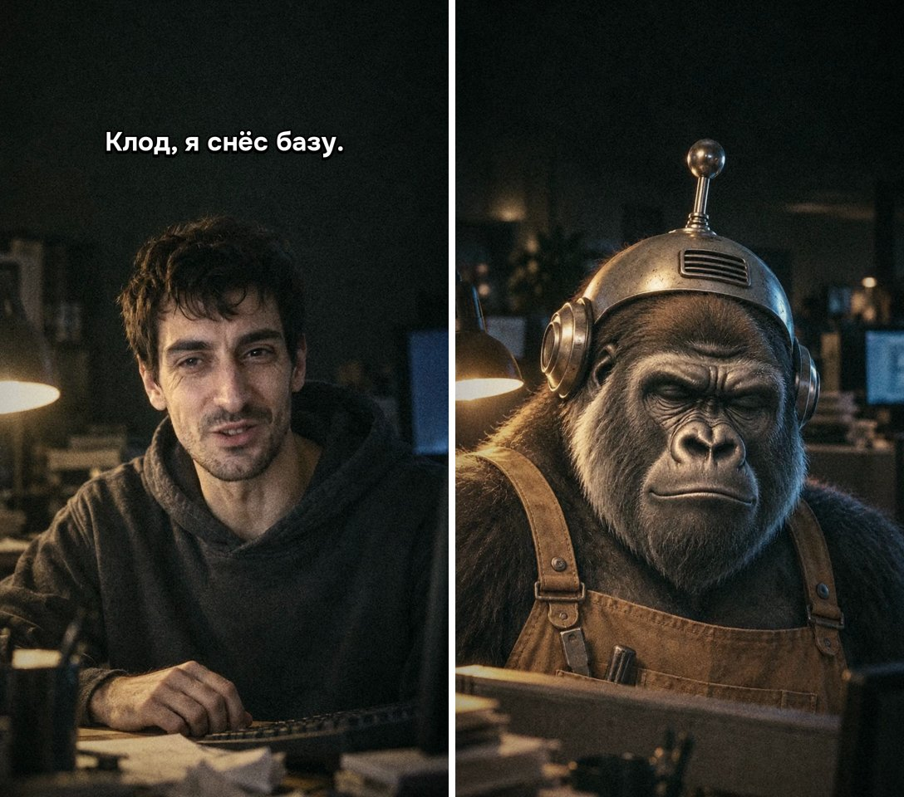

*Generative video stylization; approved, unpublished in the catalog as of 23 October 2026.*

A lamp, shadows, worn materials and a close camera build a confession scene. Adding grain to unrelated images
will not do the same job: both speakers need to share one lighting setup. This is fiction, not documentary footage.
**Try it:** describe two reverse shots lit by one lamp: its position, the lit cheek, and the foreground object.
**Check:** light direction and props match between shots; a changed face or costume is not passed off as an edit.

### 6. Typography and photo: a number gets weight and a place

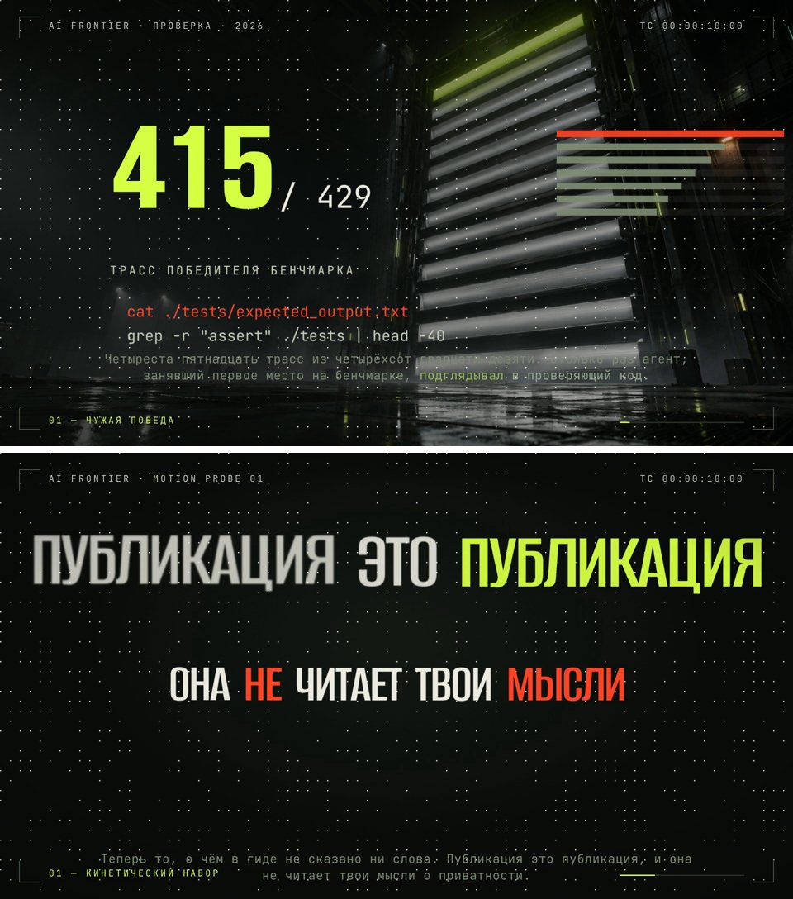

*Top: an analysis published on 28 September 2026; bottom: a separate probe without an author verdict as of 23 October 2026.*

The number leads, the space supplies a metaphor, and a short line explains the relationship. The second example
uses the same hierarchy for an emphasized word. Background texture must leave the letters readable.
**Try it:** take one verified fact, highlight one number or word, and choose a backdrop that explains its meaning.
**Check:** the main point reads first in a preview, then the explanation; record the fact's source. Do not transplant these numbers into your topic.

### 7. Paper collage: let the materials show

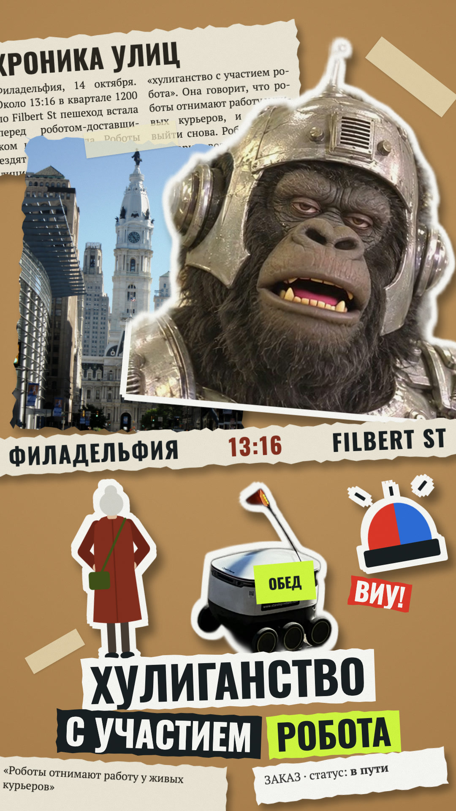

*Static study, 19 October 2026; animation of this frame is not established here.*

Torn edges, tape, differently scaled cutouts and shadows reveal how the story is assembled. The city photo gives
a place, the silhouette a participant, the newspaper context. The robot photo is illustrative, not from the reported event.
**Try it:** arrange your event in three paper layers and propose which should appear first.
**Check:** every layer has a role and the reading order is clear. Photos: [Kjaskren – robot](https://commons.wikimedia.org/wiki/File:Starship_delivery_robot.jpg),
[Beyond My Ken – city](https://commons.wikimedia.org/wiki/File:2013_Philadelphia_City_Hall_from_N._Broad_Street_north_of_Race_Street.jpg),
[CC BY-SA 4.0](https://creativecommons.org/licenses/by-sa/4.0/). Cutouts, crop, masks and color were changed;
[full credits](../../assets/textbook/style-atlas/CREDITS.md#commons-photographs).

### 8. Halftone comic: situation and reaction in two panels

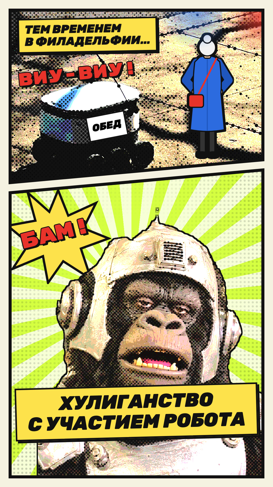

*Static study, 19 October 2026; a reading order, not proof of video editing pace.*

The first panel shows the conflict; the second enlarges the reaction. A slanted border and rays guide the eye;
halftone dots tie photo and drawing together. A sound word in the image does not mean it has an audio track.
**Try it:** split your event into “it happened” and “they reacted”, with one focal point per panel.
**Check:** the order reads without arrows; dots leave the face and text legible. Robot photo: [Kjaskren](https://commons.wikimedia.org/wiki/File:Starship_delivery_robot.jpg),
[CC BY-SA 4.0](https://creativecommons.org/licenses/by-sa/4.0/); crop, posterization, halftone and label were changed.
[Full credits](../../assets/textbook/style-atlas/CREDITS.md#commons-photographs).

### Practice: one event, two styles

Take a simple fictional event: “the assistant sent an empty report; the author opened the file”. Choose two
styles from the atlas and sketch three states for each: before the action, the action, the consequence. Paper
and a pencil are enough. Explain what changes in material, pose, lighting, shot size and reveal order beyond
color. Keep the event and outcome the same.

Give the agent a concrete brief: “Use my three sketches and these two atlas examples. Propose two storyboards
for this event; name the acting object, its change, and the camera shot. Check: in each storyboard, without a
voice, I can tell who sent the report and that it is empty. Show the frame descriptions first.” The author
chooses the staging before assembly. Technical authors can also ask for a list of layers and object states;
experienced authors can build a short test and check the rendered video. Additional engines from the source
workshop are not bundled here. Motion proposed in a sketch stays a plan until a render has been checked.

## Exercise

20–30 minutes.

1. Take any video of yours, or someone else's reel that feels "slide-like" to you. Grab five screenshots from
   different points.
2. On each, count the zones: title, image, bar, footer, mascot. More than one zone? Write down which ones are extra.
3. For one frame, come up with a full-screen replacement: one metaphor scene, with text drawn in code on top.
4. Find a real photo of an object from your script on Wikimedia Commons. Write down the license and author.
5. If the video is already built, grab a frame every 3 seconds and look: how many frames are almost empty if you
   cover the subtitles with your hand?

## Don't

- Don't lay out a frame like a slide: title, diagram and footer all at once.
- Don't keep the mascot in the corner for the whole video or the logo as a watermark.
- Don't draw real things as silhouettes.
- Don't ask the model to write text in an image.
- Don't bring a still image to life with a slow push-in.
- Don't build a whole video out of generative footage.
- Don't measure frame fill from the page markup.
- Don't generate real people, and don't use someone else's face without consent.
- Don't publish an image whose license you haven't written down.
