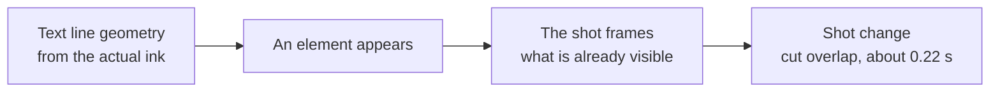
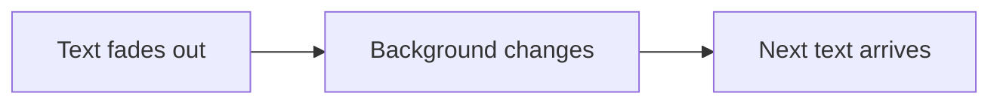

# 05. Camera, editing, transitions

Twenty minutes, 166 lines, about 2,800 words. ["Claude Code in Action: the whole course in 20
minutes"](../../examples/course-retelling/README.en.md) ([YouTube](https://www.youtube.com/watch?v=96zjz5-Ka8Q)) was
built technically clean: not a single speech recognition error, every check green. One hero in the frame per line: a
lesson page, a code block, a terminal, a list. And so the frame wouldn't stand still, the camera slowly pushes in from
1.0 to 1.06 over five seconds.

The channel's four long retellings got between 32 and 79 views. The author's verdict: "this is unwatchable".

There were two reasons it failed, and one has nothing to do with the camera: a retelling of a free course gives
nobody a reason to watch. But the second is all about the camera. A six percent push-in over five seconds technically
moves the frame, but the eye sees a slide. A change of line looks like a change of slide. Worse, that push-in fooled
our own checks: the stillness lint found 3 static scenes with the push-in on, and 41 with it off.

Compare that with the [video about a TV without ads](../../examples/tv-no-ads/README.en.md): the shot changes 17 times
in 47 seconds, every 1.5–4 seconds, with hard cuts. Handheld camera on top of every shot, and measuring the difference
between neighboring frames finds not a single still stretch longer than 0.5 seconds. 212 thousand views on Instagram.

This chapter is about how camera and editing bring a frame to life, and about how the same tools can disguise a dead
one.

Before choosing motion, return to the [eight-style atlas in chapter
04](04-image-and-frame.md#atlas-eight-ways-to-stage-one-story). Decide what changes inside the scene: a
paper layer, a character pose, an object or a line of text. Then choose the shot and cut. A static example
shows composition; check motion on the rendered video.

## Don't disguise stillness with a slow push-in

**Problem.** A card hangs in the frame, nothing happens inside it, and the agent adds a slow push-in on the whole
scene. Technically the frame "moves". The viewer sees a slide, and the stillness metrics get fooled.

**How we saw it.** Three numbers. A 1.0 → 1.06 push-in over 5 seconds on a twenty-minute video: "illustrations,
static". A push-in on a single image at 0.6% per second: "not enough motion". The stillness lint: 3 static scenes with
the push-in, 41 without. Thirty-eight dead scenes were hiding behind six percent of zoom.

**What we do.** Motion has to happen inside the frame: text appears line by line at the pace of speech, a terminal
types, a list unfolds one item per word, a page scrolls to the right paragraph. The camera changes shot size with a
cut (next section), not by zooming a few percent. When you measure stillness, turn off the global camera push-in.

**Where it breaks.** A slow drift within one shot is fine if there's action inside the frame. It's bad when the drift
is the only motion.

Agent recipe: [camera-no-ken-burns](../../recipes/camera/camera-no-ken-burns.md),
[qa-still-lint](../../recipes/qa/qa-still-lint.md)

## Shot size changes with a cut

**Problem.** One shot size for the whole video, with a smooth zoom inside it. A change of line looks like a change of
slide.

**How we saw it.** The 1.0 → 1.06 zoom was rejected as static. After that we built a 35-second test piece for a new
grammar: shot size from 0.96 to 1.55 with pans between points of interest, per-word animation, typing in a terminal.
We never got a verdict on the test piece, so it's a template, not proof. The [DeepSeek
video](../../examples/deepseek-headlines/README.en.md) rests on one hero (a stack of headlines) and camera moves into the
fine print of a benchmark table. The move became a metaphor: "let's read the fine print". The visuals were approved
with "visuals okay".

**What we do.** Change shot size with an editing cut on every line. Define a shot by a point of interest and a scale.
Inside the shot, a slow drift. Use a wide range, from wide to close-up. For numbers, push the image into blur and
darken it, and bring it back when the voiceover is about it again. On a deep push-in, fade the background with opacity
and blur, or neighboring cards at the edge look like a glitch.

**Where it breaks.** No retention measurements. In on-screen top-list formats (hotkeys, commands), a two-zone layout
with a live background beat full-screen with cuts.

Agent recipe: [camera-scale-change-not-zoom](../../recipes/camera/camera-scale-change-not-zoom.md)

## The camera follows the content

**Problem.** Scene elements arrive one by one, while the camera stays on the full canvas. For the first seconds of
every scene, the frame shows a single line in the middle of emptiness. A block's bounding box lies: in a bar 1280
pixels wide, a line of text may take up 600.

**How we saw it.** We taught the camera to frame what has already appeared, based on the actual "ink" of the text,
not on the container's bounding box. The median share of the frame covered by content grew from 11.2% to 20.5%. The
share of runtime with fill below 6% dropped from 29% to 5%. Empty stretches longer than 6 seconds went from 36 to 0.

But then comes the trap. Measuring the finished mp4 showed 25%, not 20.5%, and gaps remained in places. At its
maximum push-in of 1.85, the camera couldn't fit a 1440×170 block: you can't fix a 16:9 aspect ratio with zoom.

**What we do.** Take the geometry from the text lines themselves. For every element that appears, pick a shot that
frames what's already visible. Hide the shot change inside a cut overlap of about 0.22 seconds, or you'll see the pan
jerk.

**Where it breaks.** The camera can't save a wide, flat block (a two-line quote, a chain laid out in a row). Re-lay out
the content: it's fixed with proportions, not with the camera.

Agent recipe: [camera-follow-ink](../../recipes/camera/camera-follow-ink.md)

## The hero doesn't slide off the edge

**Problem.** A 1.35–1.5 push-in on a wide card pushes its edges out of frame. A shot centered right of the middle
sends the left column off screen. Half-cut cards at the edge read as something broken.

**How we saw it.** A code card 1580 pixels wide spilled out of frame at a 1.35 push-in. We caught it by eye on frames,
when we could have calculated it in advance.

**What we do.** The screen coordinate of a point, for a shot with center P and scale s: `screen = 960 + s · (world −
P)` for a width of 1920. Everything that must stay in frame has to be within `P ± 960 / s`. Calculate the hero's width
from this formula before layout, not after rendering. Keep the shot center close to the middle of the frame. Set the
starting scale in the animation itself, not in a separate style next to it.

**Where it breaks.** For a 1080×1920 vertical the formula is the same, just with 540 instead of 960. Details in
[chapter 08](08-vertical-publishing.md).

Agent recipe: [camera-keep-in-frame](../../recipes/camera/camera-keep-in-frame.md)

## Handheld camera as a sum of sines

**Problem.** A static camera makes the frame dead. And "shake" made of a random offset every frame looks like digital
jitter.

**How we saw it.** In the TV video, handheld camera sits on top of every shot, and there are no still stretches longer
than 0.5 seconds. We don't have our own measurements for the values; the parameters come from a camera techniques
reference.

**What we do.** Shake as a sum of two or three low-frequency sines, not a random number per frame. Make the
frequencies multiples of the loop length, so a looping video doesn't jump at the seam. In 2D that's on the order of
ten pixels and a rotation of about half a degree. On an impact, a short burst of 1–1.5 seconds. Keep the shake on a
separate wrapper layer and the camera shot on its own: otherwise they fight over the same property.

**Where it breaks.** Don't add shake to frames with small text: the eye needs to see smooth motion and read.

Agent recipe: [camera-handheld-sines](../../recipes/camera/camera-handheld-sines.md)

## Parallax by a depth formula

**Problem.** In a 2D scene, all layers shift the same way, and a camera move looks like a flat image sliding.

**How we saw it.** For layers cut from a depth map (chapter 04), a travel of about 60 pixels for the far layer and
about 190 for the near one has already been tested. Any more and inpainting artifacts show up.

**What we do.** Give each layer a depth z. The layer's screen offset is `dx = camX / z`: near layers fly apart faster
than far ones. For a pan, move all layers equally; that's a camera rotation, not a dolly. For a tracking shot, layers
move at a speed inverse to their depth while the hero stays put. Without a foreground, a push-in is indistinguishable
from a zoom, so put at least one near object in the frame.

**Where it breaks.** A true orbit around an object won't work in 2D: the most you can do is spread the layers in
different directions.

Agent recipe: [camera-parallax-formula](../../recipes/camera/camera-parallax-formula.md)

## Hard cut by default

**Problem.** Every scene change gets a transition: a crossfade, a wipe, a whip. The pace drags, and the video looks
like a set of slides with effects.

**How we saw it.** In the hits we broke down, transitions are hard cuts, one every 1.6–2.3 seconds. The TV video has
17 shots in 47 seconds, all hard cuts. Nobody misses flashy transitions where there aren't any.

**What we do.** The main cut is a hard cut. Whips, dissolves and wipes only at 2–3 key moments: a chapter change, a
"meanwhile", the ending. Wipes go in one direction for the whole video. Start the first motion in a new shot after
0.1–0.3 seconds; after something important lands, hold the frame for at least a second so the viewer can read it.

**Where it breaks.** A video that teaches transitions themselves is the exception.

Agent recipe: [transitions-hard-cut-default](../../recipes/transitions/transitions-hard-cut-default.md)

## Smash cut: silence and impact

**Problem.** The hook starts smoothly, and the first second doesn't grab.

**How we saw it.** In the ["3 keys"](../../examples/three-keys-repeat/README.en.md) video, a smash cut onto giant keys,
0.55 seconds around the key press. The video itself flopped (3 views on YouTube, 0 on TikTok), and the smash cut and tight terminal crops later moved into other videos. We don't have a separate
rating for the technique.

**What we do.** Contrast in everything at once: wide shot versus close-up, stillness versus shake, silence versus
impact. The quiet part has to be truly quiet. The impact lands exactly on the cut frame. In 2D, a sharp zoom onto a
giant object (a key, a number) for about half a second around the event works.

**Where it breaks.** Sound that's early or late by even one frame kills the impact.

Agent recipe: [transitions-smash-cut](../../recipes/transitions/transitions-smash-cut.md)

## Whip pan with motion blur

**Problem.** Switching between items or places with a plain cut looks limp, while a noticeable camera move between
shots looks like a jerk.

**How we saw it.** We tested a cut overlap of about 0.22 seconds on a long video with shot changes: with it, the shot
change is hidden; without it, you see the camera travel. The other values come from a techniques reference.

**What we do.** A short pause, the frame whipped away with an accelerating move over 0.3 seconds, the next frame
arriving from the same side, decelerating. Motion blur proportional to speed, no more than about 8% of the frame
width. The exit and entry go in the same direction. Under it, a noise whoosh with the frequency band sweeping up.

**Where it breaks.** Whip too far and the camera flies into emptiness, and the blur turns into a white smear.

Agent recipe: [transitions-whip-pan](../../recipes/transitions/transitions-whip-pan.md)

## J and L cuts: sound ties scenes together

**Problem.** Sound and picture are cut at the same point, and every cut feels like a break.

**How we saw it.** We have no measurements of our own; the values come from a camera techniques reference. Honestly,
this section has no story of ours behind it: the technique is simple, and it's worth knowing before you hit that
break yourself.

**What we do.** J cut: the next scene's sound starts 0.3–0.5 seconds before its picture. The sound has to be
recognizable, or the viewer won't connect it to the shot. L cut: the previous scene's sound carries on for 0.3–1.5
seconds after the cut and fades out.

**Where it breaks.** A lead longer than a second reads as a sync error.

Agent recipe: [transitions-j-l-cut](../../recipes/transitions/transitions-j-l-cut.md)

## Scene change order

**Problem.** The next scene's background switches on while the previous scene's text is still visible: light text
ends up hanging on a light background. A graphic bumper between chapters fights the camera over the same coordinate.

**How we saw it.** A dry review of frames before rendering caught the ordering mistake. A bumper fits at a chapter
joint, where there's a 1.5-second pause. Inside a chapter, the gap between lines is 0.32 seconds, and the bumper
together with the camera broke the frame.

**What we do.** Change order: the text fades out, the background changes, the next text arrives. Put bumpers only at
chapter joints with a pause. A bumper and a camera shot must not animate the same property of the same container.

**Where it breaks.** If text and background sit on the same fill and the contrast holds, strict order isn't needed.

Agent recipe: [transitions-scene-swap-order](../../recipes/transitions/transitions-scene-swap-order.md)

## Skit rhythm: a cut every 1.5–2.5 seconds

**Problem.** A skit with characters is shot in one take: the dialogue runs, the frame stands still, you can't see the
reactions.

**How we saw it.** A skit hit we broke down: 41 cuts in 67 seconds, roughly one every 1.6 seconds. Voxel skits with
710 and 178 thousand views: 22 cuts in 49 seconds and 19 in 45, with shots held for 2.1–2.3 seconds. Our skit ["I gave
my Instagram to Claude"](../../examples/instagram-to-claude-skit/README.en.md) goes through nine shots in 25 seconds,
including a sharp shot of the protagonist on a reaction word and a freeze frame before the final shout.

**What we do.** Cut on lines, on average every 1.5–2.5 seconds. A close-up of the face for reactions. One location
that changes at the story's turns. Instead of a call to action at the end, a meta twist or a shout.

**Where it breaks.** The numbers describe other people's hits; the effect of rhythm hasn't been measured on our own
videos. And smooth the mouth animation (chapter 04): frequent close-ups will expose any twitching.

Agent recipe: [transitions-skit-cut-rhythm](../../recipes/transitions/transitions-skit-cut-rhythm.md)

## Exercise

15–30 minutes.

1. Open any viral reel in your niche. Count the cuts in the first 15 seconds, with a stopwatch or frame by frame.
   Divide 15 by the number of cuts: how long does one shot hold?
2. Open your latest video and do the same.
3. Find a spot in your video where the frame "lives" only because of the push-in. Switch the push-in off in your head:
   what's happening in the frame then? If nothing, come up with motion inside it: typing, lines appearing one by one,
   scrolling.
4. Pick one scene and redo it: two or three shots of different sizes with hard cuts instead of one shot with a zoom.
5. For the widest block in the scene, check whether it fits at your push-in: the block width times the scale must be
   comfortably less than the frame width.

## Don't

- Don't disguise a static frame with a slow push-in.
- Don't measure stillness with the camera on.
- Don't change shot size with a few percent of zoom: change it with a cut.
- Don't try to frame a wide, flat block with the camera: re-lay it out.
- Don't make shake from a random number per frame, and don't shake small text.
- Don't put a flashy transition on every cut.
- Don't shift a smash cut's impact by even a frame.
- Don't switch on a new background while the old text is still visible.
- Don't shoot a skit in a single take.
