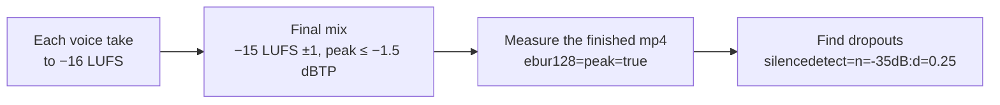
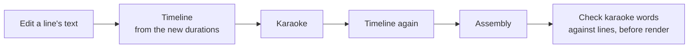

# 06. Sound and captions

The video about a TV that showed an ad on its own screen hit 212 thousand views on Instagram by the evening of day
one. The account's usual reels those days got anywhere from 58 to 400. The breakdown lives in
[examples/tv-no-ads](../../examples/tv-no-ads/README.en.md), and there's a detail in it that's easy to miss.

The most-liked comment under the video wasn't about the TV, and it wasn't about Claude. It was about the sound:
«Кто там шмыгает постоянно?» ("Who keeps sniffling in there?"). A hundred and eleven likes, and below it another
comment asking the same thing, with twenty-one. The "sniffling" was the whooshes on the cuts, made from pink noise
through a band-pass filter. Around the same days, we'd stripped the very same whooshes out of another video because
they sounded "like a vacuum cleaner".

Two lessons come out of this story, and both belong to this chapter. First: in a short video, sound isn't there to
be clean. It's there to make the video fun to watch and worth commenting on. Second: everything else about sound
and captions *is* about being clean, and there are numbers you must not fall below. Loudness, pauses, letter
contrast, a font without tofu boxes. Get them right and nobody notices. Get them wrong and people scroll past.

The chapter goes like this: sound effects and music first, then loudness and pauses, then captions.

## Whooshes on cuts: keep the "sniffling"

A cut with no sound feels like a break. A short noise whoosh covers the seam: the ear hears motion, and the shot
change feels intentional. The catch is that noise sounds like noise. When we were building the skit
["I gave my Instagram to Claude"](../../examples/instagram-to-claude-skit/README.en.md), we listened to the whooshes,
swipes and room tone and pulled them out: "vacuum cleaner". A sensible call, if you judge sound by cleanliness.

Then the TV video took off. 212 thousand views and a top comment about sniffling with 111 likes. The sound that
seemed like a defect became a reason to comment. And comments, as you'll see in the publishing chapter, move reach
harder than likes.

**What we do.** Whooshes go on cuts by default: moderate, but loud enough to hear. Pink noise, a band around
1800 Hz, a third of a second with a soft attack and tail. There's a ready-made generator in
[`tools/audio/sfx.py`](../../tools/README.md): fourteen procedural sounds, no samples, no licenses, and the whoosh is
called `whip`. A funny question in the comments ("who's sniffling?", "can I do it without Claude?") goes into the
ideas list: that's a topic for a reply video.

**Where it breaks.** The trick worked on one video as a recognizable running gag. In a serious breakdown of a hard
topic the same noise can grate. And it always sits below the voice: a whoosh that covers a word isn't texture
anymore, it's interference.

Agent recipe: [sound-keep-noise-whooshes](../../recipes/sound/sound-keep-noise-whooshes.md)

## Sounds by meaning, not on every movement

When an agent places sound effects, it reaches for the same three or four: click, whoosh, hit. The synth had
fourteen kinds; the videos used three. A viewer put it simply: "same sound effects". The channel started to sound
like one long video.

Look at how ["Goro cancelled the call"](../../examples/mascot-cancels-call/README.en.md) is built. It's 14 seconds with
three steps of escalation: the AI messages everyone that you're against calls; the director backs it; a call about
calls gets booked for Saturday at nine a.m. On the word "Saturday" the music cuts off with a hit. It's the only place
in the video where the sound stops, and that's exactly why it works.

We don't have our own measurement of the effect; this is a hypothesis. Here's what prompted it: once eleven kinds of
sounds were mapped to the meaning of events, the video was approved and published.

**What we do.** First, list the events in the frame: a grab, a hit, a shot change, a number appearing, a freeze
frame. Each event gets its own kind of sound. A smash cut gets a hit exactly on the frame, a freeze frame gets
silence and a chime around 1760 Hz, a jump cut gets a click. Tonal sounds (chime, tone, tick) are built from the
track's tonic on the major pentatonic scale, so they land in the music's key and every video sounds like itself.
Footsteps and hits follow story time: in slow motion they thin out, in a freeze frame they vanish.

**Where it breaks.** Sound won't rescue an empty story. If nothing happens in the frame, ten different sounds just
turn emptiness into noisy emptiness.

Agent recipe: [sound-sfx-by-meaning](../../recipes/sound/sound-sfx-by-meaning.md)

## Music: one track on seven videos in a row

This mistake is funny until you count. The build script gets copied from project to project, and inside it there's
one hardcoded line with the path to a track. Nobody chose it; it just came along from the first video. Result: seven
published videos in a row with the same music. To the ear, the channel turns into a conveyor belt.

**What the starter does.** The track is declared in the `music` block of [`starter/reel.json`](../../starter/reel.json):
`file` (path to the track), `offset` (seconds), `gain` (level under the voice) and `credit` (the credit line). If
`file` is `null`, `tools/sound.py` synthesizes a quiet pad by itself. The whole `music` block lands in the
`qa/final-result.json` report, but you copy the credit into the description by hand. The kit has no track rotation and
no attribution file.

**What we do.** Pick the track anew for every video instead of keeping the one that came along from the last project.
Use only tracks you're allowed to put in video (CC BY), and write down the credit right away. NC tracks and files
without attribution are off the table entirely. If you make a lot of videos, you can build rotation yourself. In our
main pipeline it works like this: a shared music library with an attribution file, each video declares its track in
`music.json` (path, offset, level, tonic, credit line), the build drops an `ATTRIBUTION.txt` next to it for the
description, history lives in `used.json`, and a track doesn't repeat if it was in either of the last two videos.
This kit doesn't include that automation; treat it as a scheme for your own extension.

**Where it breaks.** CC BY requires attribution, and versions 3.0 and 4.0 phrase it differently: check each one.
Some stock sites return a 403 to scripts; download those by hand. And don't put the mp3s themselves in a public
repo, link to them.

Agent recipe: [sound-music-rotation](../../recipes/sound/sound-music-rotation.md)

## Loudness: −15 LUFS ±1, measured on the encoded file

You're scrolling the feed, the videos play at the same volume, and suddenly one is noticeably quieter. You won't turn
it up, you'll scroll on. That's reason one to match your neighbors' loudness. Reason two: music that keeps dropping
out and then swamping the voice.

We analyzed seven hits by other creators. All of them landed at −14.1…−14.7 LUFS. In the skits, the music bed was
compressed to an LRA of 2–3 LU, meaning almost no swings. Not one video with speech had silence below −35 dB longer
than a quarter second. Our published videos came out at −15.2…−15.3: a bit quieter, but within range.

Peaks are their own story. One open-source project's demo video claimed a −1 dBTP ceiling and actually came out at
−0.88. The master was honest; the AAC codec raised the peaks during compression. So we measure everything on the
finished mp4, not on the master.

One more number, about voice. A clone made from a calm reference came out roughly 13 dB quieter than one made from an
emotional reference. Without leveling, that voice drowns under the music, and speech recognition at the QA step
starts making mistakes.

**What we do.** Level every voice take to −16 LUFS before mixing. Mix the final to −15 LUFS ±1 (hits and our own
videos both fall inside −16…−14), true peak no higher than −1.5 dBTP: AAC adds 1–2 dB on top of the master, and a
−1 ceiling has already been caught at −0.88. Every pass value and what it was measured on is in one table,
[QA-THRESHOLDS.md](../../docs/QA-THRESHOLDS.md). Check with two ffmpeg commands: `ebur128=peak=true` for loudness and `silencedetect=n=-35dB:d=0.25` for
dropouts. If peaks pop up after AAC, [`tools/audio/aac_safe.py`](../../tools/README.md) will pull the master down
locally. Music under the voice sits clearly below the voice. If a listener asks you to "turn the music down a bit",
turn it down: on one video we dropped the level from 0.5 to 0.3.

**Where it breaks.** Carving a frequency notch in the music for the voice won't fix clipped synthesis or bring back
lost words. We haven't listened to it on our own voice, so A/B it against a plain level drop at matched loudness.
And with a hard −2 dBTP ceiling, short phrases may not reach the target: in a blind test aimed at −16, they came out
at −16.0…−16.9.

Agent recipe: [sound-loudness-like-hits](../../recipes/sound/sound-loudness-like-hits.md), [voice-loudness-per-take](../../recipes/voice/voice-loudness-per-take.md)

## Pauses between lines: shorter than you want

The agent lays out the timeline for the animation: this card needs 1.5 seconds to slide in, this diagram needs 3
seconds to assemble. Meanwhile the voice waits. Gaps of 1.3, 3.8, 1.5 seconds grow between short lines. A video with
pauses like that got rejected in one sentence: "really long pauses". The rhythm fell apart.

For comparison: a voxel skit with 710 thousand views. One 1.1-second pause before the punchline, every other gap
between 0.1 and 0.46 seconds. There is a pause, but just one, and it has a job.

**What we do.** Fit the mechanics to the speech, not the speech to the mechanics. Keep gaps between lines at
0.8 s or less, and leave a single long pause, right before the punchline. Check:
[`tools/audio/gaps.py`](../../tools/README.md) with `--max-gap 0.8` prints everything longer. If you want softer
transitions between scenes, try J- and L-cuts: the next scene's audio starts slightly before its picture, or the
previous scene's tail runs under the new one.

**Where it breaks.** A voice with no natural pauses of its own, like meme-style synthesis, needs more air. On one
test piece we raised the pauses from 0.55 to 0.9 s to match a background change. And a J-cut has a limit: audio
leading by more than a second reads as out of sync.

The opposite extreme breaks the rhythm too. To stop the gaps from growing, the agent set one constant for every
joint: 0.2 or 0.38 seconds. The voice started ticking like a metronome. An audit of 26 videos showed a gap spread of
0.01–0.08 s against 0.13–0.24 s in approved reference videos, and 2 long pauses in 160 joints against 11 in 57. The
regression was heard before it was measured.

**What we do.** Write a gap for every joint in the script, by meaning: shorter inside a thought, longer between
thoughts, 0.6–0.9 s before the punchline. Add a random jitter of ±0.08 s to each, with a fixed seed. Check: the
standard deviation of the gaps is at least 0.1 s.

Agent recipe: [voice-gaps-between-lines](../../recipes/voice/voice-gaps-between-lines.md), [transitions-j-l-cut](../../recipes/transitions/transitions-j-l-cut.md)

## Captions that grow upward

On to the letters. In a twenty-minute course retelling
([course-retelling](../../examples/course-retelling/README.en.md)), karaoke captions lived at the bottom of the frame.
While a line is short, all is well. A long line wraps to a second row, and that row grows downward, onto the bottom
elements of the cards.

The geometry was this: karaoke at 34 px in three rows took up vertical space from pixel 930 to 1057 of a 1080-high
frame. So all scene content had to end above 930, or the longest line would run into it.

**What we do.** Pin the line container to the bottom of the band with `bottom: 0`. Then a wrap grows upward, into
spare space, not downward onto content. Raise the band so there's room above it for the maximum number of rows.
Check on a dry frame with the video's longest line.

**Where it breaks.** Vertical video has different geometry, and the platform's interface sits at the bottom: the
caption, the buttons. Check the frame with the interface overlaid, not the bare one.

Agent recipe: [captions-grow-upward](../../recipes/captions/captions-grow-upward.md)

## Caption color: contrast on every theme

Karaoke colors usually get picked on a dark background: white words with some transparency, the active word in a
bright accent. Then the video gets moved to a light theme, and the gray inactive words give a contrast of
1.9–2.6:1. The check threw 30 warnings, and on a phone those words simply can't be read.

The accent has the same trap in reverse. Bright lime on white gives 1.15:1, which is nearly invisible. Olive text on
a dark background gave 1.99:1. A color that looks great as a patch and a color that reads well as letters are two
different colors.

**What we do.** Keep all caption colors in `:root` of a single CSS file; the timeline reads them via
`getComputedStyle`. The theme changes in one block, not by editing every scene. On a dark background, base words are
white at about 52% opacity; on a light one, inactive words are darkened to dark gray. Use the bright brand color as
a fill (a pill behind the word), and for accent text add a dark shade of the same hue. Check contrast on both
themes.

**Where it breaks.** If a video only ever lives on one theme, it's easy to forget the second check, and then someone
moves the project to light. Always check; it takes a minute.

Agent recipe: [captions-colors-contrast](../../recipes/captions/captions-colors-contrast.md), [brand-accent-fill-only](../../recipes/brand/brand-accent-fill-only.md)

## Blink with color, not opacity

You want to emphasize the last word of a line: let it blink a couple of times. The agent writes an `opacity` tween
with `repeat` and `yoyo`. The tween ends slightly after the whole line fades out, and brings the word back into the
frame. It hangs there until the end of the video. Every automated check is green, and the dry frames before render
show nothing. We found it only on a contact sheet of the finished mp4.

The cause is one GSAP rule: a finished tween holds its end value. Two tweens on the same property have to be checked
for their order in time, not for their intent.

**What we do.** Blink with color (`color`) and leave the word's opacity alone. Count the repeats so the blinking ends
before the line fades. After render, look at the frame sheet right after the line ends: the word must not be there.

**Where it breaks.** If the line fades via the container's `autoAlpha` while a child element blinks its own
`opacity`, you have the same problem. Hunt down every opacity tween, not just the obvious one.

Agent recipe: [captions-blink-color-not-opacity](../../recipes/captions/captions-blink-color-not-opacity.md)

## A font without tofu, and burn-in without libass

Three small things, each of which ruined a frame once. The web font's Cyrillic subset turned out to be missing the
hyphen and the question mark. The display font's percent sign above 100 px arrived as a stub from a fallback font.
And the ink of a narrow display font spilled outside its line box by roughly 0.2 of the font size up and down, so
the label under a big number crept underneath it. On top of that, the ffmpeg build had no libass, and the
`subtitles` filter simply wouldn't run.

**What we do.** Before rendering, check with a script that every character you need is in the font file (five lines
of fontTools; there's an example in the recipe). Set units next to big numbers in a monospace font. Position the
label under a big number absolutely, with an offset based on the font size. If there's no libass, draw the captions
as transparent PNG frames and lay them on with `overlay`.

**Where it breaks.** With the full font file (not a subset), the glyph problem usually goes away. Usually. Check
anyway.

Agent recipe: [captions-font-and-burn](../../recipes/captions/captions-font-and-burn.md)

## Karaoke cache: old words in a new video

The last story stings the most. In a long video we rewrote eight lines and re-synthesized the voice. The video went
out. The captions for those eight lines showed the words from the previous draft.

The alignment cache was keyed only on the audio file's hash. New file, new hash, but somewhere an entry decided it
was still fresh, and the speech-recognition check on the finished video doesn't look at karaoke at all: it listens
to the audio, it doesn't read the screen. That's how the defect slipped through.

**What we do.** Build the cache key from the take's hash plus the line's text itself. After any text edit, rebuild
in this order: timeline from the new durations, karaoke, timeline again, assembly. Before rendering, compare the
karaoke words against the lines file with a short script.

**Where it breaks.** Text comparison trips over numbers and Latin script, which recognition writes differently
(«два», "two", versus "2"). Normalize both sides the same way, or the script will complain about correct lines and
you'll stop listening to it. Your own language will have its own quirks of this kind; see
[gotchas/lang](../../gotchas/lang/README.md).

Agent recipe: [captions-cache-key-text](../../recipes/captions/captions-cache-key-text.md)

## Exercise

20–30 minutes. Take any finished video of yours (or `output/final.mp4` from starter).

1. Measure loudness and peaks: `ffmpeg -i final.mp4 -af ebur128=peak=true -f null - 2>&1 | grep -E "I:|LRA:|Peak:" | tail -3`.
   Write down the three numbers. Integrated should be within −16…−14, peak no higher than −1.5 ([QA-THRESHOLDS.md](../../docs/QA-THRESHOLDS.md)).
2. Find dropouts: run the same file through `silencedetect=n=-35dB:d=0.25`. Explain each silence to yourself: is it
   needed, or is it a gap between lines?
3. Extract the audio to WAV and run `python3 tools/audio/gaps.py voice.wav --max-gap 0.8`. How many pauses are
   longer than 0.8 s?
4. Generate a whoosh: `python3 tools/audio/sfx.py whip --out whip.wav --length 0.32`. Put it on two cuts and listen
   on a phone speaker. Can you hear it? Does it cover a word?
5. List every event in your video (a number appeared, the shot changed, something fell) and write a kind of sound
   next to each. If the list has fewer than five different kinds, you sound like everyone else.

## Don't

- Don't remove whooshes just because they're "noisy". First see what people write in the comments.
- Don't put a sound on every tween. Sound goes on an event.
- Don't leave the track hardcoded in the build script, and don't use NC music.
- Don't measure loudness on the master: the codec raises peaks, so measure the finished mp4.
- Don't stretch pauses to fit the animation. A video gets one long pause, before the punchline.
- Don't write accent words in acid colors on a light background.
- Don't blink a word via `opacity`.
- Don't trust a caption cache that doesn't know the line's text.
