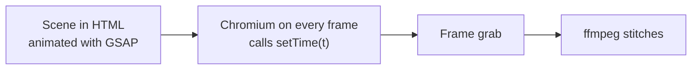
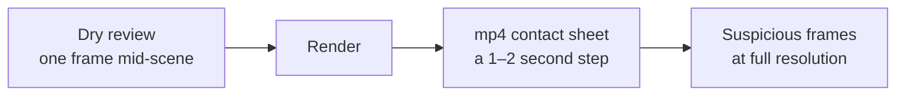

# 07. Assembling and checking the finished video

A twenty-minute retelling of a free course: 166 lines, about 2,800 words. Built carefully: not a single
speech-recognition error across twenty minutes of voice, every automated check green. The channel's author watched
it and said it was unwatchable: the illustrations were static. Four retelling longs like that on the channel got
between 32 and 79 views. Breakdown: [examples/course-retelling](../../examples/course-retelling/README.en.md).

Nine days later another long came out, ["The agent said the tests passed"](../../examples/agent-cheats-long/README.en.md):
2 minutes 7 seconds, its own photo background for each chapter, commands being typed, big numbers. It got praised
with one unprintable word, in the good sense. A measurement on the finished video showed the frame was 78% occupied
(median), while the previous long, built on the old grammar, had 24%.

This whole chapter lives between those two videos. The first half is about assembly: how to set up a frame so that
something happens in it at the pace of speech, and how not to break it technically. The second half is about
checking: why green QA tells you nothing about whether the video is interesting to watch, and which measurements
actually do tell you something.

## The engine: the frame as a function of time

The videos in this kit are assembled by code. A scene is written in HTML and animated (usually with GSAP), then a
headless browser scrubs through it frame by frame and grabs a picture. That's how [HyperFrames](../../docs/THIRD-PARTY.md)
and our [starter](../../starter/README.en.md) work: the scene has a `setTime(t)` function, a local Chromium calls it for
every frame, and ffmpeg stitches the result. The TV in [tv-no-ads](../../examples/tv-no-ads/README.en.md) is drawn in
code on a canvas; the [Instagram skit](../../examples/instagram-to-claude-skit/README.en.md) is built on three.js.
Different engines, one contract: the frame depends only on time. How this contract fits into the whole pipeline and where it came from is told in
[chapter 00a](00a-how-it-works.md).

Here's how it breaks. In preview the particles fly beautifully; in the render they're somewhere else. The handheld
camera shake is one thing in preview and another in the mp4. On scrubbing, an element appears in the wrong place.
The cause is always one of two: `Date.now()` or an unseeded `Math.random()`. The render scrubs the timeline back
and forth, and real time and randomness can't do that.

We have no measurement of our own here; the rule comes from the contracts of open-source HTML-to-video renderers.
But a violation shows up right away, and it's cheap to fix.

**What we do.** Randomness comes from a fixed, seeded generator; time comes only from `t`. No timers, no
`requestAnimationFrame` with its own counter, no variable-step physics.
[`tools/lint/motion_lint.py`](../../tools/README.md) flags `Math.random` directly in scene code.

**Where it breaks.** If you need physics, use an engine with a fixed step and run it from zero to `t`. Otherwise
every frame will be "almost" the same.

Agent recipe: [assembly-deterministic-timeline](../../recipes/assembly/assembly-deterministic-timeline.md)

## Animate by the word, not by the stopwatch

The first version of any scene looks like this: "the card slides in 2.3 seconds after the line starts". Then you
rewrite one word, the voice gets re-synthesized, the line gets half a second shorter, and all the events drift. The
card appears on the wrong word.

In the [video about tells of AI text](../../examples/ai-text-tells/README.en.md), the highlight on "a new stage" and on
the comma-separated triple lights up exactly on the narrator's word. The word's time comes from alignment (WhisperX
or similar), and after a voice edit everything moves along by itself.

A separate pitfall cost us a whole scene: the helper that looks up a word by line number had a silent fallback. The
line number got mixed up, the helper didn't crash, it quietly returned zero, and the scene vanished.

**What we do.** Hang every scene event on the time of a specific word from the alignment. A helper that can't find
the word crashes with an error instead of substituting a default.

**Where it breaks.** A block anchored to a word at the end of a line leaves the start of the scene empty. That's the
next section.

Agent recipe: [assembly-word-anchored-animation](../../recipes/assembly/assembly-word-anchored-animation.md)

## The empty scene start

The logic makes sense: the list slides in on the word "list", the big number on "twenty-five". But the line opens
with a lead-in, and the word you need arrives at second four or five. All that time the frame shows background and
captions. The audio and timing checks are green: the voice is there, the words are in place.

On the contact sheets of four shorts, this showed up as three empty frames in a row at the start of nearly every
scene. And in a 27-minute video, empty background took up 22% of the runtime, and not one check noticed.

**What we do.** Bring the block itself (the list frame, the diagram outline, the number's backing) in at the seam
between lines, right after the cut. Then light up the rows inside it word by word. From the first frame the viewer
sees what the scene is about, and then watches it fill in. After this fix, the median frame occupancy on those same
four shorts rose from 23% to 33–43%.

**Where it breaks.** If a line has no picture at all, moving to the seam won't help. You need content, not timing.

Agent recipe: [assembly-no-empty-scene-start](../../recipes/assembly/assembly-no-empty-scene-start.md)

## Block proportion beats zoom

A two-line quote 1440 wide and 170 pixels tall is technically "wide". So is a chain of four pills in a row, 1300 by
90. And the 16:9 frame is three-quarters empty. The agent tries to save it with the camera: pushing in, following
the content. At the maximum of 1.85 the emptiness remains, because you can't zoom a strip into a rectangle.

We measured frame occupancy by scene type across 96 scenes. Terminal 70–76%, quote 43%, file 35%, steps 31%,
comparison 27%, chains and tracks around 21%. See the pattern: the more happens inside a scene (a command being
typed, output scrolling), the better it fills the frame. The terminal wins not because it's pretty, but because it's
tall and alive.

**What we do.** Lay out the block to the frame's proportions: stack the chain as a staircase or in two rows, make the
quote bigger and taller. Type code and commands step by step with a `clip-path` mask, at the pace of speech. The
camera follows the text's actual ink, not the block's bounding box: in a pill 1280 wide, the text may take up 600.
One pass of such fixes took the median from 25% → 32%, scenes below 20% went from 21 to 10, and empty time from 19%
to 8%.

**Where it breaks.** Typing that runs longer than the line drags the pace. Shorten a long command: drop optional
flags and the domain. And for vertical, all these blocks will have to be laid out from scratch; see the vertical
chapter.

Agent recipe: [assembly-content-proportion](../../recipes/assembly/assembly-content-proportion.md), [assembly-terminal-typing](../../recipes/assembly/assembly-terminal-typing.md), [camera-follow-ink](../../recipes/camera/camera-follow-ink.md)

## The tween that outlived its scene

The mascot enters on one word and leaves a couple of seconds later. The exit was scheduled at a time that turned out
to be earlier than the end of the entrance. In GSAP a finished tween holds its end value, so the entrance played out
last, and the mascot stayed in the frame. It hung over other scenes for almost six minutes, from 9:48 to 15:41 of
the long. The bug made it into two versions in a row; both were re-rendered.

This pitfall has three relatives. `tl.set` doesn't survive a neighbor's finished tween. A container with
`opacity: 0` in CSS won't appear from animating its children. An inline `transform: scale()` conflicts with a tween
on `scale`.

**What we do.** For each element, check that the last tween in time is the exit, not the entrance. Schedule the exit
no earlier than the end of the entrance. Scenes must not overlap in their line ranges.

**Where it breaks.** On dry frames before render you can't see the sticking: every scene looks fine at its midpoint.
Only a contact sheet of the finished mp4 catches it; more on that below.

Agent recipe: [assembly-gsap-tween-lifetime](../../recipes/assembly/assembly-gsap-tween-lifetime.md)

## Heavy steps one at a time

When several agents build videos in parallel, each one launches voice synthesis, speech recognition and a headless
browser. Memory runs out, the system kills processes, and the render captures black tiles instead of frames. On
longs over 10 minutes, processes died from memory even without any parallelism.

**What we do.** Run synthesis, alignment and rendering behind a lock: only one heavy step at any moment. Five agents
under such a lock built five videos without a crash. In starter, `locked.py` does this.

**Where it breaks.** On a machine with plenty of memory you can keep two slots, but it's still better not to mix
synthesis and rendering. And don't delete someone else's lock, even if it looks stuck.

Agent recipe: [assembly-serialize-heavy-jobs](../../recipes/assembly/assembly-serialize-heavy-jobs.md)

## Green QA isn't "done" yet

Now the checks. The agent builds the video and runs loudness, recognition, timings, the scene contract, the motion
lint. All green, and the agent writes "done". A human watches and sees slop.

Three stories from our experience. A video passed fifteen green checks and was rejected: it had no event worth
watching for. A 2:11 reel with green QA, handed over without anyone looking at the frames, got "everything is very
bad". And that same 27-minute long with 22% empty background.

Automated checks are necessary: they cheaply catch technical defects. They just answer a different question. Not "is
this interesting?" but "is this broken?".

**What we do.** Keep two statuses apart. `ready_for_user_preview` in `qa/final-result.json` means technical
readiness, nothing more. Approval and publishing are decided by a human after watching the whole video. The delivery
passport is assembled by [`tools/project/artifacts.py`](../../tools/README.md), and the "viewed" and "accepted"
fields in it are not filled in by a script.

**Where it breaks.** The temptation is strong: everything's green, you want to ship. That's exactly the moment to
open the frames.

Agent recipe: [qa-green-is-not-approval](../../recipes/qa/qa-green-is-not-approval.md)

## Frame fill: measure the finished mp4

Emptiness can be measured. The question is what to measure. The first attempt went by the DOM: how much of the frame
the elements cover. A chain of pills 1300 by 90 counted as "wide", and therefore filled. The DOM said 20.5%, a pixel
measurement of the finished video said 25%, and the emptiness was still there.

On the 27-minute video, the mp4 measurement found sixteen holes longer than 9 seconds, the longest 33 seconds. Six
minutes of empty background in total, with green checks. For calibration: the long about the cheating agent, which
viewers accepted, holds a median of 78% and a bottom decile of 73%; the long built on the old pills held 24% and 13%.

**What we do.** Measure on the finished video: divide the frame into a 16×8 grid and count how many cells hold
content. [`tools/qa/frame_fill.py`](../../tools/README.md) in `grid` mode gives the median and the bottom decile of
occupied cells. The list of empty stretches (`empty_runs`) comes only from the default `fill` mode, which measures the
share of pixels that differ from the background. Crop out the caption band before measuring.

**Where it breaks.** Without cropping, captions count as content and the measurement comes out optimistic. And a
pre-render estimate by scrubbing a live page breaks after roughly 50 scrubs: the page stops repainting and needs a
reload.

Agent recipe: [qa-frame-fill-mp4](../../recipes/qa/qa-frame-fill-mp4.md)

## Stillness: turn off the camera and look

A filled frame isn't a living one yet. In the course retelling every frame was filled: a documentation page, a code
block, a list. And every one of them stood still. A slow push-in from 1.0 → 1.06 over five seconds created the
illusion of motion.

We ran the stillness lint on one long twice. With the push-in on, it found 3 static scenes. With it off, 41. That's
how much stillness the slow zoom was hiding.

**What we do.** Catch stillness on the scene timeline with the camera off: if the frame doesn't change for more than
three seconds, that's stillness ([QA-THRESHOLDS.md](../../docs/QA-THRESHOLDS.md)). [`tools/lint/still_lint.py`](../../tools/README.md) understands the starter
contract and writes `qa/still-lint.json` with a contact sheet. The cure is an event, not a push-in: rows light up
one at a time (that got us to 6% stillness), text gets typed, a page scrolls to the right spot, shot size changes
with a cut.

**Where it breaks.** The stillness lint can't see an empty frame where only the captions change: words switch every
half second, and the frame is technically "alive". That's what the fill measurement from the previous section is
for. You need both.

The second limit is about the camera itself. The lint turns off only the camera of DOM scenes whose push-in lives in
the CSS transform of the `#world` element. The starter's camera is drawn inside a Canvas, and the lint doesn't touch
it: on the starter the measurement runs with the camera on, and a push-in can hide stillness. An honest measurement
needs a camera-off mode in the scene (for example, a flag the camera function reads, switched on through `--pre-js`).
The starter doesn't have such a mode yet.

Agent recipe: [qa-still-lint](../../recipes/qa/qa-still-lint.md)

## A dry review before render, a contact sheet after

Rendering a long video takes hours, and a layout defect is baked into the mp4 by the end. So you look twice.

Before render, grab one frame from the middle of each scene. On a 31-minute long, a dry review of 104 frames like
this found six defects: two scenes on top of each other, a pill past the edge, overlapping elements, a stray
divider, an underline across the whole card, a sticker cut off by the edge. Plus two numbers that weren't in the
sources. Not one test caught any of it.

After render, build a contact sheet of the finished file. That catches what dry frames don't: a blinking word stuck
until the end of the video, a caption covered by a shape, three empty frames at the start of scenes.

**What we do.** Both reviews are done by a human or an agent with eyes, against a checklist: overlap, overflow,
clipping, a number with no source, tiny text. Take the finished mp4's sheet at a one-to-two-second step. Open
suspicious frames at full resolution.

**Where it breaks.** A sheet 320 px wide won't show a small overflow. A sheet at a 4-second step will miss a flash
shorter than the step: with frequent cuts, grab frames at the cuts.

Agent recipe: [qa-dry-frame-review](../../recipes/qa/qa-dry-frame-review.md), [qa-contact-sheet-final](../../recipes/qa/qa-contact-sheet-final.md)

## ASR on every take

Speech recognition is there to catch a swallowed word. Checking the final mix is useless: the music and neighboring
lines hide the stubs. On a long video, three takes out of 97 missing their first word were found only by a
per-line check.

But per-line recognition has its own problem: the recognizer's language model substitutes a familiar word for a rare
one. The Russian word «гит» ("git") was recognized as «гид» ("guide") in all 12 takes, even though the voice said it
correctly. The medium model once "lost" an entire sentence that nobody had lost; large-v3 heard it. In the
[video about the cancelled call](../../examples/mascot-cancels-call/README.en.md) it went the other way: recognition heard
«я» ("I") lasting 0.04 seconds where the synthesis had swallowed «ИИ» ("AI"), and that was true.

And about the threshold. Two real defects had text similarity of 0.975 and 0.988. A 0.90 threshold would have let
both through.

**What we do.** Recognize every take separately with the large-v3 model, with the topic's vocabulary in the prompt.
But not with the line's own text: then the model will hear what it was told. Look at missing words, not at the
similarity percentage. [`tools/voice/pick_take.py`](../../tools/README.md) picks the best of several takes based on
these measurements.

**Where it breaks.** Recognition doesn't see stress at all. «Модэль», the word "model" said with a hard "e", gets
written down as the normal «модель». Only your ears check stress. Your language has its own quirks of this kind;
see [gotchas/lang](../../gotchas/lang/README.md).

Agent recipe: [qa-asr-per-take](../../recipes/qa/qa-asr-per-take.md)

## The ffmpeg preflight check

The last layer, and the cheapest. Black frames, frozen stretches and loudness off target usually get spotted by eye
after publishing. But ffmpeg can find them itself: `blackdetect`, `freezedetect`, the scene-change detector and
`ebur128`. We have no measurements of our own for this set; it was put together from a review of local tools. The
same review says that a neural-network judge with a free-form prompt gives false positives, and with a checklist it
gives fewer.

**What we do.** Run the final through four filters. Compare the scene detector with the planned cut points. If you
call a vision model, give it a contact sheet and a concrete checklist, not "rate this video".

**Where it breaks.** `freezedetect` won't catch a frozen frame if changing captions are burned in on top. Crop out
the caption band before the check.

Agent recipe: [qa-preflight-ffmpeg](../../recipes/qa/qa-preflight-ffmpeg.md)

## Exercise

20–30 minutes, on a finished video from the starter or your own. Run every command from the repository root. For your
own video, substitute its path for `starter/output/final.mp4`.

1. Empty stretches: `python3 tools/qa/frame_fill.py starter/output/final.mp4 --json starter/qa/fill.json`. Write down
   the longest empty stretch.
2. Grid occupancy: `python3 tools/qa/frame_fill.py starter/output/final.mp4 --mode grid --cols 8 --rows 16`. For a
   vertical video the grid is 8×16; for a horizontal one keep the default 16×8. Write down the median.
3. `python3 tools/lint/still_lint.py starter --max-still 3`. How many scenes stand still longer than three seconds?
   Keep in mind that on the starter the camera stays on (see "Where it breaks" in the stillness section).
4. Make a contact sheet: `ffmpeg -i starter/output/final.mp4 -vf "fps=1/2,scale=320:-1,tile=6x2" starter/qa/sheet_%02d.jpg`.
   Go through it by eye and note everything suspicious: empty scene starts, overlaps, clipping.
5. Pick the emptiest scene and come up with one fix: bring the block in at the cut, re-lay it out for the proportion,
   or type the text out step by step. Make it and measure again.
6. Compare the median from step 2 with the chapter's reference points. They were computed with the same `grid` mode on
   horizontal longs: 24% for the long called static, 78% for the long that was praised. For a vertical video it's a
   rough guide, not a threshold.

## Don't

- Don't use `Date.now()` or an unseeded `Math.random()` in a scene.
- Don't hang events on a stopwatch from the start of the line.
- Don't hope the camera will fit a flat strip into a 16:9 frame.
- Don't mask a static frame with a slow push-in.
- Don't run several renders and syntheses in parallel on one machine.
- Don't say "done" on green QA without looking at the frames.
- Don't measure fill by the DOM.
- Don't run recognition on the final mix instead of the takes, and don't feed the recognizer the line's text.
