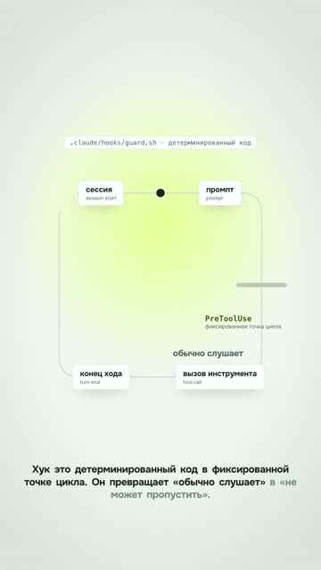
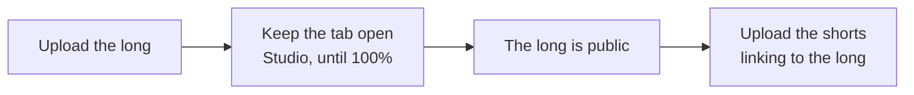
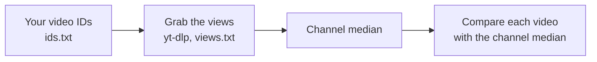

# 08. Vertical, publishing, call to action and analytics

The "Hooks" chapter of a twenty-minute long became a standalone 35-second vertical short. The voice and timings
came from the long, but the scene was rebuilt: the wide "session → prompt → tool call" loop became tall, the labels
moved under the nodes, the code card got narrower. The text on a phone came out larger than fitting the whole wide frame
would have given. Breakdown: [examples/hook-vertical-from-long](../../examples/hook-vertical-from-long/README.en.md).

Technically, everything was right. Now look at the numbers: shorts cut from tutorial longs on the channel got
between 1 and 17 views. This video's first sentence was a definition ("a hook is deterministic code at a fixed point
in the loop"), the first second was empty, and the voice came in at 1.2 s.

This chapter is about what happens after assembly. How to move a video to vertical so the text stays readable. How
to upload it without stepping on the platforms' rakes. How to call the viewer to action so they actually come. And
how to tell from the numbers what worked and what didn't, without fooling yourself.

## Re-layout, not crop

The fastest way to make a short from a long: cut a piece and center-crop it to 9:16. Or fit the whole horizontal
frame as a strip into a vertical canvas, title on top, caption below. The first cuts content off at the edges, the second makes
the text on the phone smaller than in the long. And a strip of video with a title on top is a second zone in the frame, which makes it a
slide.

Let's count. The content of a horizontal scene spans about 1620 of 1920 pixels in width (median across four clips,
from 1588 to 1708). These are three different operations. A center crop to 9:16 doesn't shrink the letters, but it
leaves a window about 608 pixels wide: a little over a third of the content fits. Fitting the whole 1920 frame into
the 1080 width scales everything by 0.56. Trimming the margins to the real content bounds and then scaling to 1080
gives 0.62–0.67. In the last two cases every letter gets one and a half to two times smaller than it was in the
horizontal video, which people already watch on a phone held sideways.

**What we do.** Rebuild each scene for a 1080 width: elements stack under each other, font size no smaller than in
the long, wide diagrams become tall, long commands get shortened. The voice and the word-anchored animations come
from the long without re-synthesis. Two series of four re-laid-out shorts each gave a median frame occupancy of
27–37% and 33–43%, no worse than their long (24%). The agent brief is in
[prompts/agent/vertical-relayout-review.md](../../prompts/agent/vertical-relayout-review.md).

**Where it breaks.** The long's camera, which spread content across the full 1920 width, gets in the way in
vertical. Its shots are recalculated too, not carried over.

Agent recipe: [vertical-relayout-not-crop](../../recipes/vertical/vertical-relayout-not-crop.md)

## The formula that keeps everything in frame

When you move to vertical, push-ins that were safe at 1920 suddenly slice the diagram's outer nodes in half. The end
of a chain sticks out past the right edge. The code card gets wider than the frame on a push-in.

The logic is simple. If the camera looks at world point P with magnification s, then world point x lands on screen
at `540 + s·(x − P)`. The visible band runs from 0 to 1080 in width. So on every push-in, every important element has
to land inside that band. In the hooks short, the code card had to be narrowed to 800 pixels at font size 24,
because at a 1.48 push-in it was wider than the frame. The diagram's rail was cut from 820 to 420 pixels: at a 1.1
push-in its end stuck out past the edge.

**What we do.** Calculate positions and camera from the center of the vertical frame using this formula, not by
shifting the long's original coordinates. Reduce the push-ins. Check everything that must stay in frame at the
extreme points of each shot.

**Where it breaks.** The formula knows nothing about the platform's interface. The bottom fifteen percent or so is
taken by the caption, and there's a column of buttons on the right. Check the frame with the interface overlaid.

Agent recipe: [camera-keep-in-frame](../../recipes/camera/camera-keep-in-frame.md)

## Titles on the seam, and when a split beats one zone

In the long, a scene's number and title appeared on the narrator's word. In a short of four or five scenes, that
means there's empty background between scenes every time. One 45-second video piled up five empty gaps of 0.8
seconds each. The long's pauses between lines (0.02–0.3 s) are too short for a proper seam.

**What we do.** Put the scene title on the seam, right after the cut, and space the short's lines at least 0.75 s
apart.

A separate note on the "one zone per frame" rule. It works for story videos. But for screen-based top lists (keys,
commands, tools), a simple split, "host on top, screen below", beat the full-screen version in an A/B on one video
about keys. The author's verdict on the full-screen one: "the previous one was better after all". In a sample of the
niche's hits, this split shows up on videos with 437 and 250 thousand views. The
["3 keys"](../../examples/three-keys-repeat/README.en.md) template is built exactly like that: the mascot in a circle
on top, narrow terminal crops below.

**Where it breaks.** In a story or a skit, the split turns back into a slide. There, it's one zone.

Agent recipe: [vertical-titles-on-joint](../../recipes/vertical/vertical-titles-on-joint.md), [vertical-split-face-screen](../../recipes/vertical/vertical-split-face-screen.md)

## Two versions in a row: what we saw

That same video, ["3 Claude Code keys"](../../examples/three-keys-repeat/README.en.md). The first version went out and
was called "a vibe". Then the background, captions and ending were changed (a code word instead of "save this"), and
the second version was uploaded the same day. Same text.

The second version got 3 views on YouTube and 0 on TikTok. The channel's ceiling for ordinary shorts at the time was
around 1.0–1.3 thousand. The first version's metrics weren't recorded and there's no control comparison, so we don't
know why it flopped.

**What we do.** As a precaution we don't upload an improved version next to the first: we change the topic, hook and
first frame so that it's a different video. If you do upload two versions, record the metrics of both.

**Where it breaks.** We have no proven fix: we haven't compared deleting the first version or re-uploading.

Agent recipe: [publishing-no-twin-versions](../../recipes/publishing/publishing-no-twin-versions.md)

## Upload pitfalls: long first, file to 100%, the draft in the Shorts tab

Platforms behave like living things, and each has its own traps. Here are the ones that have already cost us time.

Shorts cut from a long mentioned it with a link in the description. Once, the long got stuck while uploading, was
uploaded again with a new link, and the descriptions of the already published shorts had to be rewritten one by one
on every platform. Here's how it got stuck: the file was over 100 MB, a processing dialog appeared after the file
was picked, and the tab got closed. The upload froze at 49%, and Studio never offered a "Resume" button.

The second trap: the "Publish" button didn't work, and it looks like nothing was uploaded. In fact, Studio keeps the
button inactive while it says "Processing will begin shortly", the click goes nowhere, and the file is already
sitting there as a draft. And a vertical draft lives in the "Shorts" tab, not "Videos". You search the videos, don't
find it, and open the published long instead because the title looks similar.

On TikTok, right after publishing, a video sits in "Only me" status with a "Content is being reviewed" note. In both
recorded cases it switched to "Everyone" by itself within a few minutes. No need to re-upload.

**What we do.** The long goes first, and only once it's actually public do the shorts linking to it go out. Don't
close the Studio tab until 100%. If a click didn't work, look for the draft in the "Shorts" tab instead of uploading
again. On TikTok, wait out moderation.

**Where it breaks.** A network drop breaks the upload even with the tab open: upload big files over a wired
connection. On TikTok, not every account gets clickable links in the description: there, point to your profile or
the material's page. On YouTube, links in Shorts descriptions and comments aren't clickable
([YouTube Help](https://support.google.com/youtube/answer/13748639)): a short points to your own long through the "Related video" setting, and to
external material through the link in your channel profile.

Agent recipe: [publishing-long-before-shorts](../../recipes/publishing/publishing-long-before-shorts.md), [publishing-wait-upload-100](../../recipes/publishing/publishing-wait-upload-100.md), [publishing-failed-click-is-draft](../../recipes/publishing/publishing-failed-click-is-draft.md), [publishing-tiktok-only-me](../../recipes/publishing/publishing-tiktok-only-me.md)

## The "made for kids" flag and the AI label

This pitfall is quiet, and that's what makes it dangerous. A video goes out with the audience set to "Made for
kids", and YouTube itself turns off its comments and notifications. From the outside the video looks normal. Only
the "write a word in the comments" call doesn't work, because nobody can comment.

In a series of one long and four shorts, the flag got set on all five. Five more videos had slipped out the same way
before that. Each time it was removed by hand after publishing.

Instagram has a similar story with the AI label. The Reels wizard keeps changing: for a ready-made vertical, the crop
screen no longer appears, and the "Add AI label" toggle hides. In four recorded uploads, nobody found it.

**What we do.** After every YouTube upload, open the video in Studio and check the audience. The warning sign from
the outside: "Comments are turned off". On Instagram, look for the label by hand, and repeat the disclosure about
synthesized voice or images in the caption.

**Where it breaks.** If the video really is for kids, the flag is required and comments will be closed. Instagram's
interface changes without warning, and menu items may be named differently.

Agent recipe: [publishing-youtube-kids-flag](../../recipes/publishing/publishing-youtube-kids-flag.md), [publishing-instagram-ai-label](../../recipes/publishing/publishing-instagram-ai-label.md)

## The code word and what's behind it

Viewers skip a "subscribe and like" ending. A code word works. We looked at 1,470 reels by 101 Russian-speaking
creators about AI over 30 days. The 147 videos with a code word had a median of 22 comments on a median of 1,105
views: 1.96% comments to views. The other 1,323 had a median of 6 comments, 0.26%. A 7.5x difference.

But the word on its own is empty. In the same sample, the most comments went to promises like "a link to an
open-source agent on GitHub plus a full install guide": 9,207 comments on 190 thousand views. A business lesson with
no tool got 30–330.

In the [video about tells of AI text](../../examples/ai-text-tells/README.en.md), the ending goes: «Пиши в комментах
слово чисто. Скину скилл, который это вычищает» ("Comment the word 'clean' and I'll send you the skill that scrubs
this out"). A specific free thing, one word. Viewers, by the way, started joking with one of the tells and left
comments made of a single long em dash. In your language the code word itself and the way people play with it will
be different; for language-specific traps in voice and recognition, see
[gotchas/lang](../../gotchas/lang/README.md).

**What we do.** End the reel with a question or a code word, and behind the word promise a specific free tool with a
guide that gets you to a first result. Keep the promise honest: in that same AI-text video, the skill noticeably
fixes only some genres, while the CTA promised more.

**Where it breaks.** YouTube has no direct messages, so the "write the word, I'll DM it to you" mechanic doesn't
work there. We found that out on [DeepSeek](../../examples/deepseek-headlines/README.en.md) with the word «ИИ» ("AI")
and on ["Guess which one is my voice"](../../examples/guess-my-voice/README.en.md). A link in the description or a
pinned comment of a Short doesn't solve it either: links in Shorts descriptions and comments aren't clickable
([YouTube Help](https://support.google.com/youtube/answer/13748639)). Put external material behind the link in your channel profile and say so in the
video; point to your own long video through the short's "Related video" setting. In the description of a regular
long video, links are clickable.

The second limit is about the replies. A reel with a codeword collected 386 comments, and in the evening about 15
identical links went out in DMs within 11 minutes, by hand, from a browser profile that upload automation also used. By
morning the account was suspended. The platform gave no reason, and it is one case, but it is not worth the risk:
reply via the official API, with a per-hour cap, varied text and not a bare link as the first message.

Agent recipe: [cta-codeword-in-comments](../../recipes/cta/cta-codeword-in-comments.md), [cta-promise-free-tool](../../recipes/cta/cta-promise-free-tool.md), [cta-youtube-link-in-description](../../recipes/cta/cta-youtube-link-in-description.md)

## Material first, then the call

In "3 keys", the code word promised a cheat sheet with every key combination. The cheat sheet post never came out.
Another story: a LinkedIn post with 19.5 thousand impressions, three people publicly asked for the guide in the
comments, and nobody told them where to get it. The demand came and went. That author's next call to action earns
less trust.

**What we do.** Prepare the lead magnet before the video is published. Give each code word its own static page and
reply with a link to it: the material can be updated, the link doesn't get lost, and the same link can go in the
YouTube description.

**Where it breaks.** A public page is open to everyone, not just the people who wrote the word. If you need a
contact, the page leads further, to a channel or a form. And if nobody but you needs the material yet, it's better
to have no call at all than an empty one.

Agent recipe: [cta-deliver-before-asking](../../recipes/cta/cta-deliver-before-asking.md), [cta-page-per-codeword](../../recipes/cta/cta-page-per-codeword.md)

## The hit metric: a multiple of the creator's median

How do you know a video took off? Absolute views lie: on a big account, any video is "big". So we count a hit like
this: the video got at least five times its creator's median and at least 100 thousand views. For young videos the
bar is softer, three medians and 50 thousand.

We measure our own channel the same way. One yt-dlp command grabs the public views of every video, and a month later
you have a table instead of impressions. A snapshot of 39 of our videos: the shorts' ceiling was 1.0–1.3 thousand;
the best performers were the everyday story "asked the AI, got something absurd" and the meme character; narrow
tutorials 2–400, cuts from longs 1–17, longs 12–625. Sounds sad until you compare it with the niche: the median
Shorts for similar Western channels is 1.4–2.4 thousand.

And here's the TV on that scale: 212 thousand against the account's usual hundreds. Not five medians, but several
hundred.

**What we do.** Once a week, pull your videos' views into a table and compare each with the channel median. Take
ideas from the niche's hits, selected by the same rule, not out of your head.

**Where it breaks.** Public counters are rounded, and they have no completion rates or traffic sources: this is
correlation, not cause. Look at retention and CTR in Studio. Instagram and TikTok give incomplete counters without
logging in.

Agent recipe: [analytics-yt-dlp-views](../../recipes/analytics/analytics-yt-dlp-views.md), [idea-find-hits-by-median](../../recipes/idea/idea-find-hits-by-median.md)

## Platforms don't transfer

The TV reel. Instagram: 212 thousand views and 7.5 thousand likes on the first evening, and a day later 21.5 thousand
likes and 257 comments. YouTube and TikTok: from 1 to 328 views across different uploads of two versions. Which of
the two versions went to Instagram isn't recorded.

Text platforms are the same. On Telegram, five posts in different genres got the same reach within a 7% spread,
while on LinkedIn the same topics diverged in impressions by 2.5x.

**What we do.** Upload to every platform at once, and draw conclusions for each one separately. "The format worked"
always means "worked here".

**Where it breaks.** If you only have one platform, the rule becomes "don't carry conclusions across time periods":
algorithms change.

Agent recipe: [analytics-no-cross-platform-transfer](../../recipes/analytics/analytics-no-cross-platform-transfer.md)

## Comments: count people, not the counter

What sets a hit apart is comments, not likes: hits have 1.4 times more comments per view at equal likes. Under the
TV video people asked "how do I do it without Claude?", "won't it brick the TV?", "who's sniffling in there?", and
each of those questions became the topic of a reply video.

But the comment counter lies. It includes the author's own replies and repeat comments from the same people. A post
with 17,581 impressions: the counter said 24; of the 23 expanded entries, 10 were the author's replies, leaving 11
outside commenters. By the counter, 1.37 comments per thousand impressions; by unique outside commenters, 0.63. A
2.2x overstatement, and on a question post it reached 5.5x.

And the last step: clicks. The month's highest-reach post got 19,123 impressions, 35 profile views and zero
followers, zero clicks. There was no clickable link in the profile.

**What we do.** Compare videos and posts by unique outside commenters per thousand impressions. Count the funnel all
the way to the link click: if the platform doesn't report clicks, use a tagged link or a link to your own page. On
Telegram, where all posts get almost the same reach, compare reactions per thousand views, and only within the
first 36 hours: after that, views keep growing while reactions stall.

**Where it breaks.** Where the comment thread can't be fully expanded, the metric is counted on the visible part and
understates activity. And a code word inflates comments, so compare code-word videos with code-word videos.

Agent recipe: [analytics-unique-external-authors](../../recipes/analytics/analytics-unique-external-authors.md), [analytics-clicks-not-impressions](../../recipes/analytics/analytics-clicks-not-impressions.md), [analytics-telegram-reactions-36h](../../recipes/analytics/analytics-telegram-reactions-36h.md)

## Exercise

20–30 minutes.

1. Put your video IDs into `ids.txt`, one per line, and grab the views with one command:
   `yt-dlp --skip-download --ignore-errors --print "%(id)s %(view_count)s %(title)s" -a ids.txt > views.txt`.
   Work out the median. Which video is farthest above it, and which farthest below?
2. Take one of your horizontal frames with text. Measure the content width and work out how many times smaller the
   font gets when cropped to 1080 wide. More than 1.5x: re-lay it out.
3. Open your latest YouTube upload in Studio and check the audience. Is the "made for kids" flag set?
4. Write down the calls to action from your last two videos. Is there a ready page with material behind every code
   word? If not, make one or drop the call.
5. Open the comments under your most-discussed post and count unique outside commenters. Compare with the counter.

## Don't

- Don't crop a long into vertical, and don't fit it as a strip between a title and a caption.
- Don't upload an improved version next to the first one.
- Don't publish shorts before the long they link to.
- Don't close the Studio tab until a big file reaches 100%.
- Don't re-upload a "stuck" video before checking drafts and moderation.
- Don't promise anything in a call to action that isn't published yet.
- Don't use a DM code word on YouTube.
- Don't measure success by impressions, and don't carry a conclusion from one platform to another.
