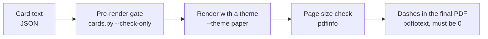
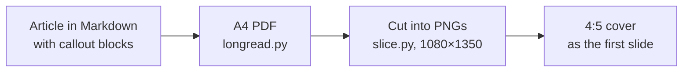

# 09. Carousels, covers, slide decks

Let's start with a bug that looked like a matter of taste. A carousel card pack is laid out at 1080×1350, but on a
phone the text looks soft. Not badly, but noticeably: the letters seem slightly blurred. You open the PNG and see
810×1013. The platform stretches it to its own width, hence the blur.

A neighboring script on the same layout produced clean 1080×1350. The difference was one flag in one command:
`pdftoppm -r 72` versus `-r 96`. WeasyPrint writes 1 CSS pixel as 0.75 points, and `-r 72` draws one point as one
pixel. Each side loses a quarter. No error in the console, no warning.

This chapter is about static content: carousels, covers, PDF guides and slides for talks. There's no motion here,
and it seems simpler than video. In fact, the mistakes here are quieter: in a video an empty frame jumps out at you,
while in a carousel a tofu box instead of a hyphen, or "3 / 7" on the sixth card, gets noticed in the comments.

Everything below is packed into three utilities with tests: [`tools/carousels`](../../tools/carousels/README.md)
(cards, longread to PDF, slicing a PDF into a carousel, SVG infographics), [`tools/covers`](../../tools/covers/README.md)
(a title in code over an AI background, plus vector covers) and [`tools/slides`](../../tools/slides/README.md) (a
single-file HTML deck and a Markdown generator). The example is the same everywhere, on a neutral topic: coffee in a
cezve (Turkish pot).

## Content separate, look separate

The first carousel is usually born as one script: card text and styles inside. Then you need a dark theme, and the
script gets copied. Then a brand theme, then another format. A month later there are five copies. A bug fixed in one
lives on in four, and the number on the third card is already different in two of the copies.

We have no measurement of our own here, but the story is familiar to anyone who's ever laid things out by hand.

**What we do.** Text lives in data (JSON for cards, Markdown for a longread); the look lives in one theme CSS file
with variables in `:root`. A new theme means a copy of `paper.css` with different tokens, not a copy of the script.
`tools/carousels/themes` has three: `paper` (warm paper), `night` (graphite) and `plain`. A card in JSON is built from
component classes: `.giant` for a giant number on the cover, `.phrase` for a hero phrase, `.bignum-grid` for a grid
of numbers, `.check` for a checklist, `.panel` with a red or green border for "bad" and "good".

A pack structure that works: cover (a number or a phrase), what happened, the numbers, the counterpoint, what to do.
Usually that's a cover, four to eight cards and a closing card.

**Where it breaks.** A card with a one-off infographic (a diagram, a map) doesn't fit the shared set of classes. Keep
it as a separate HTML fragment, but in the same theme.

Agent recipe: [carousels-content-theme-split](../../recipes/carousels/carousels-content-theme-split.md)

## A gate before render, a gate after

Here are mistakes we've seen on slides that were already published. "3 / 7" on the sixth card, because a card got
inserted in the middle and the numbers weren't recounted. An em dash in a diagram label. A tofu box instead of a
glyph. "17/30" on a cover, which reads as a fraction even though it's a date.

We didn't count how often these happen. But one detail is telling: the dashes in SVG labels were found only by the
second gate, on the finished PDF. The text check on the JSON couldn't see them, because the labels were generated by
code.

**What we do.** Before rendering, `cards.py` checks the card text (the `label` and `body` fields) and refuses to draw
if something's off. Here is what it actually checks. Zero em dashes. The "N / M" number matches the position and the
card count. No Russian constructions «не просто X, а Y» and «не только X, но и Y» ("not just X, but Y", "not only X,
but also Y"): they give away machine text. The gate only knows the Russian patterns; English phrasings like "Not just
fast, but reliable" pass. No glyphs from a short list that have already rendered as boxes for us, and no private use
area characters; the gate doesn't check whether the chosen font covers your text. The `"last": true` flag sits only on
the last card (no "swipe" on it). No words from the `ban_words` list. No two cards share a file name. After rendering,
`cards.py` checks every PDF page size with `pdfinfo`.

In the kit, the dash search in the finished PDF via `pdftotext` is done by `longread.py`, for longreads. For a card
pack, run it by hand; the answer should be 0:

```bash
cd tools/carousels
python3 cards.py examples/coffee-turka.json --check-only
python3 cards.py examples/coffee-turka.json --theme paper --out out/coffee
pdftotext out/coffee/pack.pdf pack.txt
python3 -c "print(open('pack.txt').read().count('\u2014'))"
```



**Where it breaks.** The gate won't check meaning or the accuracy of what you say. "The service is free" will pass
every check even if the service went paid long ago. That's proofreading by a human.

Agent recipe: [carousels-prerender-gate](../../recipes/carousels/carousels-prerender-gate.md)

## Pixels: -r 96, not 72

This is the story from the start of the chapter. A 1080×1350 card in CSS pixels becomes an 810×1012.5-point page in
the PDF. `pdftoppm -r 72` draws one point as one pixel, giving 810×1013. `-r 96` brings back an honest 1080×1350.

The same card engine with `-r 72` produced a pack of 810×1013 PNGs, while the neighboring script with `-r 96` on the
same layout produced 1080×1350. A 0.75 difference on each side, which is about 56% of the pixels by area.

**What we do.** Rasterize WeasyPrint px pages only with `-r 96`. `tools/carousels` has a test that checks the size of
the finished PNG, and it fails if someone puts 72 back.

**Where it breaks.** If `@page` is set in millimeters or points, `-r 96` won't give whole pixels. Then use
`-scale-to-x` and `-scale-to-y`.

Agent recipe: [carousels-pdftoppm-96dpi](../../recipes/carousels/carousels-pdftoppm-96dpi.md)

## The vanishing @page

The next quiet bug. A carousel suddenly comes out with its right edge cut off. It looks like a broken layout. In fact,
WeasyPrint silently dropped the `@page` rule because there was junk in front of it in the CSS, and the page fell back
to the default A4: 595×842 points instead of the 1080-pixel layout.

The junk came from string concatenation in Python. In the expression `"X" + """...""".replace("X", faces)`, the
`.replace` method only attaches to the triple-quoted string, and the `"X"` literal stays as the first character of
the CSS. The parser swallows it together with the `@page` rule. We found it only through `pdfinfo`.

**What we do.** After every render, check the page size with `pdfinfo`. For cards, expect 810×1012.5 pt; for a
longread, A4 at 595×842 pt. If it doesn't match: exit code 2, no PNGs get created. Concatenate CSS simply as
`faces + css`.

**Where it breaks.** If the size is set in millimeters or inches, work out the expected points yourself: an inch is
72 points.

Agent recipe: [carousels-pdfinfo-page-size](../../recipes/carousels/carousels-pdfinfo-page-size.md)

## Fonts: local and complete

Two ways to ruin a font. The first: pull in Google Fonts via `@import`. WeasyPrint fetches the font over the network
at render time, which can hang for tens of seconds or fail without a connection. In a sandbox with a 45-second limit
per command, a render with that import ran right into the limit. The second: take a "Cyrillic only" or "Latin only"
subset. Numbers and Latin letters inside Russian text turn into tofu boxes. If your text mixes scripts or uses
accented letters, your language has the same kind of trap; see [gotchas/lang](../../gotchas/lang/README.md) for
language-specific quirks.

**What we do.** Install complete font files on the system (Inter, Noto Sans, PT Serif, all under the open OFL
license) or load them locally via `@font-face`. The themes in `tools/carousels` call fonts by name with a fallback,
so without the font installed the text stays readable, it just looks different.

**Where it breaks.** WeasyPrint doesn't always handle variable fonts (one file for all weights) consistently. If the
weight comes out strange, use static files for each weight.

Agent recipe: [carousels-local-full-fonts](../../recipes/carousels/carousels-local-full-fonts.md)

## One article, two formats

A longread is needed both as a PDF document (LinkedIn, download) and as a swipe carousel (Telegram, Instagram).
Laying out two versions by hand means doing the work twice, and within a week the numbers in them diverge.

The format's reach numbers are decent. A PDF document carousel on LinkedIn and Telegram got 3,585 views; a 77-page
handbook got 8,099 in total across platforms. An English-language PDF carousel turned out to be the best format by
reach on LinkedIn, at about 1,387 impressions. An important caveat: this is the format's reach, not a comparison with
hand layout.

**What we do.** Write the article in Markdown with callout blocks (`:::callout`, `:::numbers`, `:::bars`, `:::flow`).
`longread.py` builds an A4 PDF: a cover, a page for each second-level heading, SVG infographics. Then `slice.py` cuts
the PDF into 1080×1350 PNGs, fitting the pages onto a canvas in the page color. A 4:5 cover can replace the A4 cover
as the first slide.

```bash
python3 longread.py examples/coffee-turka.md --theme paper --out out/longread
python3 slice.py out/longread/coffee-turka.pdf --out out/slides \
  --cover art.png --skip-first
```



**Where it breaks.** An A4 page fitted by height into 4:5 gets margins on the sides, and small type on the slide
becomes unreadable. For a carousel, plan a large font on the A4 or lay out dense pages separately. And remember: one
topic per page, callouts don't break across pages, budget your text from the start.

Agent recipe: [carousels-longread-to-carousel](../../recipes/carousels/carousels-longread-to-carousel.md)

## The cover: the model paints the background, code sets the letters

Ask an image generator for "a cover with the title X". You'll get garbled letters, stray strokes, "almost
Cyrillic". You can't fix it, only regenerate. And if the title has a typo or a number needs to change, start over.

So the division of labor is this. The model paints the background and leaves a calm zone for text. Code lays the
title on top, with a scrim (a semi-transparent backing) so it reads over busy art. One and the same background
covers both the PDF cover and the carousel's first slide.

There's a reverse pitfall too, this time on the code side. An icon with an "8x" badge got copied into the next post's
cover and labeled it with someone else's number. Since then, the badge is only a parameter of a specific cover, and
the icon itself has no text.

**What we do.** Generate the background from a prompt with no text, letters, numbers or logos (example in
`tools/covers/examples/art-prompt.txt`). `overlay.py` lays the title. If you don't need AI art, `cover.py` draws a
vector cover: a metaphor icon, a number or phrase, two or three lines. Stickers with captions are drawn the same way:
text by code, font size fitted to the field width. A pack of eight 512×512 stickers weighs 33–38 KB per sticker, and
the large line's font size shrinks from 62 to 24 pixels on a 284-wide field.

```bash
cd tools/covers
python3 overlay.py art.png out/cover.png --spec examples/coffee-cover.json
python3 cover.py examples/coffee-covers.json --out out/covers
```

**Where it breaks.** Without a scrim, the title gets lost on busy art, and a dark scrim on a light engraving kills
the art: use the `paper` theme. cairosvg doesn't understand a comma-separated font list and silently takes the
default font with no bold, so `cover.py` substitutes a single installed name. Font-size fitting won't save a very
long phrase: wrap it by hand or shorten it.

Agent recipe: [carousels-cover-ai-background-only](../../recipes/carousels/carousels-cover-ai-background-only.md), [carousels-stickers-text-by-code](../../recipes/carousels/carousels-stickers-text-by-code.md)

## The deck: HTML, with a PDF just in case

A deck the agent laid out in HTML looks better than a pptx: your own font, live blocks, animations. And it's easier
for the agent to edit: a single file with no framework can be read and changed in one pass. But the venue may not
have the right browser or a network. A reveal.js deck breaks without a network because it pulls files from a CDN.

For scale: an 18-slide deck weighs about 30 KB as HTML, and its PDF backup made of screenshots of 18 pages is about
1 MB. We have no "HTML versus pptx" measurement on audiences.

**What we do.** Write slides in Markdown, separating them with a `---` line, and build them with `md2deck.py` into a
single HTML file with no dependencies: arrow keys, an "N / M" number, a progress bar, and `#5` in the address opens
the fifth slide. The template has an `@media print` that puts each slide on its own page and hides the navigation.
That's how a 42-slide deck for a 90-minute talk got printed. Build the PDF in advance and check it not by flipping
through, but by page count and a contact sheet.

```bash
cd tools/slides
python3 md2deck.py examples/coffee-turka.md -o out/coffee.html
pdfinfo deck.pdf | grep -E "Pages|Page size"
```

**Where it breaks.** The background disappears in print unless you turn on "Background graphics" in the dialog. A PDF
made of screenshots doesn't let you select or search text: if people will read the backup, print through print CSS.
A scrolling slide gets cut off in print; split those in two. Pick the contact sheet grid to match the slide count
(6×7 holds 42).

Agent recipe: [slides-html-deck-with-pdf-backup](../../recipes/slides/slides-html-deck-with-pdf-backup.md), [slides-print-css](../../recipes/slides/slides-print-css.md), [slides-check-pdf](../../recipes/slides/slides-check-pdf.md)

## Exercise

20–30 minutes. You'll need WeasyPrint and poppler; installation is in
[`tools/carousels/README.md`](../../tools/carousels/README.md).

1. Go to `tools/carousels` and run the gates on the example: `python3 cards.py examples/coffee-turka.json --check-only`. It should come back clean.
2. Break the gate on purpose: copy the JSON, put an em dash into any card and change the number "2 / 5" to "3 / 5".
   Run it again and read what the script said.
3. Render the pack in two themes: `--theme paper --out out/coffee` and `--theme night --out out/coffee-night`. Open a PNG and check the size: it should be 1080×1350.
4. Run `pdftoppm -r 72 -png out/coffee/pack.pdf test72` on the same PDF and compare size and sharpness on a phone. There it is, the blur.
5. Build a deck: move to the sibling folder with `cd ../slides` (`md2deck.py` lives in `tools/slides`), then run
   `python3 md2deck.py examples/coffee-turka.md -o out/coffee.html`, open it, print to PDF and check `pdfinfo`: are
   there as many pages as slides?

## Don't

- Don't keep card text and styles in one script, and don't copy the script to get a new theme.
- Don't rasterize WeasyPrint pages with `-r 72`.
- Don't trust a render without `pdfinfo`.
- Don't pull in Google Fonts via `@import`, and don't use font subsets.
- Don't ask an image generator to write the title.
- Don't bake numbers into icons.
- Don't lay out one article twice by hand.
- Don't present a deck built on a CDN framework without a PDF copy.
- Don't treat green gates as proofreading: open the cover and two or three dense cards with your own eyes.
