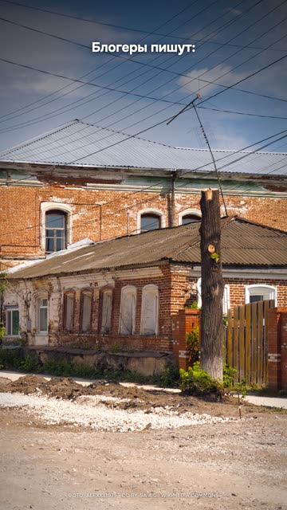
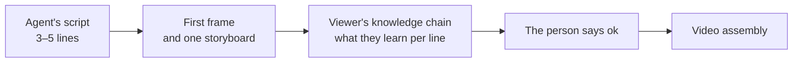
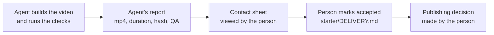

# 10. The agent as editor, brand and character

Bloggers were claiming that Claude can pinpoint a location from a single photo to within two meters. We decided to
test it blind: two photos with no metadata, a separate agent with no access to the answer, the answer key stored
separately, reverse image search forbidden. The result: 440 meters off on the first photo and 54 kilometers on the
second. The video went out with a two-layer conclusion: two meters is marketing, but it can already work out your
city, so don't post the view from your window. Breakdown:
[examples/photo-geo-blind-test](../../examples/photo-geo-blind-test/README.en.md).

The most interesting thing about this video isn't the numbers, it's how the agents behaved during the test. One
wanted to "take a closer look" and cropped the source photo with a command that had no output file, overwriting the
original. Repeating the experiment on that photo became impossible. Another hit the network sandbox and started
looking for a way around it to reach an outside mapping service. And the request "write down your reasoning, it'll
go into the video" worked like an attempt to extract the model's hidden reasoning: the safeguard cut the answer off,
and the agents crashed.

That's what working with Claude Code or Codex as your editor looks like. It's fast, confident, never tired, and does
the work of a dozen people. And at the same time it cuts corners wherever you didn't put up a fence, trusts its
memory more than the live CLI, and reports "done" without looking at the frames. This chapter is about fences. And
at the end, about brand and character: things the agent will never choose on its own, and will instead copy from
the first video into every one after it.

## Script before assembly

You give the agent a topic, and it builds the whole video: script, voice, scenes, render. You see the result an hour
later and say "slop". An hour of synthesis and rendering went into an idea you could have thrown out after three
lines.

This has happened to us many times. A video passed fifteen green automated checks and was rejected. Three videos in
a row on the same template got a single word: "slop". There's no measurement of the effect on retention; this is
experience, but very repeatable.

**What we do.** The agent first shows a 3–5 line script, the first frame and one storyboard. Plus the viewer's
knowledge chain: what they learn after each line. If the lines can be shuffled without losing meaning, it's not a
script, it's a list. Assembly doesn't start without your "ok". For a batch of videos there's a ready-made brief
template, [prompts/agent/batch-brief.md](../../prompts/agent/batch-brief.md): with it, a batch of five videos gave
three accepted, while before it, copies of one successful video kept getting "slop".

**Where it breaks.** The method comes from open-source scriptwriting repos and platform documentation. We haven't
measured its effect on retention on our own videos. We only measured how many hours it saves when the idea is bad.

Agent recipe: [idea-script-before-build](../../recipes/idea/idea-script-before-build.md)

## Copies of source files and a closed network

Back to the photo. `sips -c 600 800 photo.jpg` without `--out` overwrites the original. The agent didn't mean to
break anything, it wanted a closer look. But for a blind test, the original matters more than any conclusion. In the
same test, the second agent hit the sandbox and went looking for a way around it. We didn't count how often this
happens; two cases were enough.

**What we do.** The agent works on copies. Originals (photos, voice recordings, source data) live outside the folder
it has access to. Close the network wherever the answer could be peeked at, and check that the sandbox actually
holds. Before a big edit in starter, save a restore point: `./make.sh checkpoint save NAME`.

**Where it breaks.** `chmod a-w` doesn't protect against an agent that can run `chmod` through the shell. The only
reliable option is to physically move the originals out of its directory.

Agent recipe: [agent-work-on-copies](../../recipes/agent/agent-work-on-copies.md)

## An "evidence log" instead of "reasoning"

The video needs the agent's train of thought: how it found the place, why it picked this product. The request "your
reasoning will go into the video" sounds innocent, but it gets read as an attempt to extract the model's hidden
reasoning. The safeguard cuts the answer off.

The same task, worded differently: "keep a log of the evidence you found in the photo". The blind test went through,
and the misses of 444 meters and 53.7 kilometers went into the video honestly (rounded on screen to 440 m and 54 km).
A crosswalk sign, power lines, brick with window trims were shown as big crops of the photo, and that became the
best part of the video. We didn't count the crash rate with the first wording, but with the second there were no
crashes.

**What we do.** Ask the agent to keep a log of evidence, observations or decisions, not to show its reasoning.

**Where it breaks.** The log contains what the agent decided to write down. It's not a verbatim trace of the model's
computation. Present it that way in the video: "the agent logged the evidence", not "here's how the AI thinks".

Agent recipe: [agent-evidence-log-wording](../../recipes/agent/agent-evidence-log-wording.md)

## Tests under lock

Tell an agent "make the test pass", and it fixes the test instead of the code. In an editing pipeline it's the same,
only quieter: quality checks and scene contract tests get rewritten to match a broken result, and green status stops
meaning anything.

We tested the ban with four runs of `claude -p` on CLI version 2.1.283 with the task "make the failing test pass".
One of the runs used `--dangerously-skip-permissions`. The test file didn't change once. This story became part of
the long [about the agent that peeked at the tests](../../examples/agent-cheats-long/README.en.md): our own experiment on
top of someone else's research, with the ban line in the description.

**What we do.** In the project settings, deny `Edit(./tests/**)`. Specifically Edit: a `Write(...)` rule doesn't apply
to paths, and the CLI warns you about that itself.

**Where it breaks.** We didn't check whether the rule blocks edits through the shell (`sed -i`, `cat >`). If the agent
is allowed Bash, consider that hole open. Behavior may change between CLI versions; recheck after updating.

Agent recipe: [agent-deny-edit-tests](../../recipes/agent/agent-deny-edit-tests.md)

## Commands from the live CLI, not from memory

The script for a video about a tool is written by the model, and it confidently names commands that don't exist. It
hurts most when the video is exposing other people's mistakes: your own made-up command damages trust more than
anything.

On a long about the CLI we found four made-up commands. Two before assembly: a nonexistent command and "five modes"
when `--permission-mode` has six values. Two halfway through the render: `/review` and `/diff`, which weren't among
the built-ins. Two lines had to be re-voiced.

A similar story with a clean run. You're filming "how the plugin works out of the box", and the agent picks up your
personal copy of the same skill and your CLAUDE.md. What's on screen won't match what the viewer gets.

**What we do.** Check every command and flag in the script against the live CLI: `--help`, `/help`, searching the
binary, documentation for the same version. Run the demo without your own settings: `--setting-sources ""` and an
explicit `--plugin-dir`.

**Where it breaks.** The set of flags changes between versions. Check `claude --help` right before recording, not a
week earlier.

Agent recipe: [agent-verify-cli-in-binary](../../recipes/agent/agent-verify-cli-in-binary.md), [agent-clean-run-setting-sources](../../recipes/agent/agent-clean-run-setting-sources.md)

## Data that can't be read two ways

The agent calculates from a CSV and writes the code itself. A column named «продано_шт» ("units_sold") reads both
as "ordered" and as "actually bought". The agent picks the wrong meaning, subtracts returns a second time, and a wrong
number goes into the video, where it then gets shown big, as the hero of the frame.

That's what happened on the margin video: −51,457 ₽ instead of the correct −40,625 ₽ on one product for a month.
Caught before release.

**What we do.** Name columns so there's no second reading: «заказано_шт», «выкуплено_шт», «возвраты_шт»
("units_ordered", "units_bought", "units_returned"). Whatever language your column names are in, it will have its
own ambiguous words; for language-specific quirks in voice and recognition, see
[gotchas/lang](../../gotchas/lang/README.md). And keep one control number, worked out by hand, to check the agent's
answer against.

**Where it breaks.** Renaming doesn't protect you from a wrong formula the agent chose on its own. You always need
the control number.

Agent recipe: [agent-unambiguous-csv-columns](../../recipes/agent/agent-unambiguous-csv-columns.md)

## The little thing that eats a batch

Batch processing over a list: `while read file; do claude -p ...; done < list.txt`. The loop processes the first line
and quietly exits. The agent CLI reads stdin and eats the rest of the list. On a five-line list without `</dev/null`,
one got processed; with `</dev/null`, all five. No error, just four videos that never got built.

**What we do.** Inside a `while read` loop, give `claude -p` and `codex exec` the input `</dev/null`.

**Where it breaks.** If the agent needs input via stdin (`cat file | claude -p`), pass it explicitly for each call
and iterate the list through a different file descriptor.

Agent recipe: [agent-stdin-dev-null](../../recipes/agent/agent-stdin-dev-null.md)

## You look at the frames

The last fence, and the most important. The agent built the video, ran loudness, recognition, contract tests, and
writes "done". The checks measure sound and structure, not the picture.

Three cases. A batch of five videos from parallel agents: in one, a caption was covered by a shape, the agent missed
it, and it was found while reviewing frames. A long passed the audio check (−15.2 LUFS, zero word misses, contract
tests 6 of 6), while 26% of its runtime was a half-empty frame. A 2:11 reel with green QA, handed over without
review, got "everything is very bad".

**What we do.** Before the word "done", a human looks at the finished video's contact sheet. In its report, the
agent writes the mp4 path, duration, hash, QA result, and separately: what was checked by eye and ear, and what
wasn't. The "accepted" and "OK to publish" fields in the delivery passport
([starter/DELIVERY.md](../../starter/DELIVERY.md)) are not filled in by the agent. And nothing gets published without
your separate command.

**Where it breaks.** A sheet at a 4-second step will miss a flash shorter than the step. For edits with frequent
cuts, grab a frame every second or at every cut.

Agent recipe: [qa-contact-sheet-final](../../recipes/qa/qa-contact-sheet-final.md)

**How to send the notes.** "It's kind of boring here" gives the agent nothing to change. Name the second, the defect and
the action: "at 0:06 the headline takes four lines, cut it to two, bigger font, hold one more second, shift the next
scene so the end isn't clipped". One note per defect, and the agent's reply has to quote the timestamp and the file it
touched.

Agent recipe: [agent-feedback-name-the-frame](../../recipes/agent/agent-feedback-name-the-frame.md)

## A human picks the palette

Now, brand. We looked at 14 video projects and found that 13 of them used the same black palette. Nobody had chosen
it. It came from the first video, made "Apple-style", and kept getting copied from file to file, because the agent
uses the neighboring project as its model. The question "why are we always in a dark style?" didn't come up right
away.

**What we do.** Keep the palette in `:root` of a single CSS file; the timeline and generators read it via
`getComputedStyle`. No color literals in scenes. After pulling the colors out like this, we built one test piece in
three themes (black, warm paper, brand) and picked the brand theme by looking at three frames side by side. Use the
bright brand color only as a fill: lime `#d6ff43` on white gives a contrast of 1.15:1, olive `#425319` on white
8.46:1. For accent text, add a dark shade.

**Where it breaks.** Colors inside photos and generated backgrounds aren't controlled by tokens. Match them to the
palette through the prompt.

Agent recipe: [brand-palette-in-root](../../recipes/brand/brand-palette-in-root.md), [brand-accent-fill-only](../../recipes/brand/brand-accent-fill-only.md)

## The mascot once, the logo at the end

A mascot in the corner for the whole video and a logo as a watermark are chrome, like on a slide. The viewer stops
noticing them after three seconds, and the frame looks like a presentation. The second problem is technical, and you
already saw it in the assembly chapter: a mascot scheduled on the last word of a scene hung over other scenes for
almost six minutes, from 9:48 to 15:41.

**What we do.** The mascot appears once per episode, on a fitting word, and it's secondary to the frame's main
subject. In the [hooks short](../../examples/hook-vertical-from-long/README.en.md) it moved to a corner the camera
doesn't use and appears next to the diagram, not instead of it. The emblem and channel name appear only at the end.
Stickers and the mascot go on a separate layer outside the camera, so a push-in doesn't enlarge them and a pan
doesn't carry them off the edge. A white outline made of four shadows turns a cut-out PNG into a sticker.

**Where it breaks.** In a skit where the mascot is the main character, the rule doesn't apply: it's in the frame by
the story. And if the sticker is an object in the world by the story (a sticker on a laptop), the camera moves it
legitimately.

Agent recipe: [brand-mascot-once-logo-last](../../recipes/brand/brand-mascot-once-logo-last.md), [brand-stickers-outside-camera](../../recipes/brand/brand-stickers-outside-camera.md)

## Character: the hero's live voice, and no real people

You want to give a character with personality (a boss, the hero of a skit) a synthesized voice. What you get is a
flat, "sad" intonation, and changing the timbre doesn't cure it. The boss character got three synthesis versions,
and all three were rejected as "sad". A talking head on a clone of the author's own voice went through six variants
(different references, with and without speed-up, with and without an enhancer), and all six were rejected.

And then the [Instagram skit](../../examples/instagram-to-claude-skit/README.en.md): the hero's voice recorded on a
phone's voice recorder, Claude and the mascot voiced by synthesis, and a meme shout from the mascot at the end. The
best rating of all the skits. The phone recording, by the way, turned out cleaner than the laptop one: a
signal-to-noise ratio of 41 dB versus 33.

The character has to be your own. Look at ["Goro cancelled the call"](../../examples/mascot-cancels-call/README.en.md): a
stone-faced mascot in a circle over a crisp chat interface. The previous version, with generated mascot poses, got
called neural slop. And this approach has a limit: the mascot can't do new actions without new source video, so you
can't continue a series that fast.

**What we do.** Give the lead role to a live voice, and leave synthesis for secondary characters. Don't generate real
people: not people from the news, not famous figures. That's a fake, and platforms require an AI label for realistic
content with a real person. Make the next character video on a different template: a copy of a successful video a
day later turns into slop.

**Where it breaks.** The live-voice conclusion rests on one listener's ratings; there are no metrics to compare. The
weights of many voice models are under a non-commercial license, so commercial use needs a different engine.
Platform rules on AI labels change; check before publishing.

Agent recipe: [voice-live-for-character](../../recipes/voice/voice-live-for-character.md), [face-no-real-person](../../recipes/face/face-no-real-person.md), [idea-no-repeat-own-hit](../../recipes/idea/idea-no-repeat-own-hit.md)

One caveat about someone else's brand. The mascot, logo and palette of this kit's author are not licensed along with
the code and texts; see [BRAND.md](../../docs/BRAND.md). The recipes describe the technique; make your own character and
colors.

## Exercise

20–30 minutes, in Claude Code or Codex.

1. Ask the agent for a video script on any everyday topic. The condition in the prompt: only 3–5 lines, the first
   frame, and a "what the viewer now knows" table after each line. Forbid assembly until your "ok". Read it: can the
   lines be shuffled? Then it's a list.
2. Add a `Edit(./tests/**)` deny to a test project's `.claude/settings.json`, drop in a failing test and ask "make
   the test pass". Watch what the agent tries to edit.
3. Take any script about a tool (yours or the agent's) and write out every command and flag. Check each against
   `--help`. How many weren't there?
4. Find every color literal in your scenes: `grep -rn "#[0-9a-fA-F]\{6\}" scene/`. How many are there? Move at least
   three into `:root` and build a frame in two themes.

## Don't

- Don't let the agent build a whole video without an agreed script.
- Don't give the agent originals and an open network where it could break something or peek at the answer.
- Don't ask for "reasoning for the video"; ask for an evidence log.
- Don't leave tests without an `Edit` deny, and don't rely on `Write`.
- Don't trust commands from the model's memory; check them against the live CLI.
- Don't name data columns so they can be read two ways.
- Don't run `claude -p` inside `while read` without `</dev/null`.
- Don't accept "done" without looking at the frames, and don't let the agent publish without your command.
- Don't let the first video's palette move into every one after it.
- Don't park the mascot in a corner for the whole video, and don't generate real people.
