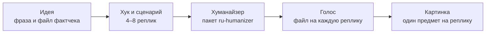
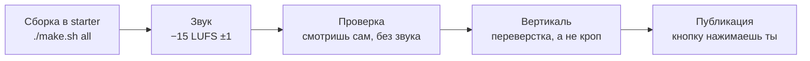

# 00. Первый ролик за вечер

Двадцать секунд. Четыре фразы. Человек просит нейросеть освободить пятницу, нейросеть сбрасывает пятницу, а следом
падают все остальные дни недели. Счётчик встреч тает с 15 до нуля, в финале звучит совет «поручая нейросети
задачу, скажи, что должно уцелеть», и ролик закольцовывается на первый кадр.

Этот ролик ([разбор](../../examples/free-friday/README.md), [YouTube](https://youtube.com/shorts/sNg2qsj1Ag4)) на
дату замера был лучшим шортсом канала на YouTube: 1 307 просмотров. Это не залёт, это потолок канала, но в нём есть
всё, что нужно первому ролику: одна бытовая ситуация, абсурд, показанный действием, понятная без звука картинка и
короткий хронометраж. Ни лица, ни студии, ни монтажёра. Сценарий умещается на салфетку.

Эта глава проводит тебя по десяти этапам от идеи до публикации. Дальше в учебнике каждый этап разобран подробно, с
цифрами и ошибками. Здесь только маршрут и признак «готово» на каждом шаге.

Перед стартом поставь [starter](../../starter/README.md) и прогони его демо с гудками вместо голоса. Установка и
скачивание моделей в вечер не входят: это отдельный вечер, и он скучный. Если работаешь с агентом, дай ему
[AGENTS.md](../../AGENTS.md): там написано, как искать рецепт и когда остановиться.

Главное правило маршрута: не переходи на следующий этап, пока нет признака «готово». Ошибку в сценарии дешевле
поймать до голоса, а ошибку в голосе дешевле поймать до рендера. Мы проверили это на себе: двадцатиминутный ролик
собрали целиком без пробника, а потом услышали «это не смотрибельно». Час синтеза и несколько часов рендера ушли
на формат, который можно было отбросить по тридцатисекундному куску.

## 1. Идея

Первая ошибка новичка: начинать с инструмента. «Сделаю ролик про то, как поставить X». Мы сделали десятки таких, и
цифры однозначные: How-To по инструменту на канале набирал от 2 до 400 просмотров, а ролик про пятницу, где
инструмент вообще не назван, 1 307. Зрителю неинтересен инструмент. Ему интересно, что случилось.

Поэтому начни с ситуации. Бытовая боль (созвон, письмо, календарь, телевизор с рекламой) плюс неожиданный
результат. Или возьми чужой ролик, который залетел в твоей нише, и придумай свою историю в его ритме. Проверка
простая: можешь пересказать ролик другу одной фразой без названия инструмента? Если нет, у тебя туториал.

Сразу заведи файл фактчека. Пустой. Туда пойдут источники и тезисы, которые говорить нельзя. Зачем на первом
этапе: агент уверенно пишет цифры и команды по памяти, и ролик, который «разоблачает чужие ошибки», легко выходит
с собственными выдуманными.

Подробно про идеи: [глава 01](01-idea-hook-script.md). Разбор чужого рила по секундам делается промптом
[reel-teardown-card](../../prompts/agent/reel-teardown-card.md).

**Готово, когда** идея умещается в фразу «кто, что случилось, чем кончилось», рядом лежит ссылка на образец и
пустой файл фактчека.

Рецепт для агента: [idea-everyday-absurd](../../recipes/idea/idea-everyday-absurd.md),
[idea-find-hits-by-median](../../recipes/idea/idea-find-hits-by-median.md),
[idea-remake-rhythm-not-words](../../recipes/idea/idea-remake-rhythm-not-words.md),
[idea-factcheck-file](../../recipes/idea/idea-factcheck-file.md)

## 2. Хук и сценарий

Сначала пиши первую фразу, потом всё остальное. В семи разобранных хитах ниши первое слово звучит в нулевую
секунду, интро нет ни у одного. «Сегодня расскажу», «скоро», «в тиктоке советуют» убивают ролик раньше, чем
зритель понял, о чём он. Первая фраза пятничного ролика: «Попросил нейросеть освободить пятницу». Сразу ситуация и
обещание, что сейчас что-то пойдёт не так.

Потом сценарий на 4–8 реплик с одним примером: на 20 секунд хватит четырёх, на 40 около восьми. Для первого ролика держись в пределах 40 секунд. Мы однажды
отправили рил на 2:11, где с 8-й по 19-ю секунду объяснялась методология, а смешные примеры шли после таблиц.
Вердикт был «всё очень плохо». Один пример равно один ролик, остальные примеры пойдут в следующие.

И покажи сценарий кому-нибудь до сборки. Хотя бы себе завтрашнему. Несколько строк текста отбрасываются за минуту,
готовый ролик за вечер.

Промпты: [hook-first-second](../../prompts/script/hook-first-second.md),
[scenario-from-material](../../prompts/script/scenario-from-material.md),
[antislop-brief](../../prompts/script/antislop-brief.md).

**Готово, когда** есть 4–8 реплик, первая отвечает на вопрос «что случилось», а читатель сценария не спросил
«и что?».

Рецепт для агента: [hooks-result-in-first-second](../../recipes/hooks/hooks-result-in-first-second.md),
[idea-script-before-build](../../recipes/idea/idea-script-before-build.md),
[idea-one-example-short-reel](../../recipes/idea/idea-one-example-short-reel.md)

## 3. Прогон через хуманайзер

Сценарий, который написала модель, звучит как диктор: «не X, а Y» в каждой второй фразе, тройки через запятую,
«новый этап». Если заметишь это после синтеза голоса, придётся переозвучивать дубли и пересобирать тайминги.
Поэтому текст правится до первого дубля.

Сними диагностику сканером (пакет `ru-humanizer`) и поправь точечно: штампы, тире, тройки. Не проси «сделай
живее»: модель допишет эмоции и выводы, которых у тебя не было. После правки сверь числа, даты и имена с
исходником, потому что редактура любит их сдвигать.

И помни: «чисто» у сканера не значит «живой сценарий». Сканер видит слова, а не форму. Рил на шаблоне «топ-3»
прошёл сканер почти без замечаний и получил оценку «нейрослоп».

Подробно: [глава 02](02-text-humanizer.md). Промпт сверки фактов:
[fact-check](../../prompts/script/fact-check.md).

**Готово, когда** сканер не ругается, числа и имена совпадают с исходником, а текст, прочитанный вслух, звучит
как ты.

Рецепт для агента: [text-humanize-script-before-tts](../../recipes/text/text-humanize-script-before-tts.md),
[text-local-edit-not-rewrite](../../recipes/text/text-local-edit-not-rewrite.md),
[text-fact-lock-before-after](../../recipes/text/text-fact-lock-before-after.md),
[text-scanner-misses-form-slop](../../recipes/text/text-scanner-misses-form-slop.md)

## 4. Голос

Самый простой путь: начитать реплики самому, по одному файлу на реплику, режимом `./make.sh live` в starter.
Запиши на телефон, а не на ноутбук: у ноутбука мы насчитали 385 щелчков рта за 34 секунды, и синтез потом их
копирует.

Если синтезируешь, готовься к сюрпризам. Синтез ставит неверные ударения, глотает первое слово, обрывает
последний звук, не делает пауз на тире. В пятничном ролике слово «ИИ» пришлось заменить на «нейросеть»: синтез
читал аббревиатуру невнятно, а распознавание слышало вместо неё «я» длиной 0,04 секунды. Метки ударения
помогают через раз, поэтому слово с неверным ударением заменяй другим словом.

После синтеза прогони распознавание речи по каждому дублю отдельно, а не по готовому миксу. На длинном ролике
так нашлись три дубля из 97 без первого слова, которые в общем миксе никто не услышал.

Подробно: [глава 03](03-voice.md). Утилиты `voice/ru_tts_text.py`, `voice/pick_take.py`, `audio/tail_trim.py`,
`audio/gaps.py` описаны в [tools/README.md](../../tools/README.md), русские грабли синтеза в
[gotchas](../../gotchas/README.md).

**Готово, когда** у каждой реплики свой файл, распознанный текст совпадает с репликой, ни одно слово не съедено в
начале и в конце, а пауз длиннее 0,8 с нет.

Рецепт для агента: [voice-live-for-character](../../recipes/voice/voice-live-for-character.md),
[voice-record-reference-clean](../../recipes/voice/voice-record-reference-clean.md),
[voice-stress-by-rewording](../../recipes/voice/voice-stress-by-rewording.md),
[qa-asr-per-take](../../recipes/qa/qa-asr-per-take.md)

## 5. Картинка

На каждую реплику один главный предмет во весь кадр. В пятничном ролике это календарь с пятью карточками дней и
один счётчик, который тает через весь ролик. Больше ничего.

Три ошибки, которые мы сделали все. Первая: рисовать реальную вещь SVG-силуэтом. Ролик про машину с рисованным
силуэтом получил резкий отказ и вопрос «почему не взять картинку реальной». Реальная вещь показывается настоящим
фото с открытой лицензией. Вторая: заголовок сверху, схема в центре, плашка внизу. Это слайд, сколько ни анимируй.
Третья: оживлять статичную картинку медленным наездом. Наезд 0,6 % в секунду получил вердикт «мало динамики».

Подробно: [глава 04](04-image-and-frame.md). Утилиты `image/depth.py` и `image/depth_layers.py`, промпты
[backdrop-preamble](../../prompts/image/backdrop-preamble.md) и
[image-agent-wrapper](../../prompts/image/image-agent-wrapper.md).

**Готово, когда** для каждой реплики понятно, что в кадре, у каждого чужого фото записаны источник и лицензия, а
реальных людей без их согласия в кадре нет.

Рецепт для агента: [image-real-object-real-photo](../../recipes/image/image-real-object-real-photo.md),
[transitions-one-zone-no-chrome](../../recipes/transitions/transitions-one-zone-no-chrome.md),
[camera-no-ken-burns](../../recipes/camera/camera-no-ken-burns.md),
[image-depth-parallax-layers](../../recipes/image/image-depth-parallax-layers.md)

## 6. Сборка в starter

Положи голос и картинки в starter, поправь `scene/scene.ts`, собери `./make.sh frames`, потом `./make.sh all`.

Главное на этом этапе: анимация привязана к времени слова, а не к секундомеру. Когда диктор говорит «только
пятницу», пятница падает ровно на этом слове. Тайминги слов берутся из выравнивания речи. Если повесить анимацию
на «через 3,7 секунды», она разъедется с голосом после первой же правки реплики.

Вторая частая беда: пустое начало сцены. Блок привязан к своему слову, а слово звучит на пятой секунде сцены, и
пять секунд зритель смотрит на фон. Выводи блок на стык реплик.

Подробно про камеру и монтаж: [глава 05](05-camera-editing.md), про сборку и проверку: [глава 07](07-assembly-qa.md). Задание агенту
лежит в [starter/FIRST-TASK.md](../../starter/FIRST-TASK.md).

**Готово, когда** `./make.sh all` завершился с кодом 0, есть `output/final.mp4`, а `lint/still_lint.py` не
находит сцен, стоящих дольше 3 с (порог и на чём он мерился: [QA-THRESHOLDS.md](../../docs/QA-THRESHOLDS.md)).

Рецепт для агента: [assembly-word-anchored-animation](../../recipes/assembly/assembly-word-anchored-animation.md),
[assembly-no-empty-scene-start](../../recipes/assembly/assembly-no-empty-scene-start.md),
[assembly-motion-timing](../../recipes/assembly/assembly-motion-timing.md)

## 7. Звук

Starter сам синтезирует тихий пэд, если трек не задан. Свой трек с открытой лицензией укажи в `reel.json`, кредит
перенеси в описание. Финал своди к −15 LUFS ±1: так звучат хиты, и тихий ролик на их фоне кажется сломанным.

На склейки ставь шумовые вжухи, на события в кадре звуки по смыслу. В пятничном ролике четыре секунды вообще без
речи: падают дни, и это слышно. Зрители одного нашего ролика услышали во вжухах шмыганье носом и устроили под ним
обсуждение, а ролик набрал 212 тысяч просмотров. Вжухи мы оставили.

Подробно: [глава 06](06-sound-captions.md).

**Готово, когда** QA starter не ругается на громкость и пики, а голос на динамике телефона не тонет в музыке.

Рецепт для агента: [sound-loudness-like-hits](../../recipes/sound/sound-loudness-like-hits.md),
[sound-sfx-by-meaning](../../recipes/sound/sound-sfx-by-meaning.md),
[sound-keep-noise-whooshes](../../recipes/sound/sound-keep-noise-whooshes.md)

## 8. Проверка

Зелёный `qa/final-result.json` значит только, что техника в порядке. Один наш ролик прошёл 15 зелёных
автоматических проверок и всё равно был отвергнут. Другой, 27-минутный, при зелёных проверках шёл пустым фоном
22 % хронометража: шесть минут одних субтитров.

Поэтому смотри сам. Открой контактный лист `qa/sheet.jpg`, посмотри ролик целиком со звуком и ещё раз без звука.
Пятничный ролик понятен без звука: дни падают, счётчик тает. Если твой без звука непонятен, это не беда звука, это
беда картинки.

Промпт [meaning-check](../../prompts/script/meaning-check.md) проверяет смысл по кадрам готового mp4. Утилиты
`qa/frame_fill.py`, `qa/jitter.py`, `project/artifacts.py`.

**Готово, когда** ты сам посмотрел ролик до конца, без звука понятно, что произошло, в контактном листе нет пустых
и налезающих кадров.

Рецепт для агента: [qa-green-is-not-approval](../../recipes/qa/qa-green-is-not-approval.md),
[qa-contact-sheet-final](../../recipes/qa/qa-contact-sheet-final.md),
[qa-frame-fill-mp4](../../recipes/qa/qa-frame-fill-mp4.md),
[qa-preflight-ffmpeg](../../recipes/qa/qa-preflight-ffmpeg.md)

## 9. Вертикаль

Starter собирает вертикаль 1080×1920, поэтому для первого ролика этап можно пропустить. Если ролик горизонтальный,
вертикальную версию делай переверсткой, а не кропом. Мы мерили: центральная обрезка в 9:16 отрезает края содержимого,
а вписывание горизонтального кадра в ширину 1080 уменьшает текст до 0,56–0,67 от исходного размера (0,56 для всего
кадра, 0,62–0,67 после обрезки полей), на телефоне его не прочитать.

Подробно: [глава 08](08-vertical-publishing.md). Промпт: [vertical-relayout-review](../../prompts/agent/vertical-relayout-review.md).

**Готово, когда** текст в вертикали не мельче, чем в исходнике, и при наезде камеры ничего не уходит за край.

Рецепт для агента: [vertical-relayout-not-crop](../../recipes/vertical/vertical-relayout-not-crop.md),
[camera-keep-in-frame](../../recipes/camera/camera-keep-in-frame.md),
[vertical-titles-on-joint](../../recipes/vertical/vertical-titles-on-joint.md)

## 10. Публикация

Кнопку «опубликовать» нажимаешь ты, агенту её не отдавай. Если в финале кодовое слово, обещанный материал должен
лежать на месте до выхода ролика. Мы однажды пообещали шпаргалку по кодовому слову и так её и не выложили. Ролик
набрал 3 просмотра, но неприятно не это, а обещание, которое осталось висеть.

Заливай на все площадки. Ролик про телевизор без рекламы собрал 212 тысяч просмотров в Instagram и от 1 до 328 на
YouTube и в TikTok. Залёт случается там, где не ждёшь, и вывод с одной площадки на другую не переносится.

После заливки на YouTube проверь, не встал ли сам собой флаг «для детей»: он отключает комментарии. У нас так
случилось со всеми пятью роликами одной серии. Метку ИИ в Instagram ставь вручную.

Подробно: [глава 08](08-vertical-publishing.md). Утилита `project/artifacts.py` фиксирует, какой именно файл ушёл.

**Готово, когда** ролик вышел на всех площадках, флаг «для детей» снят, метка ИИ стоит, ссылки в описании живые,
а в календаре записана дата первого замера просмотров.

Рецепт для агента: [cta-codeword-in-comments](../../recipes/cta/cta-codeword-in-comments.md),
[cta-deliver-before-asking](../../recipes/cta/cta-deliver-before-asking.md),
[publishing-youtube-kids-flag](../../recipes/publishing/publishing-youtube-kids-flag.md),
[publishing-instagram-ai-label](../../recipes/publishing/publishing-instagram-ai-label.md)

## Что дальше

Если хочется понять, что происходило под капотом на каждом этапе и почему ролик собирается кодом, читай
[главу 00а](00a-how-it-works.md).

Первый ролик вышел. Самое опасное теперь: сделать второй на каркасе первого. Если первый зашёл, хочется повторить
тот же фон, ту же карточку, тот же порядок. Мы выложили вторую версию ролика сразу после первой и получили 3
просмотра на YouTube и 0 в TikTok. Третий подряд ролик на одном каркасе получил оценку «слоп». Второй ролик
начинай с новой ситуации.

Если вместо ролика нужны карусель или презентация, первые три этапа те же, дальше идёт вёрстка: [глава 09](09-carousels-slides.md).

## Упражнение

Возьми таймер на 30 минут и пройди только этапы 1 и 2.

1. Выпиши три бытовые просьбы, которые ты мог бы дать нейросети: отменить встречу, ответить маме, разобрать почту.
2. Для каждой доведи буквальное выполнение до абсурда в три шага, каждый хуже предыдущего.
3. Выбери одну. Напиши сценарий в четыре фразы: просьба, уточнение, катастрофа, вывод.
4. Проверь первую фразу: есть в ней событие? Звучит она в нулевую секунду, без вступления?
5. Перескажи ролик вслух одной фразой без названия инструмента. Получилось? У тебя есть первый ролик. Не
   получилось? Начни с другой просьбы.

## Чего не делать

- Не начинай с установки моделей в тот же вечер: это съест вечер целиком.
- Не делай первый ролик туториалом по инструменту.
- Не собирай ролик целиком, пока сценарий никто не прочитал.
- Не синтезируй голос до прогона текста через хуманайзер.
- Не считай зелёный QA одобрением.
- Не публикуй вторую версию ролика рядом с первой.
- Не отдавай агенту кнопку публикации.
