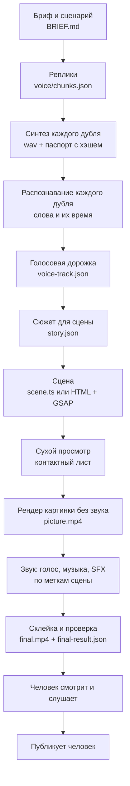

# 00а. Как это устроено: ролик как программа


У этого набора есть предыстория, и без неё непонятно, почему он устроен именно так.

Сначала мы делали свой движок. Он назывался Pygmalion, и идея у него была та же, что у всего набора: агент делает
ролик кодом, а не мышкой в монтажке. За лето мы собрали на нём много шишек. Синтез глотал первое слово и обрезал
хвосты, ударения ехали, анимация разъезжалась с голосом после каждой правки, все проверки были зелёными на роликах,
которые никто не досматривал, а шаблоны давали одинаковую картинку.

Пока мы это делали, большие команды выпустили то же самое. Diffusion Studio сделал видеоредактор для агентов, где
проект представляет собой папку с кодом. HeyGen выложил в открытый доступ HyperFrames: сцена на HTML, рендер в
браузере без окна. К концу сентября у HyperFrames было около 53 тысяч звёзд на GitHub, а поверх него уже выросли
надстройки вроде Hypit. Движок, который мы писали месяцами, стал общедоступной вещью, и делают его люди, для которых
это основная работа.

Седьмого сентября 2026 года это стало видно на одном ролике. Его собрали дважды за день. Сюжет простой: человек
просит нейросеть освободить пятницу, и она сносит всю неделю. Версия в Diffusion Studio вышла с выводом только текстом
на экране: адаптер постановки был рассчитан на три реплики, четвёртая не влезла, и автор канала ответил «не
доозвучено». Вечером ту же историю собрали на HyperFrames, взяв от Pygmalion голос и проверки. Вошли все четыре
реплики, громкость −15,8 LUFS, и ролик понравился. Через три дня он вышел как [«Попросил нейросеть освободить
пятницу»](../../examples/free-friday/README.md).

Вывод оказался неприятным, но полезным. Наша ценность не в движке. Она в том, что лежит поверх него: как обращаться
с русским синтезом, как привязать картинку к голосу, что мерить в готовом файле, как должен выглядеть и двигаться кадр,
чтобы его смотрели, и на каких роликах всё это проверено. Движок можно взять чужой. Этот набор и есть то, что поверх.

Эта глава про то, как всё устроено под капотом: почему ролик здесь пишется как программа, через какие шаги он
проходит, что мы взяли из своего движка и из чужих и какой движок когда брать. Остальные главы разбирают отдельные
этапы. Здесь собрано, как они соединяются в одну систему.

Главу можно читать без установки чего-либо. В конце есть упражнение, где ты увидишь все шаги на своей машине.

## Главная идея: ролик собирается кодом

Обычный видеоролик делают в монтажной программе. Человек тащит клипы на дорожки, двигает ключевые кадры, слушает,
подрезает. Вся работа держится на руке и глазе: где должна быть склейка, человек чувствует.

Агент так работать не умеет. Мышки у него нет, и сотню раз прослушать кусок он тоже не может. Зато он хорошо делает
другое: пишет код, запускает его, читает результат замеров и правит текст. Отсюда главное решение набора. Ролик
описывается файлами: реплики лежат в JSON, сцена в TypeScript или HTML, звук в списке событий. Готовое видео
получается из них программой, и его всегда можно пересобрать.

Что это даёт на практике:

- **Повторяемость.** Одни и те же исходники дают тот же mp4. Если что-то сломалось, видно, какой файл поменялся.
  В наборе это проверяют прямо: рендерят дважды и сравнивают хэши кадров.
- **Правки текстом.** «Поставь карточку на слово "пятница"» превращается в одну строку кода. Не надо помнить, где
  на дорожке был ключевой кадр.
- **Проверка замером.** Готовый файл можно измерить: громкость, пустые куски кадра, застывшие отрезки, слышно ли
  каждое слово. Агенту это заменяет глаз и ухо там, где их можно заменить.
- **Агент видит свою работу.** Он снимает кадры через равные промежутки, раскладывает их на контактный лист и
  смотрит. Это не просмотр ролика, но вёрстку, наложения и пустые места на листе видно.

У решения есть цена, и её надо знать заранее:

- **Каждую визуальную идею надо запрограммировать.** «Тут бы что-то живое» в монтажке закрывается стоковым клипом
  за минуту. Здесь это сцена, которую кто-то должен написать. Отсюда главная болезнь первых месяцев: ролики выходили
  статичными, потому что движение стоит труда, а неподвижная карточка нет. Подробно в главах [04](04-image-and-frame.md),
  [05](05-camera-editing.md) и [07](07-assembly-qa.md).
- **Замеры не говорят, интересно ли смотреть.** Все проверки могут быть зелёными на ролике, который не досмотрит никто.
  Последнее слово всегда за человеком, который смотрит готовый файл.
- **Нужна среда.** Синтез голоса, распознавание речи, headless-браузер, ffmpeg. Набор старается свести это к
  минимуму, но совсем без установки не обойтись.

## Конвейер целиком

Вот весь путь ролика от идеи до публикации. Каждая стрелка здесь означает файл, который один шаг отдаёт другому.



Пройдём по шагам. Названия файлов взяты из [starter/](../../starter/README.md), в основном пайплайне они почти такие же.

**1. Бриф и сценарий.** До всякого кода записываются точные реплики, что видит зритель в каждый момент и что он
получает в конце. Это правило выросло из провала: копию удачного ролика собрали на том же каркасе без показа
сценария, и её назвали слопом. Сценарий показывают человеку до сборки, потому что переписать абзац дешевле, чем
пересобрать ролик. Об идеях и сценарии подробно в главах [01](01-idea-hook-script.md) и [02](02-text-humanizer.md).

**2. Реплики.** Сценарий режется на куски, каждый синтезируется отдельно. В `voice/chunks.json` у каждой реплики
свой текст, пауза после неё и движок синтеза. Отдельные куски нужны, чтобы переделать одну фразу, не трогая
остальные: синтез голоса каждый раз звучит немного иначе, и перегенерация всего ролика ради одного слова меняет всё.

**3. Синтез каждого дубля.** Каждая реплика превращается в wav. Рядом пишется паспорт: точный текст, движок,
настройки и хэш файла. Хэш нужен, чтобы следующий шаг заметил, что звук поменялся, а тайминги остались старыми. Такая
ошибка у нас была: реплику переписали, а в кадре висели слова из прошлой версии. Ключ кэша теперь включает и текст.
Голос и его ловушки разобраны в главе [03](03-voice.md).

**4. Распознавание каждого дубля.** Каждый wav прогоняется через распознавание речи (Whisper, WhisperX). Это две
проверки в одной. Во-первых, сказаны ли все слова: синтез умеет проглотить первое слово или отрезать хвост.
Во-вторых, на какой секунде звучит каждое слово. Без этих времён сцена не знает, когда что показывать. Распознают
именно дубли, а не готовый микс: в миксе музыка и эффекты, и распознавание там врёт.

**5. Голосовая дорожка.** Дубли склеиваются в одну дорожку с паузами. Получается `voice-track.json`: где начинается
каждая реплика и на какой секунде каждое слово во всём ролике. Длина ролика с этого момента известна: её задаёт голос,
а не сцена.

**6. Сюжет для сцены.** Рендер собирает `story.json`. В нём размер кадра, частота кадров, длительность, реплики и
слова. Больше сцена ничего не читает. Если голос поменялся, а `story.json` не пересобран, рендер остановится: хэш wav
не совпадёт с паспортом.

**7. Сцена.** Здесь живёт картинка. Это код, который по времени `t` рисует кадр. Все события сцены привязаны к словам:
«карточка выезжает на слове "пятница"», а не «через 2,3 секунды». Тогда после правки голоса картинка переезжает
вслед за ним сама. Отсюда же сцена отдаёт две вещи для звука: времена склеек (на них лягут вжухи) и именованные метки
(на них лягут звуки по смыслу).

**8. Сухой просмотр.** Перед полным рендером снимается кадр каждые 0,75 секунды и раскладывается на лист. Минута
вместо полного рендера, и на листе видно наложения, обрезанный текст, пустые начала сцен. Эту привычку мы принесли из
Diffusion Studio, у которого есть команда `capture`. Однажды сухой просмотр поймал до рендера наложение двух сцен,
вылезшие плашки, обрезанный стикер и две выдуманные цифры.

**9. Рендер картинки.** Браузер без окна открывает сцену, ставит время на каждый кадр, снимает скриншот и отдаёт его в
ffmpeg. Получается `picture.mp4` без звука. Звук в картинку специально не встроен: так правка голоса не требует
перерендера картинки, если тайминги не поменялись.

**10. Звук.** Голос, музыка и эффекты сводятся отдельно. Музыка берётся с открытой лицензией и ротируется: одна
дорожка на все ролики подряд быстро надоедает. Эффекты встают на склейки и метки из сцены. Громкость доводится до
−15 LUFS ±1 с потолком пиков. Подробно в главе [06](06-sound-captions.md).

**11. Склейка и проверка.** Картинка и звук склеиваются в `final.mp4`, и проверка пишет `qa/final-result.json`.
Возможны три статуса. `technical_failed` означает, что сломано что-то измеримое: громкость, длительность, пропавшее
слово. `preview_partial` означает, что часть проверок пропущена: вместо голоса стоят гудки или не было распознавания.
`ready_for_user_preview` означает, что всё измеримое в порядке и ролик можно показывать человеку. Одобрением ролика
этот статус не является.

**12. Человек.** Кто-то смотрит ролик целиком и слушает. Только он решает, что это можно выпускать.

**13. Публикация.** Публикует человек. Агент готовит заголовок, описание и чек-лист публикации, но сам ничего не
заливает.

Конвейер выглядит длинным, но на подготовленной машине демо из стартера собирается примерно за две минуты. Медленно
не собирать, а переделывать. Конвейер нужен, чтобы переделка стоила одну команду.

## Контракт: кадр зависит только от времени

На этом правиле держится всё остальное. Сцена устроена как функция: на вход приходит время `t`, на выход кадр.
Между кадрами сцена ничего не помнит, реального времени не знает, и случайность у неё сидированная.

В [стартере](../../starter/scene/scene.ts) это функция `window.setTime(t)`. Рендер вызывает её по очереди для
`t = 0, 1/30, 2/30…` и после каждого вызова снимает скриншот. В [starter-lite](../../starter-lite/README.ru.md) и в
HyperFrames то же самое устроено через таймлайн GSAP на паузе: движок перематывает его на нужную секунду и снимает
кадр.

Почему не записать экран, пока анимация играет? Потому что браузер не обязан успевать. Тяжёлый кадр при записи экрана
проседает, и видео дёргается. При покадровом рендере браузер может считать кадр хоть секунду, в видео он всё равно
займёт ровно 1/30. Поэтому же рендер можно повторить: тот же код даёт те же байты.

Из контракта следует то, что делает возможной всю проверку:

- **Кадр можно получить в любой момент, не играя ролик с начала.** На этом стоят сухой просмотр, контактные листы,
  замер застоя и замер заполнения кадра.
- **Превью совпадает с рендером.** Если в сцене есть `Date.now()` или `Math.random()` без сида, частицы в превью
  летят одним путём, а в mp4 другим. Ручная тряска камеры тоже должна считаться от `t`, например суммой синусоид.
  `tools/lint/motion_lint.py` ругается на такие вещи прямо в коде сцены.
- **Физику прогоняют от нуля до `t` с фиксированным шагом.** Иначе каждый кадр выходит «почти» таким же, и движение
  дрожит.
- **Движок можно менять.** Canvas, HTML с GSAP, three.js и даже вставки генеративного видео живут в одном конвейере,
  потому что соблюдают один и тот же контракт.

Технические подробности и грабли вроде твина, который пережил свою сцену, разобраны в главе
[07](07-assembly-qa.md).

## Время приходит из голоса

Второе правило набора: секундомер принадлежит голосу. Сцена не решает, сколько длится реплика, она узнаёт это из
распознавания.

Почему так, а не наоборот? Пробовали и наоборот. Если сначала сделать анимацию, а потом подгонять под неё голос, синтез
приходится растягивать или ужимать. Ускоренный клон начинает звучать как робот, а растянутый плывёт. Скорость синтеза
мы теперь держим на 1,0 и не трогаем. Если голосу нужно больше времени, больше времени получает сцена.

На практике это выглядит так. В сцене пишут не «на 2,3 секунде», а примерно так:

```ts
const E = { kod: wt(0, 'кода'), bez: wt(0, 'без'), montazh: wt(0, 'монтажки') };
```

`wt(0, 'кода')` значит «время, когда в реплике 0 звучит слово "кода"». Переписали реплику, пересинтезировали, и все
события переехали вместе со словами. Если слова в реплике больше нет, хелпер падает с ошибкой, а не подставляет ноль.
Молчаливый ноль у нас однажды стоил целой сцены: она просто исчезла, и ни одна проверка этого не заметила.

Отсюда же субтитры. Они берутся из тех же времён слов, поэтому совпадают с речью без ручной подгонки.

## История: свой движок, чужие движки, наши наработки

Нынешнее устройство не придумано заранее. Сначала был свой движок, потом два чужих. Ниже что мы взяли из каждого.

### Pygmalion: свой движок (июнь–август 2026)

Первый движок автора, закрытый репозиторий. Задумка была амбициозная: даёшь любой текст (статью, список, описание
процесса, тему подкаста), и движок сам делает ролик. Локальная языковая модель через Ollama писала сценарий и
выбирала жанр из тринадцати, визуальный план раскладывался по двадцати девяти HTML-шаблонам, голос синтезировался
edge-tts или клоном, WhisperX давал время слов, Playwright рендерил кадры, ffmpeg собирал. Снаружи был MCP-сервер с
79 инструментами, чтобы агент мог управлять всем этим.

Шишки, которые мы на нём собрали:

- **Цикл правки был медленным.** Поменял JSON сценария, ждёшь превью по 3–6 секунд на кадр, потом рендер. Визуально
  поправить нельзя ничего.
- **Шаблоны давали среднее.** Двадцать девять шаблонов на все случаи выдавали ролики, похожие друг на друга. Шаблон,
  который сам сочиняет и сам верстает, выдаёт среднее, а среднее никто не смотрит. Не случайно один из первых
  опубликованных роликов был ровно об этом: «В нейровидео шаблон нужно сломать».
- **Таймлайна не было.** Второго июля решили, что строить его в Pygmalion не будем: дверь в монтажку должна быть
  односторонней, сценарий выгружается в редактор, обратно ничего не синхронизируется.

Сам движок мы отпустили, а вот что от него осталось и живёт в наборе до сих пор:

- **Контракт «кадр как функция времени».** Шаблоны Pygmalion уже были функциями `renderAt(t)`. Тогда это было
  деталью реализации, теперь это главное правило набора.
- **Русский голос.** Работа с ударениями, брендами, клоном голоса. Долгое время основной пайплайн синтезировал голос,
  импортируя код прямо из Pygmalion.
- **Время слов из распознавания** как источник секундомера.

Когда появились чужие движки, мы проверили два из них в деле.

### Diffusion Studio: видеоредактор для агентов (сентябрь 2026)

Diffusion Studio вышел седьмого июля 2026 года. Это видеоредактор, сделанный с расчётом на агентов: проект в нём
представляет собой папку с JSX-кодом, а изменения на холсте записываются обратно в код. Снаружи есть командная строка
`dapi`: `check` проверяет композицию, `capture` снимает кадры в контактные листы, `export` рендерит mp4. Ядро открыто
под MPL-2.0, приложение работало только на Mac с Apple Silicon.

На нём собрали первые два опубликованных ролика: одиннадцатисекундную петлю «В нейровидео шаблон нужно сломать» и
двадцатисекундную комедию «Чуть побольше» про маленькую правку кнопки, которую попросили у ИИ. Устроено было так.
Исходник постановки лежал в `design.tsx.txt`, скрипт `build.mjs` превращал его в композицию, `dapi` проверял, снимал
кадры и экспортировал картинку. Звук собирался отдельно на Python и подставлялся в готовое видео без перекодирования
картинки.

Что мы оттуда взяли:

- **Контактный лист до рендера.** `dapi capture` показал, что агенту полезно смотреть на кадры, разложенные листом.
  Теперь это обязательный шаг в каждом ролике.
- **Картинка отдельно от звука.** В Diffusion-версиях общий звук специально убирали из JSX, чтобы правка голоса не
  ломала рендер. Это правило осталось.
- **Исходник отдельно от сгенерированного.** Правят `design`, а сгенерированный файл перезаписывается. Так же в стартере
  устроены `scene/scene.ts` и `build/scene.js`.

Почему он не стал основным:

- **Только Mac.** Рендер на Linux-машине или в CI был невозможен.
- **Ранняя версия.** Версия 0.2xx, API JSX мог поменяться. Справочник приходилось читать из самого установленного
  приложения, а не из памяти.
- **Облачные функции за кредиты.** Распознавание, «прослушивание» и генерация шли через их сервер. Мы ими не
  пользовались, потому что у нас всё это было локально, но значительная часть возможностей редактора оставалась
  недоступной.
- **Русского голоса нет.** Его всё равно надо было делать снаружи.
- **В тот же вечер появилось решение проще.** Ролик про пятницу на HyperFrames вышел полнее и понравился, а
  Diffusion-версия того же сюжета осталась недоозвученной.

Идея моста от седьмого сентября так и осталась на бумаге: сценарий и клипы сцен выгружать в проект Diffusion Studio
как стол для ручной доводки. Ценность у неё есть, если захочется что-то подвинуть рукой на холсте. Но за два месяца
работы такой необходимости ни разу не возникло: правка текстом оказалась быстрее.

### HyperFrames: сцена на HTML, рендер в headless-браузере (с 7 сентября 2026)

[HyperFrames](https://github.com/heygen-com/hyperframes) это открытый движок под Apache-2.0: сцена пишется на HTML и
CSS, анимируется таймлайном GSAP, а движок перематывает таймлайн покадрово в headless Chromium и собирает mp4.
Композиция размечается атрибутами вроде `data-composition-id`, `data-start`, `data-duration`, таймлайн
регистрируется в `window.__timelines`. Посмотри любой файл в
[`starter-lite/compositions/`](../../starter-lite/README.ru.md): весь контракт помещается в несколько строк.

Почему он победил:

- **Обычные веб-технологии.** HTML, CSS и GSAP агент знает лучше любого видеоформата. Не нужно учить новый язык
  описания сцен.
- **Проверка из коробки.** `hyperframes check` проверяет композицию, в том числе контраст текста. Когда мы перевели
  ролики на светлую палитру, он сразу выдал тридцать предупреждений: серые неактивные слова субтитров на светлом фоне
  давали контраст от 1,9:1 до 2,6:1.
- **Работает без окна, и сам движок к Mac не привязан.** На Linux мы его, правда, не проверяли.
- **Не навязывает вид.** Шаблонов нет, сцена пустая, пока её не напишешь. Это минус для новичка, но именно поэтому
  ролики не выходят одинаковыми.

Поверх движка в основном пайплайне вырос общий слой: синтез и проверка дублей, пересчёт таймингов по голосу, сведение
звука, финальная проверка. Каждый ролик стал отдельной папкой-постановкой со своей сценой, а общее живёт в одном месте.

Один урок про HyperFrames стоит рассказать отдельно. В тот же день автор сказал о первых трёх роликах на нём, что
они «угловатые и с примитивными анимациями». Разбор показал неприятное: в клоне репозитория HyperFrames лежал целый
слой выразительности. Там больше пятидесяти правил движения с кодом, формула пружинного сглаживания, доктрина «плавное
лучше прыгучего, минимум три разных характера кривых» и тринадцать готовых приёмов. Мы его просто не прочитали. Движок
делает ровно то, что написано в сцене. Если сцену писать без знания, как устроено хорошее движение, получится
дёрганая презентация, а движок тут ни при чём.

Позже к движку добавилась библиотека из 406 готовых карточек движения из открытого учебного набора под MIT,
перекрашенных в палитру канала одним файлом токенов. Из них 80 помечены как запрещённые: это слайды.

## Движок решили за вечер, грамматику искали два месяца

Это самый важный вывод всей истории. Выбор движка занял один вечер седьмого сентября. Всё, что было дальше, ушло на
другое: как должен выглядеть кадр, как он должен двигаться и как это проверить. Сам движок за это время не менялся.
Менялась грамматика, то есть набор правил, по которым пишется сцена.

Каждый шаг ниже вызван конкретным отказом.

| Когда | Что сказали | Что поменяли |
|---|---|---|
| 9 сентября | «Ощущение презентации» | Убрали заголовок, диаграмму и футер. Один кадр, в нём герой, никакого хрома |
| 10 сентября | Нарисованная машина: «почему не взять картинку реального» | Реальные предметы показываем настоящим фото с открытой лицензией |
| 19 сентября | Двадцатиминутный пересказ курса: «иллюстрации статические» | Анимация по слову, печать в терминале, камера меняет крупность от 0,96 до 1,55 вместо наезда на 6 % |
| 25 сентября | «Картинка висит и мешает» | Двухзонная вёрстка читается как слайд. Кадр во весь экран, крупность меняется склейкой |
| 26 сентября | Замер: 22 % хронометража пустой фон при зелёных проверках | Камера идёт за содержимым, заполнение кадра меряется по готовому mp4 |
| 28 сентября | «Моушен-дизайна нет» | Грамматика рила: 60 кадров в секунду, кинетический набор, сквозной HUD, фотоподложки по главам |
| 12 октября | Нужно быстро, рилсы по 15–40 секунд | Шаблон сцены на TypeScript и Canvas, живой фон, ручная камера |
| 21 октября | Хочется формат трендовых 3D-скетчей | Персонажи на three.js, огибающая речи сглаживается, иначе модели дёргаются |
| 23 октября | Поиск визуала, который не выглядит синтетическим | Стили эпох: мультипликация 30-х на Canvas, учебный фильм 50-х из архивной хроники и генеративных вставок, игровая катсцена на three.js |

Цифра, которая подводит итог этой таблице. Двухминутный лонг [«Агент сказал, что тесты
прошли»](../../examples/agent-cheats-long/README.md) на грамматике рила занимал кадр на 78 % (медиана по готовому
видео). У лонга на старой грамматике было 24 %. Движок у них один и тот же.

Ещё один пример с тем же выводом. Самый просматриваемый ролик набора, [телевизор без
рекламы](../../examples/tv-no-ads/README.md), это 2D-сцена на Canvas без единой генеративной вставки: телевизор
нарисован кодом, терминал печатает команды. В Instagram он набрал 792 тысячи просмотров (замер 24.10.2026). Дорогой
движок для этого не понадобился.

## Ценность поверх движка

Если собрать всё вместе, получится вот что. Движков, которые рендерят сцену из кода, теперь несколько, и их делают
команды, для которых это основной продукт. Соревноваться с ними в движке бессмысленно. А вот грабли, на которые
наступаешь, когда делаешь на таком движке реальные ролики, у всех одни и те же, и готовых ответов на них нет ни в
одном движке.

Вот что мы унесли из своих шишек. Каждая строка ниже это то, чего нет в движке и что пришлось выяснять на роликах.

| Шишка | Что выяснили | Рецепт |
|---|---|---|
| Синтез ставит ударение не туда | Метки ударения не помогают, помогает замена слова | [voice-stress-by-rewording](../../recipes/voice/voice-stress-by-rewording.md) |
| Синтез глотает первое слово | Первое слово делаем жертвенным | [voice-f5-sacrificial-first-word](../../recipes/voice/voice-f5-sacrificial-first-word.md) |
| Синтез обрезает хвост реплики | Жертвенное слово в конце и проверка последних долей секунды | [voice-f5-tail-sacrificial-word](../../recipes/voice/voice-f5-tail-sacrificial-word.md) |
| Пропавшие слова не видно на слух в миксе | Распознаём каждый дубль отдельно | [qa-asr-per-take](../../recipes/qa/qa-asr-per-take.md) |
| Картинка разъезжается с голосом после правки | События сцены вешаем на слова | [assembly-word-anchored-animation](../../recipes/assembly/assembly-word-anchored-animation.md) |
| Превью не совпадает с рендером | Кадр зависит только от времени, случайность с сидом | [assembly-deterministic-timeline](../../recipes/assembly/assembly-deterministic-timeline.md) |
| В кадре остались слова прошлой версии реплики | Ключ кэша включает текст | [captions-cache-key-text](../../recipes/captions/captions-cache-key-text.md) |
| Проверки зелёные, а смотреть скучно | Заполнение кадра меряем по готовому mp4 | [qa-frame-fill-mp4](../../recipes/qa/qa-frame-fill-mp4.md) |
| Ошибки вёрстки находятся после рендера | Сухой просмотр кадров до рендера | [qa-dry-frame-review](../../recipes/qa/qa-dry-frame-review.md) |
| Технически готовый ролик принимают за одобренный | Зелёный статус не означает «выпускай» | [qa-green-is-not-approval](../../recipes/qa/qa-green-is-not-approval.md) |

Таких строк в наборе больше ста сорока, они собраны в [recipes/](../../recipes/README.md). Ни одна из них не привязана
к конкретному движку: они работают и на HyperFrames, и на Canvas, и на three.js, и будут работать на следующем движке,
который кто-нибудь выпустит.

## Какой движок когда брать

Все варианты ниже соблюдают один контракт и встают в один конвейер. Выбор зависит от того, что должно быть в кадре.

| Движок | Когда брать | Где в наборе | Где ломается |
|---|---|---|---|
| HTML + CSS + GSAP (HyperFrames) | Кинетический текст, интерфейсы, карточки, инфографика, печать в терминале | [starter-lite](../../starter-lite/README.ru.md) | Сложная графика и тысячи объектов тормозят рендер. Эффекты, которые зависят от браузера, ведут себя нестабильно |
| TypeScript + Canvas | Нарисованные кодом предметы, быстрые сцены в одном файле, полный контроль над каждым пикселем | [starter](../../starter/README.md), [телевизор](../../examples/tv-no-ads/README.md) | Вёрстку текста приходится считать руками, переносы и шрифты на твоей совести |
| three.js | Персонажи, 3D-скетчи, сцены с камерой в пространстве | [скетч про инстаграм](../../examples/instagram-to-claude-skit/README.md) | Модели из примитивов похожи на прототип. Мимика и движения рта требуют сглаживания сигнала |
| Генеративное видео (LTX и подобные) | Вставки на 2–4 секунды: человек в кадре, атмосферный план, стилизация | глава [04](04-image-and-frame.md) | Целый ролик не держит: лицо гуляет к середине клипа, детали плывут. Реальных людей не генерируем |
| Архивная хроника | Стилизация под эпоху | глава [04](04-image-and-frame.md) | Лицензию надо проверять у каждого ролика отдельно |
| Diffusion Studio | Нужно подвинуть что-то рукой на холсте, работа на Mac | не используется в коде набора | Только Mac, ранняя версия, часть функций облачная |
| Remotion | Не берём | не используется | Лицензия бесплатна только для частных лиц и маленьких команд |

Если не знаешь, с чего начать, бери HTML и GSAP через starter-lite. Это самый короткий путь увидеть, как движок
превращает сцену в видео. Когда понадобится голос и проверка, переходи в starter.

## Где всё это лежит в наборе

Набор повторяет конвейер в уменьшенном виде, чтобы его можно было запустить на одной машине.

| Шаг конвейера | Файл или команда в starter |
|---|---|
| Бриф | `BRIEF.md` |
| Реплики | `voice/chunks.json` (что звучит), `voice/lines.json` (что на экране) |
| Синтез дублей | `./make.sh voice` или `./make.sh live` для своей начитки |
| Голос-заглушка для пробы | `./make.sh fake`: гудки вместо речи, чтобы проверить сборку без моделей |
| Сцена | `scene/scene.ts`, собирается в `build/scene.js` командой `./make.sh scene` |
| Сухой просмотр | `./make.sh frames`, листы в `qa/frames/` |
| Звук | `./make.sh sound`, музыка задаётся в `reel.json` |
| Рендер картинки | `./make.sh render` |
| Склейка и проверка | `./make.sh finish`, результат в `qa/final-result.json` |
| Всё сразу | `./make.sh all` |
| Откат | `./make.sh checkpoint save NAME` и `restore NAME` |

Тяжёлые шаги идут через блокировку `locked.py`. Это не формальность. Когда несколько агентов на одной машине
одновременно запускали синтез, распознавание и рендер, память кончалась и всё падало. Тяжёлое выполняется по одному.

## Что остаётся человеку

Конвейер забирает у человека всё измеримое. Решения остаются у него:

- **Одобрить сценарий** до сборки.
- **Прослушать голос.** Распознавание подтверждает, что слова сказаны, но не говорит, хорошо ли они звучат. Ударение
  не на том слоге или мёртвая интонация проходят все проверки.
- **Посмотреть кадры.** Зелёные проверки не значат, что ролик интересно смотреть. Двадцатиминутный ролик с идеальными
  замерами назвали статикой.
- **Сказать «выпускай» и выложить ролик.** Публикует только он.

Хорошая работа агента в таком конвейере выглядит так: он показывает путь к mp4, длительность, хэш, статус проверки и
честно пишет, что он видел и слышал сам, а что осталось непроверенным.

## Упражнение

На 30 минут. Первая часть не требует Python и моделей.

1. Открой [starter-lite](../../starter-lite/README.ru.md), выполни `npm run dev` и посмотри предпросмотр. Открой
   `compositions/hook.html` и найди строку с `gsap.timeline({paused:true})`. Это и есть сцена как функция времени:
   таймлайн стоит на паузе, движок перематывает его сам.
2. Поменяй в этой сцене длительность одного твина и текст в `h1`, выполни `npm run render`. Посмотри, что
   изменилось в `output/first-video.mp4`.
3. Сохрани копию ролика, выполни `npm run render` ещё раз, ничего не меняя, и сравни кадры двух файлов:
   `ffmpeg -i output/first-video.mp4 -f framemd5 -` для каждого. Хэши кадров должны совпасть. Хэш всего файла может
   отличаться из-за служебных полей контейнера, поэтому сравниваем именно кадры. Если кадры разные, найди, что в сцене
   зависит не только от времени.
4. Если стоит Python, перейди в [starter](../../starter/README.md) и выполни `./make.sh fake`, затем
   `./make.sh frames`. Открой контактный лист в `qa/frames/` и найди на нём кадр, где появляется каждая реплика.
5. Открой `scene/scene.ts`, найди объект `E` с вызовами `wt(...)`. Перевесь одно событие на другое слово той же
   реплики, снова выполни `./make.sh frames` и найди на листе, куда оно переехало.
6. Нарисуй на бумаге конвейер своего будущего ролика: какие шаги тебе нужны, а какие можно пропустить. Например,
   без синтеза, если читаешь сам.

## Чего не делать

- Не записывай экран вместо покадрового рендера.
- Не используй в сцене реальное время и несидированную случайность.
- Не подгоняй голос под анимацию. Анимацию подгоняй под голос.
- Не вешай события на секунды. Вешай их на слова.
- Не встраивай звук в рендер картинки.
- Не распознавай финальный микс вместо дублей.
- Не жди, что новый движок вылечит статичные ролики. Лечит грамматика кадра.
- Не принимай `ready_for_user_preview` за одобрение.
- Не давай агенту публиковать. Публикует человек.
