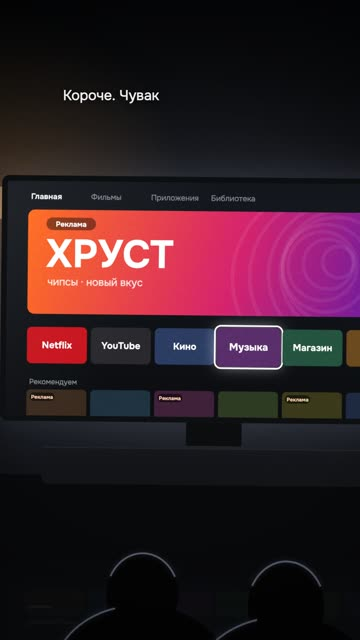
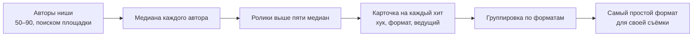
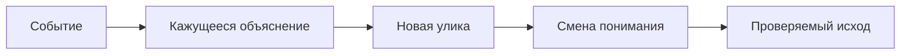

# 01. Идея, хук, сценарий

«Короче. Чувак включил родителям Нетфликс, а телевизор сначала показал ему рекламу. На своём же телевизоре.»

Так начинается ролик, который за первый вечер набрал в Instagram 212 тысяч просмотров и 7 515 лайков, а к
следующему дню 21 496 лайков и 257 комментариев ([разбор](../../examples/tv-no-ads/README.md),
[YouTube](https://youtube.com/shorts/Ma8Wsotaj2Q)). Соседние рилсы того же аккаунта в те же дни набирали 58–400.

Посмотри, что в этой первой фразе. Нет слова «нейросеть». Нет названия проекта. Нет «сегодня расскажу». Есть
бытовая обида: реклама на твоём собственном телевизоре. И есть поворот: «на своём же» звучит как личное
оскорбление, а не как техническая деталь. Через 25 секунд зритель видит крупно «удалено: 0», и главный страх
(«а не сломаю ли я телевизор») снят. Финал: что сделать и сколько это займёт, 15 минут.

Ролик не придуман из головы. Ритм взят у чужого хита ниши, слова свои. Тема взята у открытого проекта, а
рассказана как история про родителей и телевизор. Каждое из этих решений можно повторить, и эта глава про них.

## От ситуации, а не от инструмента

**Проблема.** Самый естественный ролик для человека, который разбирается в инструменте: «как поставить X». Мы
сняли много таких. Узкие дев-туториалы и нарезки из длинных роликов набирали у нас меньше всего просмотров.

**Как мы это увидели.** Снимок 39 наших шортсов на YouTube. Потолок канала 1,0–1,3 тысячи. Выше всех ролик «попросил
нейросеть освободить пятницу» (1 307) и мемный ролик с маскотом (1 017). How-To по инструменту: от 2 до 400.
Шортсы, нарезанные из лонга: от 1 до 17. Лонги-пересказы курсов: 32–79. Разница между ситуацией и туториалом на
порядок. В исследовании ниши похожая картина: ни одного AI-туториала с пятикратным превышением медианы автора среди
936 западных каналов (способ отбора каналов не описан).

**Что делаем.** Две рабочие формулы. Первая: «попросил нейросеть X, получил абсурд». Бытовая боль (созвон, письмо,
календарь) и буквальное выполнение, доведённое до катастрофы. Вторая: жанровый мир. Суд, касса, нуар, мессенджер,
пейджер, телешоу. Цифры в таком мире живут в предметах: на табло, в чеке, в протоколе. Из партии в десять роликов
в разных жанровых мирах пять получили высшую оценку. «Телешоу» вышло вяленьким, ещё один «скучноватым».
Инструмент появляется в конце как решение, а не как тема.

Проверка перед сборкой: перескажи ролик другу одной фразой без названия инструмента. Не выходит, значит, у тебя
туториал.

**Где ломается.** Шаблон «топ-N» годится для настоящих списков: горячие клавиши, команды. Натянутый на тему,
которая не список, он даёт слоп. И даже честный список слабо тянет: наш ролик «три кнопки» собирал копейки.

Рецепт для агента: [idea-everyday-absurd](../../recipes/idea/idea-everyday-absurd.md)

## Идеи из хитов, отобранных по медиане

**Проблема.** Идеи придумывают из головы или из новостей. Новость без доказанного формата остаётся гипотезой, и
ролик собирает свои обычные сотни просмотров.

**Как мы это увидели.** Мы собрали срез ниши: 92 кандидата, 65 авторов с достаточной историей роликов. Абсолютные
просмотры врут: у крупного аккаунта любой ролик «большой». Поэтому хитом считался ролик, который набрал не меньше
пяти медиан своего автора и не меньше 100 тысяч. Таких нашлось 115, скачали 106. Интересная деталь: 62 из 106
хитов сделаны без лица. Ведущий в хитах: лицо в 44 роликах, ИИ-персонаж в 34, только текст и музыка в 17, голос за
кадром в 11.

Ролик про телевизор как раз сделан по формату одного из таких хитов. Результат ты видел выше.

**Что делаем.** Собери 50–90 авторов своей ниши поиском самой площадки. Посчитай медиану каждого. Отбери ролики
выше пяти медиан. По каждому сделай карточку: хук, формат, ведущий, сложность съёмки, призыв, можно ли повторить.
Сгруппируй по форматам и выбери самые простые для своей съёмки. Дальше правило: любая новая идея равна новость
или своя тема плюс конкретный хит-образец с цифрами.

Через сутки после публикации сравнивай ролик со своей медианой, а не с хитом. Хит был у другого человека с другой
аудиторией.

**Где ломается.** Счётчики публичные и округлённые, данных о досмотрах нет, корреляция не доказывает причину.
Около 15 хитов из 115 оказались не про тему ниши, а бытовыми постами тех же авторов: такое размечай руками. И
формат живёт около недели: после второго копировщика сюжет занят.

Рецепт для агента: [idea-find-hits-by-median](../../recipes/idea/idea-find-hits-by-median.md)

## Ремейк ритма, а не слов

**Проблема.** Нашёл хит, хочется повторить слово в слово. Дословная копия грозит штрафом площадки за
неоригинальность и обвинением в краже. А ролик «по мотивам» теряет то, что сработало: ритм.

**Как мы это увидели.** Первый черновик ролика про телевизор повторял четыре фразы образца. Мы их переписали своим
языком, оставив от образца только структуру: хук, длину реплик, места склеек и пауз. Ремейк набрал 212 тысяч.
Разбор семи хитов показал ещё одну общую черту: первое слово у всех звучит в нулевую секунду.

**Что делаем.** Разбери хит посекундно: контактные листы по четыре кадра в секунду, склейки детектором сцен,
громкость, расшифровка с пословными таймкодами. Разложи текст в таблицу: номер реплики, длина в словах, роль (хук,
петля, пример, панч, призыв). Свой текст пиши в ту же таблицу: та же роль, длина реплики ±1 слово, если в ней до
пяти слов, иначе ±20 %. Пример, цифры и панч свои. В конце машинная проверка: самая длинная общая цепочка слов с
оригиналом не длиннее двух, и то служебных.

**Где ломается.** Тот же ремейк на YouTube и в TikTok набрал от 1 до 328: формат одной площадки не переносится
автоматически. Два ремейка бизнес-хитов на вымышленном «примере магазина» забраковали целиком: ритм не спасает,
если внутри нет живой истории или настоящего результата. И кадры чужих роликов держи у себя, в публичный
репозиторий не клади.

Рецепт для агента: [idea-remake-rhythm-not-words](../../recipes/idea/idea-remake-rhythm-not-words.md)

## Угадайка вместо инструкции

**Проблема.** Про инструмент (клон голоса, «очеловечиватель» текста) снимают инструкцию по установке. Такие ролики
в нише стабильно проигрывают роликам, где зрителя вовлекают в игру.

**Как мы это увидели.** Ролики про клонирование голоса на YouTube: угадайки дают медиану 3,7 тысячи, инструкции
787. Почти в пять раз. Про ИИ-тексты разница ещё больше: разоблачение «вижу ИИ-текст сразу» доходило до сотен
тысяч, туториалы установки держались на 4 тысячах и ниже. Наш ролик в формате «вижу ИИ-текст» набрал 989 на
YouTube и 530 в TikTok за первые сутки, почти потолок канала.

**Что делаем.** Делай зрителя участником: «угадай, где мой голос», «по этим словам видно ИИ-текст». Ответ в конце,
лучше с твистом. В ролике [«Угадай, где мой голос»](../../examples/guess-my-voice/README.md) твист такой: весь
ролик, кроме одной фразы, говорил клон. Инструкция «как сделать самому» уходит в последние секунды или в материал
по кодовому слову.

**Где ломается.** Твист должен быть правдой. Не повторяй непроверенные заявления из чужих хитов вроде «100 %
человек»: разоблачение работает, только если оно честное.

Рецепт для агента: [idea-guess-over-howto](../../recipes/idea/idea-guess-over-howto.md)

## Хук в нулевую секунду

**Проблема.** Ролик открывается вступлением: «скоро собеседовать тебя будет робот», «в тиктоке советуют», «я
попросил нейросеть». Это лекция. Зритель листает дальше, не дождавшись сути.

**Как мы это увидели.** Два захода со вступлением подряд забраковали словами «заход слабоватый». Хиты той же недели
в нише (до 710 тысяч) начинались сразу с катастрофы: «я удалил базу…». В семи разобранных хитах от 178 тысяч до
трёх миллионов первое слово звучит в 0,0 секунды. А наш лонг [«Агент сказал, что тесты
прошли»](../../examples/agent-cheats-long/README.md), лучший по оценке автора, теряет первую секунду: голос
вступает на 3,4 секунды.

**Что делаем.** Первая фраза в 0,0 секунды, одного из трёх типов. Результат-спойлер: «прошёл ИИ-рекрутера из-за
одной невидимой строчки». Скандал или тайна: «пока ты спишь, мы обсуждаем тебя». Интрига с предметом: «ничего не
открыто, а ноутбук орёт». Контекст на 3–5 секунде, не раньше. Условное придаточное в начале («если ты…») перепиши в
утверждение.

Первую секунду проектируй в трёх дорожках сразу: кадр показывает странность, голос добавляет конфликт, короткая
надпись помогает понять без звука. Не заставляй все три повторять одну фразу. И голос не позже 0,45 секунды: после
такой правки (вместе с ударом в первую секунду) один наш ролик приняли и выложили на три площадки.

**Где ломается.** Хук, который обещает больше, чем показывает ролик, ломает доверие. Сначала реальный результат,
потом хук под него, а не наоборот. И цифра 0,45 секунды найдена на одном ролике, это не замер удержания.

Рецепт для агента: [hooks-result-in-first-second](../../recipes/hooks/hooks-result-in-first-second.md),
[hooks-voice-by-045](../../recipes/hooks/hooks-voice-by-045.md)

## Чужой тезис в хуке, свой рефрен в финале

**Проблема.** Без лица и без характера ролик звучит как безликий диктор. Нет повода спорить в комментариях и нет
узнаваемой подписи.

**Как мы это увидели.** Разбор автора с медианой 311 тысяч на ролик: хук-тезис оппонента в 6–7 хитах из 8, одна и
та же финальная фраза во всех 11 расшифровках, ролики на «лагерные» темы (одна модель против другой) дают в 1,4 раза
больше комментариев на просмотр. Наш ролик [про DeepSeek](../../examples/deepseek-headlines/README.md) построен так:
«Китай опять обошёл GPT. Слышал? Я это слышу каждые пару месяцев». Узнавание ставит автора на сторону зрителя.
1 196 просмотров, один из трёх лучших шортсов канала.

**Что делаем.** Хук: чужой уверенный тезис из ниши, цитата со ссылкой, а не выдумка. Короткий ответ: «сейчас
покажу». Доказательство на экране. Финал всегда одной и той же фразой, она работает как подпись сильнее брендовой
плашки. В ролике [про поиск места по фото](../../examples/photo-geo-blind-test/README.md) хук «блогеры пишут: по
одному фото находит место до двух метров» и сразу «я проверил, вслепую».

**Где ломается.** У того автора живое лицо и голос, без лица приём не проверен. Чужой кусок в хуке должен
укладываться в цитирование: короткий фрагмент и ссылка на источник.

Рецепт для агента: [hooks-foreign-thesis-refrain](../../recipes/hooks/hooks-foreign-thesis-refrain.md)

## Одна открытая петля

**Проблема.** Ролик сразу объясняет причину, и к шестой секунде не остаётся вопроса, ради которого досматривать.
Или наоборот: хук обещает одно, а финал говорит мораль вместо ответа.

**Как мы это увидели.** Разобранный хит на 269 тысяч: в первые 3,4 секунды цена и «сотрудник, который не спит», к
6,5 секунде обещание «подвохов три, но сначала как это устроено». Сами подвохи начинаются на 86-й секунде, то есть
ответ отложен почти на 80 секунд. Панч на 130-й секунде, фразой-определением. В нашем лонге про тесты обещание
звучит на 19-й секунде, а финал выдаёт строку настройки, которую зритель может вставить сразу.

**Что делаем.** В хуке один конкретный вопрос. Каждый следующий план даёт новую улику или меняет ставку, повтор
понятного другими словами вырезай. Финал выплачивает ровно обещанное: строку кода, результат теста, значение до и
после. Проверка: выпиши вопрос хука и последнюю фразу рядом. Вторая отвечает на первый?

**Где ломается.** Длинная петля на 139 секунд конфликтует с правилом «рил до 40 секунд». Короткая версия: хук, три
подвоха по фразе, панч. И это наблюдение по одному хиту, причинность не доказана.

Рецепт для агента: [hooks-open-loop-payoff](../../recipes/hooks/hooks-open-loop-payoff.md)

## Один пример, до 40 секунд

**Проблема.** Честный эксперимент хочется рассказать целиком: методология, таблицы точности, четыре блока цифр с
оговорками. Ролик растягивается за две минуты, смешные примеры тонут.

**Как мы это увидели.** Отвергнутый ролик на 2:11. С 8-й по 19-ю секунду объяснялась методология, половина кадров
таблицы и бары. Вердикт: «всё очень плохо, от смысла визуала до удержания». Для сравнения, пятничный ролик длится
20 секунд и состоит из четырёх фраз.

**Что делаем.** Один пример равно один ролик, остальные примеры пойдут в следующие ролики. Панчлайн в первые
секунды, методология в описание. Таблиц, баров и мелкого текста промпта в кадре нет. Названия моделей, которые
зрителю ничего не говорят, убери из речи. Проверка: перескажи ролик одной фразой. Если в ней есть «и ещё», роликов
два.

**Где ломается.** Длина сама по себе не приговор. В выборке из 102 залетевших рилсов медиана длительности 63
секунды, 28 роликов длиннее 90. Ограничение защищает от лекции, а не от длины: ролик с одной открытой петлёй может
идти дольше.

Рецепт для агента: [idea-one-example-short-reel](../../recipes/idea/idea-one-example-short-reel.md)

## Сценарий до сборки и цепочка знания

**Проблема.** Агент собирает ролик целиком, а ты видишь его только готовым и говоришь «слоп». Час синтеза и рендера
потрачен на идею, которую можно было отбросить по трём строкам.

**Как мы это увидели.** Ролик, прошедший 15 зелёных автоматических проверок, всё равно отвергнут. Двадцатиминутный
пересказ курса собран без пробника, и только на готовом ролике выяснилось, что картинка статична. Три ролика подряд
на одном каркасе получили «слоп», хотя каждый по отдельности технически чистый.

**Что делаем.** До голоса покажи сценарий на 3–5 строк, первый кадр и одну раскадровку. Собирай после «ок».

Перед прозой составь цепочку знания зрителя: событие, кажущееся объяснение, новая улика, смена понимания,
проверяемый исход. Потом тест перестановки: поменяй местами два соседних плана. Если причинность не сломалась,
у тебя список иллюстраций, а не история. Финал должен отвечать ровно на вопрос первого кадра.

**Где ломается.** Метод взят из разбора сценарных материалов и документов площадок, эффект на удержание на наших
роликах не измерен. Работает как фильтр, а не как гарантия.

Рецепт для агента: [idea-script-before-build](../../recipes/idea/idea-script-before-build.md)

Для формы реплик помогает скелет из пяти кусков: хук в 0,0 с, ошибка, которую сделают все, что на самом деле с цифрой, три шага, поворот с вопросом и кодовым словом; метка времени у героя («ДЕНЬ 1 · 18:04»), если беда растёт во времени. Это гипотеза, по мотивам разбора формата Kylo AI: [idea-five-beat-skeleton](../../recipes/idea/idea-five-beat-skeleton.md)

## Не повторять свой хит

**Проблема.** Ролик зашёл, и следующий собирают по той же форме: тот же фон, та же карточка, тот же кружок с
персонажем. Зритель узнаёт конвейер.

**Как мы это увидели.** Ролик [«Нейросеть палится не по „стоит отметить“»](../../examples/ai-text-tells/README.md)
зашёл. Продолжение на том же каркасе через день назвали «слопом». Вторая версия ролика [«3
кнопки»](../../examples/three-keys-repeat/README.md), выложенная в тот же день, что и первая: 3 просмотра на YouTube
и 0 в TikTok. Следующая партия из пяти роликов, у каждого свой визуальный мир: три высшие оценки, одна «формат
окей», одна «скучновато».

**Что делаем.** После удачного ролика ищи новую живую ситуацию, а не новый текст в старый каркас. Каждому ролику
серии свой визуальный мир, общим остаётся только характер и рефрен. Проверка: поставь кадр нового ролика рядом с
кадром прошлого. Перепутать можно? Каркас тот же.

**Где ломается.** Серия с узнаваемой рамкой работает, если внутри меняется ситуация. Повторять можно рубрику, но не
сцену целиком.

Рецепт для агента: [idea-no-repeat-own-hit](../../recipes/idea/idea-no-repeat-own-hit.md)

## Фактчек с первого дня

**Проблема.** Агент уверенно пишет команды и цифры по памяти. Ролик, который «исправляет чужие ошибки», сам выходит
с выдуманными командами.

**Как мы это увидели.** Разбор чужого туториала: мы нашли пять ошибок оригинала и четыре свои (несуществующие
команды и неверное число режимов). Две нашлись уже на середине рендера. В другом лонге сухой просмотр 104 кадров
выловил две выдуманные цифры в иллюстрациях и титре: цифры в кадре никто не сверял так же строго, как в речи. В
ролике про лимиты фактчек снял четыре расхожих тезиса, которые иначе прозвучали бы голосом.

**Что делаем.** У каждого ролика файл фактчека: каждый факт речи и кадра со ссылкой на первоисточник. Отдельный
раздел «чего говорить нельзя». Команды проверяй по живой версии инструмента, а не по памяти модели.

**Где ломается.** На удержание фактчек не влияет. Он защищает от разгромных комментариев, а это отдельная ценность.

Рецепт для агента: [idea-factcheck-file](../../recipes/idea/idea-factcheck-file.md)

## Упражнение

20–30 минут.

1. Открой три ролика из [examples](../../examples/README.md): про телевизор, про пятницу и [«Весь курс за 20
   минут»](../../examples/course-retelling/README.md). Выпиши их первые фразы.
2. Для каждой ответь: есть событие или ставка? Звучит в 0,0? Понятно без названия инструмента?
3. Возьми тему, про которую давно хочешь снять. Напиши три варианта первой фразы: результат, скандал, интрига.
4. Выбери лучший и напиши цепочку знания в пять строк: событие, кажущееся объяснение, улика, смена понимания,
   исход.
5. Поменяй местами строки 2 и 3. Если смысл не сломался, перепиши цепочку.

## Чего не делать

- Не начинай ролик с «сегодня расскажу», «скоро» или «если ты».
- Не делай тему из инструмента: инструмент появляется в конце.
- Не копируй хит слово в слово и не клади чужие кадры в публичный репозиторий.
- Не пихай в рил методологию и таблицы: один пример на ролик.
- Не обещай в хуке то, чего нет в финале.
- Не делай продолжение удачного ролика на том же каркасе.
- Не верь цифрам и командам, которые агент написал по памяти.
