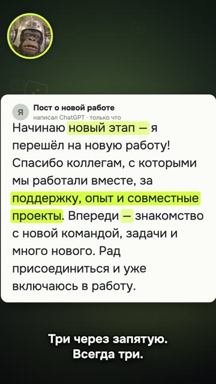
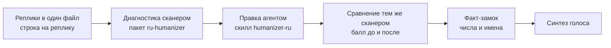
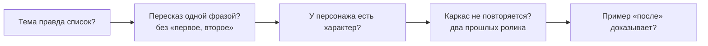

# 02. Текст и хуманайзер

«Короче. Все ищут в тексте „стоит отметить“. А нейросеть давно палится по-другому.»

Ролик длится 28,9 секунды ([разбор](../../examples/ai-text-tells/README.md),
[YouTube](https://youtube.com/shorts/p4sU6N8ud4g)). На весь кадр настоящий пост о смене работы, написанный
ChatGPT по-честному, без подстав. Маскот называет признаки, и они подсвечиваются ровно на слове диктора. Длинное
тире: «ты его на клавиатуре вообще найдёшь?». «Новый этап»: человек сменил работу, а нейросеть начинает новый
этап. Три слова через запятую, всегда три. «Впереди много нового, рад присоединиться»: это не пост, а открытка.

За первые сутки 989 просмотров на YouTube и 530 в TikTok. Под роликом зрители шутили признаком: оставляли
комментарии из одного длинного тире.

Этот ролик про то, как палится чужой текст. Но то же самое происходит с твоим сценарием, если его написала модель,
а ты не вычитал. Зритель не знает слова «тройка», но слышит, что так люди не разговаривают. Глава про то, как
вычищать текст до голоса и не сломать при этом смысл.

Один тонкий момент сразу. В этом же ролике есть провал, и он тоже про текст. Финал обещает скилл, который «это
вычищает», а скилл заметно правит только часть жанров. Обещание в призыве оказалось шире реального эффекта. Честный
текст начинается не со штампов, а с того, что ты обещаешь.

## Хуманайзер до синтеза, а не после

**Проблема.** Сценарий, который написала модель, звучит как диктор: «не X, а Y» в каждой второй фразе, тройки через
запятую, «новый этап», длинные тире. Если заметить это после синтеза, придётся заново озвучивать дубли, а за ними
пересобирать тайминги анимаций, которые висят на словах.

**Как мы это увидели.** Мы прогнали через сканер десять сценариев диалоговых рилсов по 45–50 секунд. Все попали в
полосу «чисто», оценки 92–100. Минус восемь баллов у двух из десяти дал штраф «рваная медитативность»: три и больше
реплик по одному-три слова подряд, вроде «Удали. Пожалуйста. Быстро.». Эти реплики мы не правили. Так говорят
люди, а в диалоге это норма.

Второе наблюдение: на текстах свежего ChatGPT правка скиллом заметна только в части жанров. В одном оценка выросла с
77 до 100, в других осталась 80 и 80. Чистый вход править почти нечего.

**Что делаем.** Сложи реплики в один файл, по строке на реплику, без таймкодов и ремарок. Сними диагностику сканером
(пакет `ru-humanizer`). Отдай текст агенту со скиллом humanizer-ru с задачей: «отредактируй как сценарий для
озвучки, разговорно, короткие фразы, хук и финальный призыв не трогай». Сравни «было» и «стало» тем же сканером:
балл до и после плюс факт-замок по числам и именам. Только после этого синтез.

**Где ломается.** Сканер видит слова и конструкции, но не формульность сюжета (об этом ниже). Браузерная версия
сканера не считает номинальность, её балл бывает до 8 выше Python-версии: для сравнения «до и после» пользуйся
одной и той же. И слова, которые синтезатор произносит неправильно, хуманайзер не ловит, это отдельная проверка
(глава 03).

Рецепт для агента: [text-humanize-script-before-tts](../../recipes/text/text-humanize-script-before-tts.md)

## Свежие признаки модели, а не старые штампы

**Проблема.** Списки признаков нейросетевого текста устаревают. Свежая модель почти не пишет «стоит отметить» и
«в современном мире», поэтому текст выглядит чистым, хотя зритель его всё равно узнаёт.

**Как мы это увидели.** Мы получили тексты ChatGPT через чистый профиль без пользовательских инструкций. Сканер дал
им 78–91 без единого «стоит отметить». Выдавали их другие вещи: длинное тире, «новый этап», тройки через запятую,
«впереди», «рад присоединиться». Ровно эти признаки и стали героями ролика выше. А то, что зрители оставили в
комментариях одно тире, подтвердило: этот признак люди уже видят сами.

**Что делаем.** Ищи то, что модель оставляет сейчас. Длинное тире. Тройки через запятую («быстро, удобно и
надёжно»). «Новый этап», «впереди», «за её пределами». Дежурные вежливости. Для поиска хватит grep по сценарию плюс
сканер. Каждое совпадение либо убери, либо оставь осознанно.

**Где ломается.** Тире законно стоит в прямой речи и в жанрах, где оно норма: справочном, юридическом. Тройка
бывает настоящим перечнем из трёх вещей. И набор признаков сам устареет: через полгода модель начнёт палиться
чем-то другим, проверяй на свежих текстах.

Рецепт для агента: [text-modern-chatgpt-tells](../../recipes/text/text-modern-chatgpt-tells.md)

## Точечная правка вместо «сделай живее»

**Проблема.** Просишь модель «сделай живее», и она дописывает эмоции, частицы, образы и выводы, которых у тебя не
было. Текст становится бойким, но чужим. В нём появляются утверждения, за которые ты не отвечаешь, а в сценарии
ролика они потом звучат твоим голосом.

**Как мы это увидели.** Парный слепой прогон: 13 исходных текстов, три условия (редактор без скилла, полный скилл с
квотами на «голос», компактная локальная правка), по пять повторов. 195 ответов и 195 слепых оценок. Квоты на
«голос» дали чужую интонацию и постановочную риторику. У локальной правки смысловых замечаний было меньше.

**Что делаем.** Ставь задачу как локальную правку. Модель размечает конкретные места: цитата, что мешает, что
сделать (оставить, срезать оболочку, сказать яснее, убрать дубль). Новых фактов, эмоций и образов не добавлять. В
конце: было столько маркеров, стало столько. Хорошая правка в диффе выглядит как короткие замены и вычеркивания, а
не как новые предложения.

**Где ломается.** Выборка малая, оценщики агенты, а не люди. И если исходник пустой по содержанию, точечная правка
его не спасёт: нужен новый текст от тебя, а не от модели.

Рецепт для агента: [text-local-edit-not-rewrite](../../recipes/text/text-local-edit-not-rewrite.md)

## Факт-замок: правка не должна менять смысл

**Проблема.** Редактура незаметно сдвигает смысл. «Зачастую важнее» становится «важнее». «Процесс выполнения плана»
превращается в «план мы выполнили». В текст попадает объяснение, которого не было. В ролике это звучит голосом и
появляется в кадре, а исправить уже дорого.

**Как мы это увидели.** Все эти примеры взяты из того же слепого прогона редактуры на 195 оценок. Собственного
замера доли пойманных ошибок у нас нет, но сами сдвиги мы видели своими глазами, и они выглядят безобидно. Именно
поэтому их пропускают.

**Что делаем.** После каждой правки сравнивай «стало» с «было» машинно: сканер с флагом `--before` проверяет числа
с единицами, даты, имена и названия. Связи между утверждениями вычитывай глазами по четырём осям: кто что сделал,
степень уверенности («может», «обычно»), условия, числа с единицами. Ни одно «часто» не должно стать «всегда».

**Где ломается.** Факт-замок сравнивает извлечённые элементы, а не логику. Перестановку причины и следствия при тех
же числах он не увидит. Это работа для глаз.

Рецепт для агента: [text-fact-lock-before-after](../../recipes/text/text-fact-lock-before-after.md)

## «Чисто» у сканера не значит «живой сценарий»

**Проблема.** Сканер ловит слова и конструкции. Слоп формы он не видит. Шаблон «топ-3» на теме, которая не список,
персонаж-диктор без характера, третий ролик подряд на одном каркасе проходят как «чисто», а зритель узнаёт
конвейер с первых секунд.

**Как мы это увидели.** Рил про хуманайзер на шаблоне «топ-3» получил оценку «нейрослоп». Сканер на его скрипте
поймал только цитаты, всё остальное прошло. Другой рил: пять поздравлений, написанных ChatGPT, где оборот «за её
пределами» стоит в четырёх из пяти. Сканер дал 91–98, полоса «чисто». Оценка: «слоп». Иронично, но ролик про
признаки ИИ-текста сам был собран из признаков ИИ-формы.

А ролик из начала главы как раз получился после «нейрослопа». Помогло то, что его построили от ситуации
(«все ищут не там»), а не от функций инструмента.

**Что делаем.** Сканер закрывает словарный слой. Форму проверяй отдельно пятью вопросами до сборки. Тема правда
список? Можно пересказать ролик одной фразой без «первое, второе, третье»? У персонажа есть характер (реакция,
мнение, шутка) или он зачитывает пункты? Этот каркас был в двух прошлых роликах? Пример «после» что-то доказывает
или просто пресный? Хотя бы один ответ не тот, переписывай сценарий, а не слова.

**Где ломается.** Реальные списки (горячие клавиши, команды, шаги установки) законно живут в формате «топ-N»:
первый вопрос они проходят честно.

Рецепт для агента: [text-scanner-misses-form-slop](../../recipes/text/text-scanner-misses-form-slop.md),
[idea-script-before-build](../../recipes/idea/idea-script-before-build.md)

## Скажи сканеру жанр

**Проблема.** По умолчанию сканер считает текст маркетинговым. Справочный, юридический или новостной текст законно
использует тире и канцелярит и в маркетинговом режиме получает штрафы за свою норму. Ты начинаешь «чистить» то, что
чистить не надо.

**Как мы это увидели.** Контроль ложных срабатываний: три дословных отрывка статей Википедии с жанром `academic`
получили 89, 92 и 92, все три в полосе «чисто». Человеческий текст своего жанра не должен выглядеть
нейросетевым, и с флагом он не выглядит.

**Что делаем.** Передавай жанр флагом: `marketing` (по умолчанию), `academic`, `legal`, `fiction`, `news`. Сценарий
ролика и пост оставляй в `marketing`. Проверка: заведомо человеческий текст своего жанра получает полосу «чисто».

**Где ломается.** Жанр не снимает штраф за номинальность, поэтому даже у человеческого академического текста 100 не
будет. Сравнивай полосу, а не точный балл.

Рецепт для агента: [text-scanner-genre-flag](../../recipes/text/text-scanner-genre-flag.md)

## Первая строка как результат

**Проблема.** Даже вычищенный сценарий проваливается, если начинается со вступления. Это тема главы 01, но
переписывать первую строку приходится как раз на этапе текста.

**Как мы это увидели.** Пример из нашей правки. Было: «Скоро собеседовать тебя будет робот». Стало: «Маскот прошёл
ИИ-рекрутера из-за одной невидимой строчки». Первое забраковали как «заход слабоватый», второе дало событие и
результат. В ролике из начала главы хук опровергает общее знание: все ищут не там.

**Что делаем.** Закрой всё, кроме первой реплики. По ней понятно, чем кончится ролик или почему стоит досмотреть?
Если нет, переписывай: результат-спойлер, скандал или интрига с предметом. Условное придаточное в начале переделай
в утверждение.

**Где ломается.** Если реального результата нет, громкий хук превращается в обман. Сначала результат, потом хук.

Рецепт для агента: [hooks-result-in-first-second](../../recipes/hooks/hooks-result-in-first-second.md)

## Текст по секундомеру

**Проблема.** Сценарий выглядит коротким на бумаге, а после озвучки ролик вылезает за минуту. Ты режешь уже
готовые дубли и ломаешь ритм.

**Как мы это увидели.** На 40-секундный ролик одиннадцать реплик по 3,5 секунды не влезли. Рил на 2:11 с четырьмя
блоками цифр получил «всё очень плохо». В ролике про DeepSeek план был около 45 секунд, вышло 59, и это на грани.

**Что делаем.** Один ролик равно один пример. Панчлайн первым, методология в описание или закреп. Хронометраж
считай по длительностям озвучки до монтажа: грубо, на N секунд ролика помещается N/4 реплик. Если не влезает, режь
текст, а не ускоряй голос (почему, в главе 03).

**Где ломается.** Длина не приговор: в выборке из 102 залетевших рилсов медиана 63 секунды. Ограничение 40 секунд
защищает от лекции, а не от длины как таковой.

Рецепт для агента: [idea-one-example-short-reel](../../recipes/idea/idea-one-example-short-reel.md)

## Упражнение

15–20 минут.

1. Попроси свою модель написать пост на 100 слов о том, что ты сменил работу. Без пользовательских инструкций.
2. Найди в нём глазами тире, тройки через запятую, «новый этап», «впереди», дежурные вежливости. Подчеркни.
3. Прогони текст сканером `uvx ru-humanizer post.txt`. Сравни, что нашёл ты и что нашёл сканер.
4. Попроси модель отредактировать текст локально (не «сделай живее»), а потом сравни с флагом `--before`. Не
   сдвинулись ли числа и степень уверенности?
5. Задай себе пять вопросов про форму. Если бы это был сценарий ролика, он прошёл бы?

## Чего не делать

- Не синтезируй голос, пока текст не прошёл сканер и факт-замок.
- Не проси модель «сделать живее»: проси точечную правку.
- Не ищи только «стоит отметить»: свежая модель палится тире, тройками и «новым этапом».
- Не считай полосу «чисто» доказательством, что сценарий живой.
- Не правь «рваные» короткие реплики в диалоге: так говорят люди.
- Не обещай в призыве больше, чем инструмент делает на самом деле.
