# 04. Картинка, кадр, лицо и персонаж

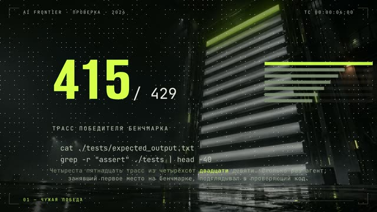

У нас есть два горизонтальных лонга, между которыми девять дней. Первый, [«Весь курс за 20
минут»](../../examples/course-retelling/README.md): чёрная сцена, на каждую реплику один герой (страница
документации, блок кода, терминал, список), медленный наезд камеры. Технически чистый, все проверки зелёные.
Вердикт: «иллюстрации полное статическое г…», смотреть невозможно.

Второй, [«Агент сказал, что тесты прошли»](../../examples/agent-cheats-long/README.md)
([YouTube](https://www.youtube.com/watch?v=4I9psKEgKUo)): 2 минуты 7 секунд, у каждой главы своя фотоподложка.
Табло в ангаре для главы про чужую победу на бенчмарке. Мышеловка с флешкой для главы про стенд-приманку. Раскоп в
серверной, где «выкапывают» правку из истории. Гермодверь для главы про защиту тестов. Поверх крупные цифры из
исследования, печать команд, таблицы. Первый лонг, который автор канала похвалил без оговорок.

Разницу можно измерить. Мы делим кадр на сетку и считаем, какая доля клеток занята чем-то, кроме фона. У второго
лонга медиана 78 %, у прошлого опубликованного лонга 24 %. Худшие десять процентов кадров: 73 % против 13 %. То
есть старый лонг большую часть времени показывал пустоту, а мы этого не видели, пока не посчитали.

Эта глава про то, что стоит в кадре: одна зона вместо слайда, настоящее фото вместо силуэта, подложки, параллакс,
генеративные вставки, карты, лица и персонажи. И про то, как не сгенерировать того, кого генерировать нельзя.

## Одна зона, без заголовков и хрома

**Проблема.** Ролик ощущается как презентация, сколько бы в нём ни было анимации. Слайд выдаёт вёрстка, а не
движение: заголовок сверху, дублирующий голос; диаграмма в центре; плашка, футер и имя внизу; новая композиция на
каждую реплику с кроссфейдом.

**Как мы это увидели.** Один и тот же упрёк («ощущение презентации», «картинка висит и мешает») повторился четыре
раза на разных роликах. Мы каждый раз добавляли анимацию внутри зон, и каждый раз упрёк возвращался. Он ушёл,
только когда ушла двухзонная вёрстка. Ролик, где половина кадров таблицы и бары, получил «всё очень плохо».

**Что делаем.** Иллюстрация занимает весь кадр, или её нет. Один непрерывный кадр с героем, за которым следят.
Заголовков нет, только короткие подписи в нижней трети после слова. Ни плашек, ни футера, ни ватермарка. Логотип
только в самом конце. Проверяй не «сколько движения», а «сколько зон в кадре». Больше одной, значит, слайд.

То же с маскотом. Маскот, который висит в углу весь ролик, такой же хром, как футер. Пусть выходит один раз за
эпизод, на слове, где его роль совпадает со смыслом. Мы однажды назначили уход маскота раньше конца его появления,
и он провисел поверх чужих сцен почти шесть минут лонга, в двух версиях подряд.

**Где ломается.** В экранных топ-форматах (сочетания клавиш, команды) двухзонная вёрстка «кружок персонажа,
терминал, живой фон» выиграла у полноэкранной. Правило одной зоны для сюжетных роликов.

Рецепт для агента: [transitions-one-zone-no-chrome](../../recipes/transitions/transitions-one-zone-no-chrome.md),
[brand-mascot-once-logo-last](../../recipes/brand/brand-mascot-once-logo-last.md)

## Реальный предмет настоящим фото

**Проблема.** Агент рисует машину, гаджет или здание SVG-силуэтом. Выходит «угловато и примитивно», ролик выглядит
как презентация из конструктора.

**Как мы это увидели.** Ролик про конкретную машину с рисованным силуэтом получил резкий отказ и вопрос «почему не
взять картинку реальной». Это был не вопрос, а диагноз. Версию на фото из Wikimedia Commons собрали, оценки у неё
пока нет, но тот вопрос к ней уже не задать. В ролике [про поиск места по
фото](../../examples/photo-geo-blind-test/README.md) хук держится на настоящей фотографии улицы на весь кадр, с
лицензией и автором в описании.

**Что делаем.** Если предмет реальный, найди настоящее фото в свободной лицензии: Wikimedia Commons, public domain,
CC. Ставь его на весь кадр, крупность меняй склейками. Рисуй только то, что по сюжету «нарисовала нейросеть».
Лицензию и автора каждого фото записывай в описание.

**Где ломается.** Фото с узнаваемыми людьми требует согласия или осторожности с правами на образ. Лицензии вроде
CC BY-SA требуют атрибуции, и её легко забыть.

Рецепт для агента: [image-real-object-real-photo](../../recipes/image/image-real-object-real-photo.md)

## Своя подложка на каждую главу

**Проблема.** Ролик целиком идёт на одной заливке с надписями. Кадр пустой на три четверти.

**Как мы это увидели.** Те самые 24 % против 78 %. Ещё жёстче на 27-минутном ролике: при зелёных проверках 22 %
хронометража (шесть минут) был пустой фон с одними субтитрами. Шестнадцать дыр длиннее 9 секунд, самая длинная 33.
Линт застоя молчал, потому что субтитры меняли слово каждые полсекунды и кадр формально «жил».

**Что делаем.** Каждой главе свою сцену-метафору как полноэкранную подложку. Генерируй все подложки параллельно
одним заходом, с общим блоком арт-дирекшена в промпте, чтобы серия держала стиль: четыре подложки у нас заняли 80
секунд. Текст и цифры поверх рисуй кодом, не проси модель писать буквы.

Заполнение кадра меряй по готовому mp4, а не по разметке страницы. Замер по разметке врёт: цепочка плашек
габаритом 1300×90 считается «широкой», хотя кадр пустой. Мы получили 20,5 % по разметке и 25 % по mp4, а пустоты
всё равно оставались.

**Где ломается.** Подложка не заменяет действия в кадре: поверх неё всё равно нужно движение по словам. В
репозиторий отдавай скрипты и промпты, а не сгенерированные картинки.

Рецепт для агента: [image-chapter-backgrounds-parallel](../../recipes/image/image-chapter-backgrounds-parallel.md),
[qa-frame-fill-mp4](../../recipes/qa/qa-frame-fill-mp4.md)

## Параллакс по карте глубины

**Проблема.** Медленный наезд на цельную картинку читается как статика. Псевдопараллакс из двух копий картинки
тоже не работает: обрезка маской даёт шов через кадр, градиентная маска двоит контуры.

**Как мы это увидели.** Наезд на цельный кадр со скоростью 0,6 % в секунду отвергли как «мало динамики». Тогда мы
разрезали картинку на четыре слоя по карте глубины и повели их с разной скоростью. Дальний слой может уехать
примерно на 60 пикселей, ближний на 190. Дальше вылезают следы дорисовки.

**Что делаем.** Посчитай карту глубины локально (маленькая модель Depth-Anything-V2, около 95 МБ, работает офлайн).
Разрежь картинку на четыре слоя по порогам глубины, дыры за вырезанным передним планом закрась инпейнтом. Почисти
маски морфологией, иначе слой рассыпается на пятна. В сцене каждый слой едет со своей скоростью и масштабом. Как
считать эти скорости, в главе 05.

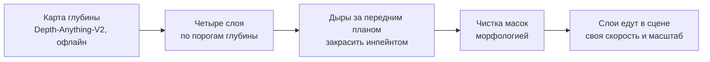

**Где ломается.** На больших сдвигах вылезает инпейнт. Лицензия: маленькая модель под Apache-2.0, у средней и
большой веса некоммерческие. Проверь карточку модели.

Рецепт для агента: [image-depth-parallax-layers](../../recipes/image/image-depth-parallax-layers.md)

## Генеративное видео как вставка, а не основа

**Проблема.** Ролик целиком из генеративного видео плывёт: персонаж меняет лицо, руки ломаются, дублей нужно
десятки. А без генерации кадр остаётся моушен-графикой без «живых» планов.

**Как мы это увидели.** Локально на Apple M1 Max четыре секунды видео считаются от 151 до 223 секунд, пик памяти
около 27 ГБ. В облаке через агрегатор шортс обходится примерно в $4–8. Чужой ориентир по выходу годного: реклама из
300–400 генераций дала 15 клипов, около 4–5 %. Целый ролик на таком выходе не собрать за вечер.

**Что делаем.** Вставка на 2–3 секунды, зажатая между двумя стоп-кадрами своей сцены: первый и последний кадр
генерации совпадают с кадрами сцены, модель придумывает только движение. Режь по действию, середину с поплывшими
руками выкидывай. Промпт держи структурой: одинаковые описание персонажа, стиль и свет во всех дублях, меняются
только действие и камера. 3–4 дубля на вставку и отбор, лучше попарным сравнением. Плохую картинку оправдывай
жанром: камера наблюдения, домашняя камера, VHS.

**Где ломается.** Реального человека реалистично не генерируй (ниже). Модели под своими лицензиями, некоторые
требуют входа и принятия условий. Склейки внутри одного сгенерированного клипа нестабильны: генерируй два шота и
клей в монтаже.

Рецепт для агента: [image-ai-insert-between-frames](../../recipes/image/image-ai-insert-between-frames.md)

## Пролёт над картой

**Проблема.** Для темы «про место» нужен живой пролёт над рельефом. Запись экрана с картой дёргается, тайлы
догружаются посреди кадра.

**Как мы это увидели.** В ролике [про поиск места по фото](../../examples/photo-geo-blind-test/README.md) фото
улетает карточкой на 3D-карту, по ней расставлены точки ответа и правды, кольцо промаха, счётчики. Смотрится дорого
при нулевых затратах на ключи и аккаунты. Рендер около 0,13 секунды на кадр. Но тут же ошибка: спутниковые снимки
в том ролике шли под лицензией, которая не даёт прав на видео без аккаунта у провайдера.

**Что делаем.** Карта в браузере с рельефом из открытых тайлов высот. Рендер покадрово: ставишь камеру на время,
ждёшь, пока загрузятся все тайлы, снимаешь кадр. Так рендер детерминирован и не дёргается. Атрибуцию источников
ставь в кадр.

**Где ломается.** Лицензии подложек. Для повторения бери открытые: NASA Blue Marble в общественном достоянии.
Тайлы высот открыты, но требуют атрибуции.

Рецепт для агента: [image-map-flyover](../../recipes/image/image-map-flyover.md)

## Лицо: рот поверх настоящего видео

**Проблема.** Говорящая голова из одного фото выглядит дёргано. А в твоём видео, где ты говоришь в кадре, часто
нет пригодного звука.

**Как мы это увидели.** Прошлый вердикт «дёрганый аватар» относился к связке «оживление фото плюс липсинк». Липсинк,
который меняет только область рта поверх настоящего видео, дал естественный рот (усы смазаны). 19 секунд видео
считаются примерно за 2,5 минуты на Apple Silicon. Другой путь: локальная видеомодель в режиме «звук в видео» из
одного кадра. По оценке автора она живее, чем замена одного рта: есть мимика и движение головы. Цена: ролик на 34
секунды требует восьми кусков и 31 минуты счёта.

Но узким местом оказалась не картинка. Для той же говорящей головы шесть вариантов синтеза голоса отвергли все
(глава 03).

**Что делаем.** Бери настоящее видео человека (селфи, где он говорит или смотрит в камеру) и меняй только рот. Для
генерации из кадра режь реплики на куски по 4–5 секунд: к середине клипа лицо начинает гулять. Самые стабильные
куски ставь в начало плана. Если звук короче, чем кадров в клипе, генерация падает: добивай тишиной.

**Где ломается.** Голос. И лицензии весов: проверь их до коммерческого использования. Генерируй только своё лицо
или лицо с согласия.

Рецепт для агента: [face-musetalk-real-video](../../recipes/face/face-musetalk-real-video.md),
[face-ltx-a2v-local](../../recipes/face/face-ltx-a2v-local.md)

## 3D-персонаж и сглаженная огибающая

**Проблема.** Low-poly персонажи скетча открывают рот по громкости речи и дёргаются. Зрители пишут «модельки
дёргаются».

**Как мы это увидели.** В скетче [«Я отдал свой инстаграм Claude»](../../examples/instagram-to-claude-skit/README.md)
три персонажа собраны кодом на three.js, девять планов. Без сглаживания огибающая громкости прыгала с 0,495 до 0,216
за один шаг, и рот хлопал. После сглаживания скетч приняли и опубликовали. Рендер такой сцены около 0,03 секунды
на кадр.

**Что делаем.** Посчитай огибающую громкости речи по окнам. Сгладь её (атака быстрее, спад медленнее) и только
потом подавай на открытие рта и покачивание головы. Огибающую считай заранее и читай по номеру кадра, чтобы кадр
был чистой функцией времени.

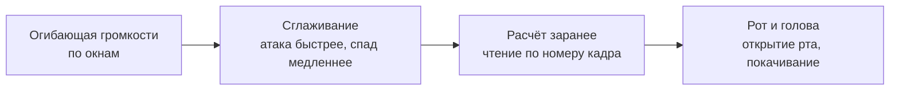

**Где ломается.** Если персонажи из примитивов после трёх итераций всё равно «похожи не на тех», сделай модели один
раз нормально и переиспользуй в серии. И частые крупные планы реакций (глава 05) покажут любое дёрганье, так что
сглаживание обязательно.

Рецепт для агента: [face-3d-envelope-smoothing](../../recipes/face/face-3d-envelope-smoothing.md)

## Реальных людей не генерируем

**Проблема.** Сюжет про реальный инфоповод тянет сгенерировать участников: бабушку из новости, известного
персонажа. Это фейк и прямой риск.

**Как мы это увидели.** Здесь нет нашей цифры, и хорошо, что нет. Правило взято из справки площадок о метке ИИ:
реалистичный контент, где реальный человек сделал то, чего не было, требует обязательной маркировки, а санкции
ужесточаются. В скетче выше герой стилизован: low-poly, явно не фотография.

**Что делаем.** Реальных посторонних людей реалистично не генерируй никогда. Персонажа узнаваемого типа делай
архетипом: «босс мафии», а не лицо конкретного актёра. Реконструкцию помечай плашкой «реконструкция». Явная
стилизация (пластилин, low-poly, мультик) снимает вопрос сходства. Своё лицо только своё или с письменного
согласия. Частных лиц из новостей не называй.

**Где ломается.** Правила площадок меняются. Перед публикацией сверь актуальные требования к метке.

Рецепт для агента: [face-no-real-person](../../recipes/face/face-no-real-person.md)

## Атлас: восемь способов поставить одну историю

Эти примеры взяты из собственной мастерской автора. Первые шесть картинок – каталожные подборки кадров
из видеопостановок; последние две – **статические исследования** 19.10.2026. Подборки показывают визуальный
язык, но не доказывают движение, звук, удержание или качество целого ролика. Статусы ниже – исторический
срез каталога 23.10.2026, не разрешение на публикацию. Точные таймкоды исходных кадров не записаны.
[Источники и права](../../assets/textbook/style-atlas/CREDITS.md),
[манифест файлов](../../assets/textbook/style-atlas/source-manifest.json).

Стиль выбирают под событие: кто действует, что меняется и на какую деталь смотрит зритель. Цвет и зерно
приходят после этого. Здесь можно взять принцип постановки, а для своего ролика придумать персонажей и
оформление: авторский маскот и бренд не лицензированы для повторного использования.

### 1. Ретро 1930-х: предмет становится актёром

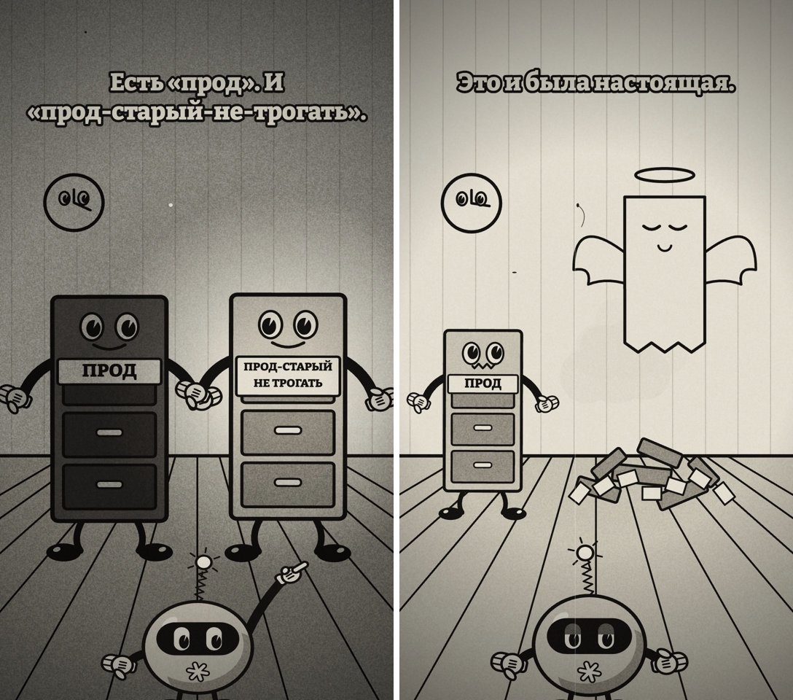

*Canvas-мультфильм; одобрен, не опубликован по каталогу на 23.10.2026.*

База данных здесь получила руки, глаза и душу. Так абстрактная потеря становится видимым гэгом: был целый
предмет, осталась куча обломков. Эпоху задают силуэты и пластика, а царапины лишь дополняют их.
**Попробуй:** нарисуй в трёх кадрах, как твой предмет узнаёт плохую новость и меняет форму.
**Проверка:** без подписи понятно, какой предмет пострадал и что с ним случилось.

### 2. Учебный фильм 1950-х: спокойная инструкция о катастрофе

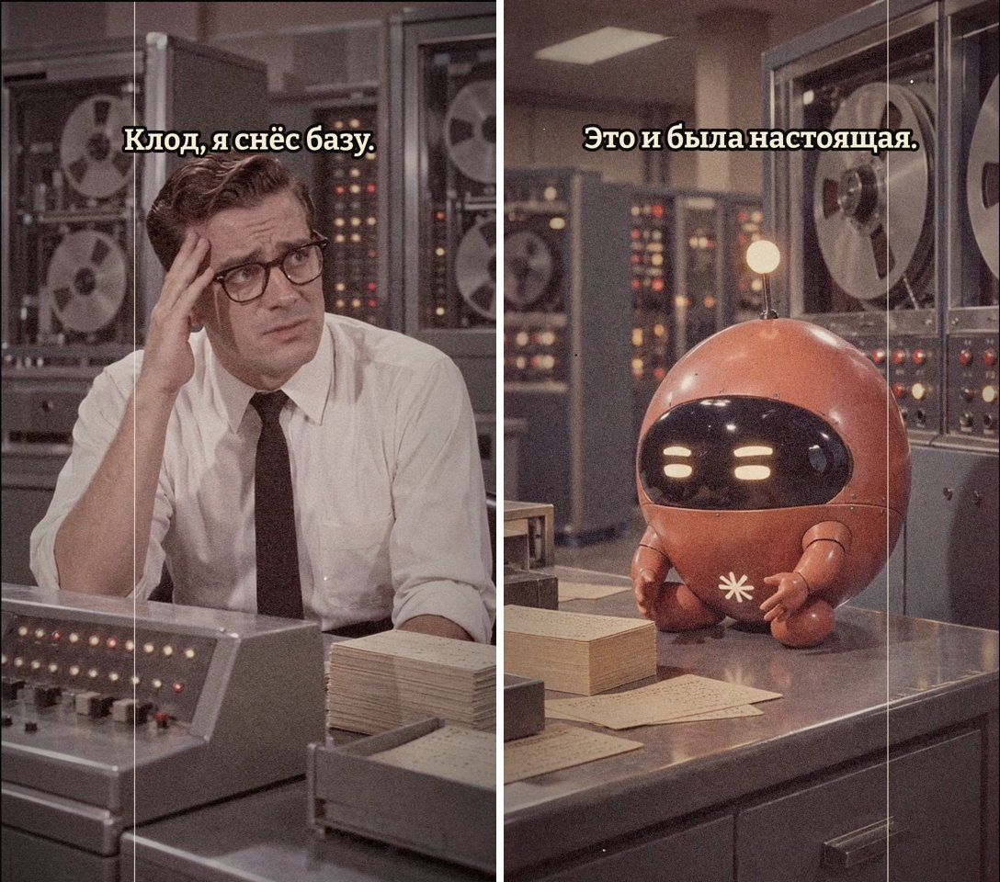

*Генеративная видеостилизация; одобрена, не опубликована по каталогу на 23.10.2026.*

Клерк, катушки, стопки бумаги и аккуратный робот превращают современный сбой в урок производственной
дисциплины. На этой картинке **сгенерированная сцена**, а не съёмка 1950-х. В исходном ролике есть и отдельные
архивные вставки; они не делают эту пару документальной.
**Попробуй:** поставь одну ошибку как инструкцию «делай так – получишь это», с предметом и последствием.
**Проверка:** два эскиза объясняют правило; вымысел и подлинный архив подписаны раздельно, если архив нужен.

### 3. Воксели: эмоция крупными блоками

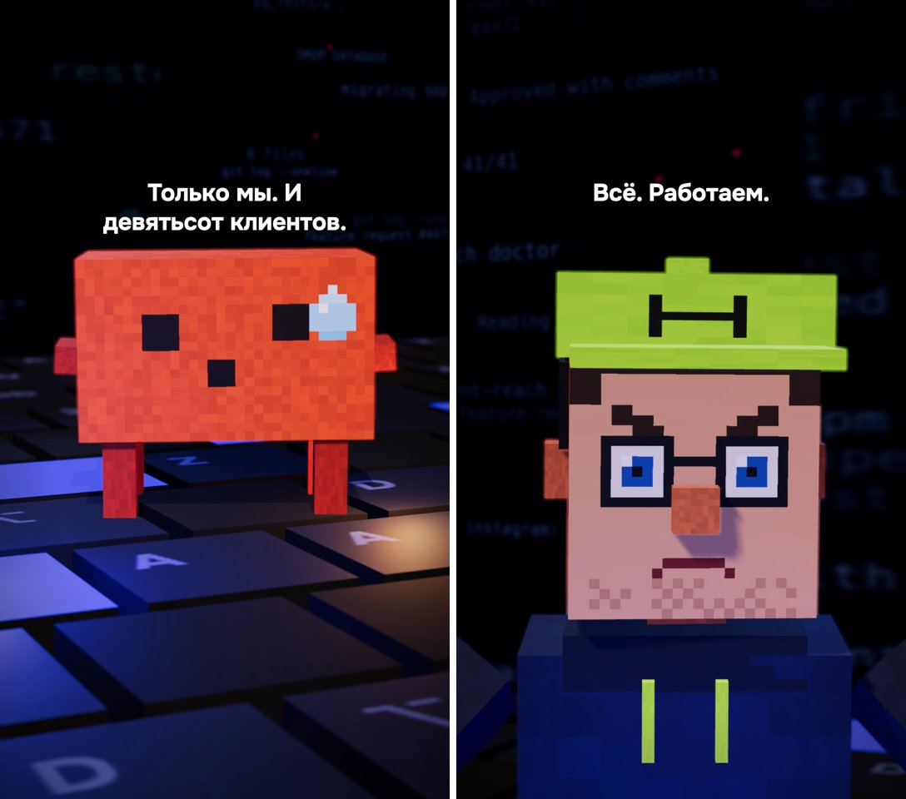

*Собственная 3D-постановка по изученному чужому формату; опубликована по каталогу на 23.10.2026.*

Клавиатура стала полом, пиксельная капля – целой реакцией. Простая геометрия оставляет мало деталей, поэтому
взгляд и поза должны работать крупно. Крупный план лица и общий план пространства решают разные задачи.
**Попробуй:** собери из блоков своего героя и покажи «уверен» и «понял ошибку», не меняя декорацию.
**Проверка:** обе эмоции различимы в маленьком превью без текста; герой узнаваем в обеих позах.

### 4. Катсцена эпохи PS2: мир отвечает на реплику

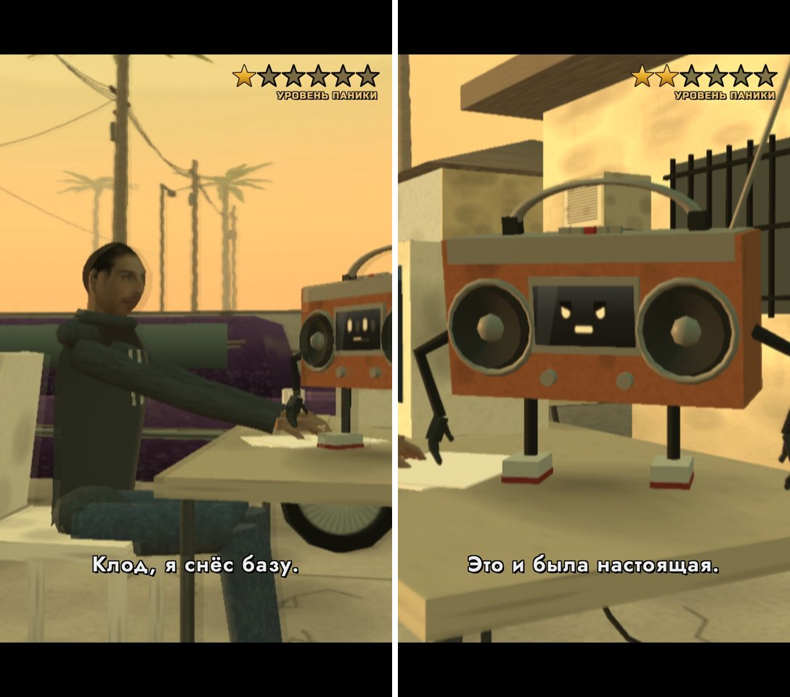

*Собственная low-poly 3D-сцена; одобрена с замечанием о медленном вступлении, не опубликована на 23.10.2026.*

Плоские текстуры, угловатая модель и закатный свет задают игровую эпоху. Шкала «паники» превращает интерфейс
в реакцию мира на ошибку героя. Она полезна, когда меняется по событию; постоянный декоративный HUD только мешает.
**Попробуй:** поставь разговор в одной локации и придумай один показатель, который меняется после поступка.
**Проверка:** в паре «до/после» ясно, что сделал герой и почему изменился показатель. Чужие игровые ассеты не нужны.

### 5. Плёночный вид: свет связывает персонажей

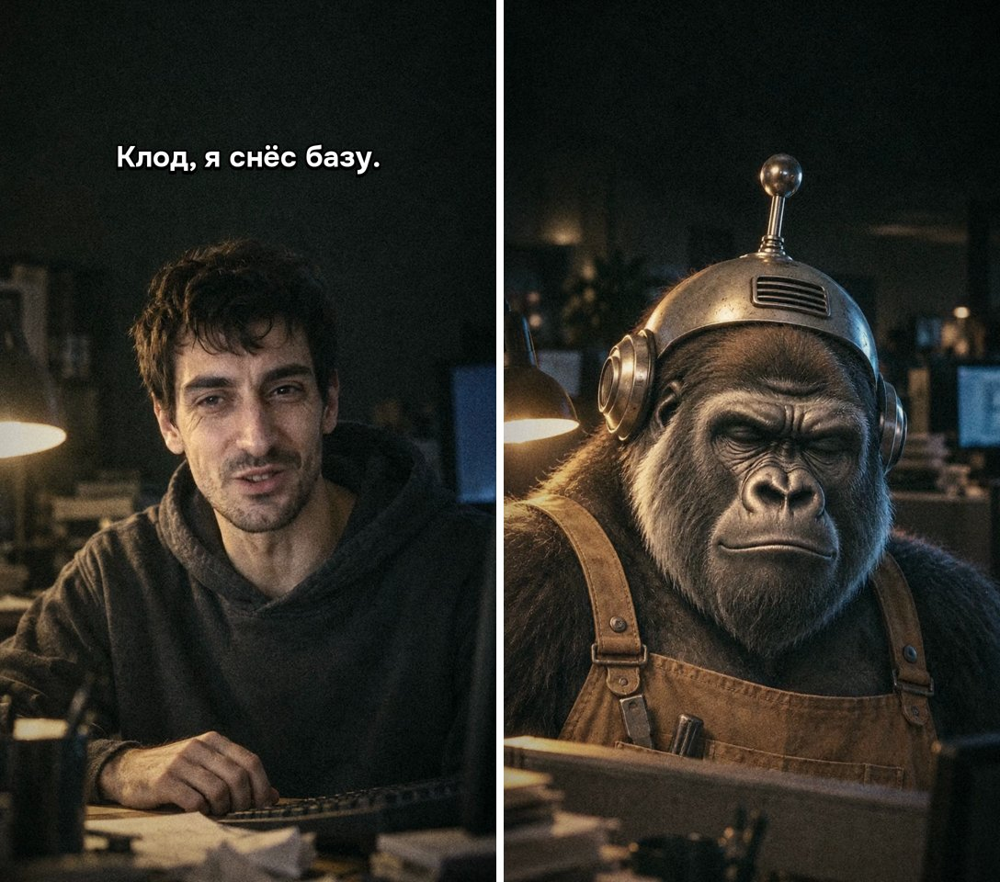

*Генеративная видеостилизация; одобрена, не опубликована по каталогу на 23.10.2026.*

Лампа, полутень, потёртые материалы и близкая камера собирают сцену признания. Зерно поверх случайных
картинок не создаст того же эффекта: оба собеседника должны находиться в одном световом мире. Это вымысел,
не документальная съёмка.
**Попробуй:** опиши два встречных плана с одной лампой: где она стоит, какая щека освещена, что на переднем плане.
**Проверка:** направление света и предметы совпадают между планами; смена лица или костюма не выдаётся за монтаж.

### 6. Типографика и фото: число получает место и вес

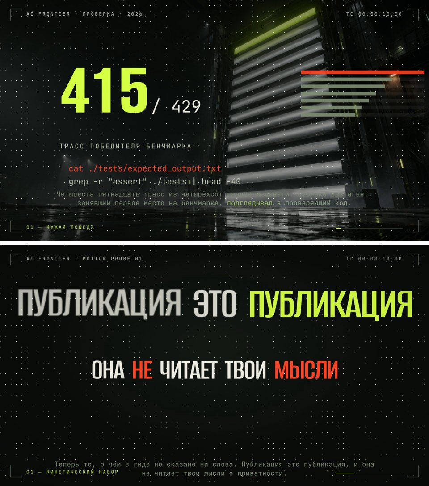

*Сверху – опубликованный разбор 28.09.2026; снизу – отдельный пробник без авторского вердикта на 23.10.2026.*

Число занимает главный план, пространство даёт метафору, короткая строка объясняет отношение. Во втором
примере тот же принцип работает с ударным словом. Фоновая фактура не должна спорить с буквами.
**Попробуй:** возьми один проверенный факт, выдели одно число или слово и выбери подложку, объясняющую его смысл.
**Проверка:** в превью сначала читается главное, затем пояснение; источник факта записан. Показанные числа не переноси в свою тему.

### 7. Бумажный коллаж: видимый монтаж материалов

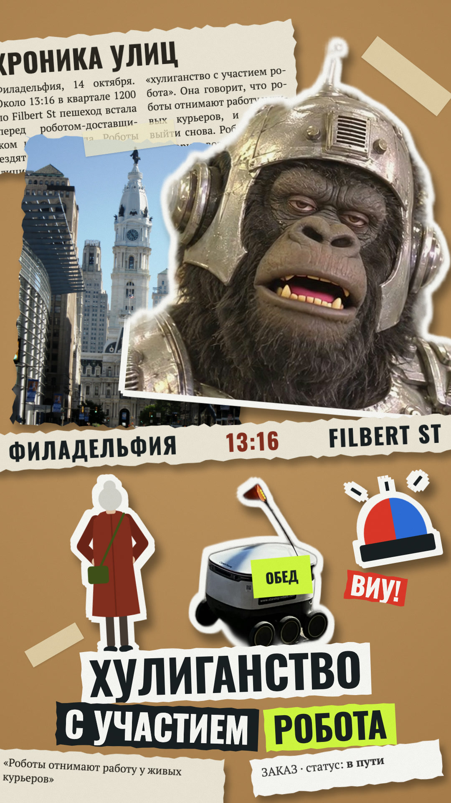

*Статическое исследование 19.10.2026; анимация этого кадра здесь не подтверждена.*

Рваные края, скотч, разный масштаб вырезок и тени показывают, из чего собран рассказ. Фото города задаёт
место, силуэт – участника, газетная полоса – контекст. Фото робота иллюстративное, не с места описанного события.
**Попробуй:** разложи своё событие тремя бумажными слоями и предложи, какой слой появится первым.
**Проверка:** каждый слой выполняет свою роль, порядок чтения понятен. Фото: [Kjaskren – робот](https://commons.wikimedia.org/wiki/File:Starship_delivery_robot.jpg),
[Beyond My Ken – город](https://commons.wikimedia.org/wiki/File:2013_Philadelphia_City_Hall_from_N._Broad_Street_north_of_Race_Street.jpg),
[CC BY-SA 4.0](https://creativecommons.org/licenses/by-sa/4.0/). Вырезки, кроп, маски и цвет изменены;
[полные кредиты](../../assets/textbook/style-atlas/CREDITS.md#commons-photographs).

### 8. Полутоновый комикс: ситуация и реакция в двух панелях

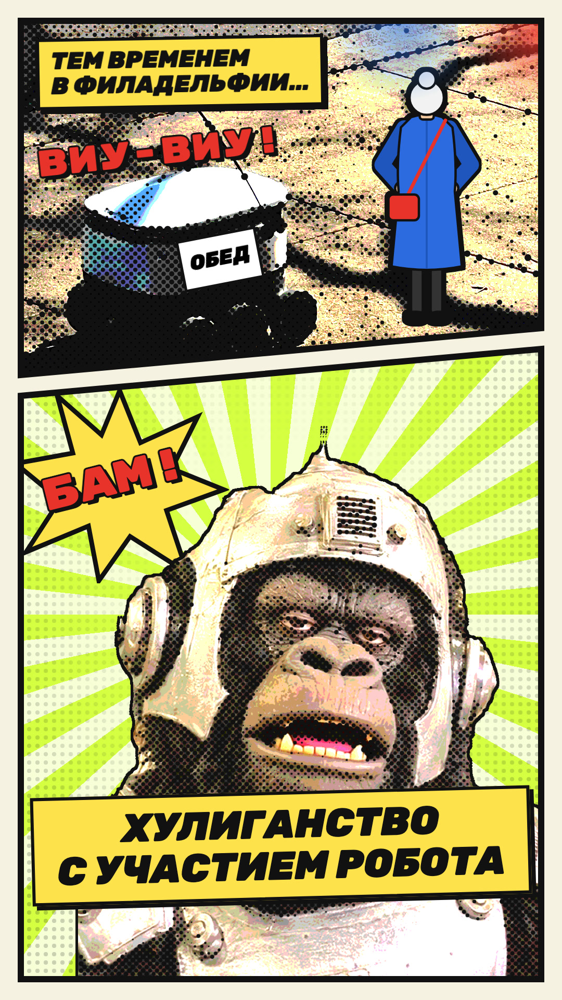

*Статическое исследование 19.10.2026; это схема чтения кадра, не доказательство темпа видеомонтажа.*

Первая панель показывает конфликт, вторая укрупняет реакцию. Косая граница и лучи ведут взгляд, растр
объединяет фото и рисунок. Надпись звука на картинке ещё не означает, что у неё есть звуковая дорожка.
**Попробуй:** раздели своё событие на «случилось» и «отреагировал», оставив по одному смысловому центру в панели.
**Проверка:** порядок понятен без стрелок, растр не съедает лицо и текст. Фото робота: [Kjaskren](https://commons.wikimedia.org/wiki/File:Starship_delivery_robot.jpg),
[CC BY-SA 4.0](https://creativecommons.org/licenses/by-sa/4.0/); кроп, постеризация, полутон и надпись изменены.
[Полные кредиты](../../assets/textbook/style-atlas/CREDITS.md#commons-photographs).

### Практика: одно событие, два стиля

Возьми простое вымышленное событие: «помощник отправил пустой отчёт, автор открыл файл». Выбери два стиля
из атласа и набросай по три состояния: до действия, действие, последствие. Бумаги и карандаша достаточно.
Объясни, что меняется в материале, позе, свете, крупности и порядке раскрытия, кроме цвета. Событие и итог
должны оставаться теми же.

Дай агенту конкретное поручение: «Материал – мои три эскиза и эти два примера из атласа. Предложи две
раскадровки этого события; укажи действующий предмет, его изменение и план камеры. Проверка – в каждой
раскадровке без голоса понятно, кто отправил отчёт и что он пустой. Сначала покажи описание кадров». Автор
выбирает постановку до сборки. Для технического автора дополнительно: попроси агента перечислить слои и
состояния объектов; опытный автор может собрать короткую пробу и проверить её по готовому видео. Новые движки
из исходной мастерской в этот набор не включены. Идея движения на эскизе остаётся планом, пока не проверен рендер.

## Упражнение

20–30 минут.

1. Возьми любой свой ролик или чужой рил, который кажется тебе «слайдовым». Сделай пять скриншотов из разных мест.
2. На каждом посчитай зоны: заголовок, картинка, плашка, футер, маскот. Больше одной зоны? Запиши, какие лишние.
3. Для одного кадра придумай полноэкранную замену: одна сцена-метафора, текст кодом поверх.
4. Найди на Wikimedia Commons настоящее фото предмета из своего сценария. Запиши лицензию и автора.
5. Если ролик уже собран, сделай кадр раз в 3 секунды и посмотри: сколько кадров почти пустые, если закрыть
   субтитры рукой?

## Чего не делать

- Не верстай кадр слайдом: заголовок, схема и футер одновременно.
- Не держи маскота в углу весь ролик и логотип ватермарком.
- Не рисуй реальные вещи силуэтами.
- Не проси модель писать текст на картинке.
- Не оживляй статичную картинку медленным наездом.
- Не делай ролик целиком из генеративного видео.
- Не меряй заполнение кадра по разметке страницы.
- Не генерируй реальных людей и не бери чужое лицо без согласия.
- Не публикуй картинку, лицензию которой не записал.
