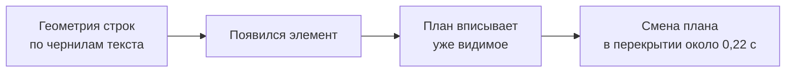
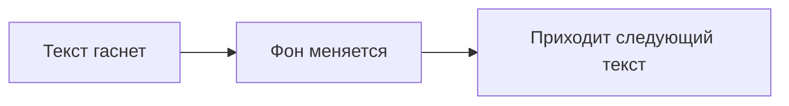

# 05. Камера, монтаж, переходы

Двадцать минут, 166 реплик, около 2 800 слов. [«Claude Code in Action: весь курс за 20
минут»](../../examples/course-retelling/README.md) ([YouTube](https://www.youtube.com/watch?v=96zjz5-Ka8Q)) собран
технически чисто: ни одной ошибки распознавания речи, все проверки зелёные. На каждую реплику один герой в кадре:
страница урока, блок кода, терминал, список. И чтобы кадр не стоял, камера медленно наезжает с 1,0 до 1,06 за пять
секунд.

Четыре лонга-пересказа на канале набрали от 32 до 79 просмотров. Вердикт автора: «это не смотрибельно».

Причин провала две, и одна из них не про камеру: пересказ бесплатного курса не даёт повода смотреть. Но вторая
именно про камеру. Наезд на шесть процентов за пять секунд формально двигает кадр, а глаз видит слайд. Смена реплики
выглядит как смена слайда. Хуже того, этот наезд обманул наши собственные проверки: линт застоя с включённым
наездом нашёл 3 статичные сцены, а с выключенным 41.

Сравни с роликом [про телевизор без рекламы](../../examples/tv-no-ads/README.md): план меняется 17 раз за 47 секунд,
каждые 1,5–4 секунды, жёсткими склейками. Поверх каждого плана ручная камера, и замер разницы соседних кадров не
находит ни одного неподвижного отрезка длиннее 0,5 секунды. 212 тысяч просмотров в Instagram.

Эта глава про то, как камера и монтаж делают кадр живым, и про то, как они же умеют маскировать мёртвый кадр.

## Не маскируй статику медленным наездом

**Проблема.** Карточка висит в кадре, внутри ничего не происходит, и агент добавляет медленный наезд на всю сцену.
Формально кадр «двигается». Зритель видит слайд, а метрики застоя обманываются.

**Как мы это увидели.** Три цифры. Наезд 1,0 → 1,06 за 5 секунд на двадцатиминутном ролике: «иллюстрации,
статика». Наезд на цельную картинку 0,6 % в секунду: «мало динамики». Линт застоя: 3 статичные сцены с наездом, 41
без. Тридцать восемь мёртвых сцен прятались за шестью процентами зума.

**Что делаем.** Движение должно быть внутри кадра: текст появляется построчно в темп речи, терминал печатает,
список раскрывается по пункту на слово, страница прокручивается к нужному абзацу. Камера меняет крупность
склейкой (следующий раздел), а не зумит на проценты. При замере застоя выключай общий наезд камеры.

**Где ломается.** Медленный дрейф внутри одного плана нормален, если внутри кадра есть действие. Плохо, когда дрейф
единственное движение.

Рецепт для агента: [camera-no-ken-burns](../../recipes/camera/camera-no-ken-burns.md),
[qa-still-lint](../../recipes/qa/qa-still-lint.md)

## Крупность меняется склейкой

**Проблема.** Одна крупность на весь ролик и плавный зум внутри неё. Смена реплики выглядит как смена слайда.

**Как мы это увидели.** Зум 1,0 → 1,06 отвергнут как статика. После этого мы собрали 35-секундный пробник новой
грамматики: крупность от 0,96 до 1,55 с панорамой между точками интереса, анимация по слову, печать в терминале.
Вердикта по пробнику мы не получили, так что это образец, а не доказательство. Ролик [про
DeepSeek](../../examples/deepseek-headlines/README.md) держится на одном герое (стопке заголовков) и заездах камеры
в мелкий шрифт таблицы бенчмарков. Заезд стал метафорой: «читаем, что написано мелко». Визуал приняли словами
«визуал окей».

**Что делаем.** Крупность меняй монтажной склейкой на каждую реплику. План задавай точкой интереса и масштабом.
Внутри плана медленный дрейф. Диапазон широкий: от общего до крупного. Под цифры уводи картинку в размытие с
затемнением и возвращай, когда речь снова про неё. При глубоком наезде гаси дальний план прозрачностью и размытием,
иначе соседние карточки на краю выглядят как брак.

**Где ломается.** Замеров удержания нет. В экранных топ-форматах (клавиши, команды) двухзонная вёрстка с живым фоном
выиграла у полноэкранной со склейками.

Рецепт для агента: [camera-scale-change-not-zoom](../../recipes/camera/camera-scale-change-not-zoom.md)

## Камера идёт за содержимым

**Проблема.** Элементы сцены приходят по одному, а камера стоит на полном холсте. Первые секунды каждой сцены в
кадре одна строка посреди пустоты. Габарит блока врёт: у плашки шириной 1280 пикселей строка текста может занимать
600.

**Как мы это увидели.** Мы научили камеру вписывать то, что уже появилось, по реальным «чернилам» текста, а не по
габариту контейнера. Доля кадра под содержимым выросла с 11,2 % до 20,5 % по медиане. Хронометраж с заполнением
ниже 6 % упал с 29 % до 5 %. Пустых кусков длиннее 6 секунд было 36, стало 0.

Но дальше ловушка. Замер по готовому mp4 показал 25 %, а не 20,5 %, и пустоты местами оставались. Камера на
максимальном наезде 1,85 не могла вписать блок 1440×170: пропорцию 16:9 зумом не исправить.

**Что делаем.** Снимай геометрию по самим строкам текста. На каждое появление элемента подбирай план, который
вписывает уже видимое. Смену плана прячь в перекрытие склейки около 0,22 секунды, иначе виден рывок панорамы.

**Где ломается.** Широкий плоский блок (цитата в две строки, цепочка в линию) камера не спасает. Переверстай
содержимое: лечится пропорцией, а не камерой.

Рецепт для агента: [camera-follow-ink](../../recipes/camera/camera-follow-ink.md)

## Герой не уезжает за край

**Проблема.** Наезд 1,35–1,5 на широкую карточку выносит её края за кадр. Центр плана правее середины уводит левую
колонку за экран. Половинчатые карточки на краю читаются как поломка.

**Как мы это увидели.** Карточка кода шириной 1580 пикселей при наезде 1,35 вылезала за кадр. Ловили это глазами на
кадрах, а можно было посчитать заранее.

**Что делаем.** Экранная координата точки при плане с центром P и масштабом s: `screen = 960 + s · (world − P)` для
ширины 1920. Всё, что должно остаться в кадре, держи внутри `P ± 960 / s`. Ширину героя считай от этой формулы до
вёрстки, а не после рендера. Держи центр плана недалеко от середины кадра. Начальный масштаб задавай в самой
анимации, а не отдельным стилем рядом.

**Где ломается.** Для вертикали 1080×1920 формула та же, только с 540 вместо 960. Подробно в [главе 08](08-vertical-publishing.md).

Рецепт для агента: [camera-keep-in-frame](../../recipes/camera/camera-keep-in-frame.md)

## Ручная камера суммой синусов

**Проблема.** Статичная камера делает кадр мёртвым. А «тряска» случайным сдвигом на каждый кадр выглядит как
цифровой дребезг.

**Как мы это увидели.** В ролике про телевизор ручная камера стоит поверх каждого плана, и неподвижных отрезков
длиннее 0,5 секунды нет. Собственных замеров на значения у нас нет, параметры взяты из справочника приёмов камеры.

**Что делаем.** Тряска как сумма двух-трёх синусов низкой частоты, а не случайное число на кадр. Частоты бери
кратными длине петли, тогда закольцованный ролик не дёрнется на стыке. В 2D это порядок десятка пикселей и
поворот около полуградуса. На удар короткий всплеск на 1–1,5 секунды. Тряску держи на отдельном слое-обёртке, а
план камеры на своём: иначе они дерутся за одно свойство.

**Где ломается.** Не добавляй тряску в кадры с мелким текстом: глаз должен видеть ровное движение и читать.

Рецепт для агента: [camera-handheld-sines](../../recipes/camera/camera-handheld-sines.md)

## Параллакс по формуле глубины

**Проблема.** В 2D-сцене все слои сдвигаются одинаково, и движение камеры выглядит как сдвиг плоской картинки.

**Как мы это увидели.** Для слоёв из карты глубины (глава 04) ход около 60 пикселей у дальнего и около 190 у
ближнего уже проверен. Больше, и вылезают следы дорисовки.

**Что делаем.** Каждому слою задай глубину z. Экранный сдвиг слоя `dx = camX / z`: ближние слои разлетаются
быстрее дальних. Для панорамы все слои двигай одинаково, это поворот камеры, а не проезд. Для проводки слои едут со
скоростью, обратной глубине, герой стоит. Без переднего плана наезд неотличим от зума, поэтому поставь в кадр хотя
бы один ближний предмет.

**Где ломается.** Честный облёт вокруг объекта в 2D не получится: максимум, развести слои в разные стороны.

Рецепт для агента: [camera-parallax-formula](../../recipes/camera/camera-parallax-formula.md)

## Жёсткая склейка по умолчанию

**Проблема.** Каждую смену сцены оформляют переходом: кроссфейд, шторка, переброска. Темп тянется, ролик выглядит
как набор слайдов с эффектами.

**Как мы это увидели.** В разобранных хитах переходы жёсткие, склейка раз в 1,6–2,3 секунды. В ролике про
телевизор 17 планов за 47 секунд, все жёсткими склейками. Эффектные переходы там, где их нет, никто не ищет.

**Что делаем.** Основная склейка жёсткая. Переброска, наплыв, шторка только в 2–3 ключевых местах: смена главы,
«тем временем», финал. Шторка в одном направлении на весь ролик. Первое движение в новом кадре начинай через
0,1–0,3 секунды, после посадки важного кадр стоит хотя бы секунду, чтобы зритель успел прочитать.

**Где ломается.** Ролик, который учит самим переходам, исключение.

Рецепт для агента: [transitions-hard-cut-default](../../recipes/transitions/transitions-hard-cut-default.md)

## Смэш-кат: тишина и удар

**Проблема.** Хук начинается плавно, и первая секунда не цепляет.

**Как мы это увидели.** В ролике [«3 кнопки»](../../examples/three-keys-repeat/README.md) смэш-кат на огромные
клавиши, 0,55 секунды вокруг нажатия. Сам ролик провалился (3 просмотра на YouTube, 0 в TikTok), а
смэш-кат и узкие кропы терминала потом перешли в другие ролики. Отдельной оценки приёма у нас нет.

**Что делаем.** Контраст во всём сразу: общий план против крупного, статика против тряски, тишина против удара.
Тихая часть должна быть по-настоящему тихой. Удар ровно в кадр склейки. В 2D работает резкий зум на огромный объект
(клавишу, цифру) примерно на полсекунды вокруг события.

**Где ломается.** Звук, опережающий или опаздывающий даже на кадр, убивает удар.

Рецепт для агента: [transitions-smash-cut](../../recipes/transitions/transitions-smash-cut.md)

## Переброска со смазом

**Проблема.** Смена пунктов или мест простой сменой кадра выглядит вяло, а заметное движение камеры между планами
выглядит как рывок.

**Как мы это увидели.** Перекрытие склейки около 0,22 секунды мы проверили на лонге со сменой планов: в нём смена
плана прячется, без него виден проезд камеры. Остальные значения из справочника приёмов.

**Что делаем.** Короткая пауза, увод кадра быстрым сдвигом с ускорением за 0,3 секунды, приход следующего кадра с
той же стороны с замедлением. Смаз пропорционален скорости, не больше примерно 8 % ширины кадра. Направление увода
и прихода одно. Под это свист шумом, полоса частот едет вверх.

**Где ломается.** Слишком большой увод уносит камеру в пустоту, и смаз становится белым пятном.

Рецепт для агента: [transitions-whip-pan](../../recipes/transitions/transitions-whip-pan.md)

## J- и L-склейки: звук связывает сцены

**Проблема.** Звук и картинка режутся в одной точке, и каждая склейка ощущается как обрыв.

**Как мы это увидели.** Своих замеров нет, значения из справочника приёмов камеры. Честно говоря, это раздел
без нашей истории: приём простой, и его стоит знать до того, как наступишь на обрыв сам.

**Что делаем.** J-склейка: звук следующей сцены начинается на 0,3–0,5 секунды раньше картинки. Звук должен быть
узнаваемым, иначе зритель не свяжет его с кадром. L-склейка: звук прошлой сцены тянется 0,3–1,5 секунды после
склейки и затухает.

**Где ломается.** Опережение длиннее секунды читается как ошибка синхрона.

Рецепт для агента: [transitions-j-l-cut](../../recipes/transitions/transitions-j-l-cut.md)

## Порядок смены сцены

**Проблема.** Фон следующей сцены включается, пока виден текст предыдущей: светлый текст повисает на светлом фоне.
Графическая перебивка между главами спорит с камерой за одну и ту же координату.

**Как мы это увидели.** Ошибку порядка поймал сухой просмотр кадров до рендера. Перебивка уместна на стыке глав,
где пауза 1,5 секунды. Внутри главы зазор между репликами 0,32 секунды, и перебивка вместе с камерой ломала кадр.

**Что делаем.** Порядок смены: текст гаснет, фон меняется, приходит следующий текст. Перебивку ставь только на
стыке глав с паузой. Перебивка и план камеры не должны анимировать одно свойство одного контейнера.

**Где ломается.** Если текст и фон на одной заливке и контраст сохраняется, строгий порядок не нужен.

Рецепт для агента: [transitions-scene-swap-order](../../recipes/transitions/transitions-scene-swap-order.md)

## Ритм скетча: склейка каждые 1,5–2,5 секунды

**Проблема.** Скетч с персонажами снят одним планом: диалог идёт, кадр стоит, реакции не видно.

**Как мы это увидели.** Разобранный скетч-хит: 41 склейка за 67 секунд, примерно одна на 1,6 секунды. Воксельные
скетчи на 710 и 178 тысяч: 22 склейки за 49 секунд и 19 за 45, план держится 2,1–2,3 секунды. Наш скетч
[«Я отдал свой инстаграм Claude»](../../examples/instagram-to-claude-skit/README.md) за 25 секунд проходит девять
планов, включая резкий план на героя на слове-реакции и стоп-кадр перед финальным выкриком.

**Что делаем.** Склейка по репликам, в среднем раз в 1,5–2,5 секунды. На реакции крупный план лица. Одна локация,
которая меняется на поворотах сюжета. Вместо призыва в конце мета-твист или выкрик.

**Где ломается.** Цифры описывают чужие хиты, на своих роликах эффект ритма не измерен. И анимацию рта сглаживай
(глава 04): частые крупные планы покажут любое дёрганье.

Рецепт для агента: [transitions-skit-cut-rhythm](../../recipes/transitions/transitions-skit-cut-rhythm.md)

## Упражнение

15–30 минут.

1. Открой любой залетевший рил своей ниши. Посчитай склейки за первые 15 секунд, по секундомеру или покадрово.
   Раздели 15 на число склеек: сколько держится один план?
2. Открой свой последний ролик и сделай то же самое.
3. Найди в своём ролике место, где кадр «живёт» только за счёт наезда. Выключи наезд в голове: что тогда
   происходит в кадре? Если ничего, придумай движение внутри: печать, построчное появление, прокрутку.
4. Выбери одну сцену и распиши её заново: два-три плана разной крупности жёсткими склейками вместо одного плана
   с зумом.
5. Посчитай для самого широкого блока в сцене, влезает ли он при твоём наезде: ширина блока умножить на масштаб
   должна быть меньше ширины кадра с запасом.

## Чего не делать

- Не маскируй статичный кадр медленным наездом.
- Не меряй застой с включённой камерой.
- Не меняй крупность зумом на проценты: меняй склейкой.
- Не пытайся вписать камерой широкий плоский блок: переверстай его.
- Не делай тряску случайным числом на кадр и не тряси мелкий текст.
- Не ставь эффектный переход на каждую склейку.
- Не сдвигай удар смэш-ката даже на кадр.
- Не включай новый фон, пока виден старый текст.
- Не снимай скетч одним планом.
