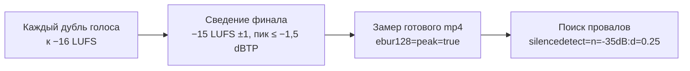
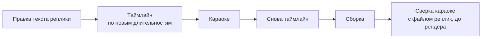

# 06. Звук и субтитры

Ролик про телевизор, который показал рекламу на своём же экране, к вечеру первого дня набрал в Instagram 212 тысяч
просмотров. Обычные рилсы того же аккаунта в те дни собирали от 58 до 400. Разбор лежит в
[examples/tv-no-ads](../../examples/tv-no-ads/README.md), и там есть деталь, которую легко пропустить.

Самый залайканный комментарий под роликом был не про телевизор и не про Claude. Он был про звук: «Кто там шмыгает
постоянно?». Сто одиннадцать лайков, ниже ещё один такой же вопрос с двадцатью одним. Шмыгали вжухи на склейках,
сделанные из розового шума через полосовой фильтр. В те же дни на другом ролике такие же вжухи убрали, потому что
они звучали «как пылесос».

Из этой истории два вывода, и оба про эту главу. Первый: звук в коротком ролике работает не на чистоту, а на то, чтобы
ролик было интересно смотреть и о нём хотелось написать. Второй: всё остальное в звуке и субтитрах как раз про
чистоту, и там есть цифры, ниже которых опускаться нельзя. Громкость, паузы, контраст букв, шрифт без квадратиков.
Зритель не заметит, если это сделано правильно, и пролистает, если неправильно.

Глава идёт так: сначала звуковые эффекты и музыка, потом громкость и паузы, потом субтитры.

## Вжухи на склейках: оставь «шмыганье»

Склейка без звука ощущается как обрыв. Короткий шумовой вжух закрывает стык: ухо слышит движение, и смена плана
кажется намеренной. Проблема в том, что шум звучит как шум. Когда собирали скетч
[«Я отдал свой инстаграм Claude»](../../examples/instagram-to-claude-skit/README.md), вжухи, свайпы и комнатный фон
прослушали и сняли: «пылесос». Решение было разумным, если мерить звук чистотой.

Потом залетел телевизор. 212 тысяч просмотров и топ-комментарий про шмыганье на 111 лайков. Звук, который казался
браком, стал поводом писать. А комментарии, как ты увидишь в главе про публикацию, двигают охват сильнее лайков.

**Что делаем.** Ставим шумовой вжух на склейки по умолчанию: умеренно, но так, чтобы его было слышно. Розовый шум,
полоса около 1800 Гц, треть секунды с мягкой атакой и хвостом. Готовый генератор есть в
[`tools/audio/sfx.py`](../../tools/README.md): четырнадцать процедурных звуков без сэмплов и без лицензий, вжух там
называется `whip`. Смешной вопрос из комментариев («кто шмыгает», «а без Клода можно?») записываем в идеи: это тема
для ролика-ответа.

**Где ломается.** Приём сработал на одном ролике как узнаваемая приколюха. В серьёзном разборе сложной темы тот же шум
может раздражать. И он всегда тише голоса: вжух, который перекрывает слово, это уже не фактура, а помеха.

Рецепт для агента: [sound-keep-noise-whooshes](../../recipes/sound/sound-keep-noise-whooshes.md)

## Звуки по смыслу, а не на каждое движение

Когда звуковые эффекты ставит агент, он тянется к трём-четырём знакомым: щелчок, вжух, удар. В синтезаторе их было
четырнадцать видов, в роликах звучали три. Зритель сформулировал это просто: «звуковые эффекты те же». Канал начал
звучать как один длинный ролик.

Посмотри, как сделан [«Горо отменил созвон»](../../examples/mascot-cancels-call/README.md). Там 14 секунд и три шага
эскалации: нейросеть пишет всем, что ты против созвонов; директор поддерживает; созвон про созвоны назначен на
субботу, в девять утра. На слове «суббота» музыка обрывается ударом. Это единственное место в ролике, где звук
останавливается, и именно поэтому оно работает.

Своего замера эффекта у нас нет, это гипотеза. Повод был такой: после того как одиннадцать видов звуков расписали по
смыслу событий, ролик приняли и опубликовали.

**Что делаем.** Сначала составляем список событий в кадре: захват, удар, смена плана, появление цифры, стоп-кадр. Каждому
событию свой вид звука. Смэш-кат получает удар ровно в кадр, стоп-кадр получает тишину и звон около 1760 Гц,
джамп-кат получает щелчок. Звонкие звуки (звон, тон, тик) строим от тоники трека по мажорной пентатонике, тогда они
попадают в тональность музыки, и каждый ролик звучит по-своему. Шаги и удары считаем от сюжетного времени: в слоумо
они редеют, в стоп-кадре пропадают.

**Где ломается.** Звук не спасает пустой сюжет. Если в кадре ничего не происходит, десять разных звуков сделают из
пустоты шумную пустоту.

Рецепт для агента: [sound-sfx-by-meaning](../../recipes/sound/sound-sfx-by-meaning.md)

## Музыка: один трек на семь роликов подряд

Эта ошибка смешная, пока не посчитаешь. Скрипт сборки копируют из проекта в проект, а внутри одна захардкоженная
строка с путём к треку. Никто её не выбирал, она просто приехала из первого ролика. Итог: семь опубликованных роликов
подряд с одной и той же музыкой. На слух канал превращается в конвейер.

**Что делает starter.** Трек объявляется в блоке `music` файла [`starter/reel.json`](../../starter/reel.json): `file`
(путь к треку), `offset` (смещение, с), `gain` (уровень под голосом) и `credit` (строка кредита). Если `file` равен
`null`, `tools/sound.py` синтезирует тихий пэд сам. Блок `music` целиком попадает в отчёт `qa/final-result.json`, но
кредит в описание ты переносишь руками. Ротации треков и файла атрибуции в наборе нет.

**Что делаем.** Трек выбираем для каждого ролика заново, а не оставляем приехавший из прошлого проекта. Берём только
треки, которые разрешено ставить в видео (CC BY), и сразу записываем кредит. Треки под NC и файлы без атрибуции не
берём вовсе. Если роликов много, ротацию можно достроить самому. У нас в основном пайплайне она устроена так: общая
фонотека с файлом атрибуции, трек ролика объявлен в `music.json` (путь, смещение, уровень, тоника, строка кредита),
сборка кладёт рядом `ATTRIBUTION.txt` для описания, история лежит в `used.json`, и трек не повторяется, если был в
одном из двух последних роликов. В этом наборе этой автоматики нет, это схема для своего расширения.

**Где ломается.** CC BY требует атрибуции, а версии 3.0 и 4.0 формулируют её по-разному: проверяй каждую. Часть стоковых
сайтов отдаёт скрипту ошибку 403, такие треки качай руками. И сами mp3 в публичный репозиторий не клади, давай ссылки.

Рецепт для агента: [sound-music-rotation](../../recipes/sound/sound-music-rotation.md)

## Громкость: −15 LUFS ±1 по закодированному файлу

Ты листаешь ленту, ролики идут на одной громкости, и вдруг один заметно тише. Ты не прибавишь звук, ты пролистаешь.
Это первая причина держать громкость как у соседей. Вторая: музыка, которая то проваливается, то накрывает голос.

Мы разобрали семь чужих хитов. Все легли в −14,1…−14,7 LUFS. У скетчей музыкальная подложка сжата до LRA 2–3 LU, то
есть почти без перепадов. Тишины ниже −35 dB длиннее четверти секунды нет ни в одном ролике со словами. Наши
опубликованные ролики выходили на −15,2…−15,3: чуть тише, но в пределах.

Отдельная история про пики. Демо-ролик одного открытого проекта заявлял потолок −1 dBTP, а по факту вышел на
−0,88. Мастер был честный, пики поднял кодек AAC при сжатии. Поэтому всё меряем по готовому mp4, а не по мастеру.

И ещё одна цифра, про голос. Клон на спокойном референсе синтезировался примерно на 13 дБ тише, чем на эмоциональном.
Без выравнивания такой голос тонет под музыкой, а распознавание речи на проверке начинает ошибаться.

**Что делаем.** Каждый дубль голоса выравниваем к −16 LUFS до сведения. Финал сводим к −15 LUFS ±1 (и хиты, и наши
ролики попадают в коридор −16…−14), true peak не выше −1,5 dBTP: AAC добавляет 1–2 дБ поверх мастера, а потолок −1
уже ловили на −0,88. Все пороговые значения и на чём они мерились собраны в одной таблице,
[QA-THRESHOLDS.md](../../docs/QA-THRESHOLDS.md). Проверяем двумя командами ffmpeg: `ebur128=peak=true` для громкости и `silencedetect=n=-35dB:d=0.25` для
провалов. Если после AAC пики вылезли, [`tools/audio/aac_safe.py`](../../tools/README.md) локально приглушит мастер.
Музыка под голосом заметно тише голоса. Если слушатель просит «музыку чуть убавить», убавляй: в одном ролике уровень
опустили с 0,5 до 0,3.

**Где ломается.** Частотный вырез музыки под голос не чинит обрезанный синтез и не возвращает потерянные слова. На
своём голосе мы его не прослушали, поэтому сравни A/B с простым понижением уровня на одинаковой громкости. А при
жёстком потолке −2 dBTP короткие фразы могут не дотянуть до цели: в слепом тесте с целью −16 они вышли −16,0…−16,9.

Рецепт для агента: [sound-loudness-like-hits](../../recipes/sound/sound-loudness-like-hits.md), [voice-loudness-per-take](../../recipes/voice/voice-loudness-per-take.md)

## Паузы между репликами: короче, чем хочется

Агент раскладывает таймлайн под анимацию: этой карточке нужно 1,5 секунды на выезд, этой схеме 3 секунды на сборку. А
голос ждёт. Между короткими репликами вырастают паузы 1,3, 3,8, 1,5 секунды. Ролик с такими паузами получил отказ
одной фразой: «очень большие паузы». Ритм рассыпался.

Для сравнения: воксельный скетч на 710 тысяч просмотров. Одна пауза 1,1 секунды перед панчем, все остальные зазоры от
0,1 до 0,46 секунды. Пауза есть, но она одна, и у неё есть работа.

**Что делаем.** Механику подгоняем под речь, а не речь под механику. Паузы между репликами держим не длиннее 0,8 с,
длинную паузу оставляем одну и ставим перед панчем. Проверка: [`tools/audio/gaps.py`](../../tools/README.md) с
`--max-gap 0.8` печатает всё, что длиннее. Если хочется связать сцены мягче, попробуй J- и L-склейки: звук следующей
сцены начинается чуть раньше картинки или хвост предыдущей заходит под новую.

**Где ломается.** Голос без собственных пауз, например мемный синтез, требует больше воздуха. На одном пробнике паузы
подняли с 0,55 до 0,9 с под смену подложки. И у J-склейки есть предел: опережение звука длиннее секунды читается как
рассинхрон.

Обратная крайность тоже ломает ритм. Чтобы паузы не разрастались, агент поставил одну константу на все стыки: 0,2 или
0,38 секунды. Голос стал тикать, как метроном. Аудит 26 роликов показал разброс пауз 0,01–0,08 с против 0,13–0,24 у
одобренных эталонов, а длинных пауз 2 на 160 стыков против 11 на 57. Регресс на слух заметили раньше, чем его
измерили.

**Что делаем.** Паузу для каждого стыка пишем в сценарии по смыслу: внутри мысли короче, между мыслями длиннее, перед
панчем 0,6–0,9 с. К каждой добавляем случайный разброс ±0,08 с с фиксированным seed. Проверка: стандартное отклонение
пауз не меньше 0,1 с.

Рецепт для агента: [voice-gaps-between-lines](../../recipes/voice/voice-gaps-between-lines.md), [transitions-j-l-cut](../../recipes/transitions/transitions-j-l-cut.md)

## Субтитры, которые растут вверх

Перейдём к буквам. В двадцатиминутном пересказе курса
([course-retelling](../../examples/course-retelling/README.md)) караоке-субтитры жили внизу кадра. Пока реплика
короткая, всё хорошо. Длинная реплика переносится на вторую строку, и эта строка растёт вниз, на нижние элементы
карточек.

Геометрия там была такая: караоке кеглем 34 px в три строки занимало по вертикали от 930 до 1057 пикселя кадра высотой
1080. Значит, всё содержимое сцены должно заканчиваться выше 930, иначе самая длинная реплика на него наедет.

**Что делаем.** Контейнер строки прикрепляем к низу полосы, `bottom: 0`. Тогда перенос растёт вверх, в запас, а не вниз,
на контент. Полосу поднимаем так, чтобы над ней оставалось место на максимальное число строк. Проверяем на сухом
кадре с самой длинной репликой ролика.

**Где ломается.** В вертикали другая геометрия, и снизу лежит интерфейс площадки: подпись, кнопки. Проверяй кадр с
наложенным интерфейсом, а не голый.

Рецепт для агента: [captions-grow-upward](../../recipes/captions/captions-grow-upward.md)

## Цвет субтитров: контраст на каждой теме

Цвета караоке обычно подбирают на тёмном фоне: белые слова с прозрачностью, активное слово ярким акцентом. Потом
ролик переводят на светлую тему, и серые неактивные слова дают контраст 1,9–2,6:1. Проверка выдала 30 предупреждений,
а на телефоне такие слова просто не читаются.

С акцентом та же ловушка в обратную сторону. Яркий лайм на белом даёт 1,15:1, то есть почти невидим. Оливковый
текст на тёмном фоне дал 1,99:1. Красивый цвет пятном и читаемый цвет буквами это разные цвета.

**Что делаем.** Все цвета субтитров держим в `:root` одного CSS-файла, таймлайн читает их через `getComputedStyle`.
Тема меняется одним блоком, а не правкой каждой сцены. На тёмном фоне базовые слова белые с прозрачностью около 52 %,
на светлом неактивные слова затемняем до тёмно-серого. Яркий фирменный цвет используем заливкой (плашка под словом), а
для акцентного текста заводим тёмный оттенок того же тона. Контраст проверяем на обеих темах.

**Где ломается.** Если ролик живёт только на одной теме, вторую проверку легко забыть, а потом кто-то переведёт проект
на светлую. Проверяй всегда, это минута.

Рецепт для агента: [captions-colors-contrast](../../recipes/captions/captions-colors-contrast.md), [brand-accent-fill-only](../../recipes/brand/brand-accent-fill-only.md)

## Мигание цветом, а не прозрачностью

Последнее слово реплики хочется подчеркнуть: пусть мигнёт пару раз. Агент пишет твин `opacity` с `repeat` и `yoyo`.
Твин заканчивается чуть позже, чем гаснет вся строка, и возвращает слово в кадр. Оно висит до конца ролика. Все
автоматические проверки зелёные, на сухих кадрах до рендера ничего не видно. Нашли это только на контактном листе
готового mp4.

Причина в одном правиле GSAP: завершившийся твин держит своё конечное значение. Два твина одного свойства надо
проверять на порядок во времени, а не на намерение.

**Что делаем.** Мигаем цветом (`color`), прозрачность слова не трогаем. Число повторов считаем так, чтобы мигание
закончилось до гашения строки. После рендера смотрим лист кадров сразу после конца реплики: слова там быть не должно.

**Где ломается.** Если строка гаснет через `autoAlpha` контейнера, а дочерний элемент мигает своим `opacity`, проблема
та же. Ищи все твины прозрачности, а не только очевидный.

Рецепт для агента: [captions-blink-color-not-opacity](../../recipes/captions/captions-blink-color-not-opacity.md)

## Шрифт без квадратиков и прожиг без libass

Три мелочи, каждая из которых однажды испортила кадр. В кириллическом сабсете веб-шрифта не оказалось дефиса и
вопросительного знака. Знак процента у дисплейного шрифта на кегле больше 100 px приходил огрызком из подменного
шрифта. А чернила узкого дисплейного шрифта вылезали за строчный бокс примерно на 0,2 кегля вверх и вниз, и подпись
под крупной цифрой заползала под неё. Плюс к этому в сборке ffmpeg не было libass, и фильтр `subtitles` просто не
запускался.

**Что делаем.** Перед рендером скриптом проверяем, что все нужные символы есть в файле шрифта (пять строк на fontTools,
пример в рецепте). Единицы у крупных цифр набираем моноширинным. Подпись под крупной цифрой ставим абсолютно, с
отступом от кегля. Если libass нет, рисуем субтитры PNG-кадрами с прозрачностью и накладываем через `overlay`.

**Где ломается.** С полным файлом шрифта (не сабсетом) проблема глифов обычно уходит. Обычно. Проверяй всё равно.

Рецепт для агента: [captions-font-and-burn](../../recipes/captions/captions-font-and-burn.md)

## Кэш караоке: старые слова в новом ролике

Последняя история самая обидная. В длинном ролике переписали восемь реплик и пересинтезировали голос. Ролик вышел. В
субтитрах этих восьми реплик стояли слова прежней редакции.

Кэш выравнивания сверялся только по хэшу аудиофайла. Файл новый, хэш новый, но где-то запись сочла себя свежей, и
проверка распознавания речи готового ролика караоке не смотрит вообще: она слушает звук, а не читает экран. Так
дефект и прошёл.

**Что делаем.** Ключ кэша собираем из хэша дубля и самого текста реплики. После любой правки текста пересобираем в
порядке: таймлайн по новым длительностям, караоке, снова таймлайн, сборка. Перед рендером сверяем слова караоке с
файлом реплик коротким скриптом.

**Где ломается.** Сверка по тексту спотыкается на цифрах и латинице, которые распознавание пишет иначе («два» против
«2»). Нормализуй обе стороны одинаково, иначе скрипт будет ругаться на верные строки, и ты перестанешь его слушать.

Рецепт для агента: [captions-cache-key-text](../../recipes/captions/captions-cache-key-text.md)

## Упражнение

На 20–30 минут. Возьми любой свой готовый ролик (или `output/final.mp4` из starter).

1. Сними громкость и пики: `ffmpeg -i final.mp4 -af ebur128=peak=true -f null - 2>&1 | grep -E "I:|LRA:|Peak:" | tail -3`.
   Запиши три числа. Integrated должен быть в −16…−14, пик не выше −1,5 ([QA-THRESHOLDS.md](../../docs/QA-THRESHOLDS.md)).
2. Найди провалы: тот же файл через `silencedetect=n=-35dB:d=0.25`. Каждую найденную тишину объясни себе: она нужна
   или это щель между репликами?
3. Вытащи звук в WAV и прогони `python3 tools/audio/gaps.py voice.wav --max-gap 0.8`. Сколько пауз длиннее 0,8 с?
4. Сгенерируй вжух: `python3 tools/audio/sfx.py whip --out whip.wav --length 0.32`. Поставь его на две склейки и
   послушай на телефонном динамике. Слышно? Не перекрывает слово?
5. Выпиши все события своего ролика (появилась цифра, сменился план, что-то упало) и напротив каждого вид звука. Если
   в списке меньше пяти разных видов, ты звучишь как все.

## Чего не делать

- Не убирай вжухи только потому, что они «шумят». Сначала посмотри, о чём пишут в комментариях.
- Не ставь звук на каждый твин. Звук ставится на событие.
- Не оставляй трек захардкоженным в скрипте сборки и не бери музыку под NC.
- Не меряй громкость по мастеру: пики поднимает кодек, меряй готовый mp4.
- Не раздувай паузы под анимацию. Длинная пауза в ролике одна, перед панчем.
- Не пиши акцентные слова кислотным цветом по светлому фону.
- Не мигай словом через `opacity`.
- Не доверяй кэшу субтитров, который не знает текста реплики.
