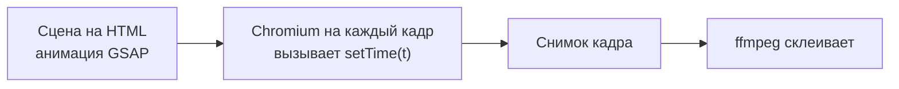
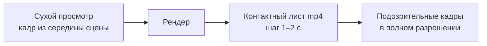

# 07. Сборка и проверка готового ролика

Двадцатиминутный пересказ бесплатного курса, 166 реплик, около 2 800 слов. Собран аккуратно: ни одной ошибки
распознавания речи на двадцати минутах голоса, все автоматические проверки зелёные. Автор канала посмотрел и сказал,
что это не смотрибельно: иллюстрации статичные. Четыре таких лонга-пересказа на канале набрали от 32 до 79 просмотров.
Разбор: [examples/course-retelling](../../examples/course-retelling/README.md).

Через девять дней вышел другой лонг, [«Агент сказал, что тесты прошли»](../../examples/agent-cheats-long/README.md):
2 минуты 7 секунд, своя фотоподложка на каждую главу, печать команд, крупные цифры. Его похвалили одним
непечатным словом в хорошем смысле. Замер по готовому видео показал, что кадр занят на 78 % (медиана), а у прошлого
лонга на старой грамматике было 24 %.

Между этими двумя роликами вся эта глава. Первая половина про сборку: как устроить кадр, чтобы в нём что-то
происходило в темп речи, и как не сломать его технически. Вторая про проверку: почему зелёный QA ничего не говорит о
том, интересно ли смотреть, и какие замеры всё-таки что-то говорят.

## Движок: кадр как функция времени

Ролики в этом наборе собираются кодом. Сцена пишется на HTML и анимируется (обычно GSAP), потом headless-браузер
перематывает её покадрово и снимает картинку. Так работают [HyperFrames](../../docs/THIRD-PARTY.md) и наш
[starter](../../starter/README.md): у сцены есть функция `setTime(t)`, локальный Chromium вызывает её на каждый кадр,
ffmpeg склеивает. Телевизор из [tv-no-ads](../../examples/tv-no-ads/README.md) нарисован кодом на canvas, скетч
[про инстаграм](../../examples/instagram-to-claude-skit/README.md) собран на three.js. Движки разные, но контракт один:
кадр зависит только от времени. Как этот контракт встроен в весь конвейер и откуда он взялся, рассказано в
[главе 00а](00a-how-it-works.md).

Вот как это ломается. В превью частицы летят красиво, в рендере они в другом месте. Ручная тряска камеры в превью одна,
в mp4 другая. На перемотке элемент появляется не там. Причина всегда одна из двух: `Date.now()` или `Math.random()` без
сида. Рендер перематывает таймлайн туда и обратно, а реальное время и случайность этого не умеют.

Своего замера тут нет, правило взято из контрактов открытых рендереров HTML-в-видео. Но нарушение видно сразу, и
чинится оно дёшево.

**Что делаем.** Случайность задаём фиксированным генератором с сидом, время берём только из `t`. Никаких таймеров,
`requestAnimationFrame` со своим счётчиком и физики с переменным шагом. [`tools/lint/motion_lint.py`](../../tools/README.md)
ругается на `Math.random` прямо в коде сцены.

**Где ломается.** Если нужна физика, бери движок с фиксированным шагом и прогоняй его от нуля до `t`. Иначе каждый
кадр будет «почти» тем же.

Рецепт для агента: [assembly-deterministic-timeline](../../recipes/assembly/assembly-deterministic-timeline.md)

## Анимация по слову, а не по секундомеру

Первая версия любой сцены выглядит так: «через 2,3 секунды после начала реплики выезжает карточка». Потом ты
переписываешь одно слово, голос пересинтезируется, реплика становится на полсекунды короче, и все события разъезжаются.
Карточка появляется не на том слове.

В [ролике про признаки ИИ-текста](../../examples/ai-text-tells/README.md) подсветка «нового этапа» и тройки через
запятую загорается ровно на слове диктора. Время слова берётся из выравнивания (WhisperX или аналог), и после
правки голоса всё переезжает само.

Отдельная грабля, которая стоила целой сцены: в хелпере, который ищет слово по номеру реплики, был молчаливый
запасной вариант. Номер реплики перепутали, хелпер не упал, а тихо вернул ноль, и сцена исчезла.

**Что делаем.** Каждое событие сцены вешаем на время конкретного слова из выравнивания. Хелпер, который не нашёл слово,
падает с ошибкой, а не подставляет значение по умолчанию.

**Где ломается.** Блок, привязанный к слову в конце реплики, оставляет пустое начало сцены. Об этом следующий
раздел.

Рецепт для агента: [assembly-word-anchored-animation](../../recipes/assembly/assembly-word-anchored-animation.md)

## Пустое начало сцены

Логика понятная: список выезжает на слове «список», крупное число на слове «двадцать пять». Но реплика начинается с
подводки, и нужное слово приходит на четвёртой-пятой секунде. Всё это время в кадре фон и субтитры. Проверки звука и
таймингов зелёные: голос есть, слова на месте.

На контактных листах четырёх шортсов это выглядело как три пустых кадра подряд в начале почти каждой сцены. А на
27-минутном ролике пустой фон занял 22 % хронометража, и ни одна проверка этого не заметила.

**Что делаем.** Сам блок (рамка списка, контур схемы, подложка числа) выводим на стык реплик, сразу после склейки. А
строки внутри зажигаем по словам. Зритель с первого кадра видит, о чём сцена, и дальше следит, как она заполняется.
После такой правки медиана занятости кадра на тех же четырёх шортсах выросла с 23 % до 33–43 %.

**Где ломается.** Если у реплики вообще нет картинки, перенос на стык не поможет. Нужен контент, а не тайминг.

Рецепт для агента: [assembly-no-empty-scene-start](../../recipes/assembly/assembly-no-empty-scene-start.md)

## Пропорция блока важнее зума

Цитата в две строки шириной 1440 и высотой 170 пикселей формально «широкая». Цепочка из четырёх плашек в линию,
1300 на 90, тоже. А кадр 16:9 пустой на три четверти. Агент пытается спасти это камерой: наезжает, ведёт за
содержимым. На максимуме 1,85 пустота остаётся, потому что полосу в прямоугольник зумом не впишешь.

Мы померили занятость кадра по типам сцен на 96 сценах. Терминал 70–76 %, цитата 43 %, файл 35 %, шаги 31 %,
сравнение 27 %, цепочки и дорожки около 21 %. Видишь закономерность: чем больше в сцене происходит внутри (печатается
команда, бежит вывод), тем лучше она заполняет кадр. Терминал выигрывает не потому, что он красивый, а потому, что
он высокий и живой.

**Что делаем.** Верстаем блок под пропорцию кадра: цепочку ставим лесенкой или в две строки, цитату даём крупнее и
выше. Код и команды печатаем по шагам маской `clip-path`, в темп речи. Камера идёт за реальными чернилами текста, а не за
габаритом блока: у плашки шириной 1280 строка может занимать 600. Один проход таких правок дал медиану 25 % → 32 %,
сцен ниже 20 % стало 10 вместо 21, пустого времени 8 % вместо 19 %.

**Где ломается.** Печать длиннее реплики тянет темп. Длинную команду сокращай: выкинь необязательные флаги и домен.
А для вертикали все эти блоки придётся переверстать заново, см. главу про вертикаль.

Рецепт для агента: [assembly-content-proportion](../../recipes/assembly/assembly-content-proportion.md), [assembly-terminal-typing](../../recipes/assembly/assembly-terminal-typing.md), [camera-follow-ink](../../recipes/camera/camera-follow-ink.md)

## Твин, переживший свою сцену

Маскот выходит на одном слове и уходит через пару секунд. Уход назначили на время, которое оказалось раньше конца
появления. В GSAP завершившийся твин держит своё конечное значение, поэтому появление доиграло последним, и маскот
остался в кадре. Провисел поверх чужих сцен почти шесть минут, с 9:48 до 15:41 лонга. Ошибка попала в две версии
подряд, обе перерендерили.

У этой грабли три родственника. `tl.set` не переживает завершившийся твин соседа. Контейнер с `opacity: 0` в CSS не
появится от анимации детей. Inline `transform: scale()` конфликтует с твином на `scale`.

**Что делаем.** Для каждого элемента проверяем, что последний твин по времени это уход, а не появление. Уход ставим не
раньше, чем закончится вход. Сцены не должны перекрываться по диапазонам реплик.

**Где ломается.** На сухих кадрах до рендера залипание не видно: каждая сцена в своей середине выглядит нормально.
Ловит его только контактный лист готового mp4, об этом ниже.

Рецепт для агента: [assembly-gsap-tween-lifetime](../../recipes/assembly/assembly-gsap-tween-lifetime.md)

## Тяжёлые шаги по одному

Когда несколько агентов собирают ролики параллельно, каждый запускает синтез голоса, распознавание и headless-браузер.
Памяти перестаёт хватать, система убивает процессы, рендер снимает чёрные плитки вместо кадров. На лонге длиннее 10
минут процессы падали по памяти и без всякой параллельности.

**Что делаем.** Синтез, выравнивание и рендер запускаем через блокировку: в каждый момент идёт только один тяжёлый
шаг. Пять агентов под такой блокировкой собрали пять роликов без падений. В starter это делает `locked.py`.

**Где ломается.** На машине с большим запасом памяти можно держать два слота, но синтез и рендер всё равно лучше не
смешивать. И не удаляй чужую блокировку, даже если кажется, что она зависла.

Рецепт для агента: [assembly-serialize-heavy-jobs](../../recipes/assembly/assembly-serialize-heavy-jobs.md)

## Зелёный QA ещё не «готово»

Теперь проверка. Агент собирает ролик, прогоняет громкость, распознавание, тайминги, контракт сцены, линт движения.
Всё зелёное, агент пишет «готово». Человек смотрит и видит слоп.

Три истории из нашего опыта. Ролик прошёл пятнадцать зелёных проверок и был отвергнут: в нём не было события, ради
которого стоит смотреть. Рил на 2:11 с зелёным QA, отданный без просмотра кадров, получил «всё очень плохо». И тот
самый 27-минутный лонг с 22 % пустого фона.

Автопроверки нужны: они дёшево ловят технический брак. Они просто отвечают на другой вопрос. Не «интересно ли это», а
«не сломано ли это».

**Что делаем.** Разделяем два статуса. `ready_for_user_preview` в `qa/final-result.json` значит техническую
готовность, не больше. Одобрение и публикацию решает человек, посмотрев ролик целиком. Паспорт поставки собирает
[`tools/project/artifacts.py`](../../tools/README.md), и в нём поля «просмотрено» и «принято» заполняет не скрипт.

**Где ломается.** Соблазн высокий: всё зелёное, хочется отправить. Именно в этот момент и надо открыть кадры.

Рецепт для агента: [qa-green-is-not-approval](../../recipes/qa/qa-green-is-not-approval.md)

## Заполнение кадра: меряй готовый mp4

Пустоту можно померить. Вопрос в том, что мерить. Первая попытка была по DOM: сколько площади кадра занимают элементы.
Цепочка плашек 1300 на 90 считалась «широкой», а значит заполненной. DOM показал 20,5 %, замер пикселей готового видео
показал 25 %, и пустоты при этом оставались.

На 27-минутном ролике замер по mp4 нашёл шестнадцать дыр длиннее 9 секунд, самая длинная 33 секунды. Всего 6 минут
пустого фона при зелёных проверках. Для калибровки: принятый зрителем лонг про агента-жулика держит медиану 78 % и
нижний дециль 73 %, лонг на старых плашках держал 24 % и 13 %.

**Что делаем.** Меряем по готовому видео: делим кадр на сетку 16×8 и считаем, сколько ячеек заняты содержимым.
[`tools/qa/frame_fill.py`](../../tools/README.md) в режиме `grid` выдаёт медиану и нижний дециль занятых ячеек.
Список пустых отрезков (`empty_runs`) даёт только режим по умолчанию `fill`, который меряет долю пикселей, отличных
от фона. Полосу субтитров перед замером обрезаем.

**Где ломается.** Без обрезки субтитры считаются содержимым, и замер выходит оптимистичным. А прикидка до рендера
перемоткой живой страницы ломается примерно после 50 перемоток: страница перестаёт перерисовываться, её надо
перезагрузить.

Рецепт для агента: [qa-frame-fill-mp4](../../recipes/qa/qa-frame-fill-mp4.md)

## Застой: выключи камеру и посмотри

Заполненный кадр ещё не живой. В пересказе курса каждый кадр был заполнен: страница документации, блок кода, список.
И каждый стоял. Медленный наезд 1,0 → 1,06 за пять секунд создавал иллюзию движения.

Мы прогнали линт застоя на одном лонге дважды. С включённым наездом он нашёл 3 статичные сцены. С выключенным 41. Вот
сколько застоя прятал медленный зум.

**Что делаем.** Ловим застой по таймлайну сцены с выключенной камерой: если кадр не меняется дольше трёх секунд,
это застой ([QA-THRESHOLDS.md](../../docs/QA-THRESHOLDS.md)). [`tools/lint/still_lint.py`](../../tools/README.md) понимает контракт starter и пишет
`qa/still-lint.json` с контактным листом. Лечим не наездом, а событием: строки загораются по одной (это дало 6 %
застоя), текст печатается, страница прокручивается к нужному месту, крупность меняется склейкой.

**Где ломается.** Линт застоя не видит пустой кадр, где меняются только субтитры: слова сменяются каждые полсекунды, и
кадр формально «живой». Для этого есть замер заполнения из предыдущего раздела. Нужны оба.

Второе ограничение касается самой камеры. Линт выключает только камеру DOM-сцен, у которых наезд лежит в
CSS-transform элемента `#world`. Камера starter рисуется внутри Canvas, и её линт не трогает: на starter замер идёт с
включённой камерой, и наезд может спрятать застой. Для честного замера сцене нужен режим без камеры (например, флаг,
который функция камеры читает и который включается через `--pre-js`). В starter такого режима пока нет.

Рецепт для агента: [qa-still-lint](../../recipes/qa/qa-still-lint.md)

## Сухой просмотр до рендера, контактный лист после

Рендер длинного ролика идёт часами, и дефект вёрстки после него уже закреплён в mp4. Поэтому смотреть надо дважды.

До рендера снимаем по кадру из середины каждой сцены. На лонге в 31 минуту такой сухой просмотр 104 кадров нашёл шесть
дефектов: две сцены поверх друг друга, плашка за краем, налезающие элементы, лишний барьер, подчёркивание на всю
карточку, обрезанный краем стикер. И ещё две цифры, которых не было в источниках. Ни один тест этого не поймал.

После рендера собираем контактный лист готового файла. Тут ловится то, чего нет на сухих кадрах: мигающее слово,
залипшее до конца ролика, субтитр, перекрытый формой, по три пустых кадра в начале сцен.

**Что делаем.** Оба просмотра делает человек или агент глазами, по чек-листу: наложение, переполнение, обрезка, цифра
без источника, мелкий текст. Лист готового mp4 снимаем с шагом в одну-две секунды. Подозрительные кадры открываем в
полном разрешении.

**Где ломается.** Лист шириной 320 px не покажет мелкое переполнение. Лист с шагом в 4 секунды пропустит вспышку
короче шага: для частых склеек снимай кадры на склейках.

Рецепт для агента: [qa-dry-frame-review](../../recipes/qa/qa-dry-frame-review.md), [qa-contact-sheet-final](../../recipes/qa/qa-contact-sheet-final.md)

## ASR по каждому дублю

Распознавание речи нужно, чтобы поймать съеденное слово. Проверять финальный микс бесполезно: музыка и соседние
реплики прячут обрубки. На длинном ролике три дубля из 97 без первого слова нашлись только пофразной проверкой.

Но у пофразного распознавания своя беда: языковая модель распознавателя подставляет знакомое слово вместо редкого.
Слово «гит» во всех 12 дублях распознавалось как «гид», хотя голос говорил правильно. Модель medium однажды «потеряла»
целое предложение, которого никто не терял; large-v3 услышала его. В ролике
[про отменённый созвон](../../examples/mascot-cancels-call/README.md) наоборот: распознавание услышало «я» длиной 0,04
секунды там, где синтез проглотил «ИИ», и это была правда.

И про порог. Два настоящих дефекта имели сходство с текстом 0,975 и 0,988. Порог 0,90 пропустил бы оба.

**Что делаем.** Распознаём каждый дубль отдельно, моделью large-v3, со словарём темы в подсказке. Но не с текстом самой
реплики: тогда модель услышит то, что ей подсказали. Смотрим на пропущенные слова, а не на процент сходства.
[`tools/voice/pick_take.py`](../../tools/README.md) выбирает лучший дубль из нескольких по этим замерам.

**Где ломается.** Ударений распознавание не видит вообще. «Модэль» с твёрдым э оно запишет как «модель». Ударения
проверяет только слух.

Рецепт для агента: [qa-asr-per-take](../../recipes/qa/qa-asr-per-take.md)

## Предполётная проверка ffmpeg

Последний слой, самый дешёвый. Чёрные кадры, зависшие куски, громкость мимо цели обычно находят глазами уже после
публикации. А ffmpeg умеет их искать сам: `blackdetect`, `freezedetect`, детектор смены сцен и `ebur128`. Своих замеров
по этому набору у нас нет, он собран из обзора локальных инструментов. Тот же обзор говорит, что нейросетевой судья
со свободным промптом даёт ложные срабатывания, а по чек-листу их меньше.

**Что делаем.** Прогоняем финал через четыре фильтра. Детектор сцен сверяем с запланированными точками реза. Если
зовём визуальную модель, даём ей контактный лист и конкретный чек-лист, а не «оцени ролик».

**Где ломается.** `freezedetect` не поймает зависший кадр, если поверх прожжены меняющиеся субтитры. Перед проверкой
обрезай полосу субтитров.

Рецепт для агента: [qa-preflight-ffmpeg](../../recipes/qa/qa-preflight-ffmpeg.md)

## Упражнение

На 20–30 минут, на готовом ролике из starter или своём. Все команды запускай из корня репозитория. Если ролик свой,
подставь его путь вместо `starter/output/final.mp4`.

1. Пустые отрезки: `python3 tools/qa/frame_fill.py starter/output/final.mp4 --json starter/qa/fill.json`. Запиши
   самый длинный пустой отрезок.
2. Занятость сетки: `python3 tools/qa/frame_fill.py starter/output/final.mp4 --mode grid --cols 8 --rows 16`. Для
   вертикали сетка 8×16, для горизонтали оставь значения по умолчанию 16×8. Запиши медиану.
3. `python3 tools/lint/still_lint.py starter --max-still 3`. Сколько сцен стоят дольше трёх секунд? Помни, что на
   starter камера при этом остаётся включённой (см. «Где ломается» в разделе про застой).
4. Сними контактный лист: `ffmpeg -i starter/output/final.mp4 -vf "fps=1/2,scale=320:-1,tile=6x2" starter/qa/sheet_%02d.jpg`.
   Пройди его глазами и выпиши всё подозрительное: пустые начала сцен, налезания, обрезки.
5. Выбери самую пустую сцену и придумай одну правку: вывести блок на стык, переверстать под пропорцию или печатать
   текст по шагам. Сделай её и перемерь.
6. Сравни медиану из шага 2 с ориентирами из главы. Они посчитаны тем же режимом `grid` на горизонтальных лонгах:
   24 % у лонга, который назвали статикой, 78 % у лонга, который похвалили. Для вертикали это грубый ориентир, не порог.

## Чего не делать

- Не используй `Date.now()` и несидированный `Math.random()` в сцене.
- Не вешай события на секундомер от начала реплики.
- Не надейся, что камера впишет плоскую полосу в кадр 16:9.
- Не маскируй статичный кадр медленным наездом.
- Не запускай несколько рендеров и синтезов параллельно на одной машине.
- Не говори «готово» по зелёному QA, не посмотрев кадры.
- Не меряй заполнение по DOM.
- Не распознавай финальный микс вместо дублей и не подсказывай распознавателю текст реплики.
