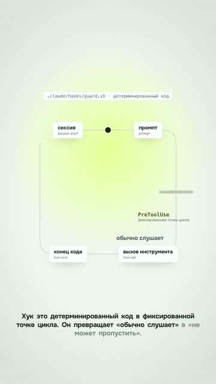
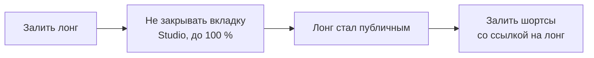
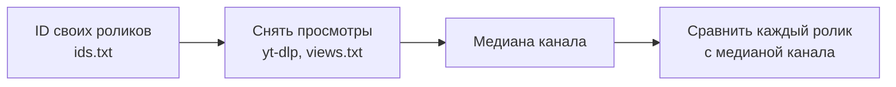

# 08. Вертикаль, публикация, призыв и аналитика

Глава «Хуки» из двадцатиминутного лонга стала отдельным вертикальным шортсом на 35 секунд. Голос и тайминги взяли из
лонга, а сцену собрали заново: широкая петля «сессия → промпт → вызов инструмента» стала высокой, подписи переехали
под узлы, карточка кода сузилась. Текст на телефоне вышел крупнее, чем был бы при вписывании всего кадра. Разбор:
[examples/hook-vertical-from-long](../../examples/hook-vertical-from-long/README.md).

Технически всё правильно. А теперь посмотри на цифры: шортсы, вырезанные из лонгов-туториалов, на канале набирали от
1 до 17 просмотров. Первая фраза этого ролика была определением термина («хук это детерминированный код в
фиксированной точке цикла»), первая секунда пустая, голос вступает на 1,2 с.

Эта глава про то, что происходит после сборки. Как перевести ролик в вертикаль, чтобы текст читался. Как залить его и
не наступить на грабли площадок. Как позвать зрителя к действию так, чтобы он пришёл. И как понять по цифрам, что
сработало, а что нет, не обманывая себя.

## Переверстка, а не кроп

Самый быстрый способ сделать шортс из лонга: вырезать кусок и обрезать по центру в 9:16. Или вписать весь горизонтальный
кадр полосой в вертикальное полотно, сверху заголовок, снизу подпись. Первый отрезает содержимое по краям, второй делает текст на
телефоне мельче, чем в лонге. А полоса видео с заголовком сверху это вторая зона в кадре, то есть слайд.

Посчитаем. Содержимое горизонтальной сцены занимает по ширине около 1620 пикселей из 1920 (медиана по четырём клипам,
от 1588 до 1708). Это три разные операции. Центральная обрезка в 9:16 буквы не уменьшает, но оставляет окно шириной
около 608 пикселей: в кадр попадает чуть больше трети содержимого. Вписывание всего кадра 1920 в ширину 1080 уменьшает
всё в 0,56 раза. Обрезка полей по реальным границам содержимого с уменьшением до 1080 даёт 0,62–0,67. В двух последних
случаях каждая буква становится в полтора-два раза меньше, чем была в горизонтальном ролике, который и так смотрят на
телефоне боком.

**Что делаем.** Каждую сцену собираем заново под ширину 1080: элементы встают друг под другом, кегль не меньше, чем в
лонге, широкие схемы становятся высокими, длинные команды сокращаются. Голос и привязку анимаций к словам берём из
лонга без пересинтеза. Две серии по четыре переверстанных шортса дали медиану занятости кадра 27–37 % и 33–43 %, не
хуже своего лонга (24 %). Бриф для агента лежит в
[prompts/agent/vertical-relayout-review.md](../../prompts/agent/vertical-relayout-review.md).

**Где ломается.** Камера лонга, которая разгоняла содержимое на всю ширину 1920, в вертикали мешает. Её планы тоже
пересчитываются, а не переносятся.

Рецепт для агента: [vertical-relayout-not-crop](../../recipes/vertical/vertical-relayout-not-crop.md)

## Формула, которая держит всё в кадре

При переводе в вертикаль наезды, которые в 1920 были безопасны, вдруг режут крайние узлы схемы пополам. Исход
цепочки вылезает за правый край. Карточка кода при наезде становится шире кадра.

Логика простая. Если камера смотрит в точку мира P с увеличением s, то точка мира x окажется на экране в
`540 + s·(x − P)`. Видимая полоса по ширине от 0 до 1080. Значит, при каждом наезде каждый важный элемент должен
попадать в эту полосу. В шортсе про хуки карточку кода пришлось сузить до 800 пикселей с кеглем 24, потому что при
наезде 1,48 она была шире кадра. Рельсу схемы сократили с 820 до 420 пикселей: при наезде 1,1 её исход вылезал за
край.

**Что делаем.** Позиции и камеру считаем от центра вертикального кадра по этой формуле, а не сдвигом исходных
координат лонга. Наезды уменьшаем. Всё, что должно остаться в кадре, проверяем на крайних точках каждого плана.

**Где ломается.** Формула ничего не знает про интерфейс площадки. Нижние процентов пятнадцать занимает подпись, справа
колонка кнопок. Проверяй кадр с наложенным интерфейсом.

Рецепт для агента: [camera-keep-in-frame](../../recipes/camera/camera-keep-in-frame.md)

## Заголовки на стык и когда сплит лучше одной зоны

В лонге номер и заголовок сцены появлялись по слову диктора. В шортсе из четырёх-пяти сцен это значит, что между
сценами каждый раз стоит пустой фон. В одном 45-секундном ролике так набралось пять пустых промежутков по 0,8 секунды.
Паузы лонга между репликами (0,02–0,3 с) для нормального стыка коротки.

**Что делаем.** Заголовок сцены ставим на стык, сразу после склейки, а реплики в шортсе разводим минимум на 0,75 с.

Отдельно про правило «одна зона в кадре». Для сюжетных роликов оно работает. А для экранных топов (клавиши, команды,
инструменты) простой сплит «ведущий сверху, экран снизу» выиграл у полноэкранной версии в A/B на одном ролике про
клавиши. Автор оценил полноэкранную так: «прошлый всё же был лучше». В срезе хитов ниши такой сплит встречается у
роликов на 437 и 250 тысяч. Шаблон [«3 кнопки»](../../examples/three-keys-repeat/README.md) так и сделан: маскот в
кружке сверху, узкие кропы терминала снизу.

**Где ломается.** В истории или скетче сплит снова превращается в слайд. Там одна зона.

Рецепт для агента: [vertical-titles-on-joint](../../recipes/vertical/vertical-titles-on-joint.md), [vertical-split-face-screen](../../recipes/vertical/vertical-split-face-screen.md)

## Две версии подряд: что мы видели

Тот самый ролик [«3 кнопки Claude Code»](../../examples/three-keys-repeat/README.md). Первая версия вышла, её
назвали «кайфово». Потом поменяли фон, субтитры и финал (кодовое слово вместо «сохрани») и в тот же день залили
вторую. Текст тот же.

Вторая версия собрала 3 просмотра на YouTube и 0 в TikTok. Потолок обычных шортсов канала в тот период был около 1,0–1,3
тысячи. Метрика первой версии не снята, контрольного сравнения нет, поэтому причину провала мы не знаем.

**Что делаем.** Осторожности ради улучшенную версию рядом с первой не заливаем: меняем тему, хук и первый кадр
так, чтобы это был другой ролик. Если всё же заливаешь две версии, снимай метрики обеих.

**Где ломается.** Проверенного средства у нас нет: ни удаление первой версии, ни перезаливку мы не сравнивали.

Рецепт для агента: [publishing-no-twin-versions](../../recipes/publishing/publishing-no-twin-versions.md)

## Собери своего публикатора

[Рецепт](../../recipes/publishing/publishing-build-your-publisher.md) и [задание](../../docs/publisher/README.ru.md)
помогут собрать свой публикатор; есть [скилл](../../.agents/skills/README.ru.md).
Загрузчика здесь нет, рецепт пока гипотеза. Публикует человек.

## Грабли заливки: лонг первым, файл до 100 %, черновик во вкладке Shorts

Площадки ведут себя как живые, и у каждой свои ловушки. Вот те, что нам уже стоили времени.

Шортсы-нарезки упоминали лонг ссылкой в описании. Однажды лонг завис при загрузке, его залили заново с новой ссылкой, и
описания уже опубликованных шортсов пришлось переписывать по одному на каждой площадке. Завис он так: файл больше 100
МБ, после выбора файла появился диалог обработки, вкладку закрыли. Загрузка встала на 49 %, кнопку «Возобновить»
Studio так и не предложил.

Вторая ловушка: кнопка «Опубликовать» не сработала, кажется, что ничего не залито. На деле Studio держит кнопку
неактивной, пока пишет «Скоро начнётся обработка», клик уходит в пустоту, а файл уже лежит черновиком. Вертикальный
черновик при этом живёт во вкладке «Shorts», а не «Видео». Ищешь среди видео, не находишь и по похожему названию
открываешь опубликованный лонг.

В TikTok сразу после публикации ролик висит в статусе «Только я» с пометкой «Контент проверяется». В двух записанных
случаях он сам перешёл в «Все» через несколько минут. Перезаливать не надо.

**Что делаем.** Сначала лонг, и только когда он реально стал публичным, шортсы со ссылкой на него. Вкладку Studio не
закрываем до 100 %. Не сработал клик: ищем черновик во вкладке «Shorts», а не заливаем снова. В TikTok ждём модерацию.

**Где ломается.** Обрыв сети ломает загрузку и при открытой вкладке: большие файлы заливай с проводного интернета. В
TikTok кликабельные ссылки в описании есть не у всех аккаунтов: там веди в профиль или на страницу материала. На
YouTube ссылки в описаниях и комментариях Shorts некликабельны ([справка YouTube](https://support.google.com/youtube/answer/13748639)): на свой лонг
шортс ведёт через «Связанное видео» в его настройках, на внешний материал через ссылку в профиле канала.

Рецепт для агента: [publishing-long-before-shorts](../../recipes/publishing/publishing-long-before-shorts.md), [publishing-wait-upload-100](../../recipes/publishing/publishing-wait-upload-100.md), [publishing-failed-click-is-draft](../../recipes/publishing/publishing-failed-click-is-draft.md), [publishing-tiktok-only-me](../../recipes/publishing/publishing-tiktok-only-me.md)

## Флаг «для детей» и метка ИИ

Эта грабля тихая, и поэтому опасная. Ролик уходит с аудиторией «Предназначено для детей», YouTube сам выключает у него
комментарии и уведомления. Снаружи ролик выглядит обычным. Только призыв «напиши слово в комментариях» не работает,
потому что комментировать нельзя.

В серии из лонга и четырёх шортсов флаг встал у всех пяти. До этого так же уехали ещё пять роликов. Каждый раз снимали
вручную после публикации.

С Instagram похожая история про метку ИИ. Визард Reels меняется: для готовой вертикали экран кропа больше не появляется,
а переключатель «Добавить метку ИИ» прячется. В четырёх записанных заливках его не нашли.

**Что делаем.** После каждой заливки на YouTube открываем ролик в Studio и проверяем аудиторию. Признак беды снаружи:
надпись «Комментарии отключены». В Instagram ищем метку вручную, а заявление о синтезированном голосе или картинке
дублируем в подписи.

**Где ломается.** Если ролик правда для детей, флаг обязателен, и комментарии будут закрыты. Интерфейс Instagram
меняется без предупреждения, названия пунктов могут быть другими.

Рецепт для агента: [publishing-youtube-kids-flag](../../recipes/publishing/publishing-youtube-kids-flag.md), [publishing-instagram-ai-label](../../recipes/publishing/publishing-instagram-ai-label.md)

## Кодовое слово и что за ним

Финал «подписывайтесь и ставьте лайк» зрители пропускают. А кодовое слово работает. Мы посмотрели 1 470 рилсов 101
русскоязычного автора про ИИ за 30 дней. У 147 роликов с кодовым словом медиана 22 комментария при медиане 1 105
просмотров, это 1,96 % комментариев к просмотрам. У остальных 1 323 медиана 6 комментариев, 0,26 %. Разница в 7,5 раза.

Но слово само по себе пустое. В той же выборке больше всего комментариев собрали обещания вида «ссылка на открытого
агента на гитхабе плюс полный гайд по установке»: 9 207 комментариев при 190 тысячах просмотров. Бизнес-урок без
инструмента собирал 30–330.

В [ролике про признаки ИИ-текста](../../examples/ai-text-tells/README.md) финал такой: «Пиши в комментах слово чисто.
Скину скилл, который это вычищает». Конкретная бесплатная вещь, одно слово. Зрители, кстати, начали шутить признаком
и писали комментарии из одного длинного тире.

**Что делаем.** Заканчиваем рил вопросом или кодовым словом, а за словом обещаем конкретный бесплатный инструмент с
гайдом до первого результата. Обещание держим честным: в том же ролике про ИИ-текст скилл заметно правит только часть
жанров, а CTA обещал шире.

**Где ломается.** На YouTube нет личных сообщений, и механика «напиши слово, пришлю в директ» там не работает. Это
выяснилось на [DeepSeek](../../examples/deepseek-headlines/README.md) со словом «ИИ» и на
[«Угадай, где мой голос»](../../examples/guess-my-voice/README.md). Ссылка в описании или в закреплённом комментарии
Shorts тоже не выход: в описаниях и комментариях Shorts ссылки некликабельны ([справка YouTube](https://support.google.com/youtube/answer/13748639)). Внешний
материал ставь ссылкой в профиль канала и называй её в ролике, на свой длинный ролик веди через «Связанное видео» в
настройках шортса. В описании обычного длинного видео ссылки кликабельны.

Второй предел касается ответов. Под роликом с кодовым словом было 386 комментариев, и вечером в директ ушло около 15
одинаковых ссылок за 11 минут, руками, из профиля браузера, которым пользуется и автоматизация заливки. Наутро аккаунт
заблокировали. Причину площадка не назвала, случай один, но рисковать не стоит: отвечай через официальный API, с
лимитом в час, разным текстом и не голой ссылкой первым сообщением.

Рецепт для агента: [cta-codeword-in-comments](../../recipes/cta/cta-codeword-in-comments.md), [cta-promise-free-tool](../../recipes/cta/cta-promise-free-tool.md), [cta-youtube-link-in-description](../../recipes/cta/cta-youtube-link-in-description.md)

## Сначала материал, потом призыв

В «3 кнопках» кодовое слово обещало шпаргалку со всеми сочетаниями клавиш. Пост со шпаргалкой так и не вышел. Другая
история: пост в LinkedIn на 19,5 тысячи показов, трое в комментариях публично попросили методичку, и никому не
ответили, где её взять. Спрос пришёл и ушёл. Следующий призыв того же автора вызывает уже меньше доверия.

**Что делаем.** Лид-магнит готовим до публикации ролика. Под каждое кодовое слово заводим отдельную статическую
страницу и отвечаем ссылкой на неё: материал можно обновить, ссылка не теряется, и её же можно поставить в описание на
YouTube.

**Где ломается.** Публичная страница доступна всем, не только написавшим слово. Если нужен контакт, страница ведёт
дальше, в канал или форму. А если материал пока не нужен никому, кроме тебя, лучше не ставить призыв вовсе, чем
ставить пустой.

Рецепт для агента: [cta-deliver-before-asking](../../recipes/cta/cta-deliver-before-asking.md), [cta-page-per-codeword](../../recipes/cta/cta-page-per-codeword.md)

## Метрика хита: кратность к медиане автора

Как понять, что ролик залетел? Абсолютные просмотры врут: у крупного аккаунта любой ролик «большой». Поэтому хит мы
считаем так: ролик набрал не меньше пяти медиан своего автора и не меньше 100 тысяч просмотров. Для молодых роликов
порог мягче, три медианы и 50 тысяч.

Свой канал меряем так же. Одна команда yt-dlp снимает публичные просмотры всех роликов, и через месяц у тебя таблица, а
не впечатления. Срез по 39 нашим роликам: потолок шортсов 1,0–1,3 тысячи, лучше всех бытовой сюжет «попросил нейросеть,
вышел абсурд» и мемный персонаж, узкие туториалы 2–400, нарезки из лонга 1–17, лонги 12–625. Звучит грустно, пока не
сравнишь с нишей: медиана Shorts у похожих западных каналов 1,4–2,4 тысячи.

А телевизор на этой шкале выглядит так: 212 тысяч при обычных для аккаунта сотнях. Не пять медиан, а несколько сотен.

**Что делаем.** Раз в неделю снимаем просмотры своих роликов в таблицу и сравниваем каждый с медианой канала. Идеи
берём из хитов ниши, отобранных тем же правилом, а не из головы.

**Где ломается.** Публичные счётчики округлены, досмотров и источников трафика в них нет: это корреляция, а не причина.
Удержание и CTR смотри в Studio. Instagram и TikTok без входа отдают счётчики неполно.

Рецепт для агента: [analytics-yt-dlp-views](../../recipes/analytics/analytics-yt-dlp-views.md), [idea-find-hits-by-median](../../recipes/idea/idea-find-hits-by-median.md)

## Площадки не переносятся

Рил про телевизор. Instagram: 212 тысяч просмотров и 7,5 тысячи лайков за первый вечер, через сутки 21,5 тысячи лайков
и 257 комментариев. YouTube и TikTok: от 1 до 328 просмотров на разных заливках двух версий. Какая из двух версий ушла
в Instagram, не записано.

В текстовых площадках то же самое. В Telegram пять постов разных жанров получили одинаковый охват с разбросом 7 %, а в
LinkedIn те же темы разошлись по показам в 2,5 раза.

**Что делаем.** Заливаем на все площадки сразу, а выводы делаем отдельно по каждой. «Формат зашёл» всегда значит «зашёл
вот здесь».

**Где ломается.** Если площадка у тебя одна, правило превращается в «не переносить вывод между периодами»: алгоритмы
меняются.

Рецепт для агента: [analytics-no-cross-platform-transfer](../../recipes/analytics/analytics-no-cross-platform-transfer.md)

## Комментарии: считай людей, а не счётчик

Хит отличают комментарии, а не лайки: у хитов комментариев на просмотр в 1,4 раза больше при равных лайках. Под
телевизором люди спрашивали «а без Клода как?», «не превратит ли в кирпич», «кто там шмыгает», и каждый такой вопрос
стал темой ролика-ответа.

Но счётчик комментариев врёт. Он включает ответы самого автора и повторные реплики одних и тех же людей. Пост с 17 581
показом: счётчик 24, из 23 раскрытых записей 10 были ответами автора, внешних авторов 11. По счётчику 1,37
комментария на тысячу показов, по уникальным внешним 0,63. Завышение в 2,2 раза, а на посте-вопросе доходило до 5,5.

И последняя ступень: переходы. Самый охватный пост месяца собрал 19 123 показа, 35 просмотров профиля и ноль
подписчиков, ноль переходов. Кликабельной ссылки в профиле не было.

**Что делаем.** Ролики и посты сравниваем по уникальным внешним комментаторам на тысячу показов. Воронку считаем до
перехода по ссылке: если площадка переходы не отдаёт, ставим ссылку с меткой или на свою страницу. В Telegram, где
охват у всех постов почти одинаковый, сравниваем реакции на тысячу просмотров и только в первые 36 часов: позже
просмотры растут, а реакции стоят.

**Где ломается.** Там, где ветку комментариев нельзя раскрыть полностью, метрика считается по видимой части и
занижает активность. А кодовое слово раздувает комментарии, поэтому сравнивай ролики со словом с роликами со словом.

Рецепт для агента: [analytics-unique-external-authors](../../recipes/analytics/analytics-unique-external-authors.md), [analytics-clicks-not-impressions](../../recipes/analytics/analytics-clicks-not-impressions.md), [analytics-telegram-reactions-36h](../../recipes/analytics/analytics-telegram-reactions-36h.md)

## Упражнение

На 20–30 минут.

1. Сложи ID своих роликов в `ids.txt`, по одному на строку, и сними просмотры одной командой:
   `yt-dlp --skip-download --ignore-errors --print "%(id)s %(view_count)s %(title)s" -a ids.txt > views.txt`.
   Посчитай медиану. Какой ролик дальше всех от неё вверх и какой вниз?
2. Возьми один свой горизонтальный кадр с текстом. Измерь ширину содержимого и посчитай, во сколько раз уменьшится
   кегль при кропе в 1080 по ширине. Больше 1,5 раза: переверстывай.
3. Открой последний залитый ролик на YouTube в Studio и проверь аудиторию. Флаг «для детей» стоит?
4. Выпиши из последних двух роликов призывы. За каждым кодовым словом есть готовая страница с материалом? Если нет,
   сделай её или убери призыв.
5. Открой комментарии под своим самым обсуждаемым постом и посчитай уникальных внешних авторов. Сравни со счётчиком.

## Чего не делать

- Не кропай лонг в вертикаль и не вписывай его полосой между заголовком и подписью.
- Не заливай улучшенную версию рядом с первой.
- Не публикуй шортсы раньше лонга, на который они ссылаются.
- Не закрывай вкладку Studio, пока большой файл не дошёл до 100 %.
- Не перезаливай «застрявший» ролик, пока не проверил черновики и модерацию.
- Не обещай в призыве то, что ещё не выложено.
- Не зови кодовым словом на YouTube.
- Не меряй успех показами и не переноси вывод с одной площадки на другую.
