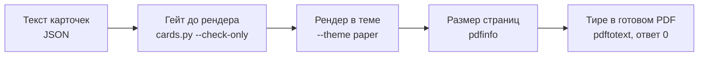
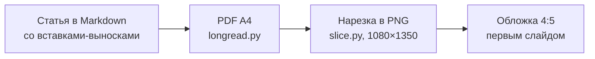

# 09. Карусели, обложки, презентации

Начнём с бага, который выглядел как вкус. Пак карточек для карусели свёрстан как 1080×1350, а на телефоне текст
мылится. Не сильно, но заметно: буквы будто чуть размыты. Открываешь PNG и видишь 810×1013. Площадка растягивает его до
своей ширины, отсюда и мыло.

Соседний скрипт на той же вёрстке давал ровные 1080×1350. Разница была в одном флаге одной команды: `pdftoppm -r 72`
против `-r 96`. WeasyPrint пишет 1 пиксель CSS как 0,75 пункта, а `-r 72` рисует один пункт в один пиксель. Каждая
сторона теряет четверть. Никакой ошибки в консоли, никакого предупреждения.

Эта глава про статичный контент: карусели, обложки, PDF-методички и слайды для выступлений. Здесь нет движения, и
кажется, что всё проще, чем в видео. На деле ошибки здесь тише: в видео пустой кадр бросается в глаза, а в карусели
квадратик вместо дефиса или «3 / 7» на шестой карточке замечают уже в комментариях.

Всё, что ниже, собрано в три утилиты с тестами: [`tools/carousels`](../../tools/carousels/README.md) (карточки,
лонгрид в PDF, нарезка PDF в карусель, SVG-инфографика), [`tools/covers`](../../tools/covers/README.md) (заголовок кодом
поверх AI-фона и векторные обложки) и [`tools/slides`](../../tools/slides/README.md) (HTML-дек одним файлом и
генератор из Markdown). Пример везде один, на нейтральную тему: кофе в турке.

## Контент отдельно, вид отдельно

Первая карусель обычно рождается одним скриптом: текст карточек и стили внутри. Потом нужна тёмная тема, и скрипт
копируется. Потом тема под бренд, потом под другой формат. Через месяц копий пять. Баг, исправленный в одной,
остаётся в четырёх, а цифра на третьей карточке в двух копиях уже разная.

Своего замера тут нет, но история знакомая всем, кто хоть раз верстал руками.

**Что делаем.** Текст живёт в данных (JSON для карточек, Markdown для лонгрида), вид в одном CSS-файле темы с
переменными в `:root`. Новая тема значит копию `paper.css` с другими токенами, а не копию скрипта. В
`tools/carousels/themes` лежат три: `paper` (тёплая бумага), `night` (графит) и `plain`. Карточка в JSON собирается из
классов компонентов: `.giant` для гигантского числа на обложке, `.phrase` для фразы-героя, `.bignum-grid` для сетки
чисел, `.check` для списка с галочками, `.panel` с красной или зелёной границей для «плохо» и «хорошо».

Структура пака, которая работает: обложка (число или фраза), что произошло, цифры, контрпозиция, что делать. Обычно это
обложка, четыре-восемь карточек и финал.

**Где ломается.** Карточка с уникальной инфографикой (схема, карта) в общий набор классов не влезает. Держи её
отдельным HTML-фрагментом, но в той же теме.

Рецепт для агента: [carousels-content-theme-split](../../recipes/carousels/carousels-content-theme-split.md)

## Гейт до рендера, гейт после

Вот ошибки, которые мы видели на уже опубликованных слайдах. «3 / 7» на шестой карточке, потому что карточку вставили в
середину и номер не пересчитали. Длинное тире в подписи схемы. Квадратик вместо глифа. «17/30» на обложке, которое
читается как дробь, хотя это дата.

Частоту таких ошибок мы не считали. Но одна деталь показательна: тире в подписях SVG находил только второй гейт, по
готовому PDF. Текстовая проверка JSON его не видела, потому что подпись генерировал код.

**Что делаем.** Перед рендером `cards.py` проверяет текст карточек (поля `label` и `body`) и отказывается рисовать,
если что-то не так. Вот что он проверяет на самом деле. Ноль длинных тире. Номер «N / M» совпадает с позицией и числом
карточек. Нет русских конструкций «не просто X, а Y» и «не только X, но и Y»: они палят машинный текст (английские
аналоги гейт не ловит). Нет глифов из короткого списка, которые у нас уже рендерились квадратами, и символов из
private use area; покрытие выбранного шрифта гейт не проверяет. Флаг `"last": true` стоит только на последней
карточке (на ней нет «листай»). Нет слов из списка `ban_words`. Имена файлов карточек не совпадают. После рендера
`cards.py` сверяет через `pdfinfo` размер каждой страницы PDF.

Поиск тире в готовом PDF через `pdftotext` в наборе делает `longread.py`, для лонгридов. Для пака карточек прогони
его руками, ответ должен быть 0:

```bash
cd tools/carousels
python3 cards.py examples/coffee-turka.json --check-only
python3 cards.py examples/coffee-turka.json --theme paper --out out/coffee
pdftotext out/coffee/pack.pdf pack.txt
python3 -c "print(open('pack.txt').read().count('\u2014'))"
```



**Где ломается.** Гейт не проверит смысл и точность формулировок. «Сервис бесплатный» пройдёт все проверки, даже если
сервис давно платный. Это вычитка человеком.

Рецепт для агента: [carousels-prerender-gate](../../recipes/carousels/carousels-prerender-gate.md)

## Пиксели: -r 96, а не 72

Это та история из начала главы. Карточка 1080×1350 пикселей в CSS становится страницей 810×1012,5 пункта в PDF.
`pdftoppm -r 72` рисует один пункт в один пиксель, получается 810×1013. `-r 96` возвращает честные 1080×1350.

Один и тот же движок карточек с `-r 72` дал пак из PNG 810×1013, соседний скрипт с `-r 96` на той же вёрстке дал
1080×1350. Разница 0,75 по каждой стороне, то есть около 56 % пикселей по площади.

**Что делаем.** Растеризуем px-страницы WeasyPrint только с `-r 96`. В `tools/carousels` есть тест, который проверяет
размер готового PNG, и он падает, если кто-то вернёт 72.

**Где ломается.** Если `@page` задан в миллиметрах или пунктах, `-r 96` не даст ровных пикселей. Тогда используй
`-scale-to-x` и `-scale-to-y`.

Рецепт для агента: [carousels-pdftoppm-96dpi](../../recipes/carousels/carousels-pdftoppm-96dpi.md)

## Пропавший @page

Следующая тихая ошибка. Карусель вдруг выходит с обрезанным правым краем. Выглядит как кривая вёрстка. На деле
WeasyPrint молча выбросил правило `@page`, потому что перед ним в CSS оказался мусор, и страница уехала в A4 по
умолчанию: 595×842 пункта вместо макета 1080 пикселей.

Мусор появился из-за склейки строк в Python. В выражении `"X" + """...""".replace("X", faces)` метод `.replace`
цепляется только к тройной строке, а литерал `"X"` остаётся первым символом CSS. Парсер съедает его вместе с правилом
`@page`. Нашли это только по `pdfinfo`.

**Что делаем.** После каждого рендера проверяем размер страницы через `pdfinfo`. Для карточек ожидаем 810×1012,5 pt,
для лонгрида A4 595×842 pt. Не совпало: код возврата 2, PNG не создаются. CSS склеиваем просто `faces + css`.

**Где ломается.** Если размер задан в миллиметрах или дюймах, ожидаемые пункты считай сам: дюйм это 72 пункта.

Рецепт для агента: [carousels-pdfinfo-page-size](../../recipes/carousels/carousels-pdfinfo-page-size.md)

## Шрифты: локальные и полные

Два способа испортить шрифт. Первый: подключить Google Fonts через `@import`. WeasyPrint при рендере тянет шрифт по
сети, и это может висеть десятки секунд или упасть без сети. В песочнице с лимитом 45 секунд на команду рендер с таким
импортом упирался ровно в этот лимит. Второй: взять сабсет «только кириллица» или «только latin». Цифры и латиница
внутри русского текста превращаются в квадратики.

**Что делаем.** Ставим в систему полные файлы шрифтов (Inter, Noto Sans, PT Serif, все под открытой лицензией OFL) или
подключаем их локально через `@font-face`. Темы в `tools/carousels` зовут шрифты по имени с фолбэком, поэтому без
установленного шрифта кириллица останется читаемой, просто вид будет другой.

**Где ломается.** Вариативные шрифты (один файл на все начертания) WeasyPrint поддерживает не всегда одинаково. Если
жирность выходит странной, бери статические файлы на каждое начертание.

Рецепт для агента: [carousels-local-full-fonts](../../recipes/carousels/carousels-local-full-fonts.md)

## Одна статья, два формата

Лонгрид нужен и PDF-документом (LinkedIn, скачать), и свайп-каруселью (Telegram, Instagram). Верстать две версии руками
значит делать работу дважды, и через неделю цифры в них расходятся.

Цифры охвата у формата неплохие. Документ-карусель в PDF на LinkedIn и в Telegram собрала 3 585 просмотров, справочник
на 77 страниц 8 099 суммарно по площадкам. Англоязычная карусель-PDF оказалась лучшим по охвату форматом в LinkedIn,
около 1 387 показов. Важная оговорка: это охват формата, а не сравнение с ручной вёрсткой.

**Что делаем.** Пишем статью в Markdown со вставками-выносками (`:::callout`, `:::numbers`, `:::bars`, `:::flow`).
`longread.py` собирает PDF A4: обложка, страница на каждый заголовок второго уровня, SVG-инфографика. Потом `slice.py`
режет PDF в PNG 1080×1350, вписывая страницы в холст цвета страницы. Обложку 4:5 можно подставить первым слайдом вместо
A4-обложки.

```bash
python3 longread.py examples/coffee-turka.md --theme paper --out out/longread
python3 slice.py out/longread/coffee-turka.pdf --out out/slides \
  --cover art.png --skip-first
```



**Где ломается.** Страница A4, вписанная по высоте в 4:5, получает поля по бокам, и мелкий кегль на слайде не читается.
Для карусели закладывай на A4 крупный шрифт или верстай плотные страницы отдельно. И помни: одна тема на страницу,
выноски не рвутся через страницу, бюджет текста считай сразу.

Рецепт для агента: [carousels-longread-to-carousel](../../recipes/carousels/carousels-longread-to-carousel.md)

## Обложка: нейросеть рисует фон, буквы кладёт код

Попроси генератор картинок «обложку с заголовком X». Получишь крокозябры, лишние штрихи, «почти кириллицу». Исправить
нельзя, только перегенерировать. А если в заголовке опечатка или надо поменять цифру, всё сначала.

Поэтому разделение труда такое. Модель рисует фон и оставляет спокойную зону под текст. Код кладёт заголовок поверх,
со скримом (полупрозрачной подложкой), чтобы он читался на пёстром арте. Один и тот же фон закрывает и обложку PDF, и
первый слайд карусели.

Есть и обратная грабля, уже про код. Иконка с бейджем «8x» скопировалась в обложку следующего поста и подписала её
чужой цифрой. С тех пор бейдж только параметр конкретной обложки, а в самой иконке текста нет.

**Что делаем.** Фон генерируем по промпту без текста, букв, цифр и логотипов (пример в
`tools/covers/examples/art-prompt.txt`). Заголовок кладёт `overlay.py`. Если AI-арт не нужен, `cover.py` рисует
векторную обложку: иконка-метафора, число или фраза, две-три строки. Стикеры с надписями рисуем тем же способом: текст
кодом, кегль подгоняется по ширине поля. Пак из восьми стикеров 512×512 весит 33–38 КБ на стикер, кегль крупной строки
сжимается от 62 до 24 пикселей при ширине поля 284.

```bash
cd tools/covers
python3 overlay.py art.png out/cover.png --spec examples/coffee-cover.json
python3 cover.py examples/coffee-covers.json --out out/covers
```

**Где ломается.** Без скрима заголовок теряется на пёстром арте, а тёмный скрим на светлой гравюре убивает арт: бери
тему `paper`. cairosvg не понимает список шрифтов через запятую и молча берёт шрифт по умолчанию без жирности, поэтому
`cover.py` подставляет одно установленное имя. Очень длинную фразу подгон кегля не спасёт: переноси вручную или
сокращай.

Рецепт для агента: [carousels-cover-ai-background-only](../../recipes/carousels/carousels-cover-ai-background-only.md), [carousels-stickers-text-by-code](../../recipes/carousels/carousels-stickers-text-by-code.md)

## Презентация: HTML-дек и PDF на всякий случай

Дек, который агент сверстал в HTML, выглядит лучше pptx: свой шрифт, живые блоки, анимации. И агенту его проще
править: один файл без фреймворка читается и меняется за один проход. Но на площадке выступления может не оказаться
нужного браузера или сети. Дек на reveal.js без сети ломается, потому что тянет файлы с CDN.

Для масштаба: дек на 18 слайдов весит около 30 КБ в HTML, его PDF-бэкап из скриншотов 18 страниц около 1 МБ. Замера
«HTML против pptx» на зрителях у нас нет.

**Что делаем.** Пишем слайды в Markdown, разделяя их строкой `---`, и собираем `md2deck.py` в один HTML-файл без
зависимостей: стрелки, номер «N / M», полоса прогресса, `#5` в адресе открывает пятый слайд. В шаблоне есть
`@media print`, который ставит каждый слайд отдельной страницей и прячет навигацию. Так печатался дек на 42 слайда для
90-минутного выступления. PDF собираем заранее и проверяем не пролистыванием, а числом страниц и контактным листом.

```bash
cd tools/slides
python3 md2deck.py examples/coffee-turka.md -o out/coffee.html
pdfinfo deck.pdf | grep -E "Pages|Page size"
```

**Где ломается.** Фон пропадает при печати, если в диалоге не включить «Фон». PDF из скриншотов не даёт выделять и
искать текст: если бэкап будут читать, печатай через print-CSS. Слайд с прокруткой при печати обрежется, такие дели на
два. Сетку контактного листа подбирай под число слайдов (6×7 вмещает 42).

Рецепт для агента: [slides-html-deck-with-pdf-backup](../../recipes/slides/slides-html-deck-with-pdf-backup.md), [slides-print-css](../../recipes/slides/slides-print-css.md), [slides-check-pdf](../../recipes/slides/slides-check-pdf.md)

## Упражнение

На 20–30 минут. Нужны WeasyPrint и poppler, установка в
[`tools/carousels/README.md`](../../tools/carousels/README.md).

1. Перейди в `tools/carousels` и прогони гейты на примере: `python3 cards.py examples/coffee-turka.json --check-only`. Должно быть чисто.
2. Сломай гейт нарочно: скопируй JSON, вставь длинное тире в любую карточку и поменяй номер «2 / 5» на «3 / 5».
   Запусти снова и прочитай, что скрипт сказал.
3. Отрендерь пак в двух темах: `--theme paper --out out/coffee` и `--theme night --out out/coffee-night`. Открой PNG и проверь размер: должно быть 1080×1350.
4. Выполни `pdftoppm -r 72 -png out/coffee/pack.pdf test72` на том же PDF и сравни размер и резкость на телефоне. Вот оно, мыло.
5. Собери дек: перейди в соседнюю папку `cd ../slides` (утилита `md2deck.py` лежит в `tools/slides`), затем
   `python3 md2deck.py examples/coffee-turka.md -o out/coffee.html`, открой, распечатай в PDF и проверь `pdfinfo`:
   страниц столько же, сколько слайдов?

## Чего не делать

- Не держи текст и стили карточек в одном скрипте и не копируй скрипт ради новой темы.
- Не растеризуй страницы WeasyPrint с `-r 72`.
- Не верь рендеру без `pdfinfo`.
- Не подключай Google Fonts через `@import` и не бери сабсеты шрифтов.
- Не проси генератор картинок написать заголовок.
- Не зашивай цифры в иконки.
- Не верстай одну статью дважды руками.
- Не показывай дек с CDN-фреймворком без PDF-копии.
- Не считай зелёные гейты вычиткой: обложку и две-три плотные карточки открой глазами.
