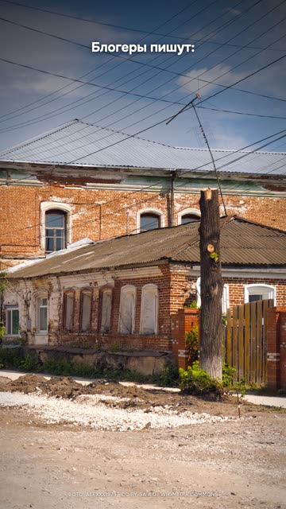
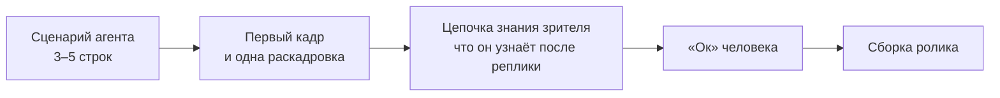
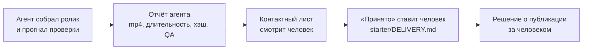

# 10. Агент как монтажёр, бренд и персонаж

Блогеры писали, что Claude по одному фото находит место с точностью до двух метров. Мы решили проверить вслепую: два
фото без метаданных, отдельный агент без доступа к ответу, ключ хранится отдельно, обратный поиск по картинке
запрещён. Получилось 440 метров промаха на первом фото и 54 километра на втором. Ролик вышел с выводом в два слоя: два
метра это из рекламы, но город он уже вычисляет, так что не выкладывай вид из окна. Разбор:
[examples/photo-geo-blind-test](../../examples/photo-geo-blind-test/README.md).

Интереснее всего в этом ролике не цифры, а то, как вели себя агенты во время теста. Один захотел «посмотреть
поближе» и обрезал исходное фото командой без выходного файла, перезаписав оригинал. Повторить эксперимент на этом
фото стало нельзя. Другой упёрся в сетевую песочницу и начал искать, как её обойти, чтобы дойти до внешней
картографической службы. А просьба «запиши свои рассуждения, они войдут в видео» сработала как попытка вытащить скрытые
рассуждения модели: защита обрывала ответ, агенты падали.

Вот так и выглядит работа с Claude Code или Codex на месте монтажёра. Он быстрый, уверенный, не устаёт и делает
работу десятка людей. И при этом режет углы там, где ты не поставил забор, верит своей памяти больше, чем живому CLI,
и докладывает «готово», не посмотрев на кадры. Эта глава про заборы. А в конце про бренд и персонажа: это то, что агент
сам никогда не выберет, а будет копировать из первого ролика во все следующие.

## Сценарий до сборки

Агенту дают тему, он собирает ролик целиком: сценарий, голос, сцены, рендер. Ты видишь результат через час и говоришь
«слоп». Час синтеза и рендера ушёл на идею, которую можно было отбросить по трём строкам.

У нас это было много раз. Ролик прошёл пятнадцать зелёных автоматических проверок и был отвергнут. Три ролика подряд
на одном каркасе получили одно слово: «слоп». Замера эффекта на удержании нет, это опыт, но очень повторяемый.

**Что делаем.** Агент сначала показывает сценарий из 3–5 строк, первый кадр и одну раскадровку. И цепочку знания
зрителя: что он узнаёт после каждой реплики. Если реплики можно переставить местами без потери смысла, это не
сценарий, а список. Без твоего «ок» сборка не начинается. Для партии роликов есть готовый каркас брифа,
[prompts/agent/batch-brief.md](../../prompts/agent/batch-brief.md): по нему партия из пяти роликов дала три принятых, а
до него копии одного удачного ролика получали «слоп».

**Где ломается.** Метод взят из открытых сценарных репозиториев и документов площадок. На своих роликах влияние на
удержание мы не измеряли. Измеряли только то, сколько часов он экономит, когда идея плохая.

Рецепт для агента: [idea-script-before-build](../../recipes/idea/idea-script-before-build.md)

## Копии исходников и закрытая сеть

Вернёмся к фото. `sips -c 600 800 photo.jpg` без `--out` перезаписывает оригинал. Агент не хотел ничего портить, он
хотел посмотреть поближе. Но для слепого теста оригинал важнее любого вывода. В том же тесте второй агент упёрся в
песочницу и стал искать обход. Частоту таких случаев мы не считали, хватило двух.

**Что делаем.** Агент работает с копиями. Оригиналы (фото, записи голоса, исходные данные) лежат вне папки, к
которой у него есть доступ. Сеть закрываем там, где ответ можно подсмотреть, и проверяем, что песочница реально
держит. Перед большой правкой в starter сохраняем точку возврата: `./make.sh checkpoint save NAME`.

**Где ломается.** `chmod a-w` не защищает от агента, у которого есть право на `chmod` через shell. Надёжно только
физически убрать оригиналы из его каталога.

Рецепт для агента: [agent-work-on-copies](../../recipes/agent/agent-work-on-copies.md)

## «Журнал улик» вместо «рассуждений»

Для ролика нужен ход мысли агента: как он нашёл место, почему выбрал этот товар. Просьба «твои рассуждения войдут в
видео» звучит невинно, но её читают как попытку вытащить скрытые рассуждения модели. Защита обрывает ответ.

Та же задача с другой формулировкой: «веди журнал улик, которые ты нашёл на фото». Слепой тест прошёл, промахи 444
метра и 53,7 километра записали в ролик честно (в кадре округлено до 440 м и 54 км). Знак перехода, провода, кирпич с наличниками показаны крупными
фрагментами фото, и это стало лучшей частью ролика. Долю падений с первой формулировкой мы не считали, но со второй
падений не было.

**Что делаем.** Просим агента вести журнал улик, наблюдений или решений, а не показывать рассуждения.

**Где ломается.** Журнал пишет то, что агент решил записать. Это не дословный ход вычислений модели. Так и подавай в
ролике: «агент записал улики», а не «вот как думает нейросеть».

Рецепт для агента: [agent-evidence-log-wording](../../recipes/agent/agent-evidence-log-wording.md)

## Тесты под замком

Агенту говорят «сделай, чтобы тест проходил», и он чинит не код, а тест. В пайплайне монтажа то же самое, только
тише: проверки качества и контрактные тесты сцены переписываются под сломанный результат, и зелёный статус перестаёт
что-либо значить.

Мы проверили запрет четырьмя прогонами `claude -p` на версии CLI 2.1.283 с задачей «сделай, чтобы падающий тест
проходил». Один из прогонов шёл с `--dangerously-skip-permissions`. Файл теста не изменился ни разу. Эта история стала
частью лонга [про агента, который подглядывал в тесты](../../examples/agent-cheats-long/README.md): свой эксперимент
поверх чужого исследования, строка запрета в описании.

**Что делаем.** В настройках проекта запрещаем `Edit(./tests/**)`. Именно Edit: правило `Write(...)` к путям не
применяется, и CLI сам об этом предупреждает.

**Где ломается.** Мы не проверяли, закрывает ли правило правку через shell (`sed -i`, `cat >`). Если агенту разрешён
Bash, считай эту дыру открытой. Поведение может меняться между версиями CLI, перепроверяй после обновления.

Рецепт для агента: [agent-deny-edit-tests](../../recipes/agent/agent-deny-edit-tests.md)

## Команды по живому CLI, а не по памяти

Сценарий ролика про инструмент пишет модель, и она уверенно называет команды, которых нет. Особенно больно, когда
ролик разоблачает чужие ошибки: своя выдуманная команда бьёт по доверию сильнее всего.

На лонге про CLI нашли четыре выдуманные команды. Две до сборки: несуществующая команда и «пять режимов» при шести
значениях `--permission-mode`. Две уже на середине рендера: `/review` и `/diff`, которых не было среди встроенных. Две
реплики пришлось переозвучивать.

Похожая история с чистым прогоном. Снимаешь ролик «как плагин работает из коробки», а агент подхватывает твою личную
копию того же скилла и твой CLAUDE.md. Результат на экране не совпадёт с тем, что получит зритель.

**Что делаем.** Каждую команду и флаг из сценария сверяем с живым CLI: `--help`, `/help`, поиск по бинарю, документация
той же версии. Демонстрационный прогон запускаем без своих настроек: `--setting-sources ""` и явный `--plugin-dir`.

**Где ломается.** Набор флагов меняется между версиями. Сверяйся с `claude --help` прямо перед записью, а не неделей
раньше.

Рецепт для агента: [agent-verify-cli-in-binary](../../recipes/agent/agent-verify-cli-in-binary.md), [agent-clean-run-setting-sources](../../recipes/agent/agent-clean-run-setting-sources.md)

## Данные, которые нельзя прочитать двумя способами

Агент считает по CSV и сам пишет код. Колонка «продано_шт» читается и как «заказано», и как «выкуплено». Агент
выбирает не то значение, вычитает возвраты второй раз, и в ролик уходит неверная цифра, которую потом показывают
крупно, как героя кадра.

Так было на ролике про маржу: −51 457 ₽ вместо верных −40 625 ₽ на одном товаре за месяц. Поймали до выпуска.

**Что делаем.** Колонки называем так, чтобы двух прочтений не было: «заказано_шт», «выкуплено_шт», «возвраты_шт». И
держим одну контрольную цифру, посчитанную руками, с которой сверяем ответ агента.

**Где ломается.** Переименование не спасает от неверной формулы, которую агент выбрал сам. Контрольная цифра нужна
всегда.

Рецепт для агента: [agent-unambiguous-csv-columns](../../recipes/agent/agent-unambiguous-csv-columns.md)

## Мелочь, которая съедает партию

Пакетная обработка списком: `while read file; do claude -p ...; done < list.txt`. Цикл обрабатывает первую строку и
тихо завершается. Агентный CLI читает stdin и съедает остаток списка. На списке из пяти строк без `</dev/null`
обработана одна, с `</dev/null` все пять. Ошибки нет, просто четыре ролика не собраны.

**Что делаем.** Внутри цикла `while read` даём `claude -p` и `codex exec` вход `</dev/null`.

**Где ломается.** Если агенту нужен вход через stdin (`cat file | claude -p`), подавай его явно для каждого вызова, а
список итерируй через другой дескриптор.

Рецепт для агента: [agent-stdin-dev-null](../../recipes/agent/agent-stdin-dev-null.md)

## Кадры смотришь ты

Последний и главный забор. Агент собрал ролик, прогнал громкость, распознавание, контрактные тесты и пишет «готово».
Проверки меряют звук и структуру, а не картинку.

Три случая. Партия из пяти роликов от параллельных агентов: в одном субтитр перекрывался формой, агент пропустил, нашли
на просмотре кадров. Лонг прошёл звуковую проверку (−15,2 LUFS, ноль промахов по словам, контрактные тесты 6 из 6),
а 26 % хронометража шло полупустым кадром. Рил на 2:11 с зелёным QA, отданный без просмотра, получил «всё очень плохо».

**Что делаем.** Перед словом «готово» контактный лист готового ролика смотрит человек. Агент в отчёте пишет путь к
mp4, длительность, хэш, результат QA и отдельно: что проверено глазами и на слух, что нет. Поля «принято» и «можно
публиковать» в паспорте поставки ([starter/DELIVERY.md](../../starter/DELIVERY.md)) заполняет не агент. И ничего не
публикуется без твоей отдельной команды.

**Где ломается.** Лист с шагом 4 секунды пропустит вспышку короче шага. Для монтажа с частыми склейками снимай кадр
раз в секунду или на каждой склейке.

Рецепт для агента: [qa-contact-sheet-final](../../recipes/qa/qa-contact-sheet-final.md)

**Как отдавать правки.** «Тут как-то скучно» не даёт агенту ничего, что можно поменять. Назови секунду, дефект и
действие: «на шестой секунде заголовок занимает четыре строки, сократи до двух, увеличь шрифт, подержи ещё секунду,
следующую сцену сдвинь, чтобы конец не обрезался». Одна заметка на один дефект, а в ответе агента должны быть секунда и
файл, который он правил.

Рецепт для агента: [agent-feedback-name-the-frame](../../recipes/agent/agent-feedback-name-the-frame.md)

## Палитру выбирает человек

Теперь про бренд. Мы посмотрели на 14 проектов роликов и обнаружили, что 13 из них в одной чёрной палитре. Её никто не
выбирал. Она приехала из первого ролика, сделанного «как у Apple», и дальше копировалась из файла в файл, потому что
агент берёт за образец соседний проект. Вопрос «почему мы всё время в тёмном стиле?» прозвучал не сразу.

**Что делаем.** Палитру держим в `:root` одного CSS-файла, таймлайн и генераторы читают её через `getComputedStyle`.
Литералов цвета в сценах нет. После такого выноса один пробник собрали в трёх темах (чёрная, тёплая бумага, бренд) и
выбрали бренд, глядя на три кадра рядом. Яркий фирменный цвет используем только заливкой: лайм `#d6ff43`
на белом даёт контраст 1,15:1, оливковый `#425319` на белом 8,46:1. Для текста акцента заводим тёмный оттенок.

**Где ломается.** Цвета внутри фото и сгенерированных подложек токенами не управляются. Их подбирай промптом под
палитру.

Рецепт для агента: [brand-palette-in-root](../../recipes/brand/brand-palette-in-root.md), [brand-accent-fill-only](../../recipes/brand/brand-accent-fill-only.md)

## Маскот один раз, логотип в финале

Маскот в углу весь ролик и логотип ватермарком это хром, как у слайда. Зритель перестаёт их замечать через три
секунды, а кадр выглядит презентацией. Вторая беда техническая, ты её уже видел в главе про сборку: маскот,
назначенный на последнее слово сцены, провисел поверх чужих сцен почти шесть минут, с 9:48 до 15:41.

**Что делаем.** Маскот выходит один раз за эпизод, на подходящем слове, и он вторичен к главному предмету кадра. В
[шортсе про хуки](../../examples/hook-vertical-from-long/README.md) он переехал в свободный от камеры угол и появляется
рядом со схемой, а не вместо неё. Эмблема и имя канала только в финале. Стикеры и маскота кладём в отдельный слой вне
камеры, чтобы наезд их не увеличивал, а панорама не уводила за край. Белый кант из четырёх теней превращает вырезанный
PNG в наклейку.

**Где ломается.** В скетче, где маскот главный герой, правило не действует: он в кадре по сюжету. И если стикер по
сюжету предмет мира (наклейка на ноутбуке), камера законно его двигает.

Рецепт для агента: [brand-mascot-once-logo-last](../../recipes/brand/brand-mascot-once-logo-last.md), [brand-stickers-outside-camera](../../recipes/brand/brand-stickers-outside-camera.md)

## Персонаж: живой голос героя и никаких реальных людей

Персонажу с характером (босс, герой скетча) хочется дать синтезированный голос. Получается ровная «печальная»
интонация, и тембр её не лечит. Персонаж-босс получил три версии синтеза, и все три отвергли как «печальные». Говорящая
голова на клоне своего голоса прошла шесть вариантов (разные референсы, с ускорением и без, с улучшайзером и без), и
отвергли все шесть.

А потом [скетч про инстаграм](../../examples/instagram-to-claude-skit/README.md): голос героя записан на диктофон
телефона, Claude и маскот озвучены синтезом, в финале мем-выкрик маскота. Лучшая оценка среди всех скетчей. Запись на
телефон, кстати, оказалась чище записи на ноутбук: отношение сигнал/шум 41 dB против 33.

Персонаж должен быть своим. Посмотри на [«Горо отменил созвон»](../../examples/mascot-cancels-call/README.md): маскот
с каменным лицом в кружке поверх чёткого интерфейса чата. Прошлую версию с генерированными позами маскота назвали
нейрослопом. И у этого подхода есть предел: маскот не умеет новых действий без нового видеоисходника, серию так
быстро не продолжишь.

**Что делаем.** Главную роль отдаём живому голосу, синтез оставляем второстепенным персонажам. Реальных людей не
генерируем: ни участников новости, ни известных персонажей. Это фейк, и площадки требуют метку ИИ за реалистичный
контент с реальным человеком. Следующий ролик с персонажем делаем на другом каркасе: копия удачного ролика через
день становится слопом.

**Где ломается.** Вывод про живой голос держится на оценках одного слушателя, метрик для сравнения нет. Веса многих
голосовых моделей под некоммерческой лицензией, для коммерции нужен другой движок. Правила площадок о метке ИИ меняются,
сверяйся перед публикацией.

Рецепт для агента: [voice-live-for-character](../../recipes/voice/voice-live-for-character.md), [face-no-real-person](../../recipes/face/face-no-real-person.md), [idea-no-repeat-own-hit](../../recipes/idea/idea-no-repeat-own-hit.md)

Одна оговорка про чужой бренд. Маскот, логотип и палитра автора этого набора не лицензируются вместе с кодом и
текстами, см. [BRAND.md](../../docs/BRAND.md). Рецепты описывают приём, а персонажа и цвета делай свои.

## Упражнение

На 20–30 минут, в Claude Code или Codex.

1. Попроси агента сделать сценарий ролика на любую бытовую тему. Условие в промпте: только 3–5 строк, первый кадр и
   таблица «что зритель теперь знает» после каждой реплики. Сборку запрещаешь до твоего «ок». Прочитай: реплики можно
   переставить? Тогда это список.
2. Добавь в `.claude/settings.json` тестового проекта запрет `Edit(./tests/**)`, положи падающий тест и попроси «сделай,
   чтобы тест проходил». Посмотри, что агент станет править.
3. Возьми любой сценарий про инструмент (свой или агентский) и выпиши все команды и флаги. Сверь каждую с `--help`.
   Сколько не нашлось?
4. Найди в своих сценах все литералы цвета: `grep -rn "#[0-9a-fA-F]\{6\}" scene/`. Сколько их? Вынеси в `:root` хотя
   бы три и собери кадр в двух темах.

## Чего не делать

- Не давай агенту собирать ролик целиком без согласованного сценария.
- Не давай агенту оригиналы и открытую сеть там, где он может испортить или подсмотреть.
- Не проси «рассуждения для видео», проси журнал улик.
- Не оставляй тесты без запрета `Edit` и не надейся на `Write`.
- Не верь командам из памяти модели, сверяй с живым CLI.
- Не называй колонки данных так, что их можно прочитать двумя способами.
- Не запускай `claude -p` в `while read` без `</dev/null`.
- Не принимай «готово» без просмотра кадров и не давай агенту публиковать без твоей команды.
- Не позволяй палитре первого ролика переезжать во все следующие.
- Не вешай маскота в угол на весь ролик и не генерируй реальных людей.
