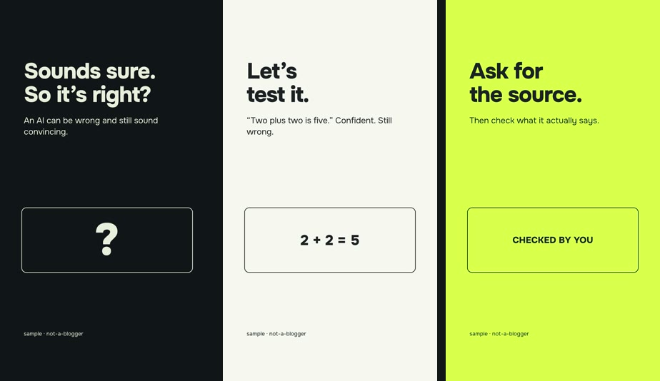

[Русская версия](README.ru.md)

# starter-lite: a first silent video, no Python

A teaching project: 15 seconds, 1080×1920, 30 fps, no sound. Three scenes in HTML + HyperFrames 0.8.208 and
GSAP 3.15.0. All you need is Node.js 22+ and FFmpeg. No voice model, no GPU, no Python, no AI account.

What <code>npm run render</code> produces: three scenes, 5 seconds each.

This is the first-render path; there is no fixed setup-time promise. The full build with voice, ASR of every take, loudness gates
and a QA report lives in [starter/](../starter/README.en.md), and the [manual](../learn/en/00-first-video.md) leads there.

1. Install Node.js 22+ from https://nodejs.org/ and FFmpeg per https://ffmpeg.org/download.html . Close and reopen
   the terminal afterwards.
2. Open a terminal in this folder (the one with `package.json`). Check `node --version` and `ffmpeg -version`.
3. `npm run dev`: local preview. Open the address it prints. Stop with Ctrl+C.
4. `npm run check`: validates the composition, not the finished video.
5. `npm run render`: the MP4 lands in `output/first-video.mp4`. The first run downloads HyperFrames and possibly a
   browser for rendering; it needs internet access.

This path has no finished-file QA, ASR or loudness report. Watch the MP4 yourself; use the full starter when you
need those checks. The Node 22 + ffmpeg demo passed [Ubuntu 24.04 CI](https://github.com/ilyautov/not-a-blogger/actions/runs/41465997589).
This does not establish the full voice/model workflow or native Windows compatibility.

Your own text: open `compositions/hook.html`, `test.html`, `takeaway.html` in a text editor and change the text
inside `h1` and `p`, not the tags. Save, check the preview, render again. Long text may not fit the frame: that is
the first lesson about [frame grammar](../recipes/README.md). The sample copy is in English; write yours in any language
(Onest covers Latin and Cyrillic; for other scripts change the font in `compositions/*.html`).

Next: add a voice and check the takes ([learn/en/03](../learn/en/03-voice.md)), or go straight to
[starter/](../starter/README.en.md), where an agent builds the whole video from your lines.

Sample code: MIT, see `LICENSE.txt`. GSAP and the Onest font ship under their own licenses in `assets/`, sources in
`SOURCES.md`. No third-party media, voices or models are included.
