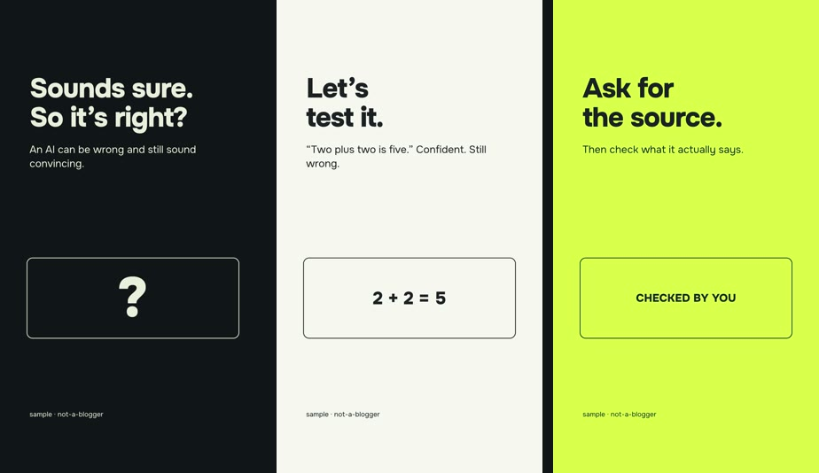

[English version](README.md)

# starter-lite: первый ролик за десять минут, без Python

Учебный проект: 15 секунд, 1080×1920, 30 кадров/с, без звука. Три сцены на HTML + HyperFrames 0.8.208 и GSAP 3.15.0.
Нужны только Node.js 22+ и FFmpeg. Голосовая модель, GPU, Python и аккаунт у нейросети не нужны.

Что выдаёт <code>npm run render</code>: три сцены по 5 секунд.

Это путь «увидеть движок за вечер». Полная сборка с голосом, ASR каждого дубля, порогами громкости и отчётом QA
живёт в [starter/](../starter/README.md); туда же ведёт [учебник](../learn/ru/00-first-video.md).

1. Поставь Node.js 22+ с https://nodejs.org/ и FFmpeg по https://ffmpeg.org/download.html . После установки закрой
   и заново открой терминал.
2. Открой терминал в этой папке (в ней лежит `package.json`). Проверь `node --version` и `ffmpeg -version`.
3. `npm run dev`: локальный предпросмотр. Открой адрес, который напечатает программа. Остановить: Ctrl+C.
4. `npm run check`: проверка композиции.
5. `npm run render`: MP4 появится в `output/first-video.mp4`. Первый запуск скачает HyperFrames и, возможно,
   браузер для рендера; нужен интернет.

Свой текст: открой `compositions/hook.html`, `test.html`, `takeaway.html` в текстовом редакторе и меняй текст внутри
`h1` и `p`, не теги. Сохрани, посмотри предпросмотр, повтори render. Длинный текст может не поместиться в кадр:
это первый урок про [грамматику кадра](../recipes/README.md). Текст примера английский, свой пиши на любом
языке: Onest держит латиницу и кириллицу, для других алфавитов поменяй шрифт в `compositions/*.html`.

Дальше: подложить голос и проверить дубли ([learn/ru/03](../learn/ru/03-voice.md)), или сразу перейти в
[starter/](../starter/README.md), где агент собирает ролик по реплике целиком.

Код примера: MIT, см. `LICENSE.txt`. GSAP и шрифт Onest идут под своими лицензиями в `assets/`, источники в
`SOURCES.md`. Сторонних материалов, голосов и моделей в папке нет.
